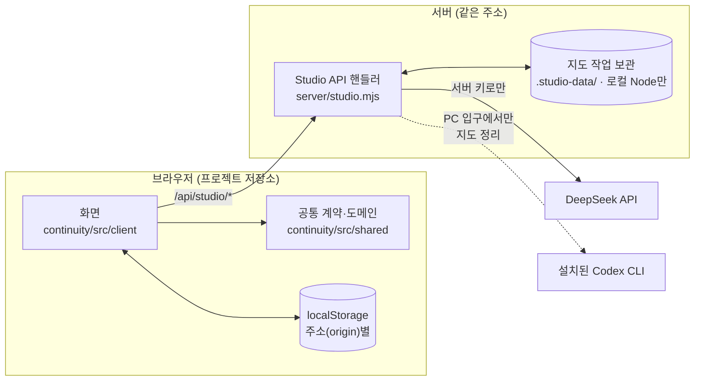

# 구조 개요

AgentFlow Studio가 어떤 조각으로 이뤄져 있고, 자료가 어디서 어디로 흐르는지 한 장으로 설명합니다.
세부 계약과 수용 근거는 각 사이클 기록에 있고, 여기서는 **처음 코드를 여는 사람이 길을 잃지 않을 정도**만 다룹니다.

기준: `work/experience142-reading-delivery` (2026-10-30). 화면·서버 정리와 세션 자동 연결기 작업이 별도 PR로 진행 중이라, 파일 이름이나 경로 같은 세부 사항은 병합 후 달라질 수 있습니다.

## 한눈에 보기

- **프로젝트 데이터는 브라우저에 있습니다.** 서버는 프로젝트를 보관하지 않고, 요청마다 필요한 자료만 받아 AI에 묻고 검증된 답을 돌려줍니다.
- **키는 서버에만 있습니다.** 브라우저 번들과 정적 빌드에는 키나 공급자 주소가 들어가지 않으며, 들어가면 빌드가 실패합니다.
- **대체 응답이 없습니다.** 키가 없거나 AI가 실패하면 오류 코드를 그대로 보여 줍니다. 모의(mock) 답으로 성공처럼 보이게 하지 않습니다.

## 코드 배치

| 위치 | 역할 |
| --- | --- |
| `app/continuity/src/shared/` | 브라우저와 서버가 함께 쓰는 순수 TypeScript. 프로젝트 스키마(`types.ts`), 도메인 조작(`domain.ts`), 저장·백업(`storage.ts`), 지도 읽기 계약(`map-reading.ts`), 각 API의 요청·응답 검증(`studio.ts`, `plan-api.ts`, `scope-api.ts`, `digest-api.ts`) |
| `app/continuity/src/client/` | 화면. 진입점은 `app.ts`(홈·지도·부분 상세)이며, 변경 구상은 `plan-*.ts`, 돌아온 결과 읽기는 `return-view.ts`, 서버 호출은 `studio-api.ts` |
| `app/continuity/server/` | `studio.mjs`는 표준 `(Request) => Response` 핸들러라 Node와 Cloudflare Worker에서 같은 코드로 돕니다. `app.mjs`·`index.mjs`는 로컬 Node 호스트, `worker*.mjs`는 Worker 호스트, `map-jobs.mjs`는 로컬 지도 작업 보관, `*-prompt.mjs`는 AI 지시문 |
| `app/continuity/scripts/` | 빌드(`build.mjs`), 정적 빌드(`build-static.mjs`), Worker 배포(`deploy-cloudflare.mjs`), Windows 실행(`start-local.ps1`, `start-pc.ps1` + `pc-entry.mjs`) |
| `app/continuity/tests/` | Node 테스트(`*.test.mjs`, 대부분 사이클 번호가 이름에 붙음)와 브라우저 스모크(`studio_browser.py`) |
| `app/server/`, `app/src/` | 초기 요청 정리 앱(INIT-004). 지금 화면에는 쓰이지 않지만 `config.mjs`·`errors.mjs`·`limiter.mjs`·`static-files.mjs`는 Studio 서버가 가져다 씁니다 |

## 서버가 받는 요청

모든 경로는 `/api/studio/` 아래에 있고, POST는 같은 주소에서 온 JSON이면서 `X-AgentFlow-Request: 1` 헤더가 있어야 합니다.
`STUDIO_ACCESS_CODE`가 설정된 배포에서는 사용자가 입력한 접속 코드도 함께 보내야 합니다.

| 경로 | 쓰임 |
| --- | --- |
| `GET status` | AI 사용 가능 여부, 모델, 접속 코드 필요 여부, (로컬이면) 지도 작업 보관 상태 |
| `POST ask` | 선택한 부분과 기록으로 현재 상황·다음 판단·질문에 답하기 |
| `POST map` | 기록으로 지도 정리(첫 지도, 이후 기록 대조) |
| `POST plan`, `POST scope` | 변경 구상 분석과 고른 범위의 전제 검토 |
| `POST digest` | 여러 부분에 걸친 자료를 근거와 묶어 읽기 (프로젝트에는 쓰지 않는 읽기 보조) |
| `jobs` 계열 | 로컬 Node 서버에서만. 지도 정리를 PC의 작업으로 맡기고, 창을 닫았다 열어도 결과를 회수 |

제한 공개판(`worker-existing-map.mjs`)은 `map`과 `jobs`를 본문을 읽기 전에 `MAP_WITHHELD`로 거절합니다.
API 세부는 서버 정리 작업에서 바뀔 수 있으니, 정확한 계약은 `server/studio.mjs`와 `src/shared/*-api.ts`를 기준으로 봅니다.

## 실행 형태

같은 화면과 핸들러를 다섯 가지 방식으로 띄웁니다.

| 형태 | 시작 | 특징 |
| --- | --- | --- |
| 로컬 Node | `node continuity/server/index.mjs` | `127.0.0.1` 전용. 기본 포트 3000(`PORT`로 변경). DeepSeek 키는 `app/.env` |
| Windows 실행 | `start-local.ps1` (4317) | 위와 같은 서버를 백그라운드로 띄우고 브라우저를 엽니다 |
| PC Codex 입구 | `start-pc.ps1` (4327) | 지도 정리만 이 PC에 설치·로그인된 Codex CLI로 실행. 판본·모델·권한이 고정된 정책으로만 돕니다 |
| Cloudflare Worker | `deploy-cloudflare.mjs` | 정적 자산 + 같은 주소의 `/api/studio/*`. 키와 접속 코드는 secret 바인딩에만 |
| 정적 Pages | `build-static.mjs` | 서버 없이 지도·기록 읽기만. AI 요청은 "서버 미연결" |

> 브라우저 저장은 **주소별**입니다. 3000·4317·4327, 공개 사이트는 서로 다른 저장소라 프로젝트가 자동으로 옮겨지지 않습니다. 옮길 때는 백업 파일로 내보내고 가져옵니다.

## 데이터와 스키마

- 프로젝트는 `localStorage`의 작업 공간(`agentflow.workspace.1`)에 `idea015.project.N` 스키마로 저장됩니다(현재 `idea015.project.14`). 작업 공간 이전의 저장값은 한 번만 옮기고 원래 키는 지우지 않습니다.
- 돌아온 결과 파일은 `agentflow.return.2` 형식으로 가져옵니다. 공통 예제도 같은 경로로 만들어져 실제 수신 모델과 다르지 않습니다.
- 정리 결과·질문 초안·변경 구상은 프로젝트 본문과 분리된 키에 둡니다. 원래 기록은 고쳐 쓰지 않습니다.
- 로컬 지도 작업은 `app/continuity/.studio-data/map-jobs-<포트>/`에 남습니다(`STUDIO_JOBS_DIR`로 변경, `STUDIO_JOBS=off`로 끔). Git에는 들어가지 않습니다.

## 검사

PR마다 `.github/workflows/verify.yml`이 Linux와 Windows에서 같은 검사를 돌립니다. 실제 AI는 호출하지 않고 공급자는 테스트 대역입니다.

1. 초기 앱: 타입·경계 검사, 빌드, Node 테스트, 브라우저 검사
2. Studio: 타입·문법·키 경계 검사, 빌드, Node 테스트
3. 배포 준비: Worker 업로드 대상 확인(`--dry-run`), 정적 빌드
4. Studio 브라우저 스모크: 진입, 지도, 부분, 질문, 실패·재시도, 키 없음, 정적 상태

로컬에서 같은 검사를 돌리는 방법은 [기여 안내](../CONTRIBUTING.md#검사-돌리기)에 있습니다.

## 알아 두면 좋은 점

- **번호는 사이클 번호입니다.** 테스트 파일명(`flow090.test.mjs`)과 코드 주석의 `AF100`, `AF124` 같은 표시는 그 동작을 정하거나 수용한 사이클을 가리킵니다. 근거를 찾을 때는 `docs/cycles/`에서 같은 번호를 찾으면 됩니다. PR 번호와는 다릅니다.
- **PC Codex 입구는 문서 폴더의 실행기를 가져옵니다.** `scripts/pc-entry.mjs`가 `docs/cycles/2026-10-29-owned-cli-preview-102/preview/cli-executor.mjs`를 import합니다. 해당 사이클 폴더를 옮기거나 지우면 PC 입구가 깨집니다.
- **두 앱이 한 `package.json`을 씁니다.** `npm run build`·`npm test`는 초기 앱 기준이고, Studio는 `node continuity/scripts/*.mjs`로 따로 빌드·검사합니다.
