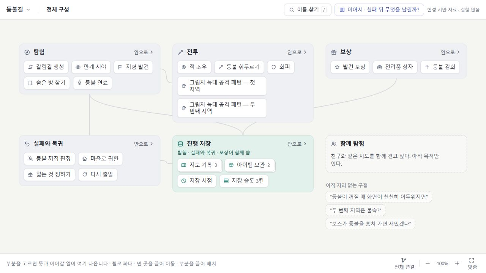
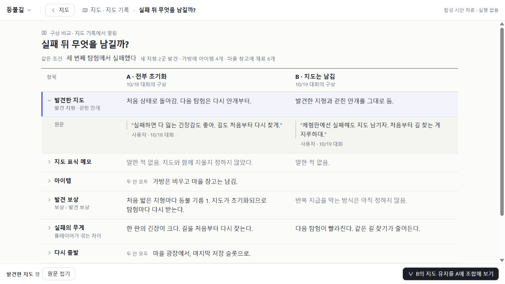

# AgentFlow 소프트웨어 지도 설계

> 연구46–48 · v0.6 · 2026-10-25 · **구성·비교·정정을 하나의 시각 문법으로 구체화 · 제품 적용 전**
> 수용 제품45 source: aae976d0357d18479a38acb75269b7a7f886fdd8. 이번 연구48의 설계 검토 기준: 9d203785f57e737f63116d800a1087c3a272c9df. 제품 코드는 바꾸지 않는다.

이 문서는 사용자가 만들고 있는 소프트웨어의 서로 다른 성질과 여러 층위를 어떻게 아름답고 직관적으로 표현할지 결정하는 단일 설계 원본이다. 조사 결과를 이어 붙이는 보고서가 아니라, 근거와 반례를 통과한 선택을 지속해서 고친다. [기존 제품 방향](PRODUCT_DIRECTION_AND_RESEARCH_PLAN_KO.md)을 계승하며, 질문 정의는 [QUESTIONS](QUESTIONS.md)에 둔다.

**제품의 중심은 대화에서 이어지는 프로젝트 기억이며, 지도는 그 기억을 이해하고 다음 일을 잇는 공간이다.** 사용자는 ‘내가 무엇을 원했는지, 왜 지금 모습이 됐는지, 무엇이 달라졌고 무엇을 이어야 하는지’를 같은 부분에서 되찾는다. 원문 대화 전체를 첫 화면에 옮기는 것이 아니라 의도·결정·보고·관측의 관련성을 읽기 쉽게 정리한다.

**표현 선택안: 익숙한 구성 공간에서 시작하고, 필요한 질문을 읽는 장면으로 들어간다.** 공간을 외우는 장점과 조건·시간·공유를 비교하는 장점을 한 화면의 재배치로 해결하려 하지 않는다. 기준 공간은 돌아갈 자리이며 유일한 의미 분류표가 아니다. 같은 대상의 다른 표현과 별개 구현으로의 대응도 구별한다.

[조작 가능한 설계 시안](https://tlsee0813-cmd.github.io/agentflow-studio/design/software-map-study.html) · [시안 소스](design/software-map-study.html)

현재 조작 시안은 **v0.3의 구성·탐색 표현**을 보여준다. v0.4–v0.6의 대화 기억·구상 비교·다음 작업과 정밀 시각 규칙은 아래 설계에 반영했으며 아직 시안이나 제품에서 작동하지 않는다. 이번 검토는 MCP·hook·작업 실행 구현의 착수가 아니다.

먼저 볼 흐름: **문서 상태 관리 선택 → 안으로 → 변경 반영 선택 → 안으로 · 세부 3 → 문서 버전 참고 → 돌아가기**. 이어서 상단 `동작 보기 → 확장 응답이 늦으면?`에서 구성과 조건 비교가 어떻게 다른지 본다. 작은 노드, 깊이가 다른 부분, 공유 자료, 조건을 같은 그림으로 억지로 합치지 않는 것이 핵심이다.

읽는 순서: **1절의 경험 → 12절의 여섯 화면과 공통 표현 규칙 → 2–8절의 의미·탐색·분야별 반례**. 14–15절은 선택 이유와 기억 방향, 부록은 원출처·고정 표본·조사 접수다. 최신 시각 규칙은 12절에서 고치며 같은 내용을 별도 설계서에 복제하지 않는다.

## 1. 설계할 경험

사용자가 긴 개발 대화를 다시 읽지 않고도 ‘무엇을 만드는지, 이것은 무엇의 일부인지, 다른 부분과 어떻게 연결되는지, 어디를 더 살펴봐야 하는지’를 이해한다. 부분마다 성숙도와 상세 깊이가 달라도 하나의 프로젝트로 읽힌다. 게임·웹·데스크톱 프로그램을 같은 평면의 카드 목록으로 환원하지 않는다.

사용자의 본업은 지도를 편집하는 일이 아니라 소프트웨어를 만드는 일이다. 이 공간은 개발 기록에서 정리된 내용을 읽고 이어가기 위한 것이다. 사용자가 필요하면 이름·묶음·배치를 바로잡을 수 있지만, 모든 대상을 직접 분류하고 선을 그려야 가치가 생기는 다이어그램 작성 도구로 바꾸지 않는다. 이번 시안은 그 결과를 어떻게 표현할지 설계하며, 기록 수집이나 자동 추출이 이미 완성됐다고 전제하지 않는다.

사용자의 요구는 유스케이스 다이어그램을 꾸미는 것이 아니다. 역할·사용 목적·기능·데이터·규칙·공유 시스템·구현 구조의 차이가 필요할 때 자연스럽게 드러나는 경험이다. 노드 팔레트는 이 의미 설계의 결과여야 한다. 입력 수집, API, hook, 인계문, 저장소 재구성은 이번 설계의 중심이 아니다.

### 사용자가 가치를 느낄 장면: 설명을 반복하지 않고 다음 일을 잇는다

다음은 **설계용 합성 장면**이다. 실제39의 발췌나 동작하는 제품을 재현했다고 주장하지 않는다.

사용자가 사흘 뒤 돌아와 ‘그 저장하는 거’를 찾는다. 지도는 관련 후보와 문맥을 보여주고 사용자가 뜻한 ‘작업 내용 보관’을 연다. 선택 상세의 첫 문장은 ‘서버 저장은 보류하고 이 기기에 보관하기로 한 부분’이다. 그 아래에서 필요할 때 다음을 읽는다.

- **원했던 것:** ‘로그인 없이 쓰고 싶어’라는 당시 발언과, 이후 서버 저장을 보류한 결정. 발언 하나를 영구 요구로 고정하지 않고 현재 유효한 범위와 이유를 함께 읽는다.
- **돌아온 내용:** 담당은 기기 내 보관을 구현했다고 보고했다. 새로고침 후 복구에 대한 확인 기록은 아직 연결되지 않았다. 구현 보고를 실제 동작 확인과 나란히 구별한다.
- **지금 이어갈 일:** ‘새로고침 뒤 복구 확인’을 선택하면 대상 부분·기준 판본·관련 결정·궁금한 결과가 든 작업 초안이 열린다. 사용자는 범위를 고치거나 기존 담당에게 이어갈 수 있다.

기대하는 순간은 ‘내 말을 기억한다’에서 끝나지 않는다. **왜 이런 선택을 했는지 알아보고, 긴 대화를 다시 설명하지 않고 정확한 다음 일을 시작하는 것**이다. 기본 지도에는 이 세 덩어리를 모든 카드에 늘어놓지 않는다. 선택했을 때 한 문장과 필요한 행동이 먼저 나오고, 근거와 이력은 그 자리에서 펼친다. 지도 입구와 최근 관심사 입구 모두 같은 대상으로 이어진다.

충돌이 없어도 가치가 있어야 한다. 이름뿐이던 부분이 ‘연락처 받기 → 확인 안내’로 구체화됐다면 새로 이해된 구성을 보여주고 ‘확인 안내 문구 이어서 정하기’로 연결한다. 모든 복귀를 문제 찾기나 검사 대기열로 시작하지 않는다.

### 새로 설계할 장면: 같은 구성에서 다른 제품을 비교한다

전투·보상·저장이라는 구성이 같아도 ‘실패하면 전부 잃는 게임’과 ‘탐험한 지도는 남는 게임’은 다르다. 구성의 변화만 보여주는 지도는 이 차이를 놓친다. **구성 공간은 익숙한 자리로 유지하고, 무엇을 만들지 고민하는 순간에는 같은 이용 장면을 고정해 다른 구상을 나란히 본다.** 모든 가능성을 세계 전체의 복제 지도로 만들지 않는다.

다음은 새로 선택한 **설계용 합성 장면**이다. 미실행 UI이며 실제 게임 기록에서 자동 생성된 결과가 아니다.

| 순서 | 사용자가 보는 것과 하는 일 | 얻는 이해 |
|---|---|---|
| 프로젝트로 돌아옴 | 익숙한 구성 옆 ‘실패 뒤 무엇을 남길까?’를 선택 | 마지막으로 고민한 목적에서 시작하며 노드 위치를 먼저 기억할 필요가 없음 |
| 같은 장면에서 비교 | ‘세 번째 탐험에서 실패했다’를 고정. A: 지도·아이템 초기화. B: 지도 유지·아이템 초기화. 같은 항목을 같은 줄에서 읽음 | 구성 이름은 같아도 실제 경험이 다름 |
| 한 부분을 조합 | ‘B의 지도 유지’를 A와 함께 살펴봄. 알려진 연결인 발견 보상 규칙도 따라 나타남 | 좋은 문장 하나를 가져오는 데 함께 바뀌는 전제가 있음을 이해 |
| 다음 작업 준비 | ‘지도를 남겨도 발견 보상을 반복해서 받지 않는 방법’을 작업 초안으로 만듦 | 막연한 ‘저장 개선’보다 구체적인 다음 일을 정함 |
| 비교를 닫음 | 원래 구성·선택·배율·초안으로 복귀. 비교한 다른 안은 다시 열 수 있음 | 살펴본 것과 채택한 것, 공간 복귀와 구상 되돌리기를 구별 |

비교의 중심에는 노드 종류가 아니라 **사용자가 겪는 차이**가 있다. 아래에는 차이가 생기는 관련 부분만 작게 대응시킨다. 직접 실행 자료가 있으면 실제 화면·명령 출력·호출 예를 참고할 수 있고, 없으면 구상 문장으로 읽는다. 생성한 화면을 만들어진 프로그램처럼 내놓지 않는다. 두 안의 대응을 모르면 빈칸을 대응 불명으로 남기며, 같은 좌표를 동일성 근거로 삼지 않는다.

새로 생기는 가치는 ‘정리된 프로젝트를 읽기’에 더해 **아직 답을 모르는 생각을 함께 놓고, 자신이 만들고 싶은 모습으로 좁혀 가는 것**이다. 지도·대안판·장부를 항상 세 칸으로 띄우지 않는다. 기본 구성 공간과 선택한 질문 장면을 왕복하고, 구조가 아직 없는 프로젝트에서는 알려진 목적과 구절만으로 이 장면에 들어갈 수 있다.

### 같은 프로젝트 기억을 사용자와 담당이 다르게 읽는다

기억에는 사용자가 하려는 일, 선택한 이유와 기각·보류한 대안, 담당의 설명, 실제 관측, 아직 풀지 못한 질문이 연결된다. 구조는 이들을 찾는 기준이며 원문은 해석을 다시 확인하는 출발점이다. 사용자 발언도 질문·실험·정정일 수 있으므로 모두 확정 요구로 바꾸지 않는다. 코드·검사·실행 결과가 연결되면 대화의 보고와 독립적으로 기록한다.

사용자가 보는 지도와 에이전트가 받는 맥락은 **같은 대상과 같은 결정 판본**을 가리켜야 한다. 화면을 직렬화해 보내는 것이 아니라 해당 작업의 목적, 유지할 결정, 관련 부분, 보고와 관측, 남은 질문을 골라 제공한다. 담당의 답은 그 작업·판본에 연결해 돌아온다. 뒤늦은 답이 새 결정을 덮지 않고, 같은 원문을 요약한 여러 세션도 독립 증거 여러 개로 계산하지 않는다.

지도에서 바로잡은 것은 다음 맥락에 반영된다. 표시명 수정은 표시명 수정이며 코드 심벌의 개명 명령이 아니다. 실제 요구를 바꾸려면 ‘바라는 동작 변경’처럼 명시적인 행동으로 의도와 영향을 적는다. 단순 드래그는 배치 조정으로 유지한다. 에이전트가 읽을 수 있는 것과 실행 권한을 얻는 것은 별개다.

이 고리의 경험은 지금 설계한다. **공유 기억은 제품 방향으로 채택하고 MCP는 후속 연결 수단 후보로 둔다.** 먼저 사용자가 다음 작업을 더 잘 정할 수 있는지, 새 담당이 오래된 결정과 현재 결정을 구별할 수 있는지 판단한다. 사용자는 매번 기억을 관리하거나 모든 정리에 승인할 필요가 없다. 중요한 해석 차이가 실제 다음 작업을 바꾸는 곳에서만 수정 입구를 준다.

작업 초안 작성·복사, 실제 전송, 담당의 접수, 실행, 반환은 다른 사건이다. 복사만 했다면 초안 복사로 남기고 요청 전달로 표시하지 않는다. 이 구별은 상태 용어를 늘리는 목적이 아니라 사용자가 실제로 무엇을 했고 다음에 무엇을 할 수 있는지 알게 하는 것이다.

## 2. 첫 경험과 조작 계약

이 절은 구현 API가 아니라 선택한 경험 후보의 약속이다. 노드 종류나 데이터베이스를 먼저 확정하지 않는다.

| 행동 | 바뀌는 것 | 유지해야 할 것 | 사용자가 읽는 단서 |
|---|---|---|---|
| 부분 선택 | 짧은 설명, 해당 관계의 강조 | 지도 배치·펼침·현재 범위 | 이름과 정확한 관계 목적어 |
| 내부 펼침 | 현재 범위에서 그 부분의 알려진 상세 | 주변을 읽을 크기, 다른 부분의 깊이 | 부모 제목과 실제 포함 경계 |
| 그 부분에 들어가기 | 읽는 범위와 주소 | 출발 위치의 상태 | 현재 범위 경로와 복귀 입구 |
| 바깥 대상 참고 | 작은 참조 설명 | 원래 선택·지도·접힘 | ‘문서 상태 관리를 사용’처럼 연결 이유 |
| 바깥 대상으로 이동 | 관심 범위·방문 이력 | 출발점 복구 정보 | 새 위치와 ‘편집하기로 돌아가기’ |
| 조건/사용처 비교 | 질문에 맞는 별도 장면 | 원래 공간의 상태 | 질문 제목, 선택한 관심사, 실제 대응 |
| 휠/확대 버튼 | 카메라 배율 | 구성의 깊이·정체성·선택 | 배율, 필요한 경우 읽기 범위 안내 |
| 부분 드래그 | 이 보기의 배치 | 실제 포함/사용 관계 | 위치만 변경. 겹쳤다고 자식이 되지 않음 |
| 보기 닫기/뒤로 | 일시 탐색 종료 또는 방문 복귀 | 미전송 초안, 비교 안·행·스크롤, 호출한 초점 | 내용 수정 취소와 혼동하지 않는 동사 |
| 구조 수정 | 이름·구성·관계의 의미 | 변경 이력·되돌림 경로 | 무엇을 바꾸는지 명시 |

### 첫 1분의 장면

문서 편집기 **합성 사례**다. 아래 기능 묶음과 관계는 설계 경험을 비교하기 위한 것이며 실제 VS Code의 전체 구조를 주장하지 않는다.

1. 프로젝트를 열면 프로그램 이름과 큰 구성 공간이 먼저 보인다. 긴 보고서나 빈 AI 입력창이 첫 화면을 차지하지 않는다. 최근 변화는 필요한 부분으로 가는 작은 입구다.
2. ‘편집하기’를 선택하면 텍스트/시각 편집의 이름과 공통 문서 상태 사용이 읽힌다. 전체를 축소하지 않는다. 길게 읽을 설명은 선택 상세에 있다.
3. ‘안으로’를 누르면 편집 기능의 내부가 주 공간이 된다. 아직 큰 구상뿐인 다른 부분까지 같은 깊이로 펼치지 않는다.
4. ‘문서 상태 관리’를 참고하면 같은 공통 대상임을 알 수 있다. 실제로 그곳으로 가는 행동은 참고와 분리한다.
5. ‘어디에서 함께 쓰나’를 열면 사용처 관계를 읽는 장면이 된다. 이 장면의 배치가 원래 구조를 수정하지 않는다.
6. 닫으면 이전 선택·펼침·시야·초안으로 돌아온다. 설명을 읽었다는 이유로 지도 구성이 달라지지 않는다.

### 아주 성긴 프로젝트

이름만 있는 ‘협업 편집’을 큰 빈 컨테이너나 자식이 숨겨진 노드로 꾸미지 않는다. 알려진 목적 한 문장이 있다면 선택 후 읽고, 세부가 없으면 펼침 조작도 만들지 않는다. 기술 모듈·파일·완료 비율을 추정해서 채우지 않는다. 아직 의미를 분류할 근거가 적으면 사용자가 붙인 이름을 유지한다.

### 커지는 프로젝트

개요는 모든 대상을 한 화면에 축소한 그림이 아니다. 사용자가 구별할 큰 범위를 보존하고 관심 부분에서 상세를 연다. 깊이는 영역별로 다르다. 자식의 수만으로 펼침을 금지하지 않되, 읽기 크기를 유지할 수 없으면 집중 장면을 제공한다. 부모와 자식을 멀리 늘어놓아 계속 선을 추적해야 하는 구조는 반려한다.

관계가 많은 공통 대상은 사용처 전체를 작은 선의 덩어리로 그리지 않는다. 관련 이름을 읽을 수 있는 목록/관계표가 더 맞으면 그 표현을 쓴다. 숨겨진 대상의 존재와 미확인 관계를 구별한다. ‘외 35’만으로 끝내지 않고 전체 사용처에 접근할 수 있어야 한다.

### Dify에서 출발한 노드 종류 질문에 대한 답

노드 종류는 실행 단계의 부품 목록처럼 미리 닫지 않는다. 먼저 ‘무엇을 만드는 부분인지’, ‘누가 어떤 일을 하는지’, ‘어떤 규칙·자료·공통 구성이 연결되는지’를 읽을 수 있어야 한다. 게임에서는 능력·자원·규칙, 웹에서는 화면·정책·권한, 편집기에서는 명령·문서·확장 같은 프로젝트 어휘가 자연스럽게 나타난다.

표현 조정의 입구는 Dify처럼 찾기 쉬워야 한다. 하지만 빈 공간 클릭을 곧바로 거대한 타입 카탈로그로 만들지는 않는다. **기존 대상을 이 보기에서 참고하기**와 **새 부분 만들기**를 구별하고, 현재 맥락의 후보와 전체 검색을 함께 둔다. 자동 정리가 기본인 제품에서 유형 선택과 배치를 사용자의 상시 업무로 만들지 않는다. 이 입구의 실제 입력 기능은 이번 구현 범위가 아니다.

## 3. 층위와 종류를 화면에서 구분하는 문법

‘층위가 있다’는 말에 서로 다른 네 행동을 섞지 않는다. **더 자세히 보기**는 같은 부분의 상세를 읽는 일이고, **안으로 들어가기**는 관심 범위를 좁히는 일이다. **무엇이 맡는지 보기**는 기능에서 구현으로 대응을 따라가는 일이며, **어떻게 움직이는지 보기**는 조건과 사건의 순서를 읽는 일이다. 모두 휠을 돌리면 일어나는 깊이 이동으로 만들지 않는다.

### 개요의 형태와 상세의 의미

개요에서 외울 시각 문법은 작게 유지한다. 반면 내부 의미를 몇 가지 노드 종류로 강제 축소하지 않는다.

| 화면에 보이는 것 | 맡는 역할 | 예 | 피해야 할 오해 |
|---|---|---|---|
| 연한 바탕과 제목이 있는 구역 | 현재 구성 관점의 포함 범위 | 편집하기 안의 텍스트/시각 편집 | 기능 분해를 코드 소유나 기술 계층으로 확대하지 않음 |
| 짧은 이름의 개별 대상 | 구별해서 살펴볼 부분 | 문서 열기, 전력 수급 계산 | 모두 실행 가능한 처리 단계라는 뜻이 아님 |
| 작은 참조 입구와 연결 동사 | 범위 밖 대상과의 접점 | ‘문서 상태를 바꿈’, ‘일정 정책을 참조’ | 내부 복제본이나 새 소유 관계가 아님 |
| 명시적인 조건/사건 표현 | 질문 장면의 갈림과 순서 | 응답 버전이 현재와 같음 / 오래됨 | 제품 구성의 자식이나 개발 완료 상태가 아님 |

기능·자료·규칙·역할·외부 대상·구현체의 차이는 **이름, 짧은 보조 종류, 관련 동사**로 읽게 한다. 원기둥·육각형·사람 모양 등 도형만으로 뜻을 암기시키지 않는다. 예를 들어 ‘가용시간’이 자료인지 정책인지 이름만으로 모호하면 선택 전에도 `일정 자료` 또는 `시간 정책`이라는 짧은 단서가 필요하다. 모든 카드에 같은 부제와 설명을 붙일 이유는 없다.

자료가 중심인 장면에서는 자료가 독립 대상이다. ‘문서’는 저장 노드의 속성으로 사라지지 않는다. 규칙을 묻는 장면에서는 규칙이 독립적으로 선택된다. 그러나 전체 개요에 모든 자료와 규칙을 펼칠 필요는 없다. **보이지 않는 것과 모델에 없는 것은 다르다.** 관련 부분의 상세·검색·질문에서 접근할 수 있어야 한다.

임시로 함께 살펴보는 묶음에는 같은 채움 구역을 쓰지 않는다. 선택 윤곽이나 가벼운 괄호와 질문 제목으로 구별한다. ‘보안 관련 부분’이라는 강조를 만들었다고 해당 부분들이 보안 모듈 안으로 이동한 것은 아니다. 구역은 포함을, 일시 강조는 관심 범위를 표현한다.

### 행위자는 사람이 그려진 별도 우주가 아니다

역할은 ‘누가 이 행동을 할 수 있는가’를 읽는 순간 등장한다. 손님/운영자는 사람의 영구 분류가 아니라 해당 제품에서의 역할이다. 같은 사람이 여러 역할을 가질 수 있다. 예약 플랫폼의 외부 캘린더는 사람이 아니며, 자동 실행 주체와 개발 담당 AI도 서로 다르다.

기본 구성 지도 위에 모든 역할을 가로 버스로 연결하지 않는다. ‘예약 취소’ 선택에서는 `손님 · 운영자` 입구를 보일 수 있고, 취소 조건 비교에서는 각각의 자격과 다른 규칙을 읽게 한다. ‘Claude가 이 부분을 작업했다’는 개발 맥락은 해당 기록에서 읽는다. 프로젝트의 사용자 역할 노드와 연결해 제품 구조인 척하지 않는다.

### 유형 팔레트보다 먼저 필요한 세 가지 의도

빈 공간의 조작 입구는 `새 부분`, `있는 부분 참조`, `함께 보기`를 구별한다. 첫째는 새로운 대상을 만들고, 둘째는 같은 대상의 새 표시를 만들며, 셋째는 현재 보기의 묶음만 만든다. 서로 결과가 다르므로 하나의 ‘노드 추가’로 감추지 않는다.

새 부분의 어휘는 프로젝트 맥락에 따라 제안할 수 있다. 게임의 ‘능력’과 웹의 ‘화면’을 같은 실행 블록 카탈로그에 맞출 필요는 없다. 분류가 확실하지 않으면 이름으로 시작한다. 이후 규칙·자료·행동을 분리할 근거가 생겼을 때 내용을 잃지 않고 나눈다. 이 절은 화면 설계이며 입력 기능 착수 승인이 아니다.

## 4. 의미를 잃지 않는 대상과 관계

### 4.1 한 종류의 카드가 한 종류의 실체를 뜻하지 않는다

사용자는 ‘부분’을 누르지만, 그 이름이 가리키는 대상은 서로 다를 수 있다. 다음 구별은 고정 팔레트 목록이 아니라 **정보를 합치면 틀리는 경계**다.

| 서로 구별할 것 | 왜 따로 남겨야 하는가 | 기본 화면에서의 표현 후보 |
|---|---|---|
| 할 수 있게 만들 일 / 그것을 맡는 구현 | 기능은 유지하고 구현만 교체할 수 있다. 대응은 다대다다. | 이름을 유지하고 선택하면 ‘이를 맡는 구성’으로 연결 |
| 규칙 / 규칙을 검사하는 처리 | 같은 규칙이 여러 행동에 적용되고 검사 위치는 바뀔 수 있다. | 관련 행동의 짧은 조건, 필요할 때 독립 규칙 상세 |
| 다루는 자료 / 저장·동기화 수단 | 자료의 의미가 같아도 저장 방식은 바뀐다. | 자료 이름과 이를 읽고 바꾸는 관계 |
| 같은 대상의 다른 표현 / 별개 대상의 공유 사용 | 문서 하나의 두 view와 Object 둘의 Mesh 공유는 다르다. | ‘같은 대상’ 표지와 ‘사용’ 관계를 서로 구별 |
| 제품의 사용자 역할 / 개발 담당 | 손님·관리자와 Claude·Codex 세션은 다른 세계다. | 전자는 사용 장면, 후자는 선택 상세의 개발 맥락 |
| 구성 / 특정 실행의 발생 / 그에 관한 증거 | 실행 순서와 개발 이력을 구조에 섞으면 노드가 폭증한다. | 구성은 지도, 발생은 장면, 증거는 해당 주장에 연결 |
| 실제 포함 / 이 질문에서 함께 보는 묶음 | 분류·권한·배포 장소는 구성 소유와 다를 수 있다. | 경계 스타일과 제목을 구별하고 보기 전환을 명시 |

독립적으로 바뀌거나 다른 적용 범위를 갖는 것이 확인되면 구별한다. 반대로 자료가 성기면 ‘저장’이라는 넓은 부분을 남길 수 있다. **정보를 아직 모아서 보여주는 것과 실제로 같은 것이라고 합치는 것은 다르다.** 예를 들어 로컬/클라우드 저장을 하나의 개요에 접을 수는 있지만 동일한 대상으로 확정해서는 안 된다.

O1 후속의 ‘슬롯 화면과 HUD가 같은 상태를 보여주므로 화면 자체도 같은 대상’이라는 식의 독해는 채택하지 않는다. 두 화면은 별개이고, 그 화면이 가리키는 상태가 같다는 근거만 있다. ‘한쪽을 고치면 모두 바뀐다’도 어떤 대상을 수정했는지 없으면 거짓이다. 관계 문장은 반드시 목적어를 가진다.

### 4.2 관계는 문장으로 확인하고 필요할 때만 선으로 보인다

- 포함: ‘예약에 시간 선택이 포함된다.’
- 사용: ‘시간 선택이 가용시간 일정을 참조한다.’
- 실현: ‘예약 처리기가 예약 생성을 맡는다.’
- 제약: ‘최소 사전 통지가 시간 선택을 제한한다.’
- 표시: ‘시각 편집기가 문서 내용을 보여준다.’
- 발생 순서: ‘이 요청에서 검사 뒤 예약이 생성됐다.’ 구성 관계와 다른 장면이다.

관계의 의미와 확인 수준은 별개다. ‘예약과 알림의 관련성은 언급됐으나 세부 끝점은 확인되지 않았다’는 새로운 관계 종류가 아니다. 관련 사실은 보존하되 자식까지 임의로 연결하지 않는다. 그 확인 한계를 기본 화면에 올릴지는 판단거리 조건에 따른다.

이 문장들을 모두 항상 지도에 적지 않는다. 이름과 공간으로 전체를 읽고, 선택하면 해당 관계의 동사·끝점·조건이 보인다. 데이터가 없는 관계를 맞는 문장으로 꾸며 채우지 않는다. ‘관련’은 임시 표현으로 허용하지만 정확한 영향 분석인 척하지 않는다.

### 4.3 단일 전역 부모는 아직 채택하지 않는다

기준 구성의 포함 관계를 공간으로 표현하는 것은 유력하다. 하지만 기능 분해·구현 소유·사용 시나리오·실행 위치를 하나의 부모 필드로 환원하지 않는다. 특정 보기의 묶음은 그 보기의 배치일 수 있다. 같은 이름만으로 병합하지 않고, 사용처 수가 늘었다고 ‘기반’이라는 새 정체성을 계산하거나 자동 이동시키지 않는다.

## 5. 게임·웹·편집기로 대입한 구성

다음은 고정 OSS의 의미 구별을 재료로 만든 **설계용 구성**이다. 해당 프로젝트가 실제로 이 구조나 이름으로 개발되고 있다고 주장하지 않는다. O1 후속의 사물 중심 개요는 그대로 채택하지 않고 개발 책임 중심으로 다시 구성했다.

### 게임 — 전력은 생산의 자식도 방어의 자식도 아니다

첫 개요는 `자원 생산 · 자원 운반 · 전력 수급 · 방어 작동 · 경기 진행`이다. 드릴 317개와 포탑 82개를 놓는 게임 운영 대시보드가 아니다. ‘전력 수급’을 선택하면 생산과 방어에서 함께 사용한다는 관계가 강조된다. 어느 쪽이 먼저 사용했는지는 소유의 근거가 아니다.

안으로 들어가면 `망 연결 · 수급 계산 · 축전`이라는 개발 책임을 읽는다. 이는 PowerGraph의 실제 생산자·소비자·배터리 집합과 수급 처리에서 얻은 총괄의 묶음이다. `무엇이 맡나`를 열면 PowerGraph와 관련 자료의 대응으로 들어간다. `어떤 자료를 다루나`에서는 Block 정의와 배치된 Building을 구별한다. **Building은 지속되는 게임 안의 객체이고, 배치·철거·정전은 사건이다.** 객체 인스턴스 자체를 모두 사건이라고 부른 O1의 표현은 수정한다.

`전력이 부족하면?`은 조건 장면이다. 공급·소비·축전의 관계를 읽되, 소비자별 우선순위나 특정 포탑 정지는 확인한 규칙 없이는 만들지 않는다. 실제 경기 기록이 없다면 발생 수나 최근 정전 목록도 생성하지 않는다. 역할이 필요하면 플레이어 행동이나 자동 게임 처리를 그 장면에서 구별한다.

이 사례에서 기본 공간의 수용 조건은 ‘전력이 여러 기능을 받친다’와 ‘전력 자체에도 내부가 있다’를 함께 읽는 것이다. 전력을 아래 한 줄의 공통 칩으로 밀어내거나, 생산과 방어 안에 별개 복제본으로 만드는 안은 반려한다. 구현체가 아직 없어도 전력 수급이라는 구상을 놓을 수 있다. 기존 코드 대응이 있어야 개요에 들어올 자격이 생기는 것은 아니다.

### 웹 — 예약 경험과 공유 일정은 다른 책임이다

첫 개요는 `예약 경험 · 가용 시간 · 팀 운영 · 일정 연동 · 알림`이다. ‘예약 경험’ 안에는 시간 찾기·예약 확인처럼 사용자가 하려는 일이 있다. 실제 예약 120건이나 특정 서비스 상품을 기본 개발 노드로 늘어놓지 않는다.

‘가용 시간’으로 들어가면 일정 자료와 시간 정책, 이를 적용하는 계산의 구별을 읽는다. 과거 Cal.com 표본에서 여러 EventType이 Schedule을 참조한다는 사실은 한 예약 유형 안에 공유 일정을 소유시키지 않을 근거다. 다만 그 사실만으로 휴무 변경이 이미 확정된 예약을 자동 취소한다고 추론하지 않는다.

`누가 바꿀 수 있나`에서 호스트·팀 관리자 같은 역할과 권한 범위를 읽는다. `예약이 확정되면?`에서 알림 정의와 특정 전송을 구별한다. 기록이 없으면 실제 전송 성공을 채워 넣지 않는다. 상품명 ‘커트 30분’은 규칙 적용을 설명하는 작은 예시 자료가 될 수 있지만 개발 책임 자체를 대신하지 않는다.

정책 다섯 개가 아직 정해지지 않았다는 이유로 다섯 경고를 만들지 않는다. 현재 작업이 ‘시간 계산 구현’인데 최소 사전 통지 규칙을 정해야 다음 행동이 달라진다면 해당 부분에 그 판단 이유를 짧게 올린다. 실제 충돌이 없어도 다음 선택을 막는 결정은 중요할 수 있다. O1의 ‘경고는 충돌에만’이라는 좁은 기준도 그대로 채택하지 않는다.

### 편집기 — 같은 문서를 쓰는 두 화면과 실행 순서

기준 공간은 `문서 다루기 · 편집하기 · 변경 되돌리기 · 확장하기 · 문서 상태 관리`와 아직 이름만 있는 `함께 편집하기`다. 텍스트 편집과 시각 편집은 별개 화면이지만 같은 문서를 참조할 수 있다. 화면 하나를 변경했다고 다른 화면의 모든 구현이 바뀌는 것은 아니다.

‘확장 응답이 늦으면?’에서는 요청 당시 문서 버전과 응답 시점 버전을 비교한다. 같은 버전/오래된 버전의 두 조건을 나란히 보고, 적용 또는 보류라는 **합성 설계 규칙**의 차이를 읽는다. 이를 VS Code의 실제 확장 응답 처리 규칙이라고 부르지 않는다. 이 장면을 닫으면 출발했던 구성 선택으로 돌아간다.

## 6. 커지는 프로젝트와 자동 변화

### 한 장에 전부 보인다는 약속을 하지 않는다

프로젝트 개요는 큰 구조를 읽는 자리다. 내부 상세는 영역마다 깊이가 달라도 된다. ‘문서 다루기’는 상세하고 ‘함께 편집하기’는 이름만 있는 상황을 정상으로 취급한다. 성긴 부분에 가짜 하위 노드를 만들거나, 깊은 부분 때문에 나머지를 모두 축소하지 않는다.

한 부분의 자식이 많아져도 숫자 하나로 펼침을 금지하지 않는다. 이름이 읽히는 국소 펼침이 가능하면 사용하고, 주변이 밀려 해석이 어려워지면 `안으로`에서 충분한 공간을 쓴다. 이때 해당 부분의 위치를 찾는 작은 개요나 경로는 보조 역할이다. 화면의 절반을 작은 전체 지도에 다시 쓰지 않는다.

공유 대상의 사용처가 많아 선이 겹치면, 기본 개요에는 해당 관계가 모여 있음을 남기고 선택 후 실제 사용처를 읽는다. 사용처 비교에는 정렬된 목록이나 표가 더 적합할 수 있다. **표를 금지하는 것이 아니라 기본 공간을 표로 대체하지 않는 것이다.** 예컨대 ‘누가 어느 저장을 쓰는가’는 사용처별 비교가 정확하고, 모든 선을 한꺼번에 펼치는 그림은 덜 정확할 수 있다.

### 새 기록이 와도 사용자의 공간을 빼앗지 않는다

읽는 중의 새 정보는 현재 선택과 카메라를 그대로 둔다. 해당 부분의 내용이 갱신되거나 새 관계가 발견됐다는 작은 입구를 제공한다. 아직 근거가 약한 새 구분은 곧바로 영구 노드를 늘리는 대신 제안으로 남길 수 있다. 이 제안의 자동화 방식은 후속 입력·정리 설계에서 다룬다.

사용자가 정돈을 열었을 때 기존 자리와 새로운 구조를 비교한다. 이름 변경은 같은 대상을 유지하고, 분할은 이전 대상에서 새 대상들로 이어지는 관계를 남긴다. 공유 추출은 첫 사용처 밑에서 대상을 지우고 멀리 보내는 자동 재배치가 아니다. 기존 위치의 참조와 새 공통 위치를 함께 이해할 수 있어야 한다.

좌표 고정이 목적은 아니다. 기존 위치를 고집해서 읽을 수 없게 되는 경우에는 국소 정돈을 제안한다. 다만 전체 재배치를 기록 수신의 부수 효과로 실행하지 않는다. 위치·정체성·의미 수정은 서로 다른 변화다.

## 7. 미정과 판단거리의 표현

기본 지도는 감사 보고서가 아니다. 출처·확인 한계·상태 문장을 모든 카드에 반복하지 않는다. 반대로 사용자가 다음 행동을 잘못 선택할 차이는 숨기지 않는다.

판단거리로 올릴 조건은 다음 세 가지 중 하나다. **다음 행동을 바꾸는가, 공유 대상의 해석/영향 범위를 바꾸는가, 현재 의도와 들어온 설명이 실제로 충돌하는가.** 단순히 미래 계획이 아직 구체적이지 않다는 이유는 경고가 아니다.

예를 들어 ‘함께 편집하기’가 이름만 있는 것은 정상적인 구상이다. ‘현재는 한 사람의 편집만 설명되는데 협업까지 완료됐다고 보고됨’은 범위 차이다. ‘저장 방식 결정 필요’는 실제로 다음 작업의 선택을 막을 때만 짧은 이유로 올린다. 부모를 접어도 그 판단거리가 있음을 남기되, 모든 미정을 합산한 빨간 숫자를 달지 않는다.

개명은 같은 대상을 이어 찾게 한다. 일부 분리는 기존 대상의 존속 여부를 보존한다. 대체는 책임 유지와 구현체 변경을 따로 말한다. 늦게 알려진 관계를 새로 구현된 관계로 읽히게 하지 않는다. [ADR의 결정 상태](https://www.cognitect.com/blog/2011/11/15/documenting-architecture-decisions)와 실제 구현·검사 상태는 다르며, [불일치의 유예](https://www.cs.toronto.edu/~sme/papers/2000/IEEEComputer2000.pdf)는 모든 문제를 즉시 승인 대기열로 만들지 않을 근거다.

## 8. 복잡한 반례를 읽는 장면

### 접힌 범위를 통과하는 가짜 경로

실제 관계가 a→b₁, b₂→c인 경우 접힌 B의 중심에 두 선을 모아 이어 그리지 않는다. 관계 입구를 분리하고, 선택하면 `a → b₁ · B 안`처럼 끝점을 밝힌다. 펼치면 선은 각 실제 대상에 붙는다. 관계가 많으면 모든 작은 끝점 이름을 기본 화면에 박지 않고 선택 시 읽는다.

이것만으로 ‘a와 c는 무관하다’고 결론 내릴 수도 없다. b₁과 b₂ 사이 관계의 부재가 입증되지 않았기 때문이다. 총괄은 O2의 ‘펼치면 이어지는 길이 없음을 알 수 있다’는 표현을 **‘현재 기록에 이어지는 길이 그려져 있지 않다’**로 좁힌다. 영향 추적을 요청했다면 관련 근거의 범위까지 읽어야 하며, 개요의 집약선은 영향 계산 결과가 아니다.

### 같은 행동의 다른 조건

합성 정책을 먼저 정한다. 예를 들어 ‘운영자 취소는 전액 환불, 시작 24시간 이내 손님 취소는 환불 없음’이다. 실제 서비스 정책을 주장하지 않는다. ‘취소’ 선택의 `조건에 따른 동작`에서 두 조건을 나란히 열고, 정책 적용·환불 요청·알림 결과의 차이를 같은 단계에 맞춰 읽는다.

같은 단계는 접어도 되지만 서로 다른 권한 확인을 단순히 ‘같음’으로 뭉개지 않는다. 셀이나 사건을 선택하면 규칙과 관련 구성으로 연결된다. 닫으면 원래 위치·선택을 되찾는다. 복잡한 분기를 한 화면에 모두 넣을 수 없으면 비교할 조건을 좁힌다. 특정 조건 수를 보편적인 화면 상한으로 확정하지 않는다.

### 공유 저장의 일부 교체

합성 상황은 ‘인벤토리는 새 저장, 거래·제작은 기존 저장’이다. ‘누가 어느 저장을 쓰나’에서는 현재 설명된 연결, 전환 계획, 확인 범위를 사용처별로 정렬한다. ‘저장 교체 완료’라는 대상 전체 상태로 압축하지 않는다. 인벤토리에서 거래로 넘길 때 어떤 저장을 기준으로 하는지 근거가 없다면 그 질문에 한해 미정이라고 밝힌다.

개요에서 계획을 전부 숨기지는 않는다. 구상 단계인 프로젝트에는 설계가 주 내용이다. 현재 설명과 계획이 함께 있을 때는 둘을 같은 확정 연결로 합치지 않고, 그 구별을 해당 선택과 비교 장면에서 읽게 한다. 모든 선에 ‘미검증’ 문구를 반복하거나, 기본 지도는 현재 구현만 표시해야 한다는 규칙은 채택하지 않는다.

## 9. 후보를 계속 깨뜨릴 반례

아래는 실제 저장소에서 발생했다고 주장하지 않는 설계용 합성 장면이다.

1. **예약 취소의 차이:** 관리자 취소와 손님 취소에서 환불 결과가 다르다. 같은 결제·권한·시간 규칙을 쓴다는 선만으로는 이유를 알 수 없다. 두 조건의 단계와 첫 차이를 나란히 읽어야 한다. 원인 근거가 없다면 ‘부분환불 미구현’처럼 자동 진단하지 않는다.
2. **Undo와 늦은 응답:** 명령 두 번이 한 이력 묶음이고, 플러그인 요청 때와 응답 적용 때 문서 버전이 다르다. 명령 처리·이력 관리·문서라는 구성과 특정 실행의 순서를 구별한다. 구성 지도만으로 실패 원인을 말하지 않는다.
3. **공유 저장의 일부 교체:** 인벤토리만 새 저장으로 전환하고 거래·제작은 기존 저장을 쓴다. ‘저장 완료’ 하나로 요약하지 않는다. 사용처별 현재/계획과 확인 범위를 나란히 읽는다. 기능의 정체성과 구현체 교체를 구별한다.
4. **집약된 가짜 경로:** 실제 관계는 a→b₁, b₂→c다. b₁·b₂를 B로 접으면 a→B→c처럼 보일 수 있다. 집약선만으로 a가 c에 영향을 준다고 결론 내리지 않는다.
5. **그저 아직 모르는 것:** 선택한 공통 시스템과 관련성이 기록된 것만 남겼다고 다른 부분에 영향이 없는 것은 아니다. 필터로 숨김, 아직 조사되지 않음, 없음이 확인됨은 서로 다르다.
6. **계속 커지는 구조:** 기존 자리에 자식을 계속 넣다가 글자가 겹치면 좌표 보존을 성공이라고 하지 않는다. 국소 정돈이나 별도 집중이 필요하다. 전체를 자동 축소해 읽기 크기를 포기하지 않는다.

## 10. 비교한 대안과 조합

| 대안 | 잘 답하는 질문 | 구조적 약점 | 이번 비교에서의 위치 |
|---|---|---|---|
| **A. 기준 구성 공간** | 무엇을 만들고 있고 어디에 어떤 부분이 있는가? | 조건별 경로·공통 사용처·구현 대응을 전부 선으로 넣으면 무너진다. | 기본 입구의 유력 후보 |
| **B. 선택 중심 관계 화면** | 이 대상은 무엇을 쓰고 어디에 쓰이는가? | 매 선택마다 다시 배치하면 전체 형상과 사용자가 기억한 위치를 잃는다. | 관계 탐색의 강한 대조안 |
| **C. 질문에 맞춘 단면** | 같은 행동이 왜 조건마다 달라지는가? 어떤 구현이 여러 기능을 맡는가? | 전환과 대응 이해 비용. 여러 보기를 직접 관리하게 하면 실패. | A가 답하지 못하는 질문의 독립 후보 |

총괄이 선택한 조합 방향은 **‘기준 공간 + 필요한 순간의 설명 장면’**이다. 첫 A/B/C 보드를 직접 보았고, 이 원리와 실제 시각 구현의 수용을 구별한다. 기본 화면에 A/B/C 탭과 모든 필터를 나열하자는 뜻도 아니다.

기준 공간에서 가벼운 선택·원문 참고 때문에 지도를 재배치하지 않는다. 반면 조건·시간·다대다 대응을 비교할 때는 기존 배치를 억지로 유지하지 않고, 현재 질문을 제목으로 가진 별도 장면을 열 수 있다. 이 장면은 원래 공간을 고쳐 쓰는 행위가 아니며, 닫으면 출발 맥락으로 돌아간다.

**조립하지 않을 것:** 기준 공간 위에 방사형 관계 고리를 자동으로 펼쳐 전체 노드를 밀기, 하단 200px 비교 띠를 모든 상황에 고정하기, 구성/경로/구현 세 지도 관리를 기본 의무로 만들기, 타임라인의 실행 발생을 구성 노드로 저장하기.

### 유스케이스와 3D에서 가져올 것, 가져오지 않을 것

유스케이스에서 유지할 것은 **누가 어떤 가치를 얻으려는가**라는 질문이다. [UML 2.5.1 §18](https://www.omg.org/spec/UML/2.5.1/PDF)의 Actor는 상호작용 역할이며, include는 공통 행동을 포함해 사용하는 의미다. 이를 프로그램 부품의 부모–자식으로 옮기지 않는다. R4가 명세를 대조했으며, 총괄이 UML 도구를 실행한 것은 아니다. 타원과 사람 도형의 스타일을 바꾸는 것보다 역할·조건·구현·자료를 섞지 않는 표현이 먼저다. 기본 지도에서는 구성 공간을 읽고, 역할과 가치의 질문은 관련 장면에서 살아 있어야 한다.

3D 도시·층별 건물은 별도 대안이 될 수 있지만 현재 기본안으로 선택하지 않는다. 건물 높이가 코드량인지 중요도인지, 층이 의미 깊이인지 기술 계층인지 먼저 정해야 한다. 프로그램은 건축 모델처럼 실제 공간 좌표를 가진 것이 아니다. [3D 가림 연구의 공개 초록](https://research.chalmers.se/en/publication/23220)은 대상 발견과 공간 관계 파악에 가림이 만드는 문제를 다룬다. 이것만으로 모든 3D가 열등하다고 주장하지 않는다. 현재 질문은 화면을 회전하는 즐거움보다 이름과 관계, 다른 조건을 빠르게 읽는 데 가깝다는 것이 총괄의 선택 이유다.

따라서 ‘여러 층위’는 우선 **다른 상세 수준과 다른 의미 질문**으로 설계한다. 3D를 구현하기 어렵다는 이유로 제외한 것이 아니며, 이후 실제 공간·장면이 핵심인 제품을 다룰 때는 별도 표현으로 재검토할 수 있다.

## 11. 시각 보드의 실제 판정

O3의 첫 [독립 HTML](https://github.com/tlsee0813-cmd/agentflow-studio/blob/b86a9e3319e7f4903671258aa3fc7739683f0907/docs/design/software-map-study.html)은 `b86a9e3319e7f4903671258aa3fc7739683f0907`에서 회수했다. 실제 VS Code 의미 구별에서 영감을 얻은 문서 편집기 합성 사례이며 실제 VS Code 현재 상태가 아니다. 제품 코드·배포는 변경하지 않는다.

**총괄 판정: 시각 반려.** Windows 1280×720에서 A의 전체/선택, B와 C 기본 화면을 직접 열었다. A는 동일 크기 6개 영역과 내부 행이 표처럼 읽혔고, 선택 패널을 열자 지도 폭이 다시 배분됐다. B는 큰 설명 카드와 빈 공간이 앞섰다. C는 기록 수와 구현 이력을 늘어놓은 보고서에 가까웠다. 작성자의 Linux 1280/1440 조작 성공 주장을 미적 수용으로 승격하지 않는다.

D 후보 `5a2f1df79a4c3807be55ba07a67885f28c9dda3b`는 같은 파일에서 비교 대안을 조용한 메뉴에 남기고, 간결한 노드·가벼운 구역·색·관계 통로를 가진 구성 공간을 기본으로 삼았다. 기록 수와 검증 면책 문구를 기본 지도에서 제거했다. 선택 설명은 하단의 짧은 인스펙터이며, 질문 장면은 열었을 때만 나타난다.

총괄은 Windows1280에서 전체→텍스트 선택→편집하기 내부→공유 문서 상태 관리→변경 반영 선택→늦은 응답 조건 비교→원래 선택 복귀를 직접 확인했다. 기본과 조건 비교를 유지하되, 편집 내부 제목 가림·큰 카드 확대에 그치는 깊이 부족·전체 관계 접근의 빈칸을 발견해 후속 보정을 요청했다.

최종 시각 소스는 **`8432f9e87f745c9474c61fa2ddd15a3b7557cb08`**다. 총괄이 Windows1280에서 제목 가림 해소, 세부 책임 진입, 전체 연결5개 열람, 문서 버전 이동 후 변경 검사 선택 복원을 직접 확인했다. 1440에서도 세부 장면의 이름·규칙·바깥 자료·선택 설명을 읽었다. 작성자의 Linux1280/1440 확인과 총괄의 실제 화면 검토를 구별하며, 사람 사용성 실험이나 임의 규모 배치 검증으로 확대하지 않는다.

깊이 보강의 장면은 `구성 → 문서 상태 관리 → 변경 반영 → 변경 검사 / 문서 갱신 / 변경 알림`이다. 세부 책임의 분해이며 특정 실행의 세 사건을 자식으로 저장하는 모델이 아니다. 문서 버전과 표현 연결은 외부 참조로 유지한다. 해당 규칙을 묻는 순간에는 별도 조건 장면으로 이어진다. 이 경로는 모든 영역을 같은 깊이로 펼치기 위한 것이 아니라, 깊은 부분과 이름뿐인 구상이 공존하는지 보기 위한 것이다.

**시안에서 직접 가능한 것:** 구성 선택, 범위 진입, 공유 대상 이동, 방문 복귀, 전체 연결 목록, 세 질문 장면, 캔버스 이동·확대. **시안의 범위 밖:** 실제 기록 자동 정리, 임의 규모 자동 배치, 자유 노드 배치 저장, 초안 입력·보존, 일반적인 모든 깊이의 생성. 제품45의 동작을 이 시안에서 다시 구현하거나 검증했다고 주장하지 않는다. 설계 산출물만 별도 Pages 경로에 두고 기존 제품 배포는 바꾸지 않는다.

현재 남는 시각상의 대가는 세 가지다. 관계가 많은 영역을 선택하면 선이 붐빌 수 있고, 전체 연결 목록이 일부 주변을 덮으며, 넓은 화면의 성긴 장면에는 여백이 남는다. 이를 가짜 정보로 채우지 않는다. 다음 개정에서는 실제 더 복잡한 구성을 같은 문법에 넣어 국소 정돈과 질문 선택의 기준을 다듬는다.

최소 장면은 전체, 부분 선택, 부분 안, 공통 대상 확인, 출발점 복귀다. 글자 크기와 노드 개수의 임의 숫자로 합격시키지 않는다. **선택 전후 지도 면적, 이름을 읽을 수 있는지, 무엇이 같은 대상인지, 지금 보는 경계가 무엇을 뜻하는지**를 실제 화면에서 판단한다. 세련됨은 색 수를 줄인 결과가 아니라 이 우선순위가 하나의 장면으로 읽히는 결과여야 한다.

## 12. 한 경험으로 이어지는 시각·상호작용 설계

**공간에서는 무엇이 어디에 있는지, 선택하면 그것이 무슨 뜻인지, 질문을 열면 무엇이 달라지는지 읽는다.** 정돈의 기준은 상자가 적다는 것이 아니라 현재 질문에 필요한 내용이 같은 자리와 표현으로 나타나는 것이다. 깊이와 정보는 남기되, 한꺼번에 읽으라고 요구하지 않는다.

이 절은 연구48의 선택안이다. 기존 조작 시안의 효과, 공식 제품의 표현, 우리가 새로 제안한 동작을 구별한다. 수치와 가림 처리도 다음 시각 시안에서 판정할 가설이며 이미 검증된 규격은 아니다. 조사 범위와 반려한 제안은 부록F에 둔다.

### 12.1 화면의 중심을 하나로 유지한다

화면은 **위치와 이동을 알려 주는 상단, 현재 내용을 읽는 중앙, 선택과 보기 조작을 잇는 짧은 하단**으로 구성한다. 중앙은 구성 공간 또는 질문 장면이다. 질문을 읽으면서 축소된 전체 지도·긴 원문 패널·입력창을 동시에 유지하지 않는다. 닫아 둔 내용은 없어지는 것이 아니라 같은 대상에서 다시 열린다.

| 자리 | 구성 공간 | 질문·비교 장면 | 일관되게 유지할 뜻 |
|---|---|---|---|
| 상단 | 프로젝트, 현재 포함 경로, 검색·이어서 입구 | 질문 제목, 공통 조건, 출발점으로 돌아가기 | 어디를 보고 왜 들어왔는지. 긴 현재 이름과 질문은 줄바꿈 허용 |
| 중앙 | 큰 범위, 부분 이름, 필요한 연결 | 대응하는 결과와 차이, 그 차이의 전제 | 지금 이해할 내용이 가장 넓은 자리를 가짐 |
| 하단 | 선택 이름·짧은 설명·관련 행동, 배율·맞춤 | 해당 장면의 다음 행동 | 행동 위치를 예측할 수 있음. 상시 AI 입력창은 두지 않음 |
| 원문 | 짧은 설명의 명시 입구로 열기 | 해당 비교 행 아래에 펼치기 | 설명과 원문의 연결을 가까이 두되 새 상시 열을 만들지 않음 |

포함 경로, 카메라, 방문 복귀는 서로 다르다. `진행 저장 › 지도 기록`은 포함 관계가 있을 때만 쓴다. 다른 영역에서 공통 대상을 방문했다면 경로를 가짜 부모 관계로 늘리지 않고 `전투로 돌아가기`를 별도로 둔다. 미니맵은 요청했을 때 현재 범위의 형상과 시야만 보여 주며 작은 글자와 선을 다시 복제하지 않는다.

**상단과 하단은 운영 도구이며 빈 여백이 아니다.** 첫 시안은 상단 약56px·하단 약48px에서 시작하되 글자 확대와 실제 내용에 따라 조정한다. 무선택 상태의 하단에는 보기 조작만 작게 두고 큰 빈 설명 상자를 예약하지 않는다. 중앙은 남는 높이를 쓰며, 구성 공간 자체 때문에 웹 페이지에 세로 스크롤이 생기지 않게 한다. 긴 질문·설명은 자기 읽기 영역에서 스크롤한다.

하단의 짧은 선택 설명은 지도 위로 확장할 수 있지만 **선택 대상과 포커스 대상을 가려서는 안 된다.** 선택하는 순간 확장 영역과 겹친다면 처음부터 작은 하단 줄에 이름·`설명 읽기`·주 행동만 표시한다. 지도는 움직이지 않는다. 긴 읽기는 중앙 장면으로 열고 원래 시야로 돌아온다. 확장 중 사용자가 지도로 조작 초점을 옮겨 이동하면 읽기 띠를 작은 줄로 접고 선택과 내용은 유지한다. 읽기 띠 내부에 키보드 초점이 있으면 자동으로 접어 그 대상을 숨기지 않는다. 확대가 끝났다고 자동으로 다시 펼치지 않는다. 이 조건부 접힘의 자연스러움은 다음 시안에서 확인한다. 상시96px 예약, 가려진 노드를 자동 팬으로 피하기, 선택 때 전체 맞춤은 현재 선택안에서 제외한다.

### 12.2 여섯 화면을 같은 프로젝트로 설계한다

아래는 **합성 게임 ‘등불길’**의 한 흐름이다. 여러 제품의 좋은 화면을 각각 모아 놓는 대신 같은 이름과 같은 출발점으로 왕복한다. 원문과 실행 자료가 실제로 존재한다는 주장은 아니다.

| 순간 | 첫 시선과 실제 표시 | 들어오고 물러나는 내용 | 다음 행동과 보존 |
|---|---|---|---|
| ① 개요 | `등불길` 아래 탐험·전투·실패와 복귀·보상·진행 저장. 큰 영역 제목에서 부분 이름으로 읽음 | 구조가 없는 ‘함께 탐험’은 이름과 알려진 목적만. 긴 상태·면책·설명은 카드에 없음 | `실패 뒤 무엇을 남길까? 이어서`는 실제 이어갈 자료가 있을 때만. 내용이 적다고 카드를 거대하게 늘리지 않음 |
| ② 지도 기록 선택 | 선택 윤곽 → `지도 기록` → ‘실패 뒤 발견한 지도를 남기는 구상’ | 같은 하단 자리에서 이전 선택 설명을 교체. 관련 끝점과 읽는 관계만 강조 | `안으로`는 알려진 내부가 있을 때, `뜻 바로잡기`는 해석 문장에, 관련 질문은 해당 자료가 있을 때. 배치·배율·접힘 유지 |
| ③ 진행 저장 안으로 | `등불길 › 진행 저장`, 지도 기록·아이템 보관·저장 시점 | 이 범위의 내부가 중앙을 사용. 관련 바깥 대상은 연결 이유와 함께 참조로 남음 | 최초 진입은 읽을 크기로, 재방문은 이전 시야로. 부모 카드 한 장을 크게 확대하는 것으로 상세를 대신하지 않음 |
| ④ 같은 실패 장면 비교 | `실패 뒤 무엇을 남길까?` → `세 번째 탐험에서 실패했다` → 지도 초기화/유지 차이 | 구성 공간과 선택 설명은 물러남. 출발 부분으로 돌아갈 입구만 상단에 남음 | 같은 행의 A/B를 함께 읽음. 셀 선택은 채택이 아니며, 원문과 전제는 그 행 아래에서 읽음 |
| ⑤ 뜻 바로잡기 | 고치는 문장과 실제 인용 → 수정할 뜻·범위 → 달라지는 설명 | 비교 위에 여러 창을 쌓지 않고 중앙을 정정 장면으로 전환. 관련 비교 행은 머리에 짧게 남음 | `뜻 정정 반영`과 `닫기`를 구별. 원문은 고치지 않고 입력 중인 정정 초안도 보존 |
| ⑥ 비교와 구성으로 복귀 | 먼저 고치던 비교 행, 이후 출발한 부분과 시야 | 정정 전용 입력·비교 강조는 퇴장. 필요할 때 `작업 초안 이어 쓰기`가 남음 | 선택·펼침·배율·스크롤·초안·호출 초점 복원. 방금 본 안을 채택안으로 바꾸지 않음 |

이 흐름에서 ‘와’라고 느낄 지점은 그림이 움직이는 순간보다 **내가 말한 차이가 정확한 위치에 나타나고, 다른 안의 좋은 부분을 살펴본 뒤에도 원래 생각과 자리를 잃지 않는 순간**이다. 카메라 비행이나 효과를 그 이해의 대체물로 쓰지 않는다.

### 12.3 정보가 늘어도 카드가 보고서가 되지 않게 한다

| 정보 | 기본 위치와 등장 조건 | 퇴장·대체 규칙 |
|---|---|---|
| 부분 이름 | 항상 식별 가능. 같은 앞말이 반복되면 차이가 되는 뒷말도 남김 | 상세를 얻었다고 이름 아래 설명 행을 계속 추가하지 않음 |
| 포함 범위 | 알려진 실제 포함에만 옅은 면·부모 제목 | 임시 함께보기는 열린 괄호와 질문 문구로 구별. 새 부모로 저장하지 않음 |
| 현재 뜻 | 선택 후 한 문장, 긴 내용은 읽기 장면 | 새 기록은 문장을 갱신할 후보이지 카드 높이를 늘릴 이유가 아님 |
| 관계 | 선택한 대상의 연결 끝점을 알려 줌. 읽는 관계에 정확한 동사·목적어 | 모든 라벨을 동시에 선 위에 놓지 않음. `전체 연결`에서 빠짐없이 접근 |
| 판단거리 | 다음 행동을 실제로 바꾸는 이유만 `저장 방식 정해야 함`처럼 짧게 | ‘미정’ 전체를 경고로 바꾸지 않음. 관련 결정 후 제거·갱신 |
| 근거·기록 | 해당 문장과 연결된 입구. 원문, 작성 주체, 시점·판본은 펼친 자리 | 전역 감사 패널로 상시 노출하지 않음. 기록 없음과 기능 없음은 구별 |
| 새 도착 기록 | 현재 질문에 관련될 때 `새 기록 · 반영해 보기` | 읽고 있는 비교를 자동 재정렬하지 않음. 사용자가 반영하면 달라진 행을 알려 줌 |

관계선의 강한 강조는 읽고 있는 관계에 집중한다. 다만 `함께 쓰는 곳 비교`처럼 여러 관계 자체가 질문이면 관련 관계를 같이 보여 준다. ‘언제나 선 하나’라는 수량 규칙으로 의미를 지우지 않는다. 선이 화면 밖으로 이어지면 정확한 대상 이름과 이동 입구를 주고, 화면에 없다는 이유로 관계가 없다고 표시하지 않는다.

### 12.4 비교는 같은 행, 조합은 별도 초안, 정정은 문장 가까이

**비교 단위부터 일치시킨다.** 같은 게임의 두 구상이라는 이유만으로 대응시키지 않는다. 실패 시점·대상·적용 범위가 같아야 차이를 같은 질문의 답으로 읽을 수 있다. 대응이 불명확하면 그 행에서 표시하고 가짜 중간 상태를 만들지 않는다.

| 세 번째 탐험에서 실패한 뒤 | A · 전부 초기화 | B · 지도는 남김 |
|---|---|---|
| 발견한 지도 | 초기화 | 발견한 지형 정보 유지 |
| 아이템 | 두 안 모두 초기화 | 두 안 모두 초기화 |
| 발견 보상 | 알려진 규칙 표시 | 반복 지급 방지 방식은 아직 정하지 않음 |

실제 화면에서는 같은 조건·의미가 확인된 공통 행을 한 번만 표시할 수 있다. 서로 다른 범위의 문장이 비슷하다는 이유로 합치지 않는다. 정정으로 공통 조건이 깨지면 그 행만 다시 A/B 대응으로 풀어낸다. 열머리·행 높이·스크롤은 함께 움직인다. 양쪽을 독립 카드와 독립 스크롤로 만들지 않는다. 폭이 부족하면 **항목 하나마다 A 다음 B를 세로로** 놓는다. 전체 A를 다 읽은 뒤 전체 B를 읽게 하지 않는다.

원문은 선택한 행 바로 아래에 펼친다. A와 B의 출처를 함께 확인할 때는 두 인용을 각각 대응 열 아래에 둔다. 다른 행의 전제가 필요하면 같은 펼침 안에 `함께 바뀌는 전제`로 덧붙인다. 여러 긴 원문을 읽어야 하면 중앙을 원문 읽기 장면으로 전환하고 비교 행·펼침·스크롤을 되돌린다. 문장 수나 출처 개수를 임의의 고정 상한으로 잘라 정보를 누락하지 않는다. 기본은 한 행의 근거 펼침이며, 행을 바꿀 때 앞의 내용을 접고 입력 초안은 별도로 보존한다.

`B의 지도 유지를 A에 조합해 보기`는 **새 조합 초안**이다. A 또는 B의 이름과 내용을 덮어쓰지 않는다. 1280의 기본 비교면에는 세 번째 열을 계속 추가하지 않고, `원래 A ↔ 조합 초안`으로 비교 쌍을 명시적으로 전환한다. 상단에 `A에 B의 지도 유지를 더한 초안`과 `A/B 비교로 돌아가기`를 남긴다. 가져온 부분과 함께 바뀔 알려진 전제를 보여 주며, B 원문에 바로 접근할 수 있다. 초안을 만들었다고 프로젝트 방향이나 보낸 작업이 바뀌지 않는다.

**뜻 정정은 큰 속성 폼보다 짧은 문장 편집에 가깝게 한다.** 예를 들어 원문이 ‘체험판에선 실패해도 지도 남기자’인데 현재 설명이 ‘모든 게임에서 지도 유지’라면, 인용과 `앞뒤 문맥` 아래에 바로잡을 문장을 놓는다. 이어서 `체험판에만 적용`을 읽고 수정할 수 있게 한다. 영향을 받는 것이 있으면 ‘지도 기록 설명과 연결된 작업 초안에 영향’부터 읽고 실제 달라지는 부분만 펼친다. 원문·해석·범위·영향을 동등한 네 개의 큰 상자로 만들지 않는다.

`뜻 정정 반영` 후 현재 설명에는 새 해석이 반영된다. 과거 원문·당시 설명 판본·이미 보낸 작업은 그대로 남는다. 아직 보내지 않은 초안의 수정 후보는 사용자가 쓴 내용과 함께 비교하며 덮어쓰지 않는다. ‘본편은 아직 정해지지 않음’을 ‘본편은 초기화하기로 함’으로 만들지 않는다. 이 동작은 **정리된 뜻을 바로잡는 것**이고 `프로젝트 방향으로 정하기`나 `바라는 동작 바꾸기`와 별도다. 정정 입구는 hover 없이도 읽기 자리와 키보드에서 접근한다.

Overlay는 좌표 대응이 확인된 실제 화면 등 시각 산출물에만 후속 후보로 둔다. 문장·관계선 두 벌을 겹치거나 미실행 게임 화면을 만들어 실제 결과처럼 보여 주지 않는다. 한 안씩 전환하는 보기는 큰 산출물을 살필 때의 보조 표현이며 긴 이유 비교의 기본을 대체하지 않는다.

### 12.5 글자·면·선·색·여백에 같은 역할을 준다

다음 수치는 **첫 시안을 만들 출발값**이다. 타제품 실측값이나 한글 최적값이 아니며, 글자를 작게 줄여 화면에 맞추는 허가도 아니다. [Fluent typography](https://fluent2.microsoft.design/typography)는 역할별 크기·행간을 참고할 근거이며 한국어의 읽기 품질은 별도로 본다.

| 표현 역할 | 출발 규칙 | 조잡해지는 반례 |
|---|---|---|
| 범위·질문 제목 | 20px/28px 안팎, 중간 굵기. 현재 이름은 줄바꿈 | 긴 제목을 한 줄에 잘라 질문 자체가 사라짐 |
| 지도 이름 | 읽기 배율에서16px/22px 안팎, 보통~중간 굵기, 두 줄부터 비교 | ‘확장 응답 처리 — 현재 버전/오래된 버전’이 둘 다 같은 말줄임으로 보임 |
| 설명·행동·출처 | 본문14–16px, 행간20–24px부터. 종류별로 새 크기를 늘리지 않음 | 출처와 중요 조건을10px 회색 글자로 내려 의미를 숨김 |
| 포함 면 | 중립 또는 매우 옅은 색면, 제목과 내부 여백. 그림자는 기본적으로 없음 | 깊어질 때마다 진한 상자·색·그림자가 중첩됨 |
| 개별 대상 | 내용에 맞는 작은 윤곽. 긴 설명 때문에 선택 순간 커지지 않음 | 모든 노드가 같은 큰 카드여서 내부가 대부분 빈칸 |
| 선택·포커스 | 선택은 지속 윤곽과 옅은 채움, 포커스는 별도로 식별되는 바깥선 | 선택한 안에 체크를 붙여 채택처럼 보임 |
| 임시 표면 | 메뉴 등 앞에 뜬 표면에만 제한적으로 그림자 | 포함 깊이와 화면 위에 뜬 높이를 같은 그림자로 표시 |
| 간격 |4/8/12/16/24/32px 등의 공통 간격에서 시작. 같은 이름과 단서는 가깝게, 다른 묶음은 더 넓게 | 모든 간격을 같게 해 묶음 차이를 없애거나, 화면을 채우려고 끝까지 벌림 |
| 조작 크기 | 자주 쓰는 버튼은32–36px 높이부터. 작은 아이콘도 충분한 클릭 영역 | 노드 축소와 함께 클릭 영역까지 점으로 줄어듦 |

영역 제목·노드 이름·설명은 글자의 시작선을 맞춘다. 아이콘의 서로 다른 폭 때문에 텍스트가 들쭉날쭉해지지 않게 한다. 아이콘은 행동을 돕고 텍스트는 뜻을 알려 준다. 사용자에게 네 가지 도형이나 종류별 색 범례를 먼저 외우게 하지 않는다.

강한 색은 선택·실제 주의·핵심 행동이 동시에 경쟁하지 않게 배분한다. 관계의 종류마다 색을 늘리지 않는다. 비교의 A 전체를 빨강, B 전체를 초록으로 칠해 좋고 나쁨을 암시하지 않는다. 다름은 바뀐 값과 말로도 읽힌다. 주변 이름은 덜 강조해도 읽혀야 하며 미정인 대상 자체를 disabled처럼 흐리게 만들지 않는다.

긴 한글 이름은 어절을 우선해 줄을 나누되, 식별에 필요한 뒷말을 보존한다. 무공백 식별자와 URL은 별도로 줄바꿈한다. 전체 이름은 선택·명시 열기·키보드로 접근할 수 있게 하며 hover만으로 제공하지 않는다. 카드가 두 줄이라는 이유로 의미를 고치거나 별칭을 자동 발명하지 않는다.

일반 텍스트의 대비4.5:1, 상태·조작을 식별하는 데 필요한 비텍스트 단서의 인접색 대비3:1을 기준으로 확인한다. 모든 장식 경계선에 같은 대비를 강제한다는 뜻은 아니다. 클릭 영역의24×24 CSS px 기준에는 예외가 있으므로 그것만 맞췄다고 충분한 사용성을 주장하지 않는다. [문자 대비](https://www.w3.org/WAI/WCAG22/Understanding/contrast-minimum.html) · [비텍스트 대비](https://www.w3.org/WAI/WCAG22/Understanding/non-text-contrast.html) · [최소 타깃 크기](https://www.w3.org/WAI/WCAG22/Understanding/target-size-minimum.html).

### 12.6 입력·전환·복귀의 세부 약속

| 입력·상황 | 동작 | 움직이거나 바꾸면 안 되는 것 |
|---|---|---|
| hover | 가벼운 중립 강조와 비필수 보조 정보 | 선택 대상·카드 크기·카메라 |
| 클릭 / 지도에서 Enter·Space | 포커스한 부분 선택 | 내부 자동 진입·채택·자동 정돈 |
| `안으로` | 알려진 내부 범위를 명시적으로 열기 | 노드 수만 보고 내부 유무를 추측하지 않음 |
| Tab / 화살표 | Tab은 영역·행동 간, 화살표는 지도 내부의 예측 가능한 대상 간 초점 이동 | 초점 이동을 곧 선택·채택으로 취급하지 않음 |
| 지도 위 휠 | 포인터를 기준으로 카메라 배율 | 포함 구조·펼침·질문 자동 전환 |
| 설명·비교 위 휠 | 해당 읽기 영역 스크롤 | 뒤에 있는 지도 확대, 상위 페이지의 뜻밖의 이동 |
| 브라우저 확대 | 글자와 UI 확대를 존중 | 자동 맞춤으로 상쇄하지 않음 |
| Esc | 입력기 조합·메뉴가 우선. 그 뒤 가장 가까운 일시 보기 하나 닫기 | 여러 단계 한꺼번에 이탈·초안 폐기 |
| 닫기 / 방문 뒤로 | 호출한 문장·부분과 초점으로 복귀 | 해석 정정을 취소하거나 다른 구상을 기각하지 않음 |
| 새 자료 도착 | 관련 갱신 입구 제시, 읽던 판본 유지 | 비교 행·선택·카메라 자동 교체 |

지도 전체를 무조건 수백 번 Tab 해야 하는 구조로 만들지 않는다. 키보드로 이름을 찾고 해당 범위·대상으로 이동하는 입구도 제공한다. 시각적인 포함 트리와 다른 의미의 지도를 무조건 ARIA tree라고 선언하지 않으며 실제 조작에 맞는 접근성 구조를 정한다. [WAI 포커스와 선택 지침](https://www.w3.org/WAI/ARIA/apg/practices/keyboard-interface/)은 이 둘을 구별할 근거다.

전환은 방향을 이해시키는 정도로만 쓴다. 명시적 진입·맞춤 때의 카메라 이동은 새 입력이 들어오면 중단한다. 모든 클릭에 줌이나 비행을 붙이지 않는다. 동작 줄이기 설정에서는 이동 효과를 줄이고 제목·경로·선택으로 전환을 알린다. 애니메이션이 없어도 어디로 갔는지 이해돼야 한다.

복귀 묶음에는 범위·선택·접힘·카메라·비교 안과 행·읽던 스크롤·편집 초안·호출 초점을 포함한다. 돌아올 대상이 삭제되거나 다른 범위로 옮겨졌다면 근거 있는 현재 위치 또는 가까운 남은 범위로 돌아가고 짧게 이유를 알린다. 오래된 주소를 같은 이름의 다른 대상에 조용히 연결하지 않는다. 오류 안내는 실패한 행동 가까이에 두고 입력을 보존한다. 관련 원문만 실패했다면 비교 전체를 빈 화면으로 만들지 않는다.

### 12.7 성긴 프로젝트부터 조밀한 프로젝트까지 같은 문법을 쓴다

**이름 세 개:** 알려진 목적과 이름을 읽기 좋은 덩어리로 놓는다. 빈 점 격자를 화면 전체의 주인공으로 두지 않고, 없는 자식·진척도·포함 상자를 채우지 않는다. 큰 여백은 허용하지만 세 카드를 화면 끝까지 확대하지 않는다. 세 개 중 하나에 실제 내부가 있으면 그 부분에는 `안으로`가 있다. 이름의 수와 의미의 깊이는 다르다.

**부분80개:** 첫 화면은 알려진 큰 범위를 읽는 개요다.80개를 한 번에 맞춰 글자를 축소하지 않는다. 사용자가 축소하면 보조 라벨 밀도를 낮출 수 있으나 포함·펼침·정체성을 바꾸지는 않는다. 개수만 남긴 화면에서도 검색·범위 진입·관계 목록으로 실제 이름에 접근할 수 있어야 한다. 외딴 참조 때문에 전체 읽기 크기를 망치지 않도록 `현재 범위 맞춤`과 `선택 맞춤`을 구별한다.

**깊이가 다른 부분:** 자세한 부분만 깊게 읽고, 이름뿐인 영역은 그 상태로 남긴다. 같은 층 번호나 카드 높이를 맞추려고 모르는 구조를 생성하지 않는다. 내부 경계와 제목이 겹칠 때는 강한 장식보다 여백·라벨 통로를 먼저 고친다. 임시 묶음은 포함 관계와 분리한 채 함께보기로 이어진다.

**확대와 좁은 읽기 폭:**1280·1440 PC를 기본 비교하되200% 글자 확대에서 이름·행동·정정 내용을 잃지 않아야 한다. 비교는 행별 A/B 세로 대응으로 바꾸고, 작은 높이에서는 고정 헤더·하단을 풀어 본문을 읽는다. 지도에 필요한2차원 배치 예외를 일반 문장과 입력창까지 확대하지 않는다. WCAG reflow의320 CSS px 조건도 별도로 보며,200% 확인만으로 접근성 준수를 선언하지 않는다. [Reflow 지침](https://www.w3.org/WAI/WCAG22/Understanding/reflow.html).

### 12.8 다음 시안에서 판정할 장면

새 기능을 먼저 붙이지 않고 **같은 데이터·같은 이름·같은 흐름**으로 아래 장면을 비교한다. 디자인을 수십 개 픽셀 단언으로 대체하지 않는다. 총괄이 직접 조작하고 읽을 것이며 사용자 사용 기록 제출을 통과 조건으로 요구하지 않는다.

| 장면 | 이해돼야 할 것 | 반려 신호 |
|---|---|---|
| 성긴 구절3개와 깊이 다른 내부 | 무엇을 만드는지, 어디에 상세가 있는지 | 빈 격자·거대 카드·모두 같은 깊이 |
| 화면 아래쪽 대상 선택 | 누른 부분과 설명의 연결 | 선택 대상 가림, 자동 팬·줌, 고정 빈 설명 공간 |
| 공유 연결이 많은 부분 | 누구와 무엇을 공유하며 어디까지 확인됐는지 | 라벨 겹침, 흐린 주변 글자, 보이지 않는 선을 없음으로 읽음 |
| 게임 A/B와 부분 조합 | 같은 조건의 차이, 원래 안, 조합 초안 | 세 열을 계속 누적, 선택을 채택으로 오해 |
| 두 원문·적용 범위 정정 | 무엇을 고쳤고 무엇은 아직 정하지 않았는지 | 비교 맥락 소실, 원문 덮어쓰기, 긴 영향 보고서가 기본 화면 |
| 확대·키보드·복귀 | 같은 이름과 행동, 읽던 자리·초안 | hover 전용 입구, 글자 축소, 초점 실종, 닫기가 폐기처럼 작동 |

통과 기준은 **내가 무엇을 보고 있고, 왜 이 내용이 나타났으며, 다음에 어디로 갈 수 있는지**가 설명 없이 화면에서 읽히는 것이다. 예쁘게 정렬됐더라도 그 구별이 흐리면 다시 설계한다. 아직 이 새 장면들을 구현·사용성 검증한 것은 아니다.

## 13. 선택한 것과 남겨 둔 결정

| 상태 | 결정 | 이유 |
|---|---|---|
| 선택 | 대화에서 이어지는 프로젝트 기억과 다음 작업을 중심 경험으로 둠 | 구조를 보는 것으로 끝내지 않고 의도·이유·현재 설명을 다시 말하지 않게 함 |
| 선택 | 기본은 구성 공간, 조건·시간·대응은 질문 장면 | 서로 다른 질문을 한 평면의 선으로 해결할 수 없음 |
| 선택 | 분류 전 구절도 함께 살펴보고 같은 장면에서 다른 구상을 비교 | 노드가 있어야만 생각을 정리할 수 있는 제약을 피함. 비교와 채택은 별도 행동 |
| 선택 | 뜻 정정의 적용 범위와 연결된 파생 설명을 함께 읽음 | 새 요구 변경과 오해 수정이 가짜 번복 이력으로 섞이지 않게 함 |
| 선택 | 클릭 선택과 범위 진입을 분리 | 잠깐 읽기 때문에 배치와 접힘이 바뀌지 않게 함 |
| 선택 | 공유 대상은 독립 대상, 사용 지점은 참조 | 복사/동일성/사용을 혼동하지 않음 |
| 선택 | 휠은 카메라, 내부 상세와 의미 관점은 명시 행동 | 확대와 분해를 강제로 결합하지 않음 |
| 선택 | 원문과 근거는 주장 가까이, 기본 지도에는 반복하지 않음 | 정직함을 긴 면책 UI로 바꾸지 않음 |
| 반려 | 동일 크기 3×2 표를 기본 지도라고 부름 | 실제 첫 시각안에서 공간보다 목록이 앞섬 |
| 반려 | 모든 노드를 타입별 색/고정 계층에 넣음 | 프로젝트 어휘와 다대다 대응을 잃음 |
| 반려 | 사용처 수로 공통 역할을 계산해 자동 이동 | 보기의 묶음이 바뀌면 대상의 정체성이 바뀌는 오류 |
| 대표 시안 선택 | 하단의 짧은 선택 설명, 필요할 때 전체 관계 목록 | 지도 폭을 줄이지 않고 선택과 연결을 읽음. 모든 규모의 일반 해법은 아님 |
| 다음 시각 선택안 | 한 중앙 장면의 교대, 행별 비교·원문, 문장 가까운 정정 | 선택 설명의 가림·긴 한글·초점·복귀까지12절로 통합. 상시 넓은 패널과 조합3열은 배제. 새 UI에서 효과 확인 전 |
| 설계 실험 중 | 깊고 조밀한 구조의 국소 정돈 | 한 사례의 수작업 배치로 일반 품질을 주장할 수 없음 |
| 다음 설계 비교 | 실제 대화에서 의도·구체화·변경을 읽고 다음 일을 정하는 장면 | 자동 추출 구현과 분리해 입력 이후 경험을 먼저 구체화 |
| 후속 구현 | 실제 기록의 자동 정리·전달 및 담당에게 맥락 제공 | MCP·hook 설치를 경험 설계의 선행조건으로 두지 않음 |

이 설계가 수용되더라도 자동 정리 엔진의 정확도, 모든 규모의 배치 품질, 사람의 학습 효과가 입증된 것은 아니다. 이 한계는 설계 문서에서 분명히 관리하고 기본 제품 화면에 반복해서 싣지 않는다.

## 14. 대화 중심 기억 제안에 대한 선택

2026-10-25 사용자가 전달한 외부 검토를 반영했다. ‘구조 탐색이 앞서고 대화에서 돌아와 다음 일을 잇는 장면이 약하다’는 지적은 수용한다. 원래 방향문서에도 자동 정리·부분 위임·세션 교체가 있으므로 제품 목표를 새로 발명하는 것은 아니다. 시안과 이 문서의 중심 경험에서 빠진 무게를 되돌린다. ‘문서의 7할이 금지’라는 수치는 측정하지 않았지만 긍정적인 사용 장면이 부족하다는 판단에는 동의한다.

### 열 가지 아이디어를 기능 열 개로 착수하지 않는다

아래의 채택은 **설계 방향**이며 구현 완료나 즉시 개발 목록이 아니다. 첫 비교는 ②·⑦·⑧을 한 경험으로 묶고 ⑥을 작은 질문 입구로 더한다. ①은 이 경험을 세션 사이에 지속시키는 방향이다. 나머지는 이 중심 경험이 어떤 정보를 필요로 하는지 확인하며 붙인다.

| 제안 | 판단 | 가져올 경험과 바꿀 부분 |
|---|---|---|
| ① 에이전트의 공유 기억 | 방향 채택, MCP 선행 구축은 보류 | 같은 부분·현재 결정·남은 질문을 다음 담당도 읽는다. 담당은 보고·관측·수정 제안을 돌려주고 기존 사용자 결정과 병합 여부는 별도로 해석한다. 읽기·쓰기 연결 자체가 기억의 품질을 보장하지 않는다. |
| ② 의도와 만들어진 것의 간극 | 핵심으로 수정 채택 | ‘원했던 것 / 보고된 것 / 관측된 것 / 다음 선택’을 관련 부분에서 읽는다. **미승인 결정**을 기본 경고로 쓰지 않는다. 맡긴 범위 안의 구현 판단, 새 제안, 기존 의도와의 차이를 구별한다. 보고가 없다는 이유로 미구현이라고 판정하지 않는다. |
| ③ 지도 위 작업자 | 후속 장면 후보 | 현재 작업을 보고 싶을 때 범위·담당·최근 관측을 겹쳐 읽는다. 배정 예고, 접수, 실행, 반환을 구별하고 마지막 관측 시점을 남긴다. 로그에서 언급된 대상을 실시간 작업 위치나 잠금으로 표시하지 않는다. 같은 대상을 다룬다는 사실만으로 충돌이라고 하지 않는다. |
| ④ 주의 지형도 | 단일 관심사 비교부터 | ‘최근 변경된 곳’ 등 질문 하나에 맞는 강조를 비교한다. 언급량·변경량·검사 범위를 하나의 중요도 점수로 합치지 않는다. 빈도는 반복 로그나 생성 코드에 좌우되며, 검사 기록의 존재는 전체 범위의 검증과 다르다. 질감도 의미를 가르쳐야 하는 시각 부호다. |
| ⑤ 시간 스크러버·연륜 | 전후 비교 채택, 안정도 질감은 보류 | 중요한 결정 이전/이후와 이름·분할·대체의 이력을 읽는다. 처음 기록된 때와 실제 만들어진 때를 구별한다. 오래되거나 수정이 적다는 이유로 안정적이라고 표현하지 않는다. 연속 재생보다 사용자가 고른 두 시점의 차이를 먼저 설계한다. |
| ⑥ 살아 있는 질문 | 제한 채택 | 최근 대화에서 이어갈 가치가 있는 질문을 해당 부분에 제안한다. 먼저 기록 안의 답을 찾고, 아직 필요한 질문만 남긴다. 구조가 바뀌면 답의 근거 판본도 갱신하거나 오래됨을 드러낸다. 자동 질문을 사용자에게 응답을 요구하는 관문으로 만들지 않는다. |
| ⑦ 프로젝트 사전 | 핵심으로 채택 | 사용자 말로 찾아서 맥락과 관련 이름을 읽는다. 사용자 표현·담당 용어·코드 심벌은 항상 1:1 별칭이 아니다. 같은 대상의 이름인지, 기능을 맡는 별도 구현인지 구별한다. 없는 코드명을 채우거나 모든 카드에 세 이름을 나열하지 않는다. |
| ⑧ 상태를 다음 행동으로 | 핵심으로 확장 채택 | ‘확인해 줘’뿐 아니라 ‘관련 변경 보기’, ‘두 안 비교’, ‘이어 맡기기’가 선택 맥락에 맞게 나온다. 행동은 대상·관련 결정·기준 판본·원하는 결과를 담는다. 클릭 자체를 접수나 실행 성공으로 표시하지 않는다. |
| ⑨ 의도 편집 | 명시 행동으로 수정 채택 | 사용자가 부분을 골라 바라는 동작과 범위를 바꾸는 경험은 설계한다. 일반 드래그로 의미와 코드까지 바뀌는 해석은 반려한다. `이 부분의 동작 바꾸기`에서 변경 의도를 표현하고, 계획과 현재 설명의 차이를 읽는다. 코드 수정은 담당에게 전달된 별도 작업이다. |
| ⑩ 돌아온 사람 안내 | 선택형 복귀 경험으로 채택 | ‘그동안 구체화된 곳’ 중 관심 항목을 골라 같은 지도에서 이어 본다. 90초 고정 재생·자동 카메라 이동을 기본으로 하지 않는다. 건너뛰기·멈추기·직접 탐색이 가능하고, 실제 마지막 열람 범위가 없으면 임의로 ‘그 이후’라고 말하지 않는다. |

### ①이 모든 아이디어의 선행조건인가

아니다. ②·⑥·⑦·⑩의 이해 경험은 고정된 대화와 결과를 순서대로 보여주는 설계 비교로 판단할 수 있다. ⑧·⑨는 사용자가 무엇을 맡길지와 어떤 맥락이 필요한지 먼저 설계할 수 있다. 실제 전달에는 연결 수단이 필요하지만 MCP로 결정돼야 할 이유는 아직 없다. ③은 관측 가능한 작업 상태, ⑤는 판본과 동일성 이력이 필요하며 공통 쓰기 서버만으로 확보되지 않는다.

‘세계 모델’은 유용한 비유지만 하나의 확정 진실을 뜻하지 않는다. 같은 부분에 서로 다른 설명이 남을 수 있고, 오래된 결정과 새 결정은 범위·시점·대체 관계를 갖는다. 공유 기억의 성공은 에이전트가 같은 말을 반복하는 것이 아니라 **새 담당이 현재 유효한 의도와 아직 확인해야 할 내용을 구별해 일을 이어가는 것**이다.

외부 검토의 비교 전제도 좁힌다. [LikeC4는 DSL로 모델과 보기를 정의](https://likec4.dev/dsl/intro/)하고, [Ilograph는 YAML을 직접 편집](https://www.ilograph.com/docs/editing/tutorial/)할 수 있다. 따라서 다른 도구가 모두 프로그램 코드에서만 구조를 추출한다는 주장은 채택하지 않는다. [Structurizr 공식 MCP](https://docs.structurizr.com/ai/mcp)에도 workspace 읽기·갱신 기능이 있다. 이 기능들이 AgentFlow의 대화 기억 경험과 같다는 뜻은 아니지만, MCP 연결 자체를 독자성의 근거로 삼을 수는 없다. 다른 제품이 대화의 의도나 결정을 원리적으로 다룰 수 없다는 주장도 근거가 없다.

### 성숙한 OSS와 초기 대화 표본의 역할을 분리한다

성숙 OSS는 공유·다대다 대응·정의와 발생 등 **복잡한 의미를 거짓으로 그리지 않는지** 점검하는 표본으로 유지한다. 중심 경험은 이름이 흔들리고 구상과 보고가 섞인 개발 과정으로 비교한다. 모든 프로젝트에 일곱 의미 경계를 동시에 노출하지 않고 실제 자료에서 필요한 차이만 드러낸다.

이미 [실제 JSONL 관측39](cycles/2026-10-24-organizer-observation-39/RESULT.md)가 있다. 새 원본을 요구하거나 같은 분류 연구를 다시 실행하지 않고, 고정된 [8발췌](cycles/2026-10-24-organizer-observation-39/source-manifest.json)와 [보정3후보](cycles/2026-10-24-organizer-observation-39/candidates3.json)를 이번 경험에 대입했다.

| 기존 실제 근거 | 이번 기억 경험에서 살릴 내용 | 이 표본으로 채울 수 없는 것 |
|---|---|---|
| E01 사용자 방향, C1 | ‘평면이아니라 층위를두고’라는 요구와 Dify는 참고 대상이며 목적은 다르다는 맥락을 되찾음 | 어떤 코드 부분이 이를 구현했는지, 요구 충족 여부 |
| E03 역할 정정·E04 배정 예고, C2 | 총괄에게 외부 담당 활용을 요구한 이유와 예고된 역할을 읽음 | 특정 세션 접수·현재 활동·담당 교체 완료 |
| E06 연구 분할·E07 재현 요청·E08 후보 판단, C3 | 어떤 질문과 판단이 기록됐는지 각각 열람 | 세 사건이 하나의 작업이라는 연결, 인과, 재현 성공 |

이 자료로 읽을 수 있는 복귀 설명은 다음 정도다. **‘층위 표현과 다른 목적에 맞는 Dify 참고가 요구됐다. 외부 담당 활용이 예고됐다. 재현 요청과 후보 판단이 남아 있다.’** 각 문장에서 원문과 당시 역할로 돌아갈 수 있게 한다. 접수·구현·재현 결과를 찾는 다음 질문은 만들 수 있지만 그 결과를 채우지는 않는다. 아직 구성에 연결되지 않은 의도도 프로젝트 수준에서 읽을 수 있어야 한다. 부분 연결을 만들려고 합성 project나 가짜 anchor를 끼워 넣지 않는다.

이것은 이번에 수행한 **기존 근거의 문서상 대입**이다. 새 화면 A/B 실험이나 자동 기억 실험은 하지 않았다. 50,421행 전체가 검토된 것도 아니며, 실제 사흘간의 연속 개발·별칭 변화·최종 결과를 갖춘 표본도 아니다. 특히39는 AgentFlow 제작의 역할·연구·판단에 관한 기록이므로 프로그램 내부 구성이 바뀌는 지도 경험을 검증하지 못한다. 39의 합성 project 사본과 실제 로그 사이 연결은 여전히 없고 수신은 NOT_RUN이다.

다음 시각 비교는 같은 정보로 `구성에서 관심 부분 찾기`와 `이어갈 관심사에서 구성으로 가기`를 비교한다. 사용자가 무엇을 만들고 있는지, 어떤 의도가 유효한지, 새로 구체화된 내용과 다음 작업을 설명할 수 있는지가 기준이다. 완전한 초기 프로젝트 재생에는 실제 연결된 연속 구간이 추가로 필요하다. 기존 허용 기록에서 확보할 수 있는 범위를 먼저 조사하고, 없는 개명·철회·구현 관측은 표시된 합성 반례로만 보완한다. 사람에게 기록 제출을 요구하는 관문은 만들지 않는다.

### 독립 검토와 총괄이 다르게 선택한 부분

기준 `8189da42abb2b3655298d90cbd26acceb66a24ad`에서 Opus5.5 High의 기존 O1 세션 후속4, Sol6.1 High의 실제39 근거 검토, Astra High의 제품 가치·의존관계 검토를 회수했다. 모두 읽기 전용이며 파일은 총괄만 수정했다. 공유 기억의 지향과 MCP 선행 구축을 구별하고, 의도·이름·다음 행동을 먼저 한 경험으로 묶는 판단을 채택했다. 검토자들의 일치는 사용자 만족이나 실행 검증의 근거가 아니다.

총괄은 Opus의 다음 제안은 수정했다. 사용자 원문을 **항상** 첫 줄에 고정하지 않고 현재 유효한 뜻과 선택 이유를 먼저 읽게 한다. 오래된 인용과 철회된 발언이 더 강해지는 것을 피한다. E08은 총괄의 후보 판단이지 사용자 승인으로 확인되지 않았지만, 이를 곧바로 권한 밖의 ‘미승인 결정’으로 낙인찍지는 않는다. `복사` 뒤에 `확인 요청함`으로 바뀌는 예시는 실제 전달 단계에 맞게 분리했다. 개발 담당을 지도 위에 겹쳐 보여주는 것도 제품 역할과 구별된다면 가능하므로, 의미 경계만을 이유로 금지하지 않았다. 작업 상태 관측에 반드시 양방향 쓰기 채널이 필요하다는 주장도 채택하지 않는다.

## 15. 넓은 재조사에서 선택한 새 경험

연구47은 기존 설계의 정답을 확인하려는 조사가 아니다. 구성 중심을 버린 현재 구상판, 산출물 중심 탐색, 결정 갈래 장부도 같은 목적으로 비교했다. 총괄의 선택은 **기준 구성 공간을 유지하되, 구상·해석 자체를 다루는 질문 장면을 강화하는 것**이다. ‘무엇이 있는가’뿐 아니라 ‘어떤 모습이면 좋겠는가’를 읽는 공간이 필요하다. 아래는 설계 선택이며 구현·자동 추출 정확도·사용자 만족을 입증한 결과는 아니다.

기존 질문 장면이 이미 정리된 대상의 조건·사용처를 읽는 데 초점을 뒀다면, 이번 차이는 **대상 분류가 아직 없을 때 시작할 수 있고, 같은 자료를 읽는 기준이나 구상 자체를 바꿔 비교할 수 있다는 점**이다. 새 화면 이름만 추가한 것이 아니라 다음 일을 정하는 과정까지 구체화한다.

### 15.1 분류 전에 함께 살펴볼 수 있다

‘예약금 받기 / 카드 보증 / 단골 제외’가 대안 셋인지, 둘 중 하나와 예외 조건인지 아직 모른다. 이를 기능 노드 셋으로 확정하지 않는다. 관련 원문 구절을 골라 **함께 살펴보기**를 열면 질문 제목 아래 나란히 놓이고, 구성에 붙은 구절은 원래 자리로 갈 수 있다. 붙일 근거가 없는 구절도 같은 장면에서 읽을 수 있다.

‘처음 온 손님 / 단골 / 예약을 취소한 손님’을 차례로 살펴보면 어떤 조건에서 달라지는지를 비교할 수 있다. 이것은 AI가 임의로 채운 실행 시뮬레이션이 아니다. 기록에 있는 동작, 아직 구상인 문장, 비교를 위해 제안한 가정을 해당 문장 가까이 구별한다. 질문이 구조를 요구할 때만 알려진 부분을 함께 보여준다.

원문을 곧바로 표준 문장이나 타입에 맞추지 않는다. 함께 놓은 위치는 관심 맥락을 만들 뿐 포함·동일성·선택의 증거가 아니다. 분류되지 않은 모든 말을 별도 함에 쌓아 사용자에게 정리 완료를 요구하지도 않는다. **지금 이어가려는 질문에 필요한 조각**이 대상이다. 분류가 생겨도 구절과 그때의 문맥은 사라지지 않는다.

### 15.2 같은 장면의 다른 안을 비교하고 일부를 조합한다

비교 상단에는 ‘지금 살펴보는 질문’과 공통 조건을 한 번만 둔다. 두 안은 이름·결과·이유가 대응되도록 나란히 놓고, 아래에 관련 구성만 연결한다. 화면 전체의 노드 배치를 두 벌 복제하거나 시간 스크러버로 움직이지 않는다. 두 안이 동시에 유효할 수 있으므로 나중에 말한 안이 자동으로 현재안이 되지 않는다.

`이 부분만 다른 안`은 한 범위의 선택지를 남긴다. `조합해 보기`는 선택한 내용과 알려진 관련 전제를 함께 읽는 실험이다. **정밀하게 비교할 수 있는 단위와 독립적으로 채택할 수 있는 단위는 다르다.** ‘지도 유지’만 선택해도 발견 보상의 전제가 얽혀 있다면 그 부분을 함께 읽는다. 연결이 알려지지 않았다고 ‘나머지는 영향 없음’이라고 쓰지 않는다.

`이번 작업에 사용할 안`과 `프로젝트의 방향으로 정하기`를 구별한다. 한 안을 사용해도 다른 안은 자동 기각되지 않는다. 다시 살펴볼 조건이 실제로 기록돼 있으면 그 안 가까이 남기고, AI가 재검토 시점을 만들어 내지는 않는다. 비교의 복귀는 보기 복원이고, 방향 변경의 취소는 별도 되돌림이다.

### 15.3 뜻을 바로잡으면 적용되는 범위도 함께 읽는다

‘공개 데모는 로그인 없이’가 ‘프로젝트에서 로그인 폐지’로 정리됐다면, 잘못된 문장에서 **이 뜻 바로잡기**를 연다. 원문·현재 해석·적용 대상이 같은 자리에서 보이고, 사용자는 ‘공개 데모에만 해당’으로 범위를 고친다. 그 해석에 기대어 만든 설명과 아직 보내지 않은 작업 초안을 찾아 정정 전후를 함께 보여주는 것이 설계 목표다. 사용자가 긴 요약 전체를 다시 작성할 필요가 없어야 한다.

이것은 ‘이제부터 로그인 없이 만들자’라는 새 요구와 다르다. 정정은 과거 원문을 고쳐 쓰거나 이미 실행한 코드를 되돌리지 않는다. 이미 보낸 작업은 **그때 보낸 내용**을 보존하며 정정 내용을 추가로 전달할 필요가 있는지 읽게 한다. 연결된 파생 설명은 갱신 대상을 추적하고, 연결을 확인하지 못한 자료까지 ‘모두 고쳐짐’으로 표시하지 않는다. 기존 B안을 철회했다고 A안이 자동 채택되는 것도 아니다.

범위를 좁힌다는 이유로 반대쪽의 뜻을 새로 만들지 않는다. ‘데모에서만 생략’으로 정정해도 본편의 로그인 방식이 원래 결정됐는지는 별도 근거가 필요하다. 정정 때문에 이미 수행된 작업의 재검토가 생길 수도 있으므로 ‘정정이면 새 작업 없음’이라고 단정하지 않는다. 수정 초안을 자동 보관하거나 작업을 없애기보다, 어떤 전제가 달라졌는지 읽고 이어갈 수 있게 한다.

두 부분이 다른 말로 같은 약속을 다루는 경우도 연결한다. 예약 화면의 ‘즉시 확정’과 공유 일정의 ‘서버 확인 후 확정’은 작업 위치가 겹치지 않아도 같이 성립할 조건을 따져야 한다. **‘오프라인의 확정은 무엇인가?’**라는 장면에서 두 예정 결과와 조건을 함께 읽는다. 범위를 확인하기 전에는 충돌로 낙인찍지 않는다. 담당 커서를 지도 위에 움직이는 것보다 다음 행동을 구체화하는 비교 후보다.

### 15.4 산출물은 또 하나의 입구다

실제 화면, 명령 출력, 호출 예처럼 사용자가 알아보는 자료가 있다면 선택한 부분에서 **관련 모습 보기**로 연다. 관측한 실행 출력, README에 적힌 사용 예, 사용자가 그린 구상은 서로 다른 근거다. README 예제가 있다는 이유로 실행 성공이라 하지 않는다. 자료와 부분의 대응 근거가 있을 때 그 조각에서 관련 부분으로 이동한다.

화면이 없는 라이브러리를 가짜 UI로 채우지 않는다. 이름만 있는 게임은 실제 발언을, CLI는 있는 경우에만 명령·출력을 읽는다. 산출물 중심을 전체 제품의 기본으로 선택하지 않은 이유다. 매체가 풍부한 프로젝트에는 좋은 보조 입구지만 초기 구상과 내부 규칙 전체를 대표하지 못한다.

### 15.5 경쟁안과 총괄의 선택

| 후보 | 실제로 좋은 점 | 선택 |
|---|---|---|
| 계속 갱신되는 현재 구상판 | 구조가 없어도 무엇·왜·다음을 곧바로 읽음 | 성긴 프로젝트의 목적·관심사 입구에 채택. 모든 프로젝트의 기본을 긴 글이나 임의의 7줄로 고정하지 않음 |
| 산출물 투시 | 익숙한 실제 모습에서 부분을 찾음 | 근거가 있는 자료의 보조 입구로 채택. 생성 목업을 현재 제품처럼 제시하는 방식은 반려 |
| 결정 갈래 장부 | 대안을 고른 이유와 다시 열 조건을 보존 | 대안 비교에 채택. 모든 구성을 결정의 그림자로 바꾸거나 매번 굳히기를 요구하는 기본 장부는 반려 |
| 기준 구성 + 선택한 질문 장면 | 안정된 탐색과 구상 비교를 같은 대상에 연결 | 대표안 유지·확장. 구조가 없으면 구조를 만들어 채우지 않고 관련 구절부터 질문 장면을 시작 |

Opus N1은 목적만 보고 먼저 발산한 뒤 원문 설계와 조사 결과를 받았다. 보고를 확인된 실재처럼 표현한 점, 증거 없음과 부재를 같게 본 점, 옛 이름 자동 병합, 휠을 의미 이동으로 쓴 점을 후속에서 철회했다. 총괄은 남은 ‘현재판 7줄’, ‘하나를 고르면 나머지는 기각’, ‘자료의 모양만으로 근거 수준 구별’도 그대로 채택하지 않는다. 짧은 사실 표현과 필요한 문맥을 함께 써야 한다.

Opus N2의 첫 반론 중 ‘기존안에는 미연결 의도의 자리가 없다’, ‘사용자와 담당의 표현을 이미 같게 강제한다’는 전제는 v0.4 원문과 맞지 않았다. 결정 중심 모델이 동일성·분할 문제를 없앤다는 주장도 성립하지 않는다. 반론의 강점인 적용 범위와 다시 열 조건은 남기고, 원문과 새 초기 OSS 사례를 넣어 재검토했다.

N2 후속은 이 오독과 확정/잠정 두 상태를 철회하고, ‘정정과 새 변경의 시간 방향’ 및 ‘구성이 같아도 목적 문구가 달라진 곳’을 제안했다. 이를 15.3과 부록 E에 반영한다. N2가 선택한 **이어가기 카드 홈**은 강한 대안으로 남기지만 대표안으로 채택하지 않았다. 뜻의 정정이 일 카드에만 붙으면 작업이 생기기 전의 오해가 숨고, 사용자가 원하는 층위 개요가 밀린다. 프로젝트·부분·질문에서도 같은 해석에 접근하게 한다. 지도에서도 관련 의미 변화를 표현할 수 있으므로 ‘지도는 변화 없음만 보여준다’는 전제는 필연적이지 않다. 명확한 원문 정정을 자동 반영할 수 있어도 침묵이나 불명확한 발언을 승인으로 바꾸지 않는다.

### 15.6 다음에 비교할 것은 기능 개수가 아니라 이해의 변화다

같은 고정 자료로 다음 세 장면을 비교한다. **예약금/카드 보증/단골 예외처럼 아직 관계가 정해지지 않은 구상**, **실패 후 무엇을 남기는지 다른 게임 두 안**, **공개 데모의 조건을 전체 프로젝트로 과잉 해석한 정정**이다. 실제 자료가 없는 구간은 합성으로 명시하며, 실제 초기 OSS 두 사례는 부록 E에서 별도로 다룬다.

선택안이 좋은지 판단할 질문은 ‘어떤 안을 보고 있는가’, ‘왜 다른가’, ‘아직 정하지 않은 것은 무엇인가’, ‘다음에 무엇을 해 보면 되는가’다. 미분류 항목을 모두 처리해야 하거나 두 안의 전제를 읽기 위해 긴 보고서를 열어야 한다면 실패다. 구조를 탐색하는 기존 시안보다 생각을 좁히는 데 실제로 유리한지는 **아직 화면 비교가 필요하다**. 이번 문서 개정만으로 그 효과를 수용했다고 하지 않는다.

## 부록 A. 원출처가 바꾼 판단

아래는 2026-10-24 조사에서 얻은 사실과 총괄의 설계 판단을 분리한 표다. 공식 문서를 읽은 것, 소스를 대조한 것, 실제 화면을 조작한 것을 같은 검증으로 세지 않는다. 자료를 많이 읽었다는 사실은 AgentFlow의 미감이나 이해도 검증이 아니다.

| 원출처 | 확인한 사실 | AgentFlow에서 택할 원리 / 버릴 해석 |
|---|---|---|
| [VS Code Custom Editor](https://code.visualstudio.com/api/extension-guides/custom-editors#custom-editor-api-basics) | 같은 리소스의 CustomTextEditor를 나누면 문서 하나와 webview 둘이 된다. Pro 조사 뒤 Sol이 본문을 직접 대조했다. | **자료의 동일성과 표현의 개수는 다르다.** 두 view의 커서·시야·상태까지 같다는 뜻은 아니다. |
| [Blender Object 복제 소스](https://github.com/blender/blender/blob/8cb6b388974a817afedf1317ce26f0c75aa5f181/source/blender/blenkernel/intern/object.cc) | Object ID 복제와 Mesh 복제는 별도 처리다. Sol이 고정 소스의 분기를 대조했다. | **별개 대상의 공유 사용**을 같은 대상의 두 표현과 구별한다. Data-Blocks 문서는 402였으므로 직접 열람했다고 하지 않는다. |
| [LikeC4 관계 집약](https://likec4.dev/dsl/views/predicates/#relationship-customization) | 중첩 요소의 관계를 상위 연결로 집약할 수 있다. 제목을 합칠 수 없을 때 `[...]`, `multiple true`로 개별 선을 사용한다. | 접힌 연결의 실제 끝점을 되찾게 한다. 상위 관계를 모든 자식의 관계로 내려 추정하지 않는다. |
| [Ilograph 탐색](https://www.ilograph.com/docs/getting-started/browsing-diagrams/) · [contexts의 도입 이유](https://www.ilograph.com/blog/posts/why-ilograph-added-contexts/) | 선택한 resource를 유지한 perspective 전환과, 관계를 바꾸지 않는 주변 묶음 변경을 구별한다. | 대상·관계·표시 묶음을 분리한다. 모든 조합을 별도 탭으로 늘리지 않는다. |
| [C4 추상화](https://c4model.com/abstractions) · [Structurizr DSL](https://docs.structurizr.com/dsl/language) | 구현 구조의 층과 동작 장면·배포 보기를 구별한다. | C4의 고정 층을 코드 전 아이디어의 필수 양식으로 삼지 않는다. 동작 장면과 개발 변경 이력도 구별한다. |
| [Dify Snippets](https://docs.dify.ai/en/cloud/use-dify/build/snippet) | 삽입한 snippet은 복사본이며 원본 수정이 자동 전파되지 않는다. 문서 조사, 직접 실행 미검증. | 재사용처럼 보이는 동작도 **복사와 공유는 다르다.** 공통 부분에는 snippet 복사 의미를 적용하지 않는다. |
| [Node-RED Subflows](https://nodered.org/docs/user-guide/editor/workspace/subflows) · [nodes/config](https://nodered.org/docs/user-guide/editor/workspace/nodes) | 재사용 정의와 인스턴스, 여러 노드가 참조하는 설정을 구별한다. | 안으로 들어가기와 정의 재사용은 참고한다. 단순 접기를 모듈 추출로 바꾸지 않는다. |
| [Unreal Reference Viewer](https://dev.epicgames.com/documentation/en-us/unreal-engine/reference-viewer-in-unreal-engine) | 필터에서 빠진 중간 참조를 작게 남겨 관계 경로를 보존한다. 문서 판본 UE5.8, 직접 실행 미검증. | 중간을 숨기고 양끝을 직접 연결하는 가짜 경로를 만들지 않는다. |
| [Ableton 그룹/Return Track](https://www.ableton.com/en/manual/mixing/#group-tracks) · [두 보기](https://www.ableton.com/en/manual/live-concepts/#arrangement-and-session) | Arrangement의 접힌 그룹은 내부 clip 개요를 남긴다. Session/Arrangement는 같은 track 집합이지만 clip 집합은 다르다. Sol 원문 대조. | **공통 기반을 쓴다고 내용까지 같은 것은 아니다.** 보기 변경과 실제 처리·재생 변경을 혼동하지 않는다. |
| [Figma main component](https://help.figma.com/hc/en-us/articles/360038665934-Edit-main-components) | 다른 파일의 instance에서 main으로 간 뒤 Return to instance가 제공된다. Sol 원문 대조. | 사용 지점→공통 정의→출발점 복귀. 정확한 카메라 복원은 이 출처로 입증되지 않았다. |
| [QGIS map themes](https://docs.qgis.org/3.44/en/docs/user_manual/introduction/general_tools.html#configuring-map-themes) · [Revit view templates](https://help.autodesk.com/cloudhelp/2026/ENU/Revit-HaveYouTried/files/GUID-DD1AF833-EAA0-4C91-8CF3-EA8BB8B5C3D5.htm) | 같은 자료의 표시 선택과 실제 모델을 분리하는 사례다. 문서 조사만 했다. | 보기 설정을 프로그램 구조 수정으로 해석하지 않는다. 오래된 삽입 영상은 현행 UI 증거가 아니다. |
| [Archi 사용자 안내 5.10](https://www.archimatetool.com/downloads/archi/Archi%20User%20Guide.pdf) · [PROV-DM](https://www.w3.org/TR/2013/REC-prov-dm-20130430/) | 개념의 여러 view 참조, 시각적 그룹과 의미적 그룹, 대상·활동·책임 주체를 각각 구별한다. | 대상·화면 출현·개발 활동·출처는 분리한다. 출처가 있다는 사실을 진실/완료 판정으로 승격하지 않는다. |

### 총괄이 직접 조작한 범위

- **Dify 기존 편집기:** 노드 탐색기를 열어 종류별 그룹·검색·Nodes/Tools/Start/Snippets의 분리를 확인했다. 초기 관찰은 좁은 패널이었으며, 이후 임시1280×720 표시에서 전체 PC 캡처와 배율 메뉴·선택 노드 이동을 추가 확인했다. 제목·아이콘·보조 정보와 작은 도구들의 위계는 참고한다. 오른쪽 설정 패널은 큰 면적을 쓰며, 전체27% 맞춤에서는 이름을 읽기 어렵다. 이를 우리 개요의 기본값으로 복제하지 않는다. 노드/설정 변경·실행·게시하지 않았고, 비교 후 전체 맞춤과 임시 표시 크기를 복구했다. Dify 전체 사용성의 평가가 아니라 현재 열린 예제의 관찰이다.
- **[Ilograph 공개 예제](https://app.ilograph.com/demo.ilograph.Ilograph/Request):** `handleDiagram` 선택→Code 관점→Request 관점을 왕복했다. 같은 대상의 연속성은 유용했다. 선택 카드의 큰 확대와 주변 재배치는 공간 기억의 대가가 있었다. 문서의 장점을 그대로 시각 수용으로 바꾸지 않는다.
- **[LikeC4 공개 Big Bank](https://playground.likec4.dev/w/bigbank/):** 시스템 선택→내부 Containers 보기 이동을 했다. 바깥 사용자·메일·메인프레임이 남는 점은 채택 후보다. 편집 영역을 줄여도 전체 맞춤에서 글자가 작았다. 이 예제는 가상의 은행이며 실제 소프트웨어 표본으로 세지 않는다.

### 연구 논문을 쓰는 범위

[Pad++ 원논문](https://www.cs.columbia.edu/graphics/courses/csw4170/resources/bedersonHollanUIST94.pdf)은 배율에 따라 같은 대상의 표현을 바꾸는 아이디어다. 이를 하위 구성 자동 펼침 의무로 읽지 않는다. [Overview+Detail/Zoom/Focus+Context 리뷰](https://www.microsoft.com/en-us/research/wp-content/uploads/2008/01/cockburn-ComputingSurveys09.pdf)는 전체·상세를 동시에 두는 방식과 시간적으로 교체하는 방식을 비교할 어휘를 준다.

[Plumlee/Ware의 비교 실험](https://vislab-ccom.unh.edu/pdfs/PlumleeWareZoom.pdf)은 떨어진 대상을 기억으로 왕복 비교하는 비용을 검토할 근거다. 추상 도형 실험의 개수를 노드 상한으로 옮기지 않는다. [Node-link/Matrix 비교](https://mohammad.ghoniem.info/research/ivs-usability-2005.pdf)와 [NodeTrix](https://profs.etsmtl.ca/mmcguffin/research/nodetrix/nodetrix.pdf)는 질문에 따라 관계표가 나을 가능성을 준다. 임의의 혼합 깊이를 해결했다는 근거는 아니다.

[GraphTrail](https://www.microsoft.com/en-us/research/wp-content/uploads/2016/12/graphtrail_chi2012.pdf)은 여러 기준의 탐색 가능성과 함께 pivot의 이해 부담도 보고한다. [정신지도 보존 연구](https://link.springer.com/chapter/10.1007/978-3-642-36763-2_42)의 재식별 이점을 좌표 영구 고정·사용자 이해 완료로 확대하지 않는다. Pro R7은 저자 업로드 전문, R8은 출판사 초록과 별도 2014 논문을 확인했다. 총괄이 모든 논문 실험을 재현한 것은 아니다.

## 부록 B. 실제 소프트웨어 고정 표본

자료가 프로그램 내부에서 쓰는 객체라는 이유만으로 AgentFlow 노드 타입이 되지는 않는다. 아래 표는 **표현이 잃으면 안 되는 차이**를 얻기 위한 것이다. 개발 기능으로 재구성한 시안은 별도로 합성 사례라고 표시한다.

| 고정 표본 | 대표 요소와 관계 | 설계가 견뎌야 할 질문 |
|---|---|---|
| **Actual Budget v26.10.0** · [SHA 2bebdbaa](https://github.com/actualbudget/actual/commit/2bebdbaae0b701120a8cad9d56aafd64fa04c577) | 목적: 지출 가능 판단. 기능: 예산 편성·은행 가져오기·규칙 적용·거래 대조. 자료: 계좌·거래·분류·월별 배분. 공통 처리: 기기 간 변경 동기화. 권한: 전역 Basic/Admin과 예산별 접근/소유. | 은행 가져오기와 기기 동기화를 같은 ‘동기화’로 합치지 않는가? 권한이 사람의 고정 종류로 굳지 않는가? |
| **과거 Cal.com v6.1.16** · [SHA 68663231](https://github.com/calcom/cal.diy/commit/68663231d84686a58ce8dd21a00ea5c520fde5f8) | 예약자·호스트·팀 관리자, 예약 유형·공유 일정·실제 예약·참석자, 배정·가용성·확인 정책, 외부 캘린더, 알림 정의와 특정 예약의 알림 발생. | 같은 일정을 쓰는 예약 유형은 무엇인가? 일정 변경이 이미 생성된 예약까지 바꾼다는 근거가 있는가? |
| **Blender 4.5.0** · [SHA 8cb6b388](https://github.com/blender/blender/commit/8cb6b388974a817afedf1317ce26f0c75aa5f181) | Scene·Collection·Object·Mesh·Material, ViewLayer, Modifier·평가 결과, RenderEngine, Operator·UndoStep. | 원본과 계산 결과, 대상과 공유 자료, 명령과 복구 단위를 구별하는가? |
| **VS Code 개발 소스** · [SHA 784ce221](https://github.com/microsoft/vscode/commit/784ce2212c21959ae8078d2fab304ecbf1f305a8) | Workspace·URI·TextDocument·TextEditor·Selection, Command·Extension·ExtensionHost, Undo element·Task·TaskExecution·DebugSession. 정식 배포판과의 대응은 미확인. | 기능·그 표현·공유 상태·실행 장소·한 번의 실행이 같은 계층으로 섞이지 않는가? |

Actual의 [클라이언트 조정](https://github.com/actualbudget/actual/blob/2bebdbaae0b701120a8cad9d56aafd64fa04c577/packages/desktop-client/src/accounts/mutations.ts)과 [거래 처리](https://github.com/actualbudget/actual/blob/2bebdbaae0b701120a8cad9d56aafd64fa04c577/packages/loot-core/src/server/accounts/sync.ts)는 한 기능이 여러 기술 영역을 가로지르는 구체 사례다. 폴더를 부모로 정하면 사용자 기능이 잘린다. [은행 문서](https://github.com/actualbudget/actual/blob/2bebdbaae0b701120a8cad9d56aafd64fa04c577/packages/docs/docs/advanced/bank-sync.md)의 은행 토큰은 예산 E2EE의 보호 범위와 다르다. ‘보안 적용’ 배지를 부모 전체에 전파하면 틀린다.

Cal.com 표본은 특히 판본을 섞지 않는다. 현재 `calcom/cal.com`은 Cal.diy로 리디렉션되며 [현행 README](https://github.com/calcom/cal.diy)는 Teams·Organizations·Workflows 등 제거를 설명한다. Sol이 릴리스–SHA 및 리디렉션을 독립 대조했다. [과거 schema](https://github.com/calcom/cal.diy/blob/68663231d84686a58ce8dd21a00ea5c520fde5f8/packages/prisma/schema.prisma)와 [예약 처리](https://github.com/calcom/cal.diy/blob/68663231d84686a58ce8dd21a00ea5c520fde5f8/packages/features/bookings/lib/service/RegularBookingService.ts)를 현행 상용 SaaS 배포 구조로 단정하지 않는다.

| 게임 고정 표본 | 실제 의미 단위 | 프로그램 구성으로 옮길 때의 판단 |
|---|---|---|
| **OpenTTD 15.3** · [SHA 14ec60f2](https://github.com/OpenTTD/OpenTTD/tree/14ec60f248547d4d062a1160f0fc26d742319888) | 운송회사·차량·차량 모델, 공유 OrderList·개별 명령, 복합 정거장·시설, 대기/적재/계획 화물, 화물별 운송망·분배 정책 | 차량 3번을 개발 지도의 기본 부분으로 만들지 않는다. ‘운행계획 공유’, ‘정거장 이용 조건’, ‘화물 분배’라는 책임을 이해하는 자료로 쓴다. |
| **Mindustry v8 Build160.7** · [SHA 17012d61](https://github.com/Anuken/Mindustry/tree/17012d61d9e4c3cbd9820d87e81c24495486ac53) | Block 정의·배치 Building, 채굴·운반·발전·방어, 전력망·배터리, 팀·경기 규칙·적 파도, Arc 기반 프레임워크 | ‘동쪽 드릴’과 ‘채굴 기능’을 구별한다. 개발 지도의 전력망 관리는 생산과 방어를 함께 지원하는 책임이다. 한 경기의 전력 수치는 특정 발생 장면에 속한다. |

총괄이 [OpenTTD Orders](https://wiki.openttd.org/en/Manual/Orders)의 공유 계획에 특별한 원본 차량이 없다는 설명을 직접 대조했다. 첫 사용처를 공통 대상의 주인으로 삼으면 틀린다. [Mindustry PowerGraph 고정 소스](https://github.com/Anuken/Mindustry/blob/17012d61d9e4c3cbd9820d87e81c24495486ac53/core/src/mindustry/world/blocks/power/PowerGraph.java)는 생산자·소비자·배터리의 별도 집합과 수급 처리를 가진다. 전력 공급과 생산/방어의 관계를 모두 부모–자식으로 표현할 수 없다. 게임 실행이나 특정 플레이 상태를 관찰했다는 주장은 아니다.

**같은 문법으로 만들 서로 다른 개요:** 게임은 ‘채굴·생산 / 운반 / 전력 / 방어 / 경기 규칙’, 웹 예약은 ‘예약 경험 / 시간 정책 / 팀 운영 / 일정 연동 / 알림’, 편집기는 ‘문서 다루기 / 편집 / 변경 되돌리기 / 확장’으로 시작할 수 있다. 이는 고정 소스에서 얻은 의미를 재구성한 **총괄의 설계용 묶음**이다. 폴더와 일치한다고 주장하지 않으며, 세 제품에 같은 기술 층을 강요하지 않는다.

## 부록 C. 조사 방식과 반환 상태

### 실제 사례를 만드는 방법

게임/웹/데스크톱 각 두 공개 프로젝트를 조사해 구조 반례 표본으로 고정했다. 저장소를 통째로 복제하지 않고 공식 설명과 의미 있는 소스 경로를 고정해 작은 대표 사례를 만들었다. 폴더 구조를 제품의 기능 구조로 간주하지 않는다. 사실에서 뽑은 객체·관계와 설계용으로 추가한 상황을 구별한다. **이 여섯 표본을 초기 대화 프로젝트의 대리 표본으로 쓰지 않는다.** 대화의 복귀·이름 변화·의도 수정 경험은 14절의 실제39 관측과 별도 연속 표본 범위로 다룬다.

각 사례에는 사용자 목적, 실제 의미 단위, 포함 관계, 교차 관계, 역할, 시간/상태 변화, 공유 대상, 깊이가 다른 부분을 담는다. 같은 사례로 모든 설계안을 비교해 유리한 예제만 골라 보여주지 않는다.

### 비교할 문제 장면

| 장면 | 사용자가 이해해야 할 것 | 실패의 모습 |
|---|---|---|
| 일부만 깊은 구조 | A는 세분화됐고 B는 아직 큰 계획이라는 차이 | B를 가짜 자식으로 채우거나 전체 축소 |
| 공유 시스템 | 여러 기능이 같은 저장·인증·자산을 사용함 | 복제 카드가 서로 다른 대상으로 보임 |
| 여러 성질 | 사용자 역할과 개발 담당, 데이터와 처리, 규칙과 화면의 차이 | 모두 같은 노드이거나 과도한 유형 암기 |
| 실제 교차 관계 | A의 일부 자식만 B와 관련됨 | 부모 관계를 모든 자식에게 전파 |
| 반복·상태 변화 | 재시도·undo·순환·상태전이는 포함 관계와 다름 | 모든 화살표를 실행 순서로 읽음 |
| 구상과 구현 공존 | 의도, 보고된 현재, 미결정의 근거 | AI 완료 주장과 실제 완료 혼동 |
| 관점 전환 | 같은 대상을 다른 기준으로 보고 있음을 알기 | 새 지도로 이동했다고 느끼거나 위치 상실 |
| 규모 증가 | 화면 밖 범위를 알고 관심 부분으로 접근 | 작은 글자와 선의 덩어리 |
| 자동 갱신 | 무엇이 왜 바뀌었는지, 이전 위치와 연결 | 전체 재배치와 갑작스러운 노드 증식 |

### 대안을 조립하는 순서

1. 원출처에서 공통 요소와 서로 섞으면 안 되는 성질을 추출한다.
2. 같은 실제 사례로 최소 세 가지 다른 화면/탐색 모델을 만든다. 색만 바꾼 세 안은 인정하지 않는다.
3. 각 모델의 첫 화면→선택→부분 진입→교차 대상→복귀를 장면으로 설명하고 시각 시안으로 비교한다.
4. 좋은 요소를 골라도 서로의 전제를 깨지 않는지 확인한다. ‘트리+모든 그래프+타임라인+필터’를 한 화면에 쌓는 것은 조합이 아니다.
5. 가장 강한 대안을 반례로 최종 후보와 대결시킨다. 취향을 근거인 척 점수화하지 않는다.
6. 최종 문서에는 선택안, 선택 이유, 시각 장면, 용어/관계 문법, 조작 계약, 변화/예외, 미해결을 함께 남긴다.

### 검토 기준

사용자가 무엇을 보고 어떻게 이해할지 설명할 수 있어야 한다. 1280×720과1440 PC의 한글 가독성, 혼합 깊이, 공유 대상과 관계, 초보자 입구와 깊은 탐색을 함께 본다. 캡처 한 장이 아름다운 것과 실제 탐색이 이해되는 것을 구별한다. 작은 글자, 긴 면책 문구, 계속 펼쳐야 의미가 보이는 카드, 지도 관리 노동을 늘리는 유형 선택은 반려 근거다.

완료라는 표현은 조사 개수나 검사 개수로 결정하지 않는다. 원출처를 대조한 실제 사례, 서로 다른 대안, 총괄이 선택한 일관된 조합, 같은 데이터의 시각 장면, 실패 반례에 대한 응답이 있어야 한다. 사용자에게 별도 사용 기록을 제출해야 다음 단계로 가는 관문을 만들지 않는다. 다만 사용자 만족은 총괄이 대신 선언하지 않는다.

### 조사 묶음과 접수

웹 Pro의 각 작업은 원출처·메커니즘·대안·반례를 반환했다. 최초 8개 주제에 시각 구성의 빈칸을 보강하는 R9를 추가했다. 동일 브라우저의 운영 동시 한도는3개이며, 요청 9개를 중복 없이 수용·회수했다. 동시에9개 실행했다고 부르지 않는다.

| ID | 범위 | 원본 세션 | 상태 |
|---|---|---|---|
| R1 | 게임 실제 요소/관계 | af-design46-r1-games-20261024 | 전체 반환·통합 |
| R2 | 웹 실제 요소/관계 | af-design46-r2-web-20261024 | 전체 반환·통합 |
| R3 | 데스크톱 실제 요소/관계 | af-design46-r3-desktop-20261024 | 전체 반환·통합 |
| R4 | 현대 소프트웨어 구조 표현 | af-design46-r4-architectu-20261024 | 전체 반환·통합 |
| R5 | 노드 편집기의 의미와 조작 | af-design46-r5-node-editors | 전체 반환·통합 |
| R6 | 타 분야 구조 탐색 경험 | af-design46-r6-cross-domain | 전체 반환·통합 |
| R7 | 정보 시각화/HCI 원연구 | af-design46-r7-hci-20261024 | 전체 반환·통합 |
| R8 | 불완전함과 변화의 표현 | af-design46-r8-evolution-20261024 | 전체 반환·통합 |
| R9 | Kumu·Heptabase·D2 실제 시각 구성 보강 | af-design46-r9-visual | 전체 반환·통합. Felt는 적절한 전체 장면 미확보로 제외 |

Opus5.5 High는 전체 설계를 한 번에 맡지 않는다. O1은 의미 단위/역할, O2는 탐색/층위, O3는 시각 문법을 독립적으로 발산한다. 이후 실제 사례와 원출처를 넣어 교차 보정한다. 최종 선택과 충돌 해결, 이 문서 작성은 총괄이 맡는다.

O1/O2는 실제 근거와 Astra의 강한 반례를 받은 후 초기안을 수정했다. Sol은 핵심 원문 5건과 웹 표본의 판본을 대조했다. DeepSeek의 좁은 출처 분류 D1은 답변 없이 error·exit1로 끝났고 원인 정보가 보존되지 않아 통합 근거로 쓰지 않았다. 중복 재전송은 하지 않았다. 참여 모델 수는 설계 품질의 판정 기준이 아니다.

## 부록 D. 개정 기록

v0.1: 연구 분해·공통 반례·비교 기준만 확정. 최종 객체 체계와 화면 모델은 미선정. 다음 개정에서 출처 기반 사례/메커니즘을 넣고, 발산안을 비교해 버린 이유까지 남긴다.

v0.2: 실제 웹/데스크톱 표본, 원출처 대조, Dify/Ilograph/LikeC4 직접 관찰, 초기안의 동일성·공유·고정 층위 오류를 반영했다. 시각 보드 수용 전이며 제품 설계 완료로 부르지 않는다.

v0.3: 첫 A/B/C 시각안을 실제 열람 후 반려하고 D 통합안을 선택했다. 5a2f1df의 첫 개선본을 다시 조작해 제목 가림과 깊이 부족을 찾아 8432f9e에서 보정했다. 게임·예약 대입과 가짜 경로·조건 차이·일부 교체의 동작을 보강하고 설계 중심으로 문서를 재편했다. 단일 HTML과 대표 이미지2개를 이 문서에 연결한다. 제품45와 실제 자동 정리 범위는 변경하지 않았다.

v0.4: 외부 검토를 받아 대화에서 이어지는 프로젝트 기억과 다음 작업을 첫 경험으로 보강했다. 열 제안의 채택/수정/후순위를 14절에 정리하고, MCP 선행 구축과 미승인 경고·드래그 즉시 실행·나이로 안정도 추정은 채택하지 않았다. 실제39를 다시 실행하지 않고 기존8발췌/3후보를 대입해 초기 프로젝트 표본의 공백을 명시했다. 공개 조작 시안은 v0.3으로 유지하며 제품·연결 구현은 변경하지 않았다.

v0.5: 새 웹Pro6개 조사와 새 Opus5.5 High2개 세션 및 후속을 대조했다. 미분류 구절의 함께보기, 같은 이용 장면의 국소 대안 비교·조합, 뜻 정정의 적용 범위와 파생 설명, 실제 산출물의 보조 입구를 1절·15절에 구체화했다. 구조가 같아도 의미가 바뀌는 초기 공개 OSS 두 사례를 추가했다. 기억 저장·MCP 자체를 독창성으로 내세우지 않으며, 문서형 현재판·전체 결정 장부·가짜 실물 중심은 기본안으로 택하지 않았다. 제품과 공개 조작 시안은 그대로다.

v0.6: 표현에 집중한 웹Pro3개와 기존 Opus N1의 후속3·4를 회수했다.12절을 여섯 연속 장면, 정보의 등장·퇴장, 비교·조합·정정, 타이포그래피·면·선·색·간격, 키보드·전환·복귀, 크기·밀도 반례로 다시 썼다. 총괄은 기존 시안과 Felt를1280에서 조작하고 Linear 공식 전후 이미지를 열람했다. 이 관찰을 새12절의 구현·사용성 증명으로 확대하지 않는다. 새 기능·제품·공개 시안 배포는 하지 않았다.

## 부록 E. 연구47의 새 근거와 선택 범위

2026-10-25, 기존46 원문을 전수 재조사하지 않고 여섯 새 주제를 나눴다. 아래 ‘선택’은 출처가 입증한 AgentFlow 효과가 아니라 총괄의 전이 판단이다. Pro는 원문 조사, Opus는 설계 발산·반론, Sol은 핵심 출처의 좁은 독립 대조를 맡았다.

### 다른 분야에서 가져온 메커니즘

| 원출처 | 관찰·문서·연구의 실제 범위 | 이 설계에서 바뀐 판단 |
|---|---|---|
| [VIKI, CHI1995](https://chi1995.acm.org/proceedings/papers/fms_bdy.htm) | 공간 배치9개 분석, 암묵적 목록/묶음으로 선택 확장. 큰 간격 때문에 묶음을 잘못 읽는 사례도 있음. Pro·Sol 원문 대조 | 분류 전에도 함께 조작할 수 있음. 공간적 계층 추정이 없다는 뜻이 아니며 의미상 포함을 입증하지도 않음 |
| [Potluck](https://www.inkandswitch.com/potluck/) · [Embark](https://www.inkandswitch.com/embark/) | 자유로운 기록에 계산/위젯을 더하거나 장소 목록을 지도에 놓는 연구. Potluck 연구진도 인식기에 맞추어 원문을 고친 사례를 보고 | 형식이 완성되기 전에 유용해져야 함. 사용자가 정리기의 문법에 맞춰 생각을 다시 쓰게 하지 않음 |
| [Patchwork 2024-03-05](https://www.inkandswitch.com/patchwork/notebook/2024-version-control/06/) | 이미 쓴 편집 세션을 나중에 갈래로 분리하고 차이·비교를 봄. 해당 실험은 main에서 갈라지는 범위 | 대안을 미리 선언해야만 보존되는 제약을 줄임. 무제한 중첩 갈래가 검증됐다는 주장은 안 함 |
| [Final Cut Pro Auditions](https://support.apple.com/guide/final-cut-pro/review-clips-in-auditions-verbbd34df0/mac) | 같은 맥락에서 후보 클립을 바꿔 보고, 선택한 클립을 사용하면서 후보 묶음을 남길 수 있음. Finalize가 별도 동작. 총괄 공식 문서 대조 | 후보 살펴보기·현재 사용·나머지 후보 없애기를 분리. AgentFlow에서는 단순 열람이 방향 변경조차 하지 않도록 더 구별 |
| [Onshape merge](https://cad.onshape.com/help/Content/Document/merging.htm) · [Ableton Comping](https://www.ableton.com/en/live-manual/12/comping/) | Onshape 선택 단위는 탭이며 탭 안의 개별 변경 선택은 안 됨. Ableton의 구간 복사는 원본과 독립이고 위치/속성이 맞을 때 출처가 강조됨. 총괄·Sol 대조 | 비교 단위와 채택 단위를 구별. 소프트웨어 결정의 문장 조합은 연결된 전제까지 봐야 함 |
| [DocumentCloud 주석 임베드](https://help.muckrock.com/DocumentCloud-Embeds-19ef88926963818598a1e8ca776db4bb) · [고정 소스](https://github.com/MuckRock/documentcloud-frontend/blob/ed0d91fcccaf0755924a4d2da621c38ec66c7172/src/lib/components/notes/NoteExcerpt.svelte) | 설명에 원문 영역을 붙이고 원래 문서의 쪽으로 왕복. Pro 문서·소스 대조 | 해석을 읽는 자리에서 원문 맥락으로 돌아감. 발췌를 붙였다고 해석이 맞는 것은 아님 |
| [Sensemaking Translucence, CSCW2016](https://sfussell.hci.cornell.edu/pubs/Manuscripts/Goyal_CSCW_2016.pdf) | 경쟁 설명·지지/반대 근거와 관심 표시를 함께 평가한 모의 사건 분석. 전역 표시의 부담과 주관적 유용성 한계도 보고. Pro 원논문 | 한 질문을 가를 차이만 비교. 언급량 기반 관심 지도나 전역 근거표를 기본 화면에 복제하지 않음 |
| [Factorio Remote View](https://factorio.com/blog/post/fff-380) · [Overwatch 2 Ping](https://news.blizzard.com/en-us/article/23785337/an-inside-look-at-the-ping-system-in-overwatch-2) | 전자는 실물 자리의 예정 구성과 사전 설정, 후자는 대상별 요청·응답 및 마지막 관측 위치 표현. 전자는 총괄 문서 대조, 후자는 Pro 조사 | 작업자 이동보다 예정 결과와 적용 조건을 함께 읽는 장면. ghost 배치의 건설 요청 의미를 구상에 옮기지 않음 |

HCI 추가 원논문도 설계 효과를 대신 증명하지 않는다. [Cost Structure of Sensemaking](https://www.markstefik.com/wp-content/uploads/2014/04/1993-Cost-Structure-of-Sensemaking1.pdf)의 기존 틀에 들어맞지 않는 자료는 **분류 기준을 고칠 이유**다. [Horvitz의 Mixed-Initiative](https://erichorvitz.com/chi99horvitz.pdf)와 [Human-AI Interaction Guidelines](https://www.microsoft.com/en-us/research/wp-content/uploads/2019/01/Guidelines-for-Human-AI-Interaction-camera-ready.pdf)는 불확실한 자동화를 좁히고 국소 정정을 쉽게 하는 근거다. [Variolite](https://www.amberhorvath.com/resources/kery_chi2017.pdf)는 코드 구간의 대안을 유지하는 사례다. 작은 고정 과제의 파일럿은 일부 탭 기능 평가였으며 전체 이력 기능·장기 생산성·AgentFlow 비교 UI를 검증한 것이 아니다. 이 추가 논문은 Pro가 읽었으며 총괄이 실험을 재현하지 않았다.

### 공유 기억 자체가 새로움이라는 가정을 버린다

Sol이 공식 원문을 대조했다. [Letta](https://docs.letta.com/concepts/conversations)는 **한 agent의 여러 conversation**이 장기 기억을 공유하되 메시지 맥락은 분리한다. 모든 agent가 기본으로 하나의 기억을 쓴다는 뜻은 아니다. [Entire Brain](https://github.com/entireio/entire-brain)은 검색·brief·사실 철회와 앵커/참조 확인을 문서화하며, `verify`가 결론의 정확성 검증은 아니라고 명시한다. README 관찰이며 고정 릴리스나 실행 결과를 확인한 것은 아니다.

[Graphiti PR2025](https://github.com/getzep/graphiti/pull/2025)는 episode 삭제 후 남은 근거로 entity 요약을 갱신한다. 2026-10-19 main 병합을 확인했지만 해당 배포 릴리스 포함은 미확인이다. 실패 시 이전 요약을 남기고 오류를 기록하며 모든 속성을 다시 만드는 것도 아니다. **원문 철회와 모든 파생 설명의 정정 완료는 다른 문제**다. AgentFlow의 차별성은 저장·검색·MCP 유무보다 사용자가 적용 범위를 이해하고 바로잡아 다음 일을 정확하게 잇는 경험에서 검토한다. 아직 입증된 우위라고 주장하지 않는다.

### 초기 공개 프로젝트에서 실제로 생긴 두 반례

성숙 OSS 외에 개발 초반의 공개 기록을 조사했다. 총괄은 사용자 PC에 저장소를 복제하지 않고 필요한 원문·diff만 읽었다. 다음 두 건은 총괄이 GitHub 원문을 직접 대조하고 새 Opus N2도 원격 scratchpad에서 지정 소스를 독립 확인했다.

| 고정 근거 | 확인한 변화 | 설계에 주는 반례 |
|---|---|---|
| simonw/micro-javascript · [2025-12-25 UTC 커밋 86236b28](https://github.com/simonw/micro-javascript/commit/86236b28d2ad0a5b9896c2432d109aed3d0933ee) · [그 판본 README](https://github.com/simonw/micro-javascript/blob/86236b28d2ad0a5b9896c2432d109aed3d0933ee/README.md) | 배포 패키지명이 microjs에서 micro-javascript로 바뀜. 설치 예는 새 이름, import 예는 microjs 유지 | ‘설치할 때의 이름’과 ‘코드에서 부를 이름’은 동시에 유효함. 전역 개명·단순 별칭 통합으로 처리하면 실제 사용을 망침 |
| OBaruch/ai-voice-agent · [2025-04-11 ed655e3f](https://github.com/OBaruch/ai-voice-agent/commit/ed655e3f23328997f0a84045c2512771e271402c) → [04-12 116d9fb0](https://github.com/OBaruch/ai-voice-agent/commit/116d9fb045a1a7b5829a7263992620a6f041c330) | 안경점 예약·세척 키트 수령·구매로 대화를 유도하는 prompt가 추가됐다가 다음날 다른 짧은 문구로 바뀜. 후자 diff는 처리 구조를 바꾸지 않음 | 구성은 같아도 목적을 담은 내용이 달라짐. 삭제가 폐기·실험·실수인지 이유 기록 없이 판단할 수 없음. 예약 유도 문구가 실제 예약 처리 구현을 입증하지도 않음 |

Pro는 첫 프로젝트의 [공개 Claude 대화 첫 페이지](https://static.simonwillison.net/static/2025/claude-code-microjs/page-001.html)와 이슈·커밋을 더 조사했다. **전체15시간 대화를 검토한 것이 아니다.** 두 번째 사례에는 연결된 개발 대화가 없으므로 코드를 보고 사용자 의도까지 복원하지 않는다. 이 표본은 이름의 역할과 구조 밖 의미 변화의 반례를 보강했으며, 실제 연속 JSONL→자동 정리→수정 전파를 검증한 표본의 공백까지 채우지는 않는다.

### 직접 관찰과 미실행

총괄은 [Potluck 공개 데모](https://www.inkandswitch.com/potluck/demo/?openDocument=pizza-dough)에서 문서를 선택하고 자유로운 글 안의 숫자·계산 결과·밑줄 표현을 직접 봤다. 입력을 수정해 계산 갱신을 시험한 것은 아니다. Final Cut·Ableton·Onshape·Factorio·Overwatch·기억 도구들은 이번에 제품을 실행하지 않았고 공식 설명/소스 조사로 사용했다. Opus N1의 Ink & Switch/VIKI 원문 접근은 프록시403으로 실패해 제공 요약에 근거했으며, 총괄·Pro·Sol이 직접 읽은 범위와 구별한다.

### 새 세션 접수와 결과

| 새 작업 | 원본 접수 | 결과 |
|---|---|---|
| Pro R1 생각과 점진적 구조 | af-research47-thinking | completed·exit0·전체 반환 |
| Pro R2 창작 도구의 대안·조합·시간 | af-research47-time | completed·exit0·전체 반환 |
| Pro R3 공동 분석과 개입 | af-research47-coordinati | completed·exit0·전체 반환 |
| Pro R4 에이전트 기억 비교 | af-research47-agent-memory | completed·exit0·전체 반환 |
| Pro R5 HCI 원연구 | af-research47-hci | completed·exit0·전체 반환 |
| Pro R6 초기 공개 프로젝트 | af-research47-young-projects | completed·exit0·전체 반환 |
| Opus N1 목적부터 독립 발산 | [새 세션](https://claude.ai/code/session_01Vruv6L486tuRXuGgMYgwqb) | 첫 답변·후속2 전체 회수, 총괄 선택·수정 |
| Opus N2 기존안의 반론 | [새 세션](https://claude.ai/code/session_01KpPCqHD95vgdeKWXrDXNn9) | 첫 답변·후속2 전체 회수, 원문 오독 철회·총괄 선택·수정 |

Pro는 여섯 독립 요청을 동시 한도3에서 운영했다. 실제 웹 모델·Pro thinking 선택을 확인했다. Opus 두 세션은5.5 High이며 저장소 작성·제품 변경은 맡기지 않았다. 중요한 원출처의 좁은 대조에는 Sol6.1 High를 사용했다. 연구 원문 전체나 임시 작업물을 제품 저장소에 복제하지 않고 이 문서에 선택과 최소 근거만 남긴다.

## 부록 F. 연구48의 표현 근거와 총괄 선택

기준 문서 SHA는 `9d203785f57e737f63116d800a1087c3a272c9df`, 조사일은2026-10-25다.46–47의 제품 방향 연구를 다시 하지 않고, **같은 설계가 화면에서 읽히는 방법**을 세 갈래로 조사했다. 아래 자료는 메커니즘의 근거이며 AgentFlow의 효과를 입증한 자료가 아니다.

| 원출처·확인 주체 | 확인 범위 | 가져온 것과 가져오지 않은 것 |
|---|---|---|
| [Linear 2026 디자인 개편](https://linear.app/now/behind-the-latest-design-refresh) · 총괄/Pro | 공식 글과 전후 이미지. 총괄은 확대 이미지의 사이드바를 직접 열람, 실제 제품 조작은 안 함 | 본문 우선권·반복 위치·장식 감소. 낮은 대비를 그대로 모방하지 않음 |
| [tldraw camera](https://tldraw.dev/sdk-features/camera) · [맞춤 예제](https://tldraw.dev/examples/zoom-to-bounds) | 총괄은 공식 API 문서 확인. Pro R1은 맞춤·미니맵 실제 조작을 보고 | 전체/선택 맞춤 구별, 확대 상한·여백, 사용자 입력으로 이동 중단. 휠로 의미 깊이 변경은 안 함 |
| [Excalidraw 앱](https://excalidraw.com/) · [고정 LayerUI 소스](https://github.com/excalidraw/excalidraw/blob/b7de45e88111f5680ae4bb3c3f3541c7d3b279fe/packages/excalidraw/components/LayerUI.tsx) | Pro R1 도구 전환·속성면 직접 조작 및 소스 대조 보고. 총괄 재실행 안 함 | 선택·그리기 문맥에 따라 같은 읽기 자리 사용. 속성 편집 팔레트를 AgentFlow 기본으로 복제하지 않음 |
| [Felt 지도 디자인](https://felt.com/blog/how-to-design-a-beautiful-map) · [줌별 표시](https://developers.felt.com/felt-style-language/zoom-based-styling) · [공개 DC 지도](https://felt.com/map/DC-Points-of-Interest-5ApT7bl3QFSgXolFcP5tQD?loc=38.899349,-77.020877,17.07z&share=1) | 총괄 공식 자료와 실제1280 화면.17.1z 부근→15z 축소에서 이름 감소·점 유지, 하단 표 열기/닫기 확인 | 배경과 읽는 정보의 무게 분리, 조밀할 때 라벨 조절. 종류별 다색 범례·큰 좌측 목록을 그대로 가져오지 않음 |
| [Blender Node Editors](https://docs.blender.org/manual/en/5.0/interface/controls/nodes/node_editors.html) | Pro R1 공식 매뉴얼·화면, 앱 실행 아님 | 포함 경로·상위 범위·카메라 맞춤 구별. 방문 이력을 포함 관계로 꾸미지 않음 |
| [Figma 브랜치 비교](https://help.figma.com/hc/en-us/articles/5691189138839-Merge-branch-into-main-file) · [Premiere 비교](https://helpx.adobe.com/premiere/desktop/edit-projects/compare-edits-to-source-clips/compare-edits-to-clips-in-the-program-monitor.html) | Pro R2 공식 설명, Premiere 공식 화면 열람. 두 앱 조작 아님 | 대응 위치·동일 장면 조건·차이 비교. 전체 브랜치 병합 절차나 모든 제어를 이식하지 않음 |
| [Photos 편집 비교](https://support.apple.com/guide/photos/editing-basics-pht304c2ace6/mac) · [Linear Peek](https://linear.app/changelog/2019-09-23-improved-peek) | Pro R2 공식 설명/이미지. Peek는2019년 화면이며 현재 앱 형태의 증거 아님 | 잠깐 기준 보기와 출발 대상 연속성. 긴 문장 읽기에 누르고 있기 강요 안 함 |
| [Fluent layout](https://fluent2.microsoft.design/layout) · [elevation](https://fluent2.microsoft.design/elevation) · [drawer](https://fluent2.microsoft.design/components/web/react/core/drawer/usage) | Pro R3 공식 도해. 총괄 typography·drawer 원문 재대조 | 글자 시작선, 떠 있는 표면과 포함 깊이 구별, 복잡한 읽기에 집중된 공간. 여러 overlay를 동시에 쌓지 않음 |

기존46의 [Kumu 관계 선택](https://kumu.io/markets/system-mapping), [Heptabase 요소](https://wiki.heptabase.com/fundamental-elements), [D2 Scenarios](https://d2lang.com/tour/scenarios/)는 각각 양끝 강조·동일 대상/보드 구별·다른 경로 읽기의 근거로 유지한다. 이번에 다시 실행했다고 주장하지 않는다.

### 실제 관찰과 미실행의 경계

총괄은 기존 v0.3 시안을1280×720으로 설정한 뒤 맞춤·선택 해제를 조작하고 전체 화면을 확인했다. 처음에는 좁은 패널에서 사용한 카메라가 남아 잘렸으므로 맞춤 후 화면과 구별했다. 작은 노드와 깊이 표현은 유지할 만하지만 긴 비교·원문·정정을 위한 공간 규칙은 이 시안에 아직 없다. Felt의 하단 표는 지도와 데이터의 동시 대응 사례인 동시에, 표가 커질수록 지도의 높이를 소비한다는 반례로 읽었다. 표를 열었다는 사실을 연결 행 강조까지 검증한 것으로 확대하지 않는다.

Pro R1의 tldraw/Excalidraw 직접 조작은 **담당의 반환 보고**이고 총괄의 독립 실행이 아니다. Pro R2/R3의 타제품 조사는 공식 문서·이미지다. Opus는 설계 대안을 만들었으며 공식 원문 검증·시선 조사·사용성 실험을 수행하지 않았다.12절의 수치, 조건부 선택 설명, 행별 원문, 정정 전환은 새 시안에서 확인할 대상이다. 문서 개정에 제품 CI 성공이나 사람의 사용성 합격을 붙이지 않는다.

### 충돌을 해결한 선택

- **오른쪽 레일+가림 시 자동 팬:** Opus 후속3 제안에서 제외.1280에서 폭과 공간 기억을 다시 소비한다. 후속4에서 Opus도 하단 선택 설명으로 수정했다.
- **상시96px 설명 예약/가림 눈금:** Pro R1의 예약과 Opus 후속4의 가림 표식은 그대로 채택하지 않았다. 기본적으로 빈 높이를 쓰고 사용자가 방금 고른 대상을 다시 찾아야 한다.12.1의 작은 하단 조작 줄과 가림 시 읽기 장면 전환을 다음 시안 후보로 선택했다.
- **조합으로 A열 덮기/세 번째 열 추가:** 두 Opus 제안을 모두 수정했다. 원래A/B를 보존하면서 비교 쌍을 ‘원래안/조합초안’으로 바꾼다. 좁은 화면에서 대안 수만큼 열을 늘리지 않는다.
- **정정을 모든 비교와 같은 표로 만들기:** 의미가 다른데 외형만 통일하지 않는다. 문장과 범위를 고치는 장면은 짧은 글 흐름을 쓰되 제목·복귀·원문·행동 위치의 공통 문법을 유지한다.
- **항상 두 열/항상 선 하나/항상 세 노드면 내부 없음:** 고정 수량 규칙 대신 실제 대응·질문·내부 유무를 판단한다. 긴 이름 강제 한 줄, hover 전용 정정, 도형 암기는 배제했다.

### 접수와 회수

| 작업 | 원본 접수 | 반환·사용 |
|---|---|---|
| Pro R1 공간·시선·탐색 | af-visual48-spatial | completed·exit0, 전체 답변 회수 |
| Pro R2 비교·정정 | af-visual48-compare | completed·exit0, 전체 답변 회수 |
| Pro R3 시각 공예·입력 | af-visual48-craft | completed·exit0, 전체 답변 회수 |
| Opus N1 같은 표현 주제의 후속3·4 | [기존 N1 세션](https://claude.ai/code/session_01Vruv6L486tuRXuGgMYgwqb) | Opus5.5 High, 두 답변 전체 회수·총괄 선택/수정 |

Pro는 실제 모델과 Pro thinking 선택을 확인하고 세 독립 요청을 병렬 운영했다. 같은 표현 문제의 짧은 Opus 후속은 기존 세션을 사용했다. Sol6.1 High가 새12절과 기존 의미·조작 약속을 좁게 대조했고, 설명 띠를 자동으로 접을 때 키보드 초점을 숨기는 모순 한 건을 찾아 총괄이 수정했다. 화면 실행 검토는 아니다. 총괄만 문서를 수정했으며 전체 로그는 비공개 운영 경로에 보존하고 제품 저장소에는 이 최소 근거만 남긴다.
