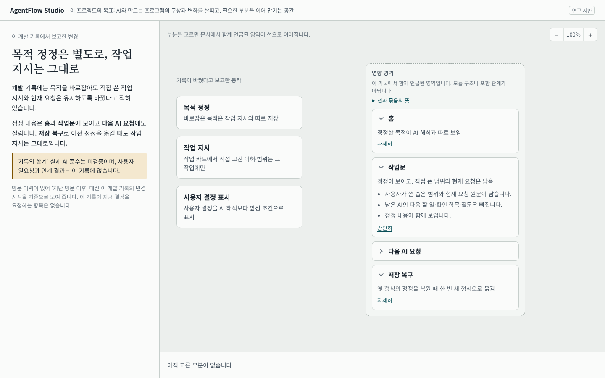

# 공간 복귀 흐름 cycle03 — 총괄 판단

2026-10-16 · 아래 판정의 고정 대상은 작성 입력 `16e417af…`, 시안 fix1 `34b41240…`이다. 최신 배정은 [ACTIVE](../ACTIVE.md)에 모은다.

## 바뀐 사용자 경험

목적 정정의 변경 설명에서 관련 홈·작업문·다음 요청·저장 복구를 보고, 한 부분을 선택해 필요한 근거를 읽고, 선택적으로 인계 준비 내용을 살핀 뒤 전체로 돌아오는 한 경로를 만들었다. cycle02의 정밀한 읽기 화면 전체를 기본 지도에 붙이지 않았다. 기본은 짧은 변경 설명과 관련 영역, 상세는 문장별 근거와 필요한 대조다.

총괄과 독립 검토는 첫 화면에서 프로그램 목적이 약하고 안내가 반복된다고 판단했다. fix1에서 프로젝트 목표 한 문장을 넣고, 기본의 기술 식별자를 상세로 보내고, 중복 영역 목록과 긴 안내를 줄였다. 선택·영역별 펼침·배율·근거·준비·복귀 함수는 유지됐다. ‘기술 식별자는 기본에서 제외’가 정확한 범위이며 상세 비교표에도 식별자는 남는다.

## 판단과 증거의 경계

**fix1의 이 작은 읽기·준비·전체 복귀 흐름을 다음 연구의 기반으로 수용한다.** 두 화면 크기의 독립 8단계와 반복을 완주한 증거, 원본 바이트 귀속, 내용·이미지·코드 대조를 확보했다. 기본 화면의 짧은 설명과 상세 근거 분리는 유지한다. 전체 제품 구조·자동 갱신·인계 실행·Dify 대비 품질 우위를 확정하는 판정은 아니다.

독립 Cloud는 작성자 검사기를 실행하지 않고 별도 조작으로 **1440×900·390×844 각각 8단계, 총16단계 PASS·실제 exit0**를 남겼다. Chromium이 받은 실제 HTTP 응답 바이트와 원본 해시가 일치했다. 사용자가 홈의 펼침을 바꾼 뒤에도 다른 깊이·선택·스크롤·적용 배율과 7개 기준 노드의 좌표가 두 번의 복귀 직후 그대로였다. 이 단계 수를 하위 단언이나 사람 성공률로 합산하지 않는다.

모바일 준비본은 실제 휠로 57/57px까지 내려 보존 조건·미확인·보내지 않음 안내에 접근했다. 반복 재열기 때는 내부 위치57이 남아 있으므로 매회 처음으로 초기화됐다는 주장은 하지 않는다. 근거 닫힘·재열기·Escape와 초점 복귀도 관측했지만 독립 실행의 근거 읽기 출발 위치는 두 화면 모두0이었다. 비초기 위치의 독립 스트레스 검증으로 확대하지 않는다. 모바일 관련 표시4개의 존재·숨긴SVG는 확인했으나 네 표시가 모두 한 화면에 보였다는 증거는 아니다.

도움말 때문에 선이 옮겨지는 장면은 목적 선택을 다시 하지 않는 별도 한 장면으로 확인했다. 전체 16단계를 다시 실행한 것으로 세지 않는다. 독립 원본의 pageerror·fatal·cleanup 오류는 없었고 favicon404만 별도로 기록했다. [Cloud 수령·해시 감사](CLOUD_RECEIPT_AUDIT.md)와 [코드·관측 범위 감사](CLOUD_CODE_AUDIT.md)가 판정 근거다.

- 작성자: v0 뒤 모바일 읽기 위치 문제 등을 고쳤다고 보고했고, 최종 로그와 이후 회수한 초기 로그를 보존했다. 초기 로그에는 모바일 0→168이 PASS로 남아 있어 당시 누락된 판정을 확인할 수 있지만 초기 HTML·검사 코드는 없어 같은 조건의 수정 전후 재현으로 주장하지 않는다.
- 독립 내용·시각: [v0 검토](V0_CONTENT_VISUAL_AUDIT.md)와 [fix1 검토](FIX1_CONTENT_VISUAL_AUDIT.md). 고정 사실 8개를 뒤집거나 실제 승인·전달 완료를 발명한 오류는 발견하지 않았다. 이는 AI의 내용·이미지 관찰이며 사람 사용성 결과가 아니다.
- 독립 코드: [v0 감사](V0_CODE_AUDIT.md), [fix1 감사](FIX1_CODE_AUDIT.md). 기존 함수의 보존을 확인했고 작성자 검사기의 실패 종료·실행 바이트 귀속 약점을 분리했다.
- 검사기 보완: [감사](CHECKER_AUDIT.md). 정상 실제 exit0/의도한 단계 실패 exit1 원본을 회수했다. 외곽 실행 기록기의 남은 실패 판정은 [별도 보완](checker-hardening/PATCH_NOTE.md)으로 구분했으며 그 셸 자체의 새 브라우저 실행은 미실행이다. 제품 흐름의 판정은 이 미실행 사본에 의존하지 않는다.

## 이번 입력이 말할 수 있는 것

FIX058은 과거 실제 개발 변경을 문서가 보고한 자료다. 사용자 원발화·승인·실제 인계 수신/수락은 없다. 그래서 준비 제안은 보내기·수신·완료로 바뀌지 않고, 없는 사용자 결정을 숙제로 만들지 않는다. 이번 입력의 홈·작업문 등은 영향 영역이며 진짜 모듈 부모·자식의 증거가 아니다. 이를 최종 제품의 구조 지도나 자동 영향 분석으로 일반화하지 않는다.

[추가 메커니즘 판단](MECHANISM_REVIEW.md)은 Bloom·Archi를 비교했지만 도구 전체를 채택하지 않았다. Bloom의 자동 저장은 집중 전 보기 복원을 보장하지 않고, Archi의 시각 Group은 모델 의미가 없는 것과 연결을 할 수 없는 것이 다르다. 가져온 원리는 같은 대상의 정체성·관계 의미와 보기 상태를 구분하는 것이며, 우리 복귀는 별도로 관측했다.

## 남은 제품 과제와 다음 좁은 범위

1440 기본 화면에는 세 동작과 네 영향 영역이 함께 보인다. 390에서는 헤더·요약·한계 안내가 약524px를 차지해 네 영향 영역의 배치가 첫 화면 아래에 있다. 실제로 내려가 접근할 수 있는지와 처음부터 전체 관계를 이해하기 쉬운지는 다르다. 사람의 혼란이나 이해 개선을 측정한 것은 아니다.

다음 반복은 모바일에서 요약을 읽은 뒤 관련 부분을 다시 찾는 부담을 줄이는 문제 하나로 좁힌다. 중요한 출처 경계를 숨기거나 또 다른 모듈 트리를 추가하지 않고, 첫 화면에서 변경·현재 부분·관련 영역을 어떻게 함께 읽게 할지 비교한다. 이는 레이아웃을 확정하거나 현재 연구 입력으로 전체 제품을 일반화하는 결정이 아니다.

## 다른 세션의 재검토 경로

- [입력](INPUT.md) · [배정 범위](BRIEF.md) · [브라우저 계약](BROWSER_CONTRACT.md).
- 작성자 [v0 원본](author-v0/REPORT.md) · [검사기 보완 원본](checker-followup/FOLLOWUP_REPORT.md) · [fix1 원본과 화면](author-fix1/FIX1_REPORT.md). ZIP 대신 원본 파일과 대표 PNG를 저장소에서 회수할 수 있다.
- [v0 수령·해시](AUTHOR_V0_RECEIPT.md) · [검사기 수령·해시](CHECKER_RECEIPT.md) · [fix1 수령·해시](FIX1_RECEIPT.md). HTML SHA256 `af748df1dfacb7ed6b4ae3709d5ced26ef43f96bc45a9e6c2c05cdc02e9cc77e`.
- [독립 Cloud 원본 16파일](https://github.com/tlsee0813-cmd/agentflow-studio/tree/0201912a2e05ae920337bf25c9e2d116142c94d7/docs/transfer/return-flow-03/fix1): 실행 코드·보고·JSON·실제 종료 기록·대표 PNG3장과 manifest. 작성자 결과와 합산하지 않는다. [실제 모바일 준비본 하단](https://github.com/tlsee0813-cmd/agentflow-studio/blob/0201912a2e05ae920337bf25c9e2d116142c94d7/docs/transfer/return-flow-03/fix1/390-prep-lower-conditions.png), [전체 복귀 지도](https://github.com/tlsee0813-cmd/agentflow-studio/blob/0201912a2e05ae920337bf25c9e2d116142c94d7/docs/transfer/return-flow-03/fix1/1440x900-returned-map.png)를 다른 세션도 직접 회수할 수 있다.

이 연구 때문에 제품 소스·main·공개 체험판을 바꾸지 않았다. 실제 손가락 스와이프·외부 GitHub 원문 왕복·사람 사용성·실제 인계 실행·Dify 대비 품질 우위는 판정하지 않았다.
