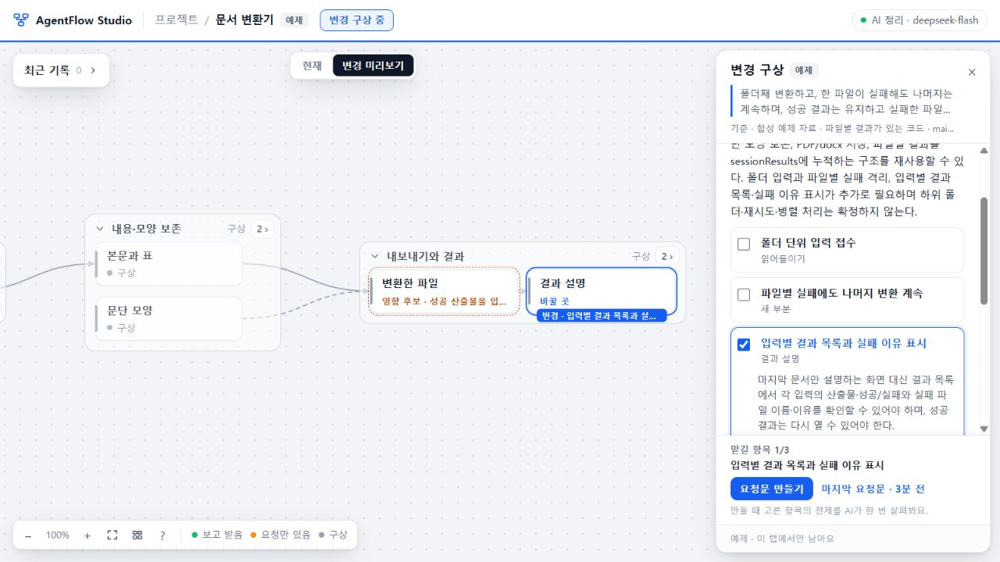

# 변경안 왕복 57 — 첫 구현 수용

2026-10-26. 배포 source **93cbff963c064a24de1438e2dba5cd07efde0840**. [PR29](https://github.com/tlsee0813-cmd/agentflow-studio/pull/29)의 merge `8e1101843989d29706d9a9001982c55385dda0bd`와 app 내용이 같다. [정확 SHA CI](https://github.com/tlsee0813-cmd/agentflow-studio/actions/runs/40297714933)는 Ubuntu `121487909868`, Windows `121487909509` 모두 성공했다.

[주 체험본](https://agentflow-studio.tlsee0813.workers.dev/#/p/ex-converter) · [보조 정적판](https://tlsee0813-cmd.github.io/agentflow-studio/) · [설계 기준 v1.3.1](../../SOFTWARE_MAP_DESIGN_KO.md). Workers와 Pages의 공개 BUILD에서 source 일치를 확인했다. Pages commit은 `fb657951c7e34c0f7d3de46e949293acf1769618`이며 기존 design 시안 파일을 보존했다.

## 구현된 경험

- 현재 지도에서 변경 구상을 열고, 같은 부분 위에서 맡길 변화의 제목과 영향 후보를 읽는다. 항목 읽기와 요청 포함 체크는 별개다. 1280에서는 읽을 크기를 유지하며 항목 선택 시 필요한 만큼 이동하고, 닫으면 기존 카메라·접힘·선택으로 복귀한다.
- 내 프로젝트의 변경 문장과 붙인 보고·코드·검사 자료를 실제 AI가 읽는다. 원자료, 유지 조건, 미확인을 펼쳐 볼 수 있다. 자료가 바뀐 것과 작성된 예제 답을 구별한다.
- AI 분석에서 요청문을 만들 때 고른 범위만 다시 검토한다. 미선택 전제를 자동 포함하지 않으며 제외 항목, 전체 구상의 미정, 선택 범위의 미확인을 분리한다. 검토에 사용한 원자료를 요청문에 보존한다.
- 요청문은 생성 당시 항목·판본·기준의 스냅샷이다. 복사는 전달·접수·실행을 뜻하지 않는다. 돌아온 글은 요청 항목별 보고·코드 자료·검사로 나눠 붙이며, 다른 브랜치의 보고나 옛 검사를 현재 완료로 올리지 않는다.
- 내 프로젝트 초안·자료·분석은 브라우저에 저장한다. 변경안 내보내기는 프로젝트 백업과 별도다. 예제는 탭 메모리에만 남으며, 원래 project/return 수신 계약과 가짜 anchor를 만들지 않았다.

## 검증과 총괄 판단

| 근거 | 실행한 것 | 범위 |
|---|---|---|
| 작성자 Claude | 구현·실제 브라우저 1280/1440·스텁 공급자·취소/실패/오래된 응답·저장 오류 | 실제 DeepSeek은 작성자가 실행하지 않음 |
| 독립 Cloud, AF-CLOUD-20261026-57 | 요청 선택·클립보드·부분 반환·두 줄 초안 재열기/F5·예제 비저장. 최종93cb delta도 별도 수용 | 제공 정적 runtime 직접 실행. 원격 source 재빌드·실제 AI는 미실행 |
| 총괄 Windows | 1280 실제 화면, 선택한 대상의 패널 가림 해소, 실제 AI 예제/내 프로젝트 분석, 선택 요청문, 새로고침 보존 | 공개 합성 자료를 정상 자료 추가 UI로 넣음 |
| 총괄 실제 API | 문서 변환기 A/B, 측정 장치/PC 교차 사례. 배포된93cb의 A/B scope 모두 HTTP200 | 합성 원자료의 실제 API 처리. 실제 프로젝트 자동 이해·일반 정확도 검증 아님 |
| 독립 Sol | API 답변과 원자료 대조, 공유 계약·HTTP 경계 및 기존 브라우저 회귀 | 작성자 주장과 실제 실행을 구별 |
| 최종 CI | 기존 app 및 continuity 검사, Worker 준비, 정적 빌드, 양OS 브라우저 흐름 | 공급자는 스텁이며 사람 사용성 검사가 아님 |

Cloud 최종 ZIP은 153812 bytes, SHA256 `682228d610f1e87316ddf4445c36123ae4cc9a3354564e922117f29a8842b816`. 1280에서 선택 대상 오른쪽 끝850 < 패널 시작916, 1440에서는1027.3 <1076이었다. 현재 보기의 변경 표식은0이며 닫기 후 기존 카메라가 복원됐다. 1280 PNG는 Cloud가 직접 보았고 1440은 조작·DOM 확인이다. 총괄이 Cloud 원본 이미지를 회수했다고 주장하지 않는다.

총괄은 작은 지도와 색만 다른 첫 결과를 반려하고 읽기 크기·의미 표식을 추가했다. Cloud가 발견한 예제 B의 ‘전제를 먼저 다룬다’는 문구도 수정했다. 전역 의존 그래프를 한 번에 만드는 AI 실험은 잘못된 필수 전제를 만들었으므로 채택하지 않았다. 최종 경로는 변경안 분석과 선택 범위 검토를 나누며, 변경안 최대60초/8192토큰·범위 검토30초/4096토큰의 reasoning 호출만 사용한다. 기존 부분 질문 경로는 그대로다. 실패하면 초안을 유지하고 예제 답으로 대체하지 않는다.

배포 후 A scope는 기존 `inputId/status/reason/sessionResults` 재사용을 짚고 추가 전제 후보0개였다. B scope는 입력별 실패 기록의 대응·누적 수단 한 개를 제안했다. 파일명 대응·누적 범위는 미확인으로 남겼다. [최소 실제 응답](OBSERVATIONS.json)에 원문과 한계를 남긴다. 이 결과만으로 임의 프로젝트의 정확성이나 자동 정리 성공을 선언하지 않는다.

Pro `af-experience-ui`의 읽기/선택 분리·맥락 복귀 비교를 활용했다. Claude 세션 `session_01XyYXhoCCWxpcW6YNjJpcdD`의 좁은 구현과 Sol High의 계약/대조, Astra High의 의존 추론 판단을 총괄이 결합했다. DSH 추출 session `session-83e23511-cf87-415b-b3cb-406b41cc9072`는 실패했고 이를 제품 DeepSeek API 성공과 혼동하지 않는다. 완료된 외부 작업 탭과 검증 서버는 정리한다.

## 다음 범위와 미완성

57은 설계 전체의 완성이 아니다. 지도 자동 생성·지속 갱신·자동 동일성·질문 장면·구조 정정·기록 수집기·에이전트 자동 실행은 구현하지 않았다. 지금 돌아온 결과를 연결하는 것은 명시적인 항목 선택이며 자동 연결이 아니다. API 응답은 제안으로 남고 임의 규모·불완전한 실제 프로젝트에서의 정확도는 미확인이다. 실제AI의 항목 수·용어·미정 표현은 실행마다 달라질 수 있다.

다음 Q02/Q06 범위는 기존39의 실제 JSONL과 project 사본을 출발점으로, 출처를 보존한 구절→현재 대상 후보→새 기록으로 달라진 설명의 작은 왕복이다. 연결 근거가 없으면 미연결로 남긴다. 하나의 실제 프로젝트에서 이름 변경·부분 분리·늦은 보고가 현재 설명을 어떻게 바꾸는지 먼저 검증하고, 그 결과로 자동 반영과 제안의 경계를 결정한다. 질문 목록 전수 구현이나 hook/MCP 확장으로 넓히지 않는다.
