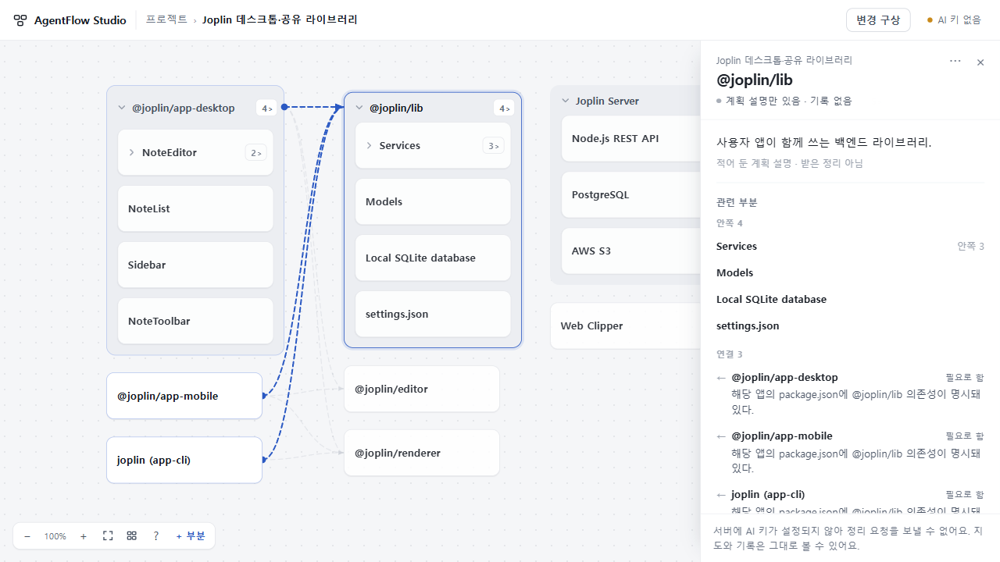
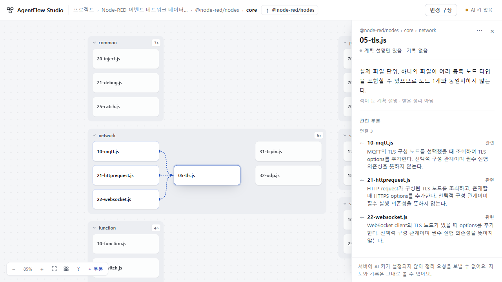
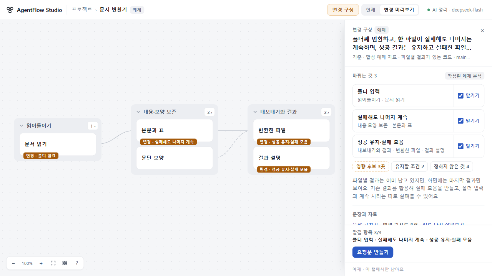

# UI/UX58 · OSS 구조로 검토한 지도 작업 공간
입력 수집·출력 계약을 늘리지 않고 홈, 지도, 선택 상세, 내부 탐색, 변경 미리보기를 하나의 작업 공간으로 정돈했다.

## 바뀐 경험
- 내 프로젝트를 홈의 첫 자리에 두고 예제는 작게 분리했다.
- 경로·구성 상위·직전 장면·현재/변경 모드를 상단 한 줄로 모았다. 빈 최근 기록 패널이 지도 폭을 차지하지 않는다.
- 선택 상세와 변경안은 같은 폭의 오른쪽 패널을 필요할 때 연다. 열 때 배율을 바꾸지 않고 필요한 최소 이동만 한다.
- 긴 이름은 두 줄, 반복 이름은 부모 맥락으로 구별한다. 많은 형제는 읽을 수 있는 블록으로 배치하고 기존 수동 위치는 보존한다.
- 작은 하위 흐름을 세로로 묶어 변환기의 현재/변경 구성이 1280·100%에서도 패널 옆에 보인다. 변경 표지는 제목을 가리지 않는다.
- 연결된 형제 사이에 무관한 부분이 끼지 않게 배치한다. 그룹 관계는 그룹 머리로 연결하고, 선택한 선은 실제 양끝을 강조한다. 막힌 선의 우회는 제한된 보조 규칙이다.

## 실제 사용한 자료와 검토
[고정 출처·선택 범위](OSS_CASES.md)와 [기계 판독 자료](OSS_CASES.json), 재현 생성기는 같은 저장소에 있다. Joplin 30부분/깊이4, restic 29부분/20개 명령군, Node-RED 32부분/선택적 TLS 관계를 기존 백업 가져오기로 열었다. 성긴 Joplin 4부분, 긴 공통 접두어, 다른 부모의 동명 ‘설정’은 별도로 표시한 파생 스트레스 자료다. 작업·보고·anchor를 만들어 수신 계약을 통과시키지 않았다.

재현: 저장소 루트에서 빌드한 뒤 아래 생성기를 실행하고, 생성된 여섯 프로젝트 JSON을 Studio의 ‘백업 파일 가져오기’로 연다. `ATTRIBUTION.json`은 출처 부록이므로 가져오지 않는다. 생성 백업과 로컬 ZIP은 저장소에 중복 보관하지 않는다.

```sh
node app/continuity/scripts/build.mjs
node app/continuity/tests/visual58-fixtures.mjs --out <임시 출력 폴더의 절대 경로>
```

이 검토는 공식 소스에서 선택한 구조의 **표시·탐색 시험**이다. OSS 자체를 설치·실행했거나 전체 구조를 자동 이해했다는 결과가 아니다.

| 구분 | 범위·결과 |
|---|---|
| 작성자 Claude Opus | UI 단일 작성. Node 323개, 스텁 브라우저 8흐름 통과 주장. 정적 빌드 검사는 작성자 미실행 |
| Cloud 독립 request1 | 5e62b0e, 6자료×1280/1440 실행·실제 캡처 열람. 탐색/배율/접힘/선택/초안/근거 복귀 통과. Node-RED 선의 TCP/UDP 관통, Joplin 그룹 끝점 귀속 모호함으로 시각 반려 |
| 총괄 Windows | 6자료 정상 가져오기, 긴 이름·깊은 경로·반복 이름·변경 미리보기·선택 직접 조작/화면 확인. 4b860a4에서 700px 패널700/시트676, 메뉴 Escape 후 선택/초점 유지 확인. d64f74a에서 두 관계선 반례 수정 화면 직접 확인. 최종52e8c44에서도 긴 이름 잘림 없음·Joplin/TLS 화면을 다시 확인 |
| Sol 6.1 High | 읽기 검토로 좁은 창 폭·메뉴 Escape 결함 발견, 수정 diff 확인. 화면 실행으로 표기하지 않음 |
| 로컬 검사 | 형/문법/키 경계 통과. 기존 Node314개 통과. sparse checkout 밖 자료 누락으로 신규 suite가 처음 실행되지 않아 해당 디렉터리만 포함한 뒤 신규8개 통과. 최종 글꼴 보정 뒤 관련9개 재검사 통과. 제품 수정 없이 해결 |
| 정확 SHA CI | 최종 `52e8c44c817e494cfd5c367f6a116b728ec293ee`의 [CI40312210728](https://github.com/tlsee0813-cmd/agentflow-studio/actions/runs/40312210728): Ubuntu121535917321·Windows121535917649 모두 성공. Node323개·스텁 브라우저·정적판 검사 포함 |
| Cloud 독립 request2 | d64f74af20f0daf4434968ce59e08b67afc02831 / ZIP181157 bytes SHA2565370fc6c841087c278dd3e43e547e80fc7a2334e492309665143e2f783ff9084 동일.1280·1440 Joplin머리포트/TLS선관통해소/변환기100%3묶음패널왼쪽24px 여유 실제실행·캡처열람 후 수용. 전체suite/700/Esc/API/원격source대조미실행. 서버종료exit0, Cloud이미지다운로드미수행(root별도직접캡처공유). |

Pro의 공식 [Linear 표시 옵션](https://linear.app/docs/display-options), [Figma UI 줄이기](https://help.figma.com/hc/en-us/articles/41414918021271-Hide-or-minimize-the-UI), [LikeC4 보기 범위](https://likec4.dev/dsl/views/predicates/) 비교에서 맥락 줄·점진적 상세·관계 범위를 취했다. 항상 빈 오른쪽 공간을 예약하자는 제안은 채택하지 않았다. Pro 라이브 관찰은 1363×936이며 지정 설계 SHA 열람 실패를 전체 설계 검토로 올리지 않는다.

d64f74a의 첫 CI는 Ubuntu에서 긴 공통 접두어 이름이 잘려 실패했다. 작성자는 넓은 DejaVu Sans로 이를 재현했고, 최종52e8c44는 화면 글꼴로 폭을 측정해 긴 카드만 넓힌다. 기존 검사와 이름은 축소하지 않았다. 320px 상한에서도 넘는 극단적인 이름은 상세에서 전체를 읽는다.

## 배포와 남은 범위
[기존 Workers](https://agentflow-studio.tlsee0813.workers.dev/#/p/ex-converter)에 source `52e8c44c817e494cfd5c367f6a116b728ec293ee`를 배포했다. [PR30](https://github.com/tlsee0813-cmd/agentflow-studio/pull/30) merge `0a54b653229b34ece45348a8aea086dfdf20850e`와 app tree `dcc73a819d3b7c8b44cab63f6692c77a54c51af1`이 동일하다. 실제 비밀값 일치 검사를 통과한34자산/15서버모듈만 업로드했다. 보조 Pages `59879592a5f4db76fd7816243882d3ddb5959f7b`도 같은 source이며 기존 design/ 자료를 보존했다. 양쪽 공개 BUILD 일치와 Workers의 실제 변경 미리보기 표시를 확인했다.

대표 화면은 총괄이 직접 캡처했다. Joplin/Node-RED는 최종 소스의 키 없는 로컬 UI, 변환기는 공개 Workers의 작성된 예제 분석이다.







실제 AI/API는 이번 시각 변경에서 재검사하지 않았다. 서버·자료 수집·요청문 계약은 변경하지 않았다. 임의 대규모 프로젝트의 자동 이해, 모든 수동 배치의 관계선 무겹침은 보장하지 않는다. 깊고 큰 범위는 일부가 화면 밖에 남으므로 내부 진입·이동으로 읽는다. 화면 캡처는 고정 자료의 결과이며 사람 사용성 연구를 대신하지 않는다.

