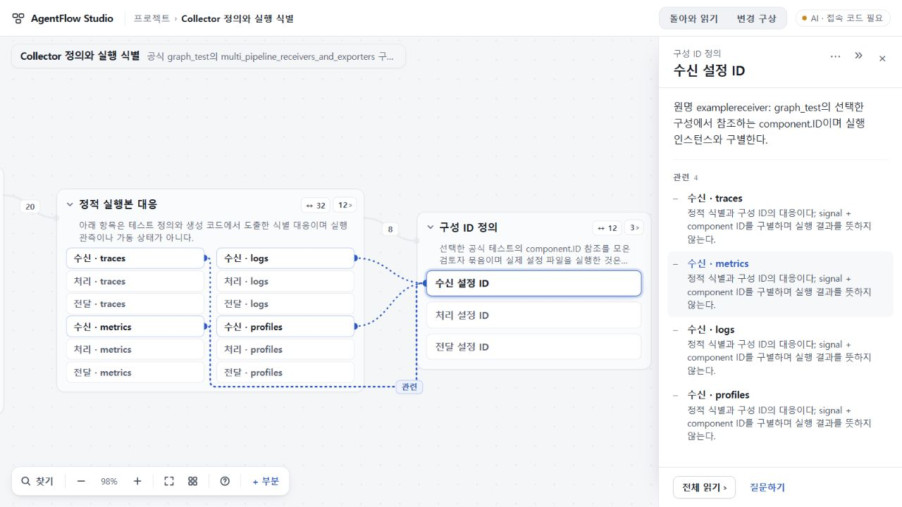
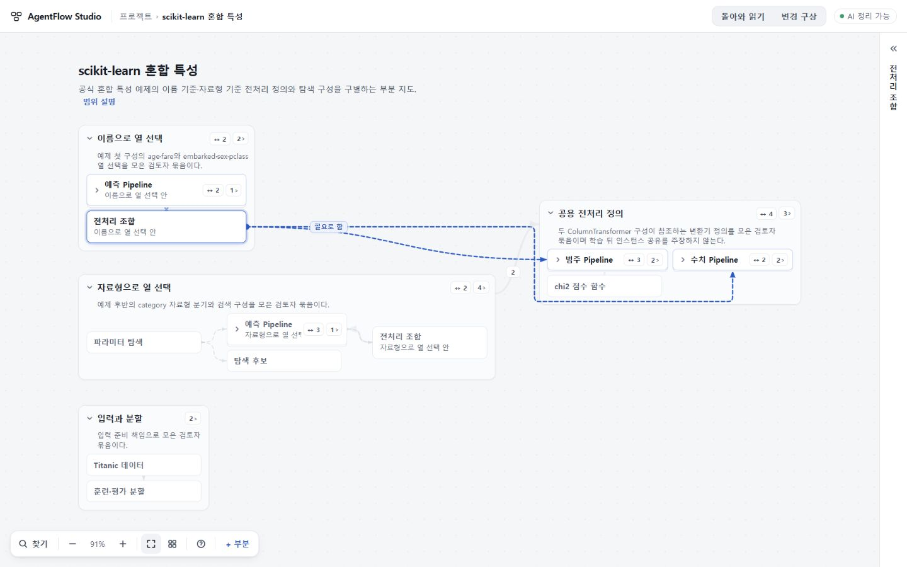

# UI·UX68 · 큰 지도의 개요·읽기면·배치 보존

## 수용 결과

2026-10-28 수용·배포 완료. runtime **0dc84a1703bc9f1dbc785de8bee51d90bebd69ba**, [PR39](https://github.com/tlsee0813-cmd/agentflow-studio/pull/39), merge **3950222751ad0e0a659e4312905f1d45d391d8f7**. 후보와 병합본의 app tree가 같다. [정확 SHA Windows·Ubuntu CI40541468977](https://github.com/tlsee0813-cmd/agentflow-studio/actions/runs/40541468977) 성공 후 기존 [Workers](https://agentflow-studio.tlsee0813.workers.dev/)와 보조 Pages를 갱신했다. 양쪽 공개 BUILD source가 일치하며 Pages 커밋은 **3cd6458ca15e38132fb444d9063aea67b1e1fc17**이다.

다른 세션의 UI67 개선을 결합했다. 큰 지도는 묶음 사이 관계를 개수 있는 집계선으로 읽고, 개요 예산이 부족할 때 작은 묶음 하나만 강조하지 않도록 균일하게 접는다. 관계 제목은 도착점 곁에 놓고, 묶음을 선택하면 내부 대상의 바깥 관계도 읽는다. 읽기면을 레일로 접을 수 있고 관계를 따라간 출발점은 읽는 곳 위에 남는다. 새로고침 뒤 접힘·카메라가 유지된다. 간격·보조 글자·선택 상태·입구 이름과 변경 구상의 현재 설명도 정돈했다.

## 독립 검토에서 고친 것

[원검토67](REVIEW67.md)의 네 결함을 수정했다.

- 같은 project.id의 백업 사본을 가져와도 원본의 수동 배치를 덮지 않는다. 배치·보기는 workspace entry별로 분리하고 구형 보기의 승계도 보존한다.
- 외부 positions의 상속 키·잘못된 좌표를 검증하고 안전한 사전으로 정리해 prototype 오염을 막는다.
- Collector의 관계 12개 중 4개를 선택하면 개별 4개와 잔여 집계 8개가 함께 남는다. 별도 경계 20개도 보존되고 해제하면 12·20으로 돌아온다.
- scikit의 이름 기준 전처리 조합에서 수치 Pipeline으로 가는 선은 무관한 범주 Pipeline 아래의 빈 통로로 우회한다.

후속 저장 검토에서 찾은 두 문제도 수정했다. 배치·보기 쓰기가 실패하면 새 사본과 성공 안내를 만들지 않는다. 기존 project 키의 접힘·카메라는 기존 entry만 승계하고 새 사본은 자신의 보기로 시작한다.

## 무엇을 실행했나

자료는 [고정 OSS 소스 기반 부분지도](../2026-10-26-visual-experience-58/OSS_CASES.json)다. OSS 자체 실행이나 전체 저장소 자동 추출 검증이 아니다.

| 담당 | 실제 범위 |
|---|---|
| 작성자 Claude | 최종 고정 TS5.8.3 check/build, 368 Node, 전체 Studio smoke와 두 PC 화면 통과 보고. 작성자 주장이다. |
| 총괄 Windows | e339 check/build·366 Node, 최종 0dc check/build·7 저장 회귀 통과. Collector 1280의 4+8+20, scikit 1440 우회, VS Code 136부분의 균일 접힘·묶음 관계·카메라 복귀를 직접 조작했다. |
| 독립 Sol6.1 High | 사본 배치·상속 키와 최종 positions/view/workspace 쓰기 거부, 구형 view 승계를 별도 in-memory Storage로 재현했다. 파일 수정·화면 검증은 하지 않았다. |
| 독립 Cloud Sol6.1 High | e339 제공 빌드 17 browser flow 1회 exit 0, Collector/scikit/VS Code 및 긴 복귀 이름의 1280·1440 PNG를 직접 검토했다. 최종 0dc의 동일 화면 코드와 저장 delta를 대조하고 실패 안내·새 entry 0·원본 보존을 확인해 수용했다. BUILD·111 payload 해시 대조. |
| 최종 CI | 0dc 정확 SHA의 Windows job122320686678·Ubuntu job122320686336 모두 성공. 정식 빌드·Node·브라우저·정적판 검증 경로다. 실제 AI는 스텁이다. |
| 배포 후 총괄 | Workers/Pages 공개 BUILD를 대조하고 Workers Collector의 4+8+20을 화면에서 확인했다. 새로고침 후 선택·카메라가 정확히 유지됐다. |

Cloud는 제공 빌드 실행이며 원격 Git 재빌드·Windows·실제 AI는 미실행이다. 번들에 static-dist가 없어 조건부 정적판 검사는 실행하지 않았으며 최종 CI가 그 경로를 확인했다. 백업 생성은 제공 serializeBackup을 호출한 검토 wrapper이고, 가져오기는 실제 UI다. Studio에는 아직 백업 다운로드 버튼이 없다.

처음 718의 CI 실패는 숨겨진 집계선 3개에도 ctx가 붙어 상세선과 중복 집계된 문제였다. 기대값 3은 유지했다. 긴 복귀 이름은 의도한 줄바꿈을 버리지 않고 전체 이름·출발 범위·본문 공간·정확한 카메라 복원을 검사하도록 옛 한 줄 높이 단언을 교체했다.

## 대표 화면과 한계

Collector 선택 시 왼쪽 묶음 일부는 화면 밖에 남아 전체를 한 번에 읽지는 못한다. 작은 배율의 긴 이름과 긴 소속은 여전히 조밀하다. 우회 탐색은 제한된 주변 통로를 대상으로 하며 임의 배치의 무겹침을 보증하지 않는다. workspace 쓰기 거부 후에는 비어 있는 미참조 view 기록 하나가 남을 수 있으나 원본이나 프로젝트 사본은 생성·변경되지 않는다.

## 다음 범위

사용자 승인으로 입력·출력의 절대 제외를 해제했다. 다음69는 **실제 작업 원문 한 번 붙여넣기 → 짧은 읽기와 근거 있는 관련 후보 → 같은 지도 복귀**만 구현한다. 새 hook/MCP/Git 연결과 지도 자동 변경은 펼치지 않는다. 원자료·백업·사본 격리와 작은 백업 저장 입구를 함께 다룬다. 실제 Node-RED PR6019 원본문과 동명 PC/장치 합성 반례를 사용하며 작성자 검사 보고를 독립 실행으로 바꾸지 않는다.

Pro의 Eraser/NotebookLM/Grafana 공식 메커니즘 비교와 Sol의 저장·후보 계약 검토를 통합했다. canonical 설명·상태를 보고만으로 자동 덮는 제안은 채택하지 않았다. DeepSeek 워커 추출은 오류·빈 반환으로 미채택했으며 총괄이 공개 원자료를 직접 대조했다. 아직69 구현·실제 AI 품질 수용은 아니다.

[직전66 결과](https://github.com/tlsee0813-cmd/agentflow-studio/blob/0cfb4f6c8a3e98880cf3bf034d87369ba42f6554/docs/cycles/2026-10-26-visual-experience-59/RESULT.md)는 고정 커밋에 보존한다. 기존 결과·대표 PNG만 갱신하며 ZIP·긴 실행 로그는 게시하지 않는다.
