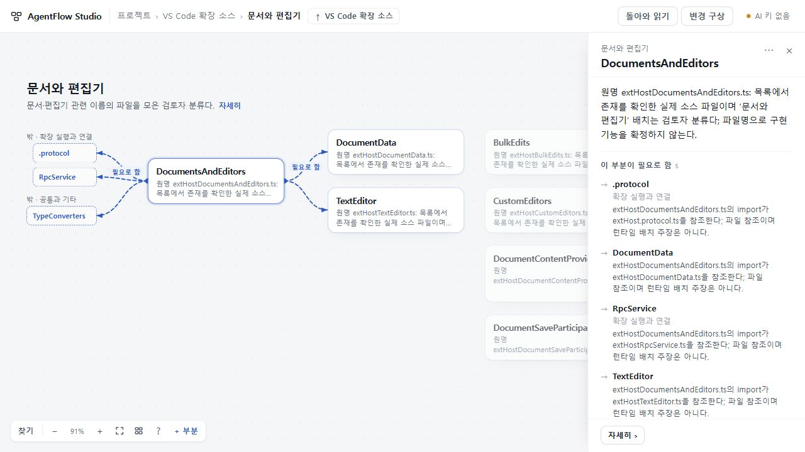

# UI·UX66 · 복잡한 구성에서 연결 대상과 소속을 함께 읽기

## 결과

상태: 2026-10-27 독립 수용·배포 완료. runtime **d037ef01f4a819b250d161e9e4229500a707bb4c**, [PR38](https://github.com/tlsee0813-cmd/agentflow-studio/pull/38), merge **cfac33423aac351e7408fd438833de80b7e58fe5**. 후보와 병합본의 app tree가 같다. [정확 SHA의 Windows·Ubuntu CI40497869855](https://github.com/tlsee0813-cmd/agentflow-studio/actions/runs/40497869855)가 모두 성공했다. 기존 [Workers](https://agentflow-studio.tlsee0813.workers.dev/)와 보조 Pages의 공개 BUILD source를 대조했다(Pages **974bab017e9116c4d10f4ca9fab07251dd53690b**).

바깥 연결 대상을 범위 전체의 먼 가장자리에 몰아놓지 않고 실제 연결되는 부분 곁의 빈 공간에 놓는다. 이름은 자르지 않고, 같은 소속의 대상 위에 소속을 한 번 표시한다. 동일한 이름도 소속으로 구별된다. 공용 정의를 먼저 읽는 최초 자동 배치 순서를 보완하되 저장된 수동 위치가 우선하고, 선택할 때마다 전체를 재정렬하지 않는다.

같은 종류·방향·화면 쪽의 관계는 동사를 반복하지 않는다. 개별 선과 근거는 보존하며 한 선에 전체 개수를 붙이지 않는다. 단순한 **관련**은 양쪽 점과 중립 목록으로 표시하고, 전달·필요 관계의 방향은 유지한다. 저장된 관계 ID·양 끝점·종류·원문은 바꾸지 않았다. 입력·출력·AI 계약은 이번 변경에 없다.

## 어떤 구조에서 확인했나

[기존 고정 소스와 부분지도](../2026-10-26-visual-experience-58/OSS_CASES.json)를 재사용했다. 아래는 **출처 기반 수작업 부분지도**이며 저장소 전체 자동 분석이나 OSS 자체 실행이 아니다.

| 사례 | 읽기 과제와 결과 |
|---|---|
| VS Code · 136개 부분 | DocumentsAndEditors의 내부 2개·바깥 3개 연결을 함께 읽는다. 43개 동급 항목 중 파일과 디렉터리인 Types도 구별한다. |
| scikit-learn | 두 ColumnTransformer가 참조하는 정의와 각 조합의 소속을 구별한다. 같은 이름을 합치거나 학습된 상태 공유로 해석하지 않는다. |
| Zephyr | GPIO에 닿는 6개 관련 관계를 실행 방향처럼 보이지 않게 읽는다. 부모를 접어도 실제 안쪽 대상과 근거는 읽기면에 남긴다. |
| OpenTelemetry Collector | 설정 ID·파이프라인 정의·정적 식별 대응을 구별한다. 수신 traces의 세 바깥 끝점을 1280에서도 함께 볼 수 있다. |

## 비교와 선택

웹 Pro는 [Ilograph의 범위·바깥 맥락](https://www.ilograph.com/docs/getting-started/browsing-diagrams/), [IntelliJ의 구조 탐색](https://www.jetbrains.com/help/idea/viewing-structure-of-a-source-file.html), [Onshape의 Instances](https://cad.onshape.com/help/Content/Assembly/instances_list.htm)를 비교했다. Ilograph 공개 데모는 직접 조작했고 나머지는 공식 문서·이미지 검토다. AgentFlow 실행 검토로 세지 않는다.

Opus5.5 High의 두 안 중 실제 연결 곁에 끝점을 두는 안을 수정 채택했다. 화면 가장자리에 별도 표지를 띄우는 안, 상시 새 사이드바, 선택마다 전체를 다시 배치하는 안은 제외했다. 단순히 반복 문구를 줄이기 위해 관계를 합치거나 원문을 바꾸지 않았다.

## 검증과 반려

- **작성자:** 최종 d037에서 타입·빌드, Node 344검사, Studio 브라우저 18흐름 및 두 PC 크기 직접 화면을 통과했다고 반환했다. 자체 주장과 아래 독립 확인을 구별한다.
- **Sol6.1 High 정적 검토:** 첫 후보414의 긴 조상 제목 높이가 두 줄로 제한돼 겹칠 수 있음을 지적했다. 작성자가 59+59+60자 소속 경로와 60자 끝점으로 재현·수리했다.
- **총괄 Windows 직접 조작:** VS Code 관계 왕복의 카메라·선택 보존, scikit 소속과 단계 순서, Zephyr 중립 6관계를 확인했다. 첫 후보414의 Collector 끝점 하나가 읽기 영역 밖으로 밀리는 것을 반려했다. 최종 d037에서는 1280·1440 모두 세 끝점이 보이고 이름·소속이 읽힌다.
- **독립 Cloud:** 작성자와 별도의 Sol6.1 High. 414에서 네 사례·1280/1440 조작과 PNG를 검토하고 Collector 가림을 독립 재현했다. 최종 d037의 BUILD·109개 payload 해시를 대조한 뒤, 두 PC에서 Collector 세 끝점과 scikit 동일 이름의 소속, 60자 끝점·59/59/60자 조상 경로를 실제로 읽었다. relation_visit_flow를 원단언 그대로 1회 통과했고 확인 범위에서 남은 P1/P2 없이 수용했다. 긴 경로는 여전히 조밀하다. 제공 빌드 실행이며 원격 Git 재빌드·Windows·실제 AI는 미실행이다. converter continue 장면에 .ctx가 0개여서 해당 선의 독립 시각 검증으로 세지 않는다. 서버·브라우저 종료.
- **최종 CI:** Ubuntu job122167818612·Windows job122167818943 성공. 실제 AI가 아닌 시뮬레이션 공급자 검사다.
- **배포 후:** Workers·Pages 공개 BUILD source d037 일치. 공개 Workers 1280에서 Collector의 세 끝점·소속·중립 관계를 직접 확인했다. 수신 설정 ID를 따라갔다 복귀할 때 선택과 카메라 translate(259.2px, 162px) scale(1)이 보존됐다.

첫 후보414의 양 OS CI는 related 목록이 두 그룹에서 하나로 짧아져 600px 창에 스크롤이 생기지 않는 검사 전제에서 실패했다. 해당 구간만 500px로 바꾸고 실제 스크롤 및 복귀 값 일치 단언은 유지했다. 전체 단언을 약화하거나 실패를 재실행으로 덮지 않았다.

Collector 가림은 414에서 총괄과 Cloud가 직접 관측했다. 65의 초기 배율은 Windows와 작성자 Linux에서 달라 **66이 새로 만든 회귀라고 확정하지 않는다**. 최종 후보에서 관측된 가림의 해소를 판정했다.

## 대표 화면과 남는 한계

많은 동급 항목 전체가 한 화면에 들어오는 것은 아니다. 선택한 대상의 관련 부분을 읽고, 나머지는 확대·이동·범위 진입으로 탐색한다. 긴 원문과 여러 관계의 근거는 읽기면에서 스크롤이 필요하며, 모든 배치·모든 글꼴의 무겹침을 보증하지 않는다. 페이지 새로고침 뒤 접힘 초기화는 기존 동작이다.

이번에는 새 실제 AI 호출·자동 수신·자동 이해 일반 품질을 검증하지 않았다. [직전65의 변경 구상·실제 AI 검토](https://github.com/tlsee0813-cmd/agentflow-studio/blob/e3cc3a6a30f9536db9935854698438466844d176/docs/cycles/2026-10-26-visual-experience-59/RESULT.md)는 고정 커밋에 보존한다. 현재 결과 파일과 대표 PNG 두 장만 추가·갱신하며 전체 ZIP·긴 로그·새 감사 폴더는 게시하지 않는다.
