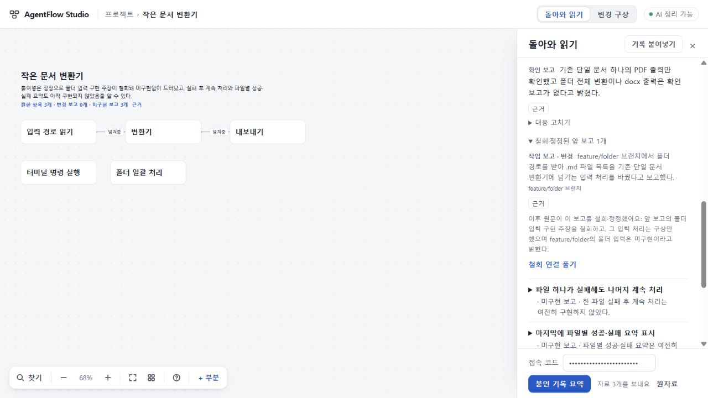
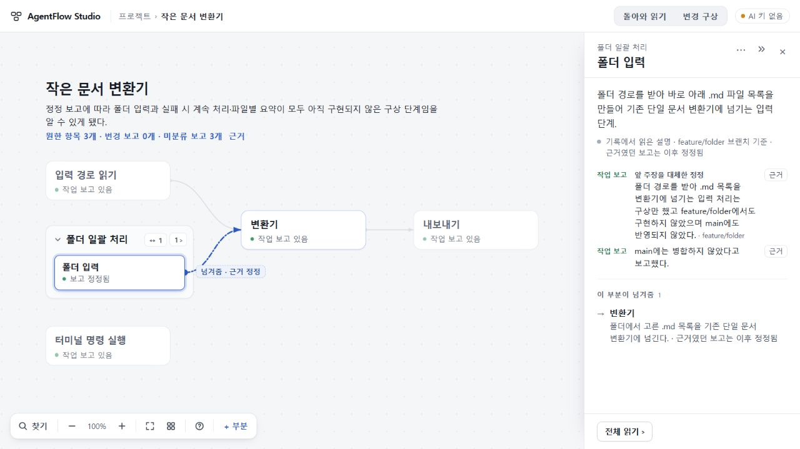

# 경험72–73 · 현재 보고와 철회 이력을 같은 지도에서 읽기

2026-10-28 수용·배포. [Workers 주 체험본](https://agentflow-studio.tlsee0813.workers.dev/)과 [보조 Pages](https://tlsee0813-cmd.github.io/agentflow-studio/)의 공개 BUILD는 **26b24b935567a95d101720cbf0e06d188d8765d9**다. [PR43](https://github.com/tlsee0813-cmd/agentflow-studio/pull/43)의 병합 e538904d0640df1f2bd4a05603fe3f7e5c4ac17a와 app tree `b670c0ea300050e28cdba9655515ebcf2e03d9d5`가 같다. [최종 Windows·Ubuntu CI40636208671](https://github.com/tlsee0813-cmd/agentflow-studio/actions/runs/40636208671) 모두 성공한 뒤 배포했다. Pages 게시 커밋은 cddc0634a535e7fb53951ad9d1ee40a9e4b7b347이다.

## 사용자가 달라졌다고 느낄 부분

- “만들었다”는 보고가 나중에 명시적으로 철회되면 현재 변경 수에서 빠진다. “미구현 보고”와 자료 부족을 구별하고, 앞 보고는 펼쳐 읽을 수 있는 이력으로 남는다.
- 보고 유형과 진술을 분리한다. 작업 보고가 있다는 이유만으로 구현됨이나 완료로 표시하지 않는다. feature 브랜치·main 미병합·검사 범위도 그대로 읽는다.
- 정정된 설명을 먼저 읽고, 그 설명을 뒷받침하던 관계에는 정정 사실을 표시한다. 선택한 정정 관계의 짧은 표시는 카드와 겹치지 않는 위치에 남는다.
- 요청 항목과 그 안의 이력을 펼쳐 근거를 읽고 돌아와도 펼침·스크롤·키보드 초점·지도 맥락을 유지한다. 부분 선택과 지도 전체의 비교 입구를 각각 확인했다.
- 홈의 이어가기는 프로젝트 사본별로 보존한다. 이전 화면 복원이 오래된 데이터의 재생이 되지 않도록 현재 자료로 다시 그린 뒤 읽기 위치만 복원한다.

## 재현 표본

[표준 백업](request73-sample.json)을 홈의 **백업 파일 가져오기**로 연다. 상단의 **원한 항목 3개 · 변경 보고 0개 · 미구현 보고 3개 → 첫 항목 → 철회·정정된 앞 보고 → 근거 → 정리로**를 따라간다. 기존 프로젝트와 별도 사본으로 열리고 추가 AI 호출이 필요 없다.

원문은 테스트용 **합성 개발 대화**다. 원한 항목은 실제 UI로 생성한 고정 요청이며, 후속 보고와 철회의 읽기는 실제 DeepSeek 출력이다. 변환기를 구현하거나 실행해 확인한 결과가 아니다. 이 구별은 백업 원문에도 적혀 있다.

## 검증과 반려한 결과

| 근거 | 확인 범위 |
|---|---|
| 작성자 Claude Opus5.5 High | 432 Node 검사 보고. 작성자 환경 TS6 결과는 정식 빌드 확인과 구별했다. |
| 총괄 고정 환경 | TypeScript5.8.3 check/build, 최종1280 지도 전체 입구의 이력·근거 복귀와 선택 정정선 표시. |
| 독립 Sol6.1 High | 현재/철회 계약 19개, 정확 인용과 범위·사용자 정정 보존. 실제 모델 출력의 인용15개와 offset8개 대조. |
| 독립 Cloud | 고정26b 제공 빌드 SHA256 `19d2ae0b76b0633c407031580501f8011a17be03eef2674283184c314eb2301e` 대조. 1280·1440에서 지도 전체/부분 경로의 이력·근거 왕복, 선택 정정선, 다른 entry 격리. 최종 확장 history73_flow 1회 성공. 새 AI 호출이나 원격 소스 재빌드가 아니다. |
| 최종 CI | 정확26b Windows122643653289·Ubuntu122643653775 성공. 정식 빌드·브라우저 흐름 포함. |
| 공개 배포 후 | 두 호스트 BUILD 일치, Workers 표준 백업 가져오기와 지도 전체→옛 근거→정리로 왕복. 이력과 키보드 초점 유지 확인. 새 AI 호출 없음. |

초기 후보의 범위 비교가 공통 브랜치 이름만으로 서로 다른 커밋의 철회를 허용하고, 전송하지 않은 원문 꼬리를 저장 검증에서 참조하는 문제를 독립 재현해 수정했다. Cloud가 찾은 중첩 이력 닫힘·선택 정정선 표기 누락을 보정했고, 총괄이 추가로 찾은 지도 전체 입구의 복귀 누락도 최종26b에서 고쳤다. 중간 CI 성공을 최종 수용으로 대신하지 않았다.

실제 순차 호출은 계약 최종15a에서 **부분 보고 28.4초 → 철회 16.6초**로 성공했다. 첫 호출은 변경1개·근거 없는 항목2개, 두 번째는 변경0개·미구현 보고3개였다. 뒤의 UI 수정26b는 그 프롬프트·서버·계약을 변경하지 않았다. 앞 후보의 JSON 오류, 잘못된 철회 필드, 연결 종료 실패는 성공으로 세지 않는다. 정정 자체의 대응 제외는 앞 보고를 몰래 부활시키지 않으며, 명시적인 철회 연결 해제는 상충 보고로 다시 읽는다.

## 남는 문제와 다음74

이번으로 전체 목표가 끝난 것은 아니다. 실제 AgentFlow 개발 지시를 첫 지도에 넣었을 때 길이 초과와 부정확한 원문 인용으로 실패했고, 별도 빠른 응답 진단에서는 내부 테스트용 변환기를 실제 제품 부분으로 잘못 뽑았다. 원문은 보존했다. 단순 모델 변경·토큰 증액·인용 검사 완화로 통과시키지 않는다.

74는 **정확한 원문 구간을 끝까지 보존하는 참조**와 **현재 프로젝트·내부 예시의 구별**에 집중한다. 새 Claude 세션의 좁은 구현을 진행 중이며, 실제 개발 지시와 micro-javascript·Zephyr 공개 발췌를 다시 대조할 예정이다. 자동 수집이나 전체 OSS 실행 성공과 혼동하지 않는다. 짧은 정리의 단정적인 어조와 긴 응답 대기도 남는 품질 문제다.

[이전70–72의 실제 호출·교차 사례·판정](https://github.com/tlsee0813-cmd/agentflow-studio/blob/a05d31dc106403d60ea714c6d643234161682083/docs/cycles/2026-10-26-visual-experience-59/RESULT.md)은 고정 커밋에 보존한다. 공유 저장소에는 코드·이 결과·작은 백업·대표 화면만 남기며 전체 응답 로그나 실행 ZIP은 추가하지 않는다.
