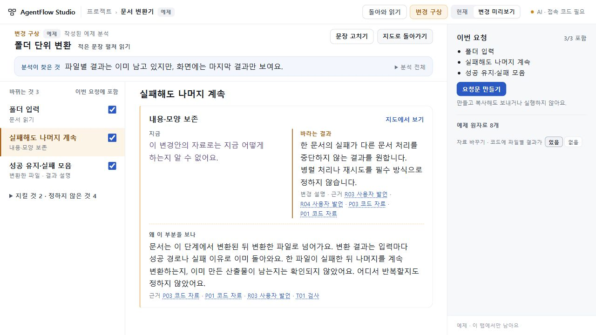
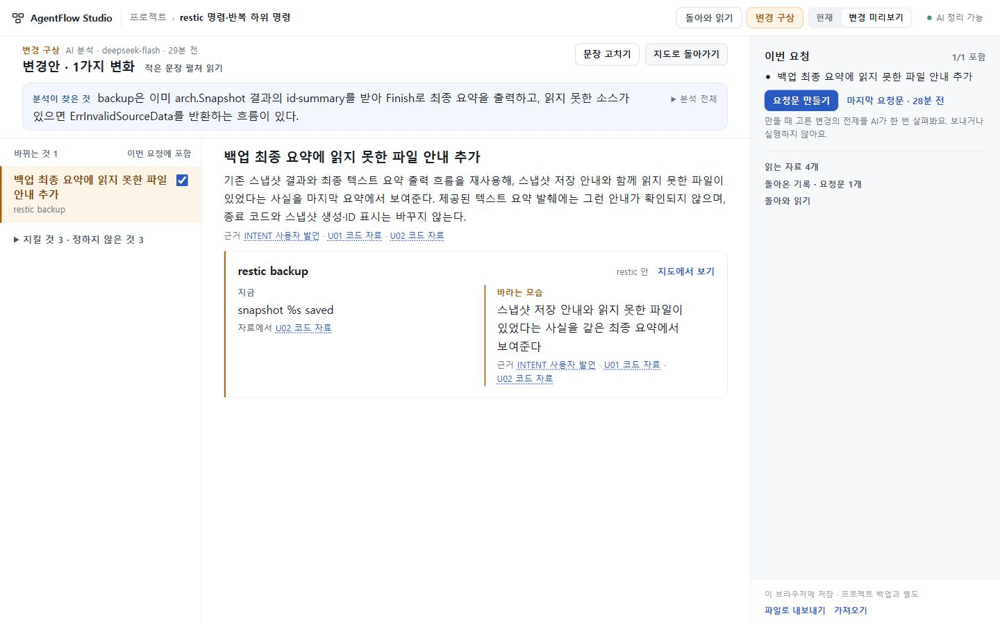

# UI·UX65 · 변경의 차이와 이유를 한 작업면에서 읽기

## 결과

상태: 2026-10-27 독립 수용·배포 완료. runtime **3764788fc07dd99a2861f8136717e74ea6e91dd0**, [PR37](https://github.com/tlsee0813-cmd/agentflow-studio/pull/37) merge **4ad91ebdf6932ba202bfc1340e74bd2b972de0b4**와 app tree **46da6a6ba16d29d1717723f06005deb710a5b74c** 동일. [Windows·Ubuntu CI40489452723](https://github.com/tlsee0813-cmd/agentflow-studio/actions/runs/40489452723) 성공 후 [기존 Workers 체험본](https://agentflow-studio.tlsee0813.workers.dev/#/p/ex-converter)과 보조 Pages를 갱신했다. Pages commit **078aa9dde042bf20d0833bceb01a5deabd928f24**. 두 공개 BUILD의 source 일치를 확인했다.

일반 지도와 부분 읽기는 유지하고, 여러 변경을 비교하거나 문장을 고치는 순간에는 넓은 작업면을 쓴다. **현재 자료에서 알 수 있는 것 → 바라는 결과 → 그 부분이 관련되는 이유**를 읽고, 지도 위치와 원문을 확인한 뒤 같은 변경으로 돌아온다.

- 요청 문장을 바꾸면 이전 분석으로 요청문을 생성할 수 없다. 버튼뿐 아니라 생성 동작에서 문장·자료·분석 기준을 대조한다. 취소되거나 이전 맥락에서 도착한 응답도 적용하지 않는다.
- 변환기의 파일별 결과 재사용 사실을 먼저 보여준다. ‘실패해도 계속’은 임의의 본문·표 항목이 아니라 변환 단계에 연결하며, 현재 중단 범위와 산출물 보존 여부가 미확인임을 남긴다.
- 읽는 변경은 행 선택, 이번에 맡길 범위는 명시적 체크박스로 구별한다. 읽기만으로 요청 범위가 바뀌지 않는다.
- 긴 요구는 펼쳐 읽고, 짧은 제목과 핵심 발견을 먼저 보여준다. 요청문·원자료·작성 도구를 모두 좁은 패널에 쌓지 않는다.
- 작업면 뒤의 가려진 지도·패널은 키보드와 접근성 트리에서 제외하고, 복귀하면 원래 카메라와 조작을 되살린다.
- 접속 코드가 아직 입력되지 않은 AI 연결은 ‘AI · 접속 코드 필요’로 표시한다.

## 선택과 반려

Pro가 [Figma의 변경 비교](https://help.figma.com/hc/en-us/articles/15023193382935-Compare-changes-in-Dev-Mode), [GitHub의 변경 파일 읽기](https://github.blog/changelog/2026-01-22-improved-pull-request-files-changed-page-on-by-default/), [Onshape 비교](https://cad.onshape.com/help/Content/Document/compare.htm)를 조사했고 총괄이 공식 출처를 대조했다. 비교 대상의 대응을 유지하면서 탐색·판단·적용을 구별하는 방식을 참고했다. 제품들에 같은 기능이 있다고 주장하거나 화면을 복제하지 않았다.

Opus5.5 High가 만든 두 공간안 중 넓은 작업면을 선택했다. 지도를 위쪽 얇은 띠로 남기는 안은 Node-RED·Joplin의 깊은 구조를 읽기 어렵게 만들어 제외했다. 첫 구현은 제목과 반복 요약이 위쪽을 차지해 중요한 이유가 아래로 밀려 반려했다. 제목을 줄이고 중복 설명을 걷어낸 뒤 1280에서 핵심 차이와 이유를 함께 읽도록 보정했다.

‘모든 항목의 현재 모습을 채운다’는 방식은 채택하지 않았다. 자료가 말하지 않는 현재 동작은 미확인으로 두고, 요구와 연결 이유를 읽게 한다. 비교를 완성한 듯 보이기 위해 사실을 만들지 않는다.

## 실행과 화면 검토

| 구분 | 확인 범위 |
|---|---|
| 작성자 Claude | 요구·자료 신선도, 넓은 비교, 편집·지도·근거 왕복, 키보드 경로 관련 테스트. 작성자 보고와 아래 독립 결과를 구별한다. |
| Sol6.1 High | 첫 생성 차단·비동기 수락·요청 포함 변경 경로를 정적으로 검토. 예제에 추가된 U자료 누락을 찾아 수정했다. 실행·시각 검증은 하지 않았다. |
| 총괄 Windows | 공개64의 첫 요청문 결함 재현, 후보1280·1440 직접 조작, 실제 DeepSeek 변환기/다른 OSS 요구와 요청문 검토. 첫 화면 밀도와 숨은 키보드 컨트롤을 반려·재검증했다. |
| Cloud | 작성자와 다른 Sol6.1 High. 496에서 관련 7흐름 각1회·1280/1440 변환기/Node-RED/Joplin/restic PNG 직접 검토. 편집 중 지도·커서 P2를 반려했고 626 inert만 별도 수용. 최종376에서 stale_request/stale_work/workspace 각1회와 직접138자 초안·커서137·근거 왕복·지도 탈출/재열기·Tab을 확인해 delta 수용. 서버·브라우저 종료. |
| 정확 SHA CI | 3764788, run40489452723: Windows122139406389·Ubuntu122139406511 모두 성공. 실제 AI가 아닌 시뮬레이션 공급자·브라우저 검사다. |
| 배포 후 확인 | Workers·Pages 공개 BUILD source376 일치. Workers에서 부정 폴더 요구 입력 직후 생성 차단·현재 지도 복귀·inert 해제를 직접 확인. 새 탭의 AI 접속 코드 필요 표시와 1280 넓은 비교 화면을 확인했다. |

중간 626의 Windows CI40487784492는 자료 재추가에서 실패했다. 자료 추가 뒤 지연된 포커스가 본문 입력을 제목으로 옮겨 자료가 제출되지 않는 경쟁이었다. 최종376은 동기 렌더 직후 포커스를 옮기고, 지연 프레임을 고정한 회귀 검사로 기존 코드 실패·수정 코드 통과를 구별했다. Cloud가 496에서 찾은 편집 중 지도 이동·커서137→138 반례도 수용하지 않았다. 최종376은 오래된 분석의 지도 버튼을 입력 즉시 끄고 동작에서도 재확인하며, 현재 지도로 나가는 길과 초안·입력 위치를 보존한다. 총괄 Windows 직접 조작에서 근거 확인 후 커서137, 닫기 후 지도 조작 복원, 다시 열 때 초안과 생성 차단, 원문 복원 후 활성화를 확인했다.

Cloud DELTA3의 최종 묶음은 source376, 619022B, SHA256 **8add116a296489bae26355eac36200c3ed0f17954a9bcd74abd3f5092fa57002**다. MANIFEST의114개 payload를 확인했고 Linux 명령 python3 /workspace/work/af65-d3-session.py는 exit0이었다. Cloud는 제공 빌드와 동결 실제 응답을 사용했으며 새 AI 호출·Windows 실행·OSS 자체 실행은 하지 않았다. 앞선 restic 재생의 시각 표기 차이로 생긴502는 한국 시간대 문맥으로 정확 매칭해 해소했으며 제품 결함으로 기록하지 않는다.

## 실제 AI와 교차 자료

[실제 응답 최소 기록](AI_SAMPLE_65.json)은 공개 합성 변환기와 고정 restic 코드 자료의 두 요구를 담는다.

변환기에 “폴더 변환은 추가하지 말고, 파일 이름 충돌 때 덮어쓰지만 막아줘”를 입력했다. 수정 직후 생성이 막혔고, 실제 재분석과 범위 검토 뒤 새 요청에는 덮어쓰기 방지만 남았다. 과거 폴더 요구는 지시가 아닌 원자료 블록에서 구별됐다.

restic에서는 처음에 호출 코드만 제시했다. 초기 응답이 함수 호출을 현재 사용자 출력처럼 비교해 반려했고 프롬프트를 좁게 보완했다. 실제 출력 코드를 추가한 후에는 기존 스냅샷 ID 표시를 유지하고 누락 파일 안내 한 항목으로 좁혔다. 범위 검토는 읽기 실패 상태가 최종 출력에 도달하는지를 확인할 전제로 제시했다. 이는 해당 발췌의 분석이며 restic 실행이나 JSON 출력 검증이 아니다. 자료가 부족한 재시도 요약에는 여전히 변경 필요를 단정하는 문장이 남아 일반 정확성 수용으로 확대하지 않는다.

[기존 고정 OSS 부분지도](../2026-10-26-visual-experience-58/OSS_CASES.json)를 재사용했다. Node-RED는 앞선 실제 분석, Joplin은 여러 대상의 표시 반례용 합성 변경안, restic은 이번 실제 AI 결과다. 출처 기반 수작업 지도·합성 화면 자료·실제 응답을 구별하며 8종 전체 연구를 처음부터 반복하지 않았다.

## 대표 화면과 남는 대가

넓은 비교를 열면 지도는 가려지고 ‘지도에서 보기’로 왕복한다. AI 변경안 제목은 새 의미를 지어내지 않는 ‘변경안 · N가지 변화’이며, 긴 원문과 많은 항목은 여전히 펼침·스크롤이 필요하다. 자동 이해의 일반 품질, 기록 연결기·자동 갱신, 입력·출력 기능 확장, 설계 전체 완성은 이번 수용 범위가 아니다.

[직전64 결과](https://github.com/tlsee0813-cmd/agentflow-studio/blob/04b38bc7599978646bea708ff73b192fb37adc6b/docs/cycles/2026-10-26-visual-experience-59/RESULT.md)는 고정 커밋에 보존한다. 현재 결과 파일을 갱신하고 대표 PNG 두 장과 작은 실제 응답 기록만 남긴다. 전체 ZIP·긴 실행 로그·추가 감사 폴더는 저장소에 올리지 않는다.
