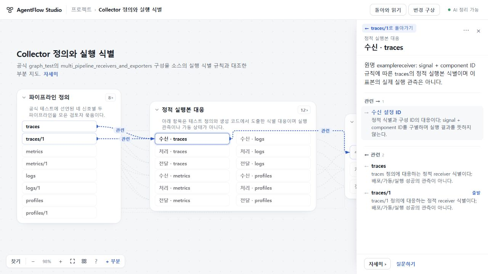
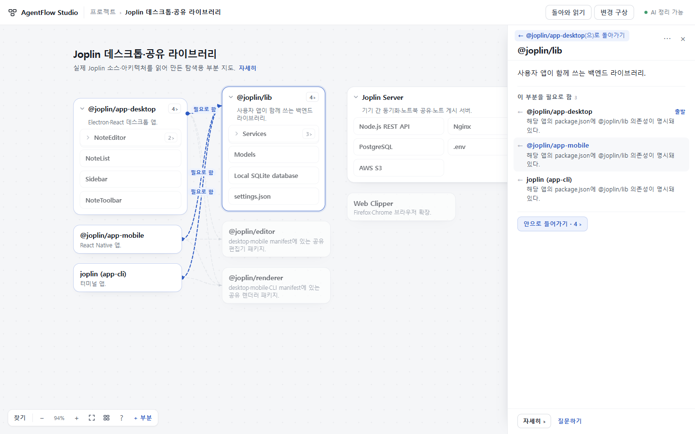

# UI·UX64 · 관계를 따라 읽고 원래 자리로 돌아오기

## 수용 결과 · 2026-10-27

같은 읽기면에서 다른 부분의 관계를 따라가도 **어디서 왔는지 이름으로 남고, 읽던 곳으로 돌아온다.** 실제 소속 경로와 방문 경로를 구별한다. 범위 밖으로 이동하면 기존 상단 복귀 입구 하나를 사용한다.

- source: `f5036013f4d18f24c02eadb354c45816f2de9110`
- [PR36](https://github.com/tlsee0813-cmd/agentflow-studio/pull/36), merge `94b5662f0166f51077ada920b2fb7fed85d2b287`; app tree `d2013befcda4c2d06f7a062391108861225b21ce` 일치.
- [최종 CI40466829984](https://github.com/tlsee0813-cmd/agentflow-studio/actions/runs/40466829984): Ubuntu122064403291 · Windows122064403536 성공. checkout은 PR head SHA를 명시하며 Node22.16.0을 사용한다.
- [주 체험본](https://agentflow-studio.tlsee0813.workers.dev/) / [보조 Pages](https://tlsee0813-cmd.github.io/agentflow-studio/): 공개 BUILD source 일치. Pages 게시 `7feb310bb1c675419211a021a99ed4a25231355f`.
- 기반인 [62의 8종 OSS 화면·변경 비교 수용 결과](https://github.com/tlsee0813-cmd/agentflow-studio/blob/b6a9987f21c9628d550c10894eabda871de2c38a/docs/cycles/2026-10-26-visual-experience-59/RESULT.md)와 [63 돌아와 읽기](../2026-10-27-return-experience-63/RESULT.md)를 유지한다. 이번에는 입력 수집·출력 확장·서버·모델 계약을 바꾸지 않았다.

## 사용자가 덜 해야 하는 일

Collector의 `traces/1 → 수신 · traces → 수신 설정 ID`를 읽은 뒤, 역관계 목록을 다시 찾아갈 필요가 없다. 오른쪽 면의 작은 복귀 행이 출발 부분을 이름으로 가리킨다. 관계 목록의 ‘출발’은 그 관계를 따라왔다는 뜻이며, 부분의 소속이나 개발 순서를 바꾸지 않는다.

Joplin 내부에서 바깥 공유 라이브러리를 보고 돌아오면 원래 내부 범위와 설명이 복원된다. 요약에서 출발했으면 요약, 상세에서 출발했으면 상세와 읽던 스크롤로 돌아온다. 사용자가 그동안 직접 바꾼 접힘·배치와 질문·변경 구상 초안은 과거 상태로 되감지 않는다.

같은 부분을 다시 방문하는 순환, 여러 단계를 건너뛰는 브라우저 Back/Forward도 주소만으로 구별하지 않고 방문 항목을 구별한다. 복귀 직후 입력을 시작했을 때 늦은 focus가 입력을 빼앗지 않도록 동기로 처리하고, 복원된 읽기면의 관계 버튼을 먼저 찾는다.

## 선택한 표현

[VS Code의 의미 이동 이력](https://code.visualstudio.com/updates/v1_65#_new-editor-history-navigation), [Obsidian의 문맥 미리보기](https://obsidian.md/help/plugins/page-preview), [Ilograph의 관점 간 선택 유지](https://www.ilograph.com/docs/getting-started/browsing-diagrams/)를 Pro가 조사하고 총괄이 공식 출처를 대조했다. 이들의 서로 다른 기능을 같은 방문 기능이라고 뭉뚱그리지 않았다. AgentFlow에는 실제 소속과 방문을 분리하고 같은 읽기면에서 복귀하는 방법을 선택했다.

상시 두 줄의 이력 바·세 개의 이동 버튼·새 미리보기 모드는 채택하지 않았다. 같은 범위에서는 한 줄, 범위가 달라지면 기존 상단 입구를 재사용해 지도 면적을 추가로 줄이지 않는다.

## 근거와 검증 범위

| 구분 | 실제 확인과 한계 |
|---|---|
| 작성자 Opus5.5 High | 초기 구현과 관계 방문 흐름을 반환. 중간본의 기존 브라우저 흐름 및 정적 흐름 통과 보고. 마지막 요약/상세 복원과 focus 변경은 관련 흐름만 다시 실행했다. Node 검사 1개는 작성자 Node22.22와 고정22.16 요구 차이로 기준본에서도 실패했으며, 환경 재설치 대신 최종 CI에서 확인했다. |
| Sol6.1 High 코드 검토 | 다단계·동일주소 방문, 지연 focus, 동일 대상의 요약→상세 후 복귀 반례를 발견했다. 마지막 surface 수정 해소는 읽기 검토이며 실제 실행과 구별한다. |
| 총괄 Windows 실제 조작 | Collector 단계별 앱/브라우저 복귀, Joplin 내부·바깥 관계·범위 설명 복귀를 사용했다. 1280×720 및 실제1440×900 캡처를 열람했다. scope 설명 복귀 초점이 지도 제목으로 가던 차이를 직접 발견했고 최종본에서 읽기면 복원을 확인했다. |
| Cloud 독립 실행 | f809의 relation_visit_flow·workspace_flow·return_flow·main_flow 각1회 성공. Collector·Joplin·Zephyr·VS Code 교차 조작과 1280×720·1440×900 PNG 열람 후 수용. f503의 최종 focus 차이와 relation_visit_flow를 별도1회 확인하고 직후 입력 보존까지 수용했다. 서버·브라우저 종료 보고. 실제 AI 호출·전체 OSS 실행은 하지 않았다. |
| 최종 CI | 정확 source에서 양OS type/build/domain/HTTP/보안 경계/브라우저 검사 성공. AI 공급자는 스텁이며 실제 AI 의미 품질 검증이 아니다. |
| 배포 후 확인 | Workers·Pages 공개 BUILD source 일치와 Workers AI 상태를 확인했다. 공개 Workers에서 Collector 단계별 관계·복귀, Joplin 관계 순환·복귀를 실제 조작하고 1280·1440 원본 화면을 저장했다. 이번에는 실제 AI를 다시 호출하지 않았다. |

Cloud 첫 검토는 `f809e01` ZIP593003B·SHA256 `3b147955181370a257a497f67de4a316946d66e014b8eb250da87c787ebc65db`, 최종 focus 변경 검토는 `f503601` ZIP593190B·SHA256 `47c7b80b66b37cbc9c6a9cdd9a455925715b62082fc0998a1519965c02cab5f4`다. 111개 파일의 manifest를 확인한 제공 빌드 실행이며 원격 Git 재빌드는 아니다. ZIP과 전체 로그를 GitHub에 추가하지 않았다.

초기 Cloud 지시의 ‘일반 선택은 history를 늘리지 않는다’는 문구는 부정확했다. 실제 일반 선택의 native history.length 3→4 관측은 보존했다. 제품 기준은 **일반 선택에 관계 출발 입구를 만들지 않는 것**이며, 기존 부분 주소와 브라우저 Back을 위해 native 이력은 유지한다. 통과를 위해 이를 숨기거나 제품 이력을 제거하지 않았다.

## 자료·남는 대가

[고정 OSS 원자료](../2026-10-26-visual-experience-58/OSS_CASES.json)와 기존 생성기를 재사용했다. 이번 핵심은 Collector·Joplin이며 Cloud가 Zephyr 관계 왕복과 VS Code 긴 목록 선택를 교차 확인했다. 출처 있는 수작업 부분지도이며 전체 OSS 실행이나 자동 추출 검증이 아니다. 앞선8종 전수 연구를 반복하지 않았다.

- 복귀 행은 명시적으로 관계를 따라간 방문에 붙는다. 일반 선택·지도 선 클릭 전체를 새 방문 기능으로 바꾸지 않았다.
- 방문 이력은 현재 탭의 짧은 읽기 맥락이다. 새로고침·프로젝트 전환 뒤에는 남지 않는다.
- 긴 출발 이름은 한 줄로 줄이되 전체 접근성 이름·설명을 남긴다. 영문 끝소리가 불명확한 이름에는 ‘(으)로’를 사용한다.
- 조밀한 개요의 선 다발, 큰 자료의 일부 화면 밖 배치, 긴 상세의 스크롤은 남는다. 모든 관계를 첫 화면에서 읽히게 했다는 뜻은 아니다.
- 실제 AI 일반 이해·자동 기억 갱신·설계 전체 완성·구매 의사는 이번 수용 범위가 아니다.

## 대표 공개 화면

이전59–62 판단과 원래 대표 화면은 위 고정 커밋 및 Git 이력에 보존한다. 현재 결과 문서를 갱신하며 별도 감사 폴더와 전체 로그 묶음을 늘리지 않았다.
