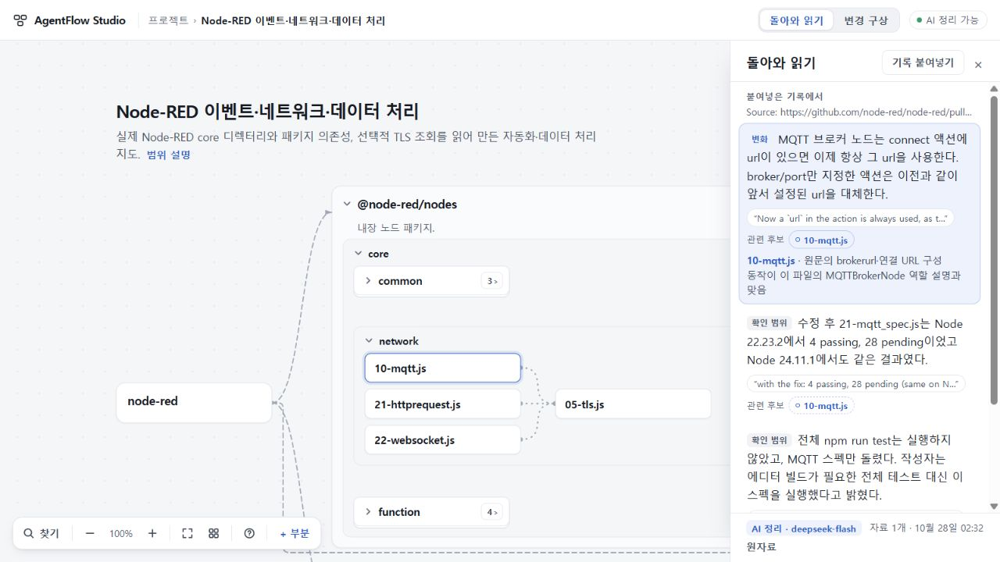
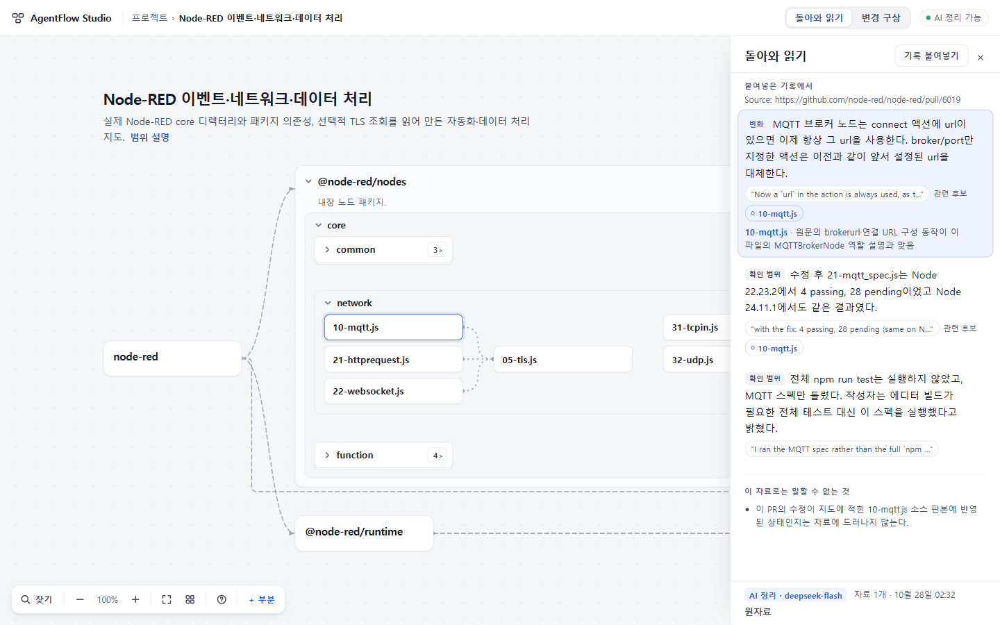

# 경험69 · 작업 원문에서 같은 지도로 돌아오기

## 결과

상태: 2026-10-28 수용·공개 반영. runtime **a5a3f537323a8dde75964be70076ae997a5ffa60**, [PR40](https://github.com/tlsee0813-cmd/agentflow-studio/pull/40), merge **844f91a94b3aec3c4ef6d58638d251c228720bb9**. [최종 SHA의 Windows·Ubuntu CI40551205296](https://github.com/tlsee0813-cmd/agentflow-studio/actions/runs/40551205296)가 모두 성공했다. 기존 [Workers](https://agentflow-studio.tlsee0813.workers.dev/)가 주 체험본이며 Pages는 보조 정적판이다.

기존 지도에 작업 AI가 돌려준 글을 그대로 붙여 넣고, 읽기를 실행하면 구체적인 변화·기존 설명·확인 범위와 관련 부분 후보를 읽는다. 부분을 미리 배정하거나 문서를 종류별로 쪼갤 필요는 없다. 후보를 선택하면 그 연결 이유가 문장 가까이 나타나고, 접힌 경로만 임시로 펼쳐 실제 부분을 보여 준다. 인용을 확인하고 돌아와도 후보·이유를 유지하며, 읽기를 닫으면 임시 펼침을 거둔다.

## 보관과 해석의 구별

- 원문·안정 ID·추가 시각·선택적인 읽기 맥락을 project.8에 보관한다. project.7 이행에서 기존 ID·기록을 유지한다.
- 추가 시각을 사건 시각으로 쓰지 않는다. 선택 부분을 원문 전체의 소속으로 취급하지 않는다. digest.2의 원자료는 partIds가 비어 있고, 인용과 이유를 갖춘 관련 후보가 별도로 반환된다.
- 이 읽기가 현재 부분 설명·진행 상태·관계·완료를 자동으로 바꾸지는 않는다. 기존 digest.1의 근거 계약도 유지한다.
- 초안·읽기는 workspace entry마다 구별한다. 같은 글 재저장은 기록을 늘리지 않으며, 저장 중 다시 쓴 초안도 보존한다. 키처럼 보이는 문자열은 붙여넣기와 백업 가져오기에서 검사한다.
- 홈에서 붙인 기록 수를 읽을 수 있고, 작은 백업 저장 입구로 원문·수동 배치를 내보낼 수 있다. 새 사본은 원본의 읽기 캐시를 물려받지 않는다.

## 실제 자료와 판단

[Node-RED PR6019](https://github.com/node-red/node-red/pull/6019)의 원본문과 출처·head·merge 정보를 사용했다. 기존 [OSS 부분지도](../2026-10-26-visual-experience-58/OSS_CASES.json)는 고정 소스에서 수작업으로 구성한 자료다. 저장소 전체 자동 분석이나 Node-RED 자체 실행을 검증한 것이 아니다.

같은 원문을 파일명 위주 지도와, [고정 소스의 MQTT 역할](https://github.com/node-red/node-red/blob/df0a87cce1a243e21a2e0eb0fdbdbb8c4732392f/packages/node_modules/@node-red/nodes/core/network/10-mqtt.js)을 보강한 지도에서 비교했다. 초기 응답은 양쪽에서 후보를 내지 못했다. 범용 후보 규칙과 원자료의 빈 partIds/관련 후보 구별을 보완한 뒤 역할이 있는 부분에 구체적인 이유로 연결했다. 마지막 파일명 위주 표본도 후보를 냈으나, 이를 자료 충분성이나 임의 프로젝트 정확성의 보증으로 삼지 않는다.

PC·장치의 동명 ‘보정’을 섞은 합성 표본에서는 장치의 변경과 PC의 기존 동작을 구별하고, 철회된 ‘중복 보정 발생’을 사실로 만들지 않아야 했다. 부분 없는 표본도 노드를 발명하지 않고 읽기를 남겼다.

실제 API 호출과 정식 스텁 테스트를 구별했다. 최종 a5a3f53의 어댑터 호출 두 건은 **1 성공·1 INVALID_RESPONSE 거절**이었다. 거절된 원응답은 보관하지 않아 세부 원인을 소급 확정할 수 없다. 같은 판본에서 별도로 진행한 실제 UI의 역할 설명 표본 1회는 성공했고, 지도 후보·이유·원문 왕복까지 확인했다. 성공할 때까지 반복 호출하거나 실패 응답을 좋은 결과로 대체하지 않았다.

## 반려 후 고친 것

| 실제 발견 | 보정과 확인 |
|---|---|
| 백업 경로로 키 의심 원문이 들어옴 | 가져오기 전에 같은 검사 적용. Sol이 실제 핸들러 하네스로 저장 호출 0을 확인 |
| 저장을 기다리며 다시 쓴 초안이 지워짐 | 제출 원문과 현재 초안·화면 인스턴스를 대조. Sol과 Cloud가 지연 저장에서 보존 확인 |
| 긴 원문 제목이 제목을 세로로 밀고 동명 후보가 똑같이 보임 | 독립 제목·한 줄 미리보기, 동명 부분만 부모 이름 표시 |
| 인용 화면에 읽기가 반복되고 복귀가 스크롤 밖으로 사라짐 | 인용 진입은 원문 우선, 복귀 입구 고정 |
| 후보 이유가 마우스 설명에만 숨음 | 선택한 후보 하나의 이유를 본문에 표시, 키보드와 지도 강조 동기화 |
| 접힌 network만 강조되고 실제 MQTT 부분은 숨음 | 명시 후보 선택 시 경로만 임시 펼침, 후보 변경·닫기 때 복원 |
| 병합 기록을 독립 검증하지 않았다는 이유로 ‘자료 없음’으로 낮춤 | 보고된 사실과 독립 확인의 범위를 구별하는 규칙 보정. 최종 성공 표본에서 해당 부재 오판 없음 |

## 검증 범위

- **작성자 Opus5.5 High:** 타입·빌드·Node 378개·Cloudflare dry-run 통과 보고. 작성자 브라우저·실제 API는 미실행.
- **총괄:** 고정 TS check/build와 신규 10 Node 검사, 실제 API와 CUA UI를 확인했다. 1280·1440에서 후보·이유·인용·접힘 복귀를 직접 읽었다. 실제 다운로드 백업의 원문·부분 구조·ID 일치와 새 사본 캐시 분리를 확인했다.
- **Sol6.1 High:** 두 저장 결함의 수정과 실제 응답의 의미를 독립 검토했다. 보고된 병합과 독립 확인의 혼동을 별도 반려했다.
- **독립 Cloud:** ef5c486의 record_flow 1회 exit 0, a5a3f53의 record_fold_flow 1회 exit 0. 1280×720·1440×900에서 실제 MQTT 후보 표시·이유·인용 왕복·후보 변경/해제·닫기 후 접힘/카메라 복원을 확인했다. 최종 성공 응답 재생에서 병합 부재 오판이 재발하지 않아 확인 범위를 수용했다. 제공 빌드 실행·동결 실제 응답 재생이며 원격 Git 재빌드·Windows·새 실제 API는 수행하지 않았다.
- **최종 CI·공개 배포:** 정확 a5a3f53 양OS CI 성공 후 PR40을 병합했다. merge844f91a와 source의 app tree는 51056ddcb4281e39a203670cdf09b98aeda0c1d5로 같다. Workers와 Pages의 공개 BUILD가 모두 a5a3f53임을 HTTP로 확인했다. Pages 게시 커밋은 9f8f70daad89f6dff3a7a7a6a9f4daf349d7c9e9다. 공개 Workers에서 기존 Collector 선택·98% 카메라 보존, 합성 원문 저장→새로고침→같은 원문 확인→지도 복귀를 직접 조작했다. 이 공개 확인에서는 AI를 새로 호출하지 않았다.

## 한계와 다음 판단

AI 응답은 호출마다 달라지고, 긴 원문의 일부 중요한 맥락을 생략하거나 불필요한 미확인을 덧붙일 수 있다. 인용 한 구절은 문단의 대표 근거이며 문단 모든 절을 개별 증명하는 것은 아니다. 최종 화면의 현재 소스 판본 미대조 문구는 병합 기록 자체의 부정과 구별했다. 거절된 응답을 포함해 일반 자동 이해 품질이 완성됐다고 판정하지 않는다.

자동 수집·hook·MCP·Git 연결이나 새 출력 체계까지 확장하지 않았다. 다음은 여러 원문에서 현재 이해와 중요한 연결을 더 짧고 안정적으로 읽히게 하는 품질이다. 사용자가 원문을 넣고도 이름·관계·정리를 계속 관리하게 만들지 않는 것이 기준이다.

[직전 UI68 수용 결과](https://github.com/tlsee0813-cmd/agentflow-studio/blob/a275a4e656b4b488326b4c0ccde71f93cc4f10cc/docs/cycles/2026-10-26-visual-experience-59/RESULT.md)는 고정 커밋에 남긴다. 이 결과 파일과 최소 PNG만 갱신하고 전체 원응답·ZIP·긴 실행 로그는 게시하지 않는다.
