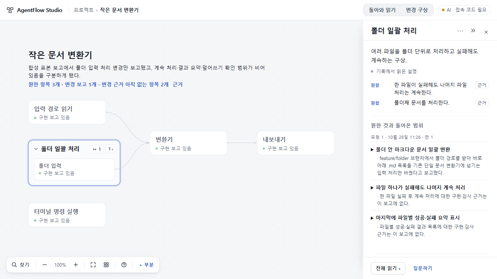
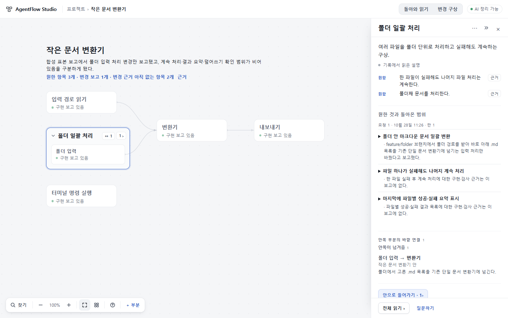

# 경험70–71 · 기록에서 지도를 만들고 돌아온 범위를 비교하기

## 결과

**후속 72 상태(공개 배포와 구별):** 인용에서 돌아올 때 같은 요청 항목의 펼침·스크롤·포커스를 복원하고, 홈의 이어가기를 프로젝트 사본별로 보존하는 [PR42](https://github.com/tlsee0813-cmd/agentflow-studio/pull/42)를 병합했다. 최종 `9b5ee83bae19ec913cfa05376146b1846e2f4465`의 [양OS CI40627927953](https://github.com/tlsee0813-cmd/agentflow-studio/actions/runs/40627927953) 성공, merge `299d64328c3ef176db0537893d73b2567be5fde8`와 app tree `804b4c5c43208eec9700c02ce22240737a07561e` 동일. Node 413개와 정식 브라우저 검사를 CI에서 실행했다. 총괄은 1280 읽기면·1440 전체 읽기에서 저장된 실제 응답의 두 번째 인용 왕복, 원본/사본의 서로 다른 마지막 위치와 내부 선택 복원을 직접 조작했다. 독립 Sol의 좁은 복원 검사와 구형 백업 대조는 별도 근거이며 새 AI 실행이나 사람 사용성 검사가 아니다. 초기 CI 두 건은 신규 회귀의 예제 이름·묶음 선택자 오류로 실패했고 테스트만 수정한 뒤 최종 SHA에서 통과했다. 공개본은 아래 71이다.

**다음 수용 전 해결할 실제 반례:** 공개 71에서 첫 모델 응답을 저장한 다음 정정 기록 하나만 읽혔을 때, 세 항목의 ‘아직 미구현’ 보고가 ‘변경 보고 3개·근거 없는 항목 0개’로 집계됐다. 지도에도 긍정적으로 읽히는 ‘구현 보고 있음’이 남았다. 이는 변환기 실행 결과가 아니라 합성 개발 기록을 처리한 실제 AI/UI 결과다. 73은 유형과 변경 진술, 현재와 철회 이력을 분리한다. 별도로 실제 AgentFlow 개발 지시를 빈 프로젝트에 입력한 첫 지도 시도는 근거 규칙 오류로 거절됐다. 원문은 보존됐으며 동일 입력의 진단 호출로 원인을 좁히고 있다. 두 문제를 숨긴 채 전체 흐름 완성으로 판정하지 않는다.

2026-10-28 수용·공개 반영. runtime **4e160961b7234fa96cd4642883f73d48d7396226**, [PR41](https://github.com/tlsee0813-cmd/agentflow-studio/pull/41), merge **1b808a7f8d79ae44d608077a25080db92a88d4ff**. [정확 SHA의 Windows·Ubuntu CI40623643262](https://github.com/tlsee0813-cmd/agentflow-studio/actions/runs/40623643262)가 모두 성공했다. source와 merge의 app tree는 `4d847c5932ac87dbde3e76ca0ac67248515a6586`로 같다. [Workers](https://agentflow-studio.tlsee0813.workers.dev/)가 주 체험본이고 Pages는 보조 정적판이다. 양쪽 공개 BUILD의 source 일치를 확인했다.

이제 빈 내 프로젝트에 원문을 보관하고 읽기를 실행하면, 인용 근거를 가진 첫 지도와 부분 설명이 생긴다. 후속 기록은 같은 부분에 이어지고 사용자가 바꾼 이름·배치·초안을 보존한다. 변경 구상에서 만든 요청문은 당시의 항목·설명·자료를 고정한다. 돌아온 보고를 다시 항목별로 나누어 입력하지 않아도, 원한 것·보고된 것·근거가 아직 없는 범위를 같은 지도에서 비교한다.

**이는 전체 목표의 종료 선언이 아니다.** 인용 복귀 때의 펼침/스크롤 보존과 순차 정정의 현재 판단 반영, 실제 AI의 긴 대기는 다음 집중 범위다.

## 직접 볼 수 있는 표본

[표준 백업 JSON](request71-sample.json)을 내려받아 홈의 **백업 파일 가져오기**로 연다. **전체 보기 → 폴더 일괄 처리 → 첫 요청 항목 → 근거 → 이름 있는 복귀**를 따라가면 된다. 새 AI 호출 없이 저장된 실제 모델 응답을 읽을 수 있다.

이 파일은 총괄이 실제 UI에서 생성·내보낸 백업이다. **변환기 개발 원문 자체는 합성**이고, 부분 보고를 실제 구현·검사 결과로 주장하지 않는다. 첫 지도·요청 분석·돌아온 보고 읽기는 실제 DeepSeek 출력이다. 파일에는 고정 요청과 원문·읽기·배치가 있고 비밀키나 접속 코드는 없다. 기존 프로젝트와 별도 사본으로 가져온다.

## 바뀐 판단과 동작

- **첫 지도와 갱신:** 사전에 만든 부분 목록을 요구하지 않는다. 원문에서 읽은 설명은 사용자 설명과 구별하고, 같은 기록의 재독으로 구조를 중복 만들지 않는다. 인사나 자료 없는 구절로 가짜 구조를 만들지 않는다.
- **근거와 판본:** 원문 구간·인용을 검사하고, 보고·코드 자료·검사 자료를 구별한다. feature 브랜치의 보고를 main 반영이나 완료로 승격하지 않는다. 모호한 동일성이나 요청 대응은 후보로 남는다.
- **요청과 돌아온 범위:** 한 항목의 보고로 전체 요청을 완료 처리하지 않는다. 부분 읽기면에는 그 부분과 관계있는 대응만 표시하고, 무관한 구절은 모든 부분에 정정 폼으로 퍼뜨리지 않는다. 실제 보고가 있는 요청을 빈 새 요청보다 먼저 읽게 한다.
- **긴 요청과 복구:** 전송용 요청 문맥은 축약하되 고정 원본은 보존한다. 한도를 넘으면 몰래 지도 전용 읽기로 바꾸지 않는다. 사용자가 요청을 골라 대조하거나 명시적으로 지도만 정리할 수 있으며, 이후 원문을 요청별로 다시 대조할 수 있다.
- **재독과 시간:** 요청 생성 전에 붙인 자료는 그 요청의 후속 반환으로 승격하지 않는다. 붙인 시각은 작성 시각이 아니다. 이미 지도에 읽은 구간은 재대조 때 지도 효과를 다시 적용하지 않고, 새 구간은 정상 반영한다.
- **이전 자료:** 구형 요청문은 고정 범위를 지어내어 채우지 않고 기존 직접 기록 경로를 유지한다. 기존 원문·ID·사용자 정정/제외를 보존한다.

## 실제 AI와 교차 자료

70에서 공개 micro-javascript와 Zephyr의 고정 문서·코드 발췌, Node-RED 원문, 합성 변환기와 인사 표본을 사용했다. 첫 지도와 후속 갱신을 실제 API로 실행했다. 저장소 전체 자동 분석이나 해당 OSS 자체 실행이 아니다. 초기 길이 제한·인용 불일치·후속 INVALID_RESPONSE 실패는 성공 응답으로 대체하지 않았다.

71의 최종 의미 검토에는 다음 실제 호출을 구별해 사용했다.

| 표본 | 확인한 것 | 한계 |
|---|---|---|
| 부분 feature 보고 | 3개 요청 중 입력 처리만 보고됨, main 미병합·검사 범위 구별 | 합성 원문. 1f3 응답 74.6초 |
| 식별자 없는 두 요청 | 두 후보 유지, 자동 확정 target 없음 | 합성 원문. 1f3 응답 49.1초 |
| 이전 요청을 지정한 늦은 보고와 검사 주장 철회 | 이전 RQ의 해당 항목만 연결, 입력 변경 보고 유지·전체 PDF 검사 통과 철회 | 최종4e 응답 73.896초. 두 원문을 **함께 한 번** 읽었으며 순차 두 번 갱신 시험은 아님 |
| 실제 UI 왕복 | 새 요청 생성 → 보고 저장 → 지도 갱신 → 정확 인용 → 같은 부분 복귀·F5 | 서버1f3 프롬프트/클라이언트f372에서 실행. 최종4e 화면은 저장 응답 재생으로 별도 확인 |

Sol 독립 의미 검토는 원문·인용·offset·적용 결과를 대조했다. 최종 표본에서 확정 P1/P2는 없었다. 일반 자동 이해 정확성이나 임의 프로젝트 품질 보증으로 확대하지 않는다.

## 반려 후 수정과 검증

독립 Claude는 최초 후보에서 요청 문맥 초과로 대조가 꺼지는 문제, 무관한 구절이 부분마다 퍼지는 문제, 구형 요청의 막힌 경로를 반려했다. 후속에서는 요청 전 자료의 잘못된 승격과 요청 9개 이후 지도 갱신 차단을 발견했다. 총괄 실제 UI는 서버 m2 프롬프트를 클라이언트가 받지 못하는 연결 결함을 찾아냈다. 모두 좁게 수정했다.

- **작성자:** Claude의 70 구현과 Sol6.1 High의 71 구현을 결합. 고정 TypeScript check/build와 최종 413 Node 검사 통과.
- **총괄 실제 실행:** 실제 API, 1280·1440 지도/부분 읽기, 인용 왕복, 새로고침·초안 보존. 공개 Workers에서는 최종 표준 백업 가져오기→부분 선택→새로고침 보존과 접속 코드 필요 표시를 확인했다. 공개 확인에서 추가 AI를 호출하지 않았다.
- **독립 Claude Opus5.5 High:** 최종 제공 빌드의 ZIP/183 payload 해시와 source128파일을 대조. converter 1280·1440, microJS1440에서 직접 화면 조작·인용 복귀·새로고침을 확인하고 수용. 제공 빌드 request71 17/17 통과. 새 AI 호출, 정식 전체 브라우저 suite, 9개 요청의 UI 경로는 미실행이며 소스 판정과 구별했다.
- **최종 CI:** Windows와 Ubuntu에서 정식 빌드·브라우저 흐름 성공. 중간 Ubuntu 실패는 연속 스텁 호출의 분당 한도였다. 11번째 호출의 429를 직접 재현하고 테스트 서버만 120/min으로 분리했다. 운영 기본 10/min과 실제 화면 단언은 유지했다.
- **채널 구별:** Cloud는 DNS 오류로 새 작업 미접수였다. 독립 화면 역할은 새 계정 Claude에서 수행했으며 Cloud 실행으로 표기하지 않는다. Pro의 공식 제품 메커니즘 조사는 첫 이해/사용자 수정 보존에 참고했고 실제 제품 화면 검증과 구별한다.

## 남는 대가와 다음 범위

인용에서 복귀하면 같은 부분·카메라는 돌아오지만 펼친 요청 항목과 읽기면 스크롤은 초기화된다. 구절마다 반복되는 정정 입구도 무겁다. 홈의 이어가기는 범위 복귀와 부분 선택 복귀가 일치하는지 더 확인한다.

순차적으로 저장된 검사 주장에 나중 철회가 도착했을 때, 이력을 남기면서 현재 판단을 명확히 읽게 하는 경험은 아직 별도로 확인해야 한다. 함께 읽은 두 원문의 성공으로 이를 대체하지 않는다. AI 응답 49~75초와 간헐적 응답 거절도 남는다.

자동 수집·hook·MCP·계정 설정은 이번 범위가 아니다. 코드와 작은 재현 백업·PNG 두 장만 공유하며 전체 응답 JSON·실행 로그·ZIP은 공개 저장소에 쌓지 않는다. [직전69 수용 결과](https://github.com/tlsee0813-cmd/agentflow-studio/blob/d05593b23ee888a1655e9d789592779c6928001e/docs/cycles/2026-10-26-visual-experience-59/RESULT.md)는 고정 커밋에 보존한다.
