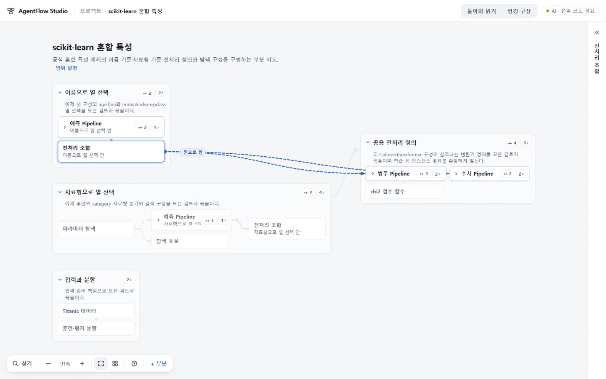

# UI67 독립 검토 · 2026-10-28

검토 대상: `work/experience67-polish`의 **71883f3f0c8e5f558a7bbbea3eacc57306cc26ad**. 비교 기준: **0cfb4f6c8a3e98880cf3bf034d87369ba42f6554**. 작성자 보고를 그대로 수용하지 않고 총괄 실행·화면 검토와 Sol6.1 High 두 명의 읽기 전용 검토를 결합했다.

**판정: 개선 방향은 수용할 만하지만, 아래 네 결함을 고치기 전 병합·배포는 보류한다.** 제품 코드를 수정하지 않았으며 공개 수용본은 UI66이다. 이 문서는 배포 승인이나 전체 제품 완성 판정이 아니다.

## 수정할 결함

### 1. P2 · 백업을 새 사본으로 가져와도 원본 배치가 바뀐다

- 위치: [app.ts:1878–1880](https://github.com/tlsee0813-cmd/agentflow-studio/blob/71883f3f0c8e5f558a7bbbea3eacc57306cc26ad/app/continuity/src/client/app.ts#L1878).
- 재현 조건: 기존 프로젝트에서 위치를 옮긴 뒤 그 프로젝트의 예전 위치를 담은 백업을 새 사본으로 가져온다.
- `WorkspaceStore.create`는 새 `entryId`를 만들지만 `project.id`는 보존한다. 이번 가져오기 코드가 `memoryPositions[project.id]`와 영구 저장의 같은 키를 교체하므로, 새 사본뿐 아니라 기존 원본이 읽는 위치도 예전 값으로 바뀐다.
- 독립 Node 실행에서 서로 다른 두 entry의 project ID가 같고 가져오기 후 원본의 위치 조회도 바뀜을 확인했다. 이번 검토에서 실제 파일 가져오기부터 드래그까지의 브라우저 재현으로 세지는 않는다.
- 수정 방향: 배치를 workspace entry별로 격리하고 기존 배치의 이전 규칙을 마련한다. 원본/사본을 번갈아 열어도 위치가 독립적이어야 한다. 기존에도 복제 프로젝트가 배치 키를 공유하던 문제는 있었지만, 백업 가져오기로 원본 위치를 즉시 덮는 경로는 이번에 추가됐다.

### 2. P2 · 외부 백업의 위치 키가 공용 객체를 오염시킨다

- 위치: [validation.ts:518–520](https://github.com/tlsee0813-cmd/agentflow-studio/blob/71883f3f0c8e5f558a7bbbea3eacc57306cc26ad/app/continuity/src/shared/validation.ts#L518), 위 가져오기 경로의 `cleanPositions`.
- `positions`의 컨테이너 키 `__proto__`와 내부 키 `toString`을 검증이 허용한다. `cleanPositions`의 일반 객체에 값을 넣으면 상속된 `Object.prototype`을 수정한다.
- 유효한 예제 프로젝트에 이 위치 자료를 붙여 `parseBackup`을 실행하고, 정확한 소스에서 추출한 `cleanPositions`를 별도 Node 프로세스에서 실행했다. 검증을 통과했고 `Object.prototype.toString`이 객체로 바뀌어 `String({})`가 `Cannot convert object to primitive value`로 실패했다. 총괄과 보조가 각각 확인했다.
- 수정 방향: 허용할 컨테이너/부분 키를 검증하고 상속 프로퍼티를 경유하지 않는 사전을 쓴다. 실제 코드 실행·키 유출까지 확인한 것은 아니다. 백업 입력으로 앱 동작을 훼손할 수 있는 검증 결함이다.

### 3. P2 · 선택한 관계가 포함된 집계선에서 나머지 관계도 사라진다

- 위치: [app.ts:1299–1300](https://github.com/tlsee0813-cmd/agentflow-studio/blob/71883f3f0c8e5f558a7bbbea3eacc57306cc26ad/app/continuity/src/client/app.ts#L1299), [styles.css:1077–1078](https://github.com/tlsee0813-cmd/agentflow-studio/blob/71883f3f0c8e5f558a7bbbea3eacc57306cc26ad/app/continuity/public/styles.css#L1077).
- Collector 개요에서 `수신 설정 ID`를 선택한다. 12개 관계의 집계선에 선택 관계가 하나라도 있으면 그 집계선 전체를 숨기고, 선택 관계 4개만 개별선으로 남긴다. 나머지 8개는 개별선도 집계선도 보이지 않는다.
- 총괄이 1280×720에서 실제 선택 후 화면과 DOM의 `display:none`을 확인했다. 보조는 Collector와 Zephyr 자료로 관계 ID를 대조했다.
- 수정 방향: 선택된 관계를 뺀 나머지를 집계해 남긴다. 기존 수치 12를 그대로 남겨 중복 계산하는 것도 피한다. 선택 해제 시 원래 집계가 돌아와야 한다. 작성자가 의도한 ‘나머지 관계는 흐린 집계선’이 현재는 일부 관계에서 성립하지 않는다.

### 4. P2 · 경로를 못 찾으면 관계선이 무관한 카드 뒤를 통과한다

- 위치: [map-layout.ts:442–474](https://github.com/tlsee0813-cmd/agentflow-studio/blob/71883f3f0c8e5f558a7bbbea3eacc57306cc26ad/app/continuity/src/client/map-layout.ts#L442).
- scikit-learn 자료를 1440×900에서 열고 이름 기준 `전처리 조합`을 선택한 뒤 읽기면을 접고 전체 보기를 한다. `수치 Pipeline`으로 향한 선이 `범주 Pipeline` 카드 뒤로 들어간다. 중간 카드가 경유 대상인 것처럼 오해하거나 연결을 놓칠 수 있다.
- 총괄이 화면과 SVG 경로를 확인했다. 화면의 경로는 `M293,177 C663.5,177 663.5,234 1034,234`였다. 보조는 동일한 상자 좌표에서 기준 알고리즘과 후보 알고리즘을 비교했고 새 회피 제약 이후 fallback 곡선이 이 무관한 카드와 교차함을 확인했다. 기준 알고리즘도 조상 제목을 지나는 경우가 있어 전체 라우팅이 완벽했다고 주장하지 않는다.
- 수정 방향: 제목 영역 회피를 유지하면서 fallback도 다른 카드와 교차하지 않게 한다. Collector 한 사례만 통과하는 경로 검사를 scikit의 이 반례까지 넓힌다.

## 유지할 개선과 제품 판단

- Collector 개요의 수가 붙은 묶음 간 집계선은 옛 점선 다발보다 읽기 쉽다.
- VS Code 1280 첫 화면에서 최상위 9개 묶음이 모두 접혀, 가장 작은 묶음만 임의로 강조되던 모습이 사라졌다. 이 사례는 100%로 열렸고, 60%는 모든 큰 지도에 강제로 적용되는 값이 아니다.
- 읽기면을 레일로 접어 지도 공간을 확보하는 동작은 실제로 작동한다.
- scikit에서 직접 접은 `자료형으로 열 선택`과 카메라가 새로고침 뒤 유지됐다. 전후 모두 `translate(218.579px, 192.203px) scale(0.762195)`였고 접힘도 유지됐다.
- 미용실에서 관계 제목을 도착 지점 곁에 놓는 것은 이전 중앙 중첩보다 낫다. 모든 자료·배치에서 겹침이 해소됐다는 판정은 아니다.
- **개요의 ‘연결이 몇 개 있다’와 ‘무엇이 어떻게 연결된다’는 아직 다르다.** 집계는 효과적이지만 다음 조정은 숫자 장식 추가보다 선택 전 의미와 선택 후 주변 맥락의 연속성에 집중하는 편이 맞다. 이번 변경을 전면 폐기할 이유는 없다.

## 검증 범위

| 구분 | 이번에 확인한 것 |
| --- | --- |
| 총괄 독립 실행 | 저장소 고정 TypeScript 5.8.3 타입·구문·클라이언트 경계 검사 통과, 정식 build 및 static preview build 통과, Node **361/361** 통과 |
| 작성자 타입 오류 주장 | TS6의 `bindNewProject` 오류는 고정 TS5.8.3에서 재현되지 않음. 제품 결함으로 집계하지 않음 |
| 총괄 직접 PC 화면 | 미용실·Collector·scikit-learn·VS Code의 관련 장면. 1280×720 및 scikit 1440×900. 모든 사례×모든 해상도 전수 검증은 아님 |
| 읽기 전용 보조 2명 | 상태·백업 / 관계 집계·경로를 분담. 관계 ID·방향·바깥 끝점 및 기존 8개 OSS 자료의 여러 펼침/범위 조합 검사. 앱 수정 없음 |
| 원격 상태 조회 | 정확 후보 SHA의 GitHub combined statuses 및 PR-triggered workflow 조회가 빈 목록 반환. 양OS 최종 CI 통과 근거로 삼을 수 없음 |
| 미실행 | Python Playwright 미설치로 `studio_browser.py` 정식 전체 스모크 미실행. 실제 AI 호출·Windows/Ubuntu 원격 CI·OSS 자체 빌드/실행 미실행 |

OSS 자료는 고정 공개 소스에서 구성한 부분 지도이며 자동 추출 품질이나 원본 프로그램 전체 동작을 검증한 것이 아니다. 기존 자료를 재사용했고 대형 저장소나 실행 환경을 새로 설치하지 않았다.

수용 전 필요한 일은 위 네 결함의 좁은 수정, 해당 반례 재확인, 최종 수정 SHA의 정식 브라우저 스모크와 양OS CI 확인이다. 새 기능이나 전면 재설계는 요구하지 않는다.
