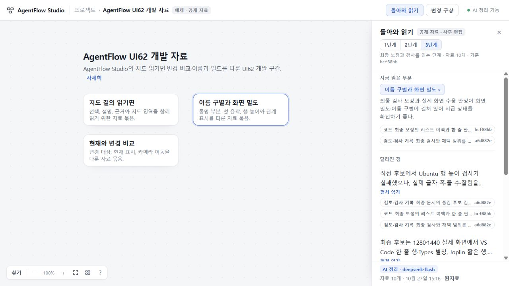
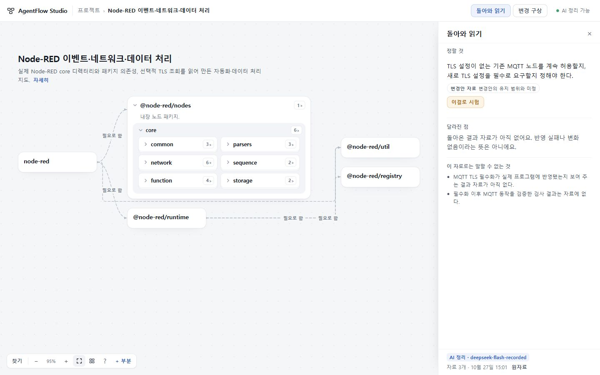

# 돌아와 읽기63 — 같은 지도에서 변화 이해와 다음 구상 잇기

2026-10-27. **수용·배포 완료.** 준비된 개발 자료에서 지금 읽을 부분과 남은 선택을 찾고, 같은 지도에서 근거를 확인한 뒤 기존 변경 초안으로 이어간다. 입력 연결기·출력 기능은 확장하지 않았다.

- 런타임 source: `3b28ac0133f7ad0fe82f44e287b0a7e75e4440ac`. [PR35](https://github.com/tlsee0813-cmd/agentflow-studio/pull/35) merge `20e2c87b964370bbc1a1f13b156f3d08a79188ec`와 app tree `c4242857a3edd009d6a34357ce6702f97cd043ef` 동일.
- [정확 SHA CI40459072191](https://github.com/tlsee0813-cmd/agentflow-studio/actions/runs/40459072191): Ubuntu122039127747·Windows122039127563 성공.
- [주 체험본](https://agentflow-studio.tlsee0813.workers.dev/#/p/ex-ui62)과 [보조 정적판](https://tlsee0813-cmd.github.io/agentflow-studio/)에 같은 source 반영. Pages commit `876652c7a879da9344bc2c6fa9747e4e5e992bd7`. 공개 BUILD 대조 결과는 아래 배포 확인에 남긴다.

## 사용자에게 달라진 경험

처음에는 **지금 읽을 부분 → 실제 남은 선택 → 달라진 점** 순서로 읽는다. 변화는 실제 응답 두 줄로 시작하고 선택한 문장만 펼쳐 지도와 연결한다. 검사 결과를 길게 자동으로 펼치지 않는다. 근거는 접힌 상태에서도 한 번에 열며, 자료 제목·종류·판본으로 구별한다.

‘이걸로 시험’은 문장과 결과 근거를 제안한다. 사용자가 수락하기 전에는 초안을 바꾸지 않으며, 기존 글이 있으면 끝에 덧붙인다. 사용자 발언·방향·변경안을 결과 보고로 바꿔 넣지 않는다. 원문에서 돌아오면 읽던 선택·스크롤·지도 위치가 남는다. 정리 결과로 프로젝트의 상태나 설명을 덮지 않는다.

같은 자료·모델·프롬프트의 정리는 재사용한다. 예제 정리는 탭 안에만 남고 내 프로젝트의 정리는 별도 보관한다. 전송은 UTF-8 바이트 한도를 따르며, 보낸 자료 수와 발췌 범위를 밝히고 인용용 원문은 보존한다. 이전 변경안 판본의 관찰을 새 항목의 결과로 연결하지 않는다.

## 자료와 실제 AI의 범위

[MATERIAL.json](MATERIAL.json)은 공개 commit과 최종 결과 문서에서 가져온 실제 발췌 10개를 사후 편집한 자료다. 지도 3부분은 편집 분류이고, 3단계는 자료를 나눠 읽는 순서다. 원래 대화·JSONL·실시간 수신·자동 구조 추출·당시 도착 순서의 재현이 아니다. S01도 사용자 발언 직접 인용이 아닌 방향 기록이다.

다른 형태는 [Node-RED 고정 OSS 부분지도](../2026-10-26-visual-experience-58/OSS_CASES.json)와 [기존 실제 AI 변경안](../2026-10-26-visual-experience-59/node-red-real-plan.json)으로 대조했다. MQTT TLS 필수화 요구 자체는 UI 검토용 합성 요구이며, 결과 보고는 없는 상태 그대로 사용했다. 가짜 report·return·anchor를 만들지 않았다.

[실제 DeepSeek 응답 4개](ACTUAL_RESPONSES.json)는 source440625a의 `deepseek-flash`·프롬프트 `d1-9dd94a4850d7`에서 받았다. 최종 source의 입력 어댑터·프롬프트·응답/캐시 계약은 동일하다. UI62에서 해소된 Ubuntu 실패와 검사 주체별 범위를 구별했고, Node-RED에서 결과 부재를 반영 실패로 만들지 않고 기존 MQTT 설정 처리라는 선택을 남겼다. 네 사례의 결과이며 일반 이해 정확성의 보증은 아니다.

## 검증과 통합 판단

| 구분 | 확인한 범위 |
| --- | --- |
| 작성자 | Claude Opus5.5 High의64220ef 백엔드와 같은 세션의 미커밋 UI를 회수했다. 작성자 한도 뒤 Sol6.1 High와 총괄이 계약·표현·입력 보존을 보정했다. 작성자 주장을 최종 독립 검증으로 세지 않는다. |
| 실제 모델 | 위4개 실제 호출과 총괄의 별도 실제 화면 호출. 정답 문장을 UI에 넣지 않았다. 긴 응답을 줄이려던 지시 변경은 중요한 실패가 뒤로 밀려 채택하지 않았다. |
| 독립 화면 | Cloud request2가 첫 화면의 긴 검사 나열·서로 같은 근거 이름을 보류했다. request3에서 d64827a의1280×720·1440×900 실제 조작과 PNG 열람 후 두 문제 해소를 수용했다. 실제 응답을 동결 재생했으며 Cloud가 모델을 새로 호출한 것은 아니다. |
| 독립 실행 | request3의 return_flow·return_failure_flow 성공. 최종3b28ac0의 request4는 기존 workspace_flow를1회 실행해 대상·근거·pan·키보드 복귀 성공. 제공 ZIP/파일 해시를 확인한 실행이며 원격 Git 재빌드와 구별한다. |
| 총괄 | 실제1280·1440 화면, 근거/부분 복귀, 접힌 근거 직접 접근, 키보드 선택, 제안 거절·덧붙임·수락 직후 즉시 편집을 확인했다. 최종 한 줄 초점 수정은 Cloud/CI 범위다. |
| CI | 최종 source를 직접 checkout한 양OS build·계약/HTTP·브라우저·정적/Worker 준비 검사 성공. 유료 모델은 스텁이다. |

CI에서 잡힌 두 입력 경합은 실제 코드를 수정했다. 제안 수락 뒤 커서 이동, 근거 복귀 뒤 초점 이동을 뒤 프레임으로 미루면 다음 입력을 가로챌 수 있어 해당 이벤트 안에서 완료하도록 했다. 대기 시간을 늘리거나 키보드·초안 단언을 완화하지 않았다. 원자료 수 기대도 유지 조건 자료의 실제 제목·원문까지 확인하도록 갱신했다.

Pro 비교에서 [Confluence 변화 요약](https://support.atlassian.com/confluence-cloud/docs/summarize-changes-with-atlassian-intelligence/), [Slack 근거 접근](https://slack.com/intl/en-nz/help/articles/25076892548883-Guide-to-AI-features-in-Slack), [Copilot의 새 문제·해결 구별](https://github.blog/changelog/2026-09-18-copilot-code-review-an-improved-review-experience/)을 참고했다. 이들의 소개 문서를 조사한 결과이며 AgentFlow 실행 증거는 위 표와 별개다.

## 남는 한계

펼친 모델 문장에는 구현·검사 나열이 길고 확인 공백이 반복되는 경우가 남는다. 이번 수용은 먼저 이해할 내용을 앞에 두고 필요한 상세만 펼치는 경험이다. 자료가 지도의 어느 부분과 관계되는지 근거가 없으면 표식을 만들지 않는다. 전체 자동 수집·연결·기억 갱신, 임의 대규모 프로젝트의 자동 이해, 설계 전체 완성을 뜻하지 않는다. 이전8종 OSS 화면 검토를 이번에 전부 다시 실행하지 않았으며, 이번에는 실제 개발 자료·Node-RED·변환기 왕복에 집중했다.

## 대표 화면

첫 화면은 최종3b28ac0 공개 Workers에서 새로 받은 실제 DeepSeek 응답이다. Node-RED 화면은 d64827a에서 기존 실제 모델 응답을 재생했다. 최종3b28ac0과의 차이는 기존 근거 복귀 초점 처리 한 줄이며 표시 내용과 배치는 같다.

## 배포 확인

2026-10-27 15:18 KST 확인. Workers와 Pages의 공개 BUILD.txt 모두 source `3b28ac0133f7ad0fe82f44e287b0a7e75e4440ac`로 일치했다. Workers 상태 API는 deepseek-flash·정리 프롬프트 d1-9dd94a4850d7·접속 코드 사용을 반환했다. 배포 전 공개40자산·17모듈에서 실제 비밀값 일치를 검사했으며 키는 Worker secret에 유지했다.

총괄이 공개 Workers의 최종 자료 단계에서 실제 모델 응답을 새로 받아 1280 화면으로 확인했다. 해소된 Ubuntu 실패·수용된 화면·미실행 강제 글꼴을 구별했고, 자료에 없는 최종 배포 결과는 추정하지 않았다. 코드 근거를 연 뒤 Esc로 같은 정리에 복귀했다. 이 공개 호출은 위 동결 응답4개 및 Cloud 재생과 별개다. 작성자/Cloud 작업 탭과 로컬 서버를 종료하고 최종 체험 탭 하나만 남겼다.

