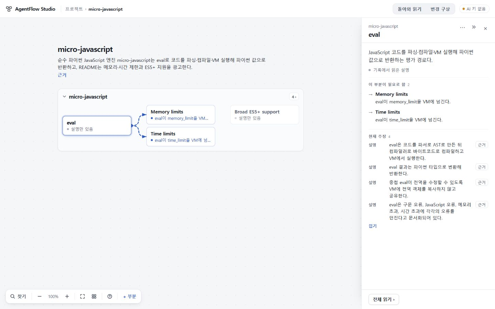
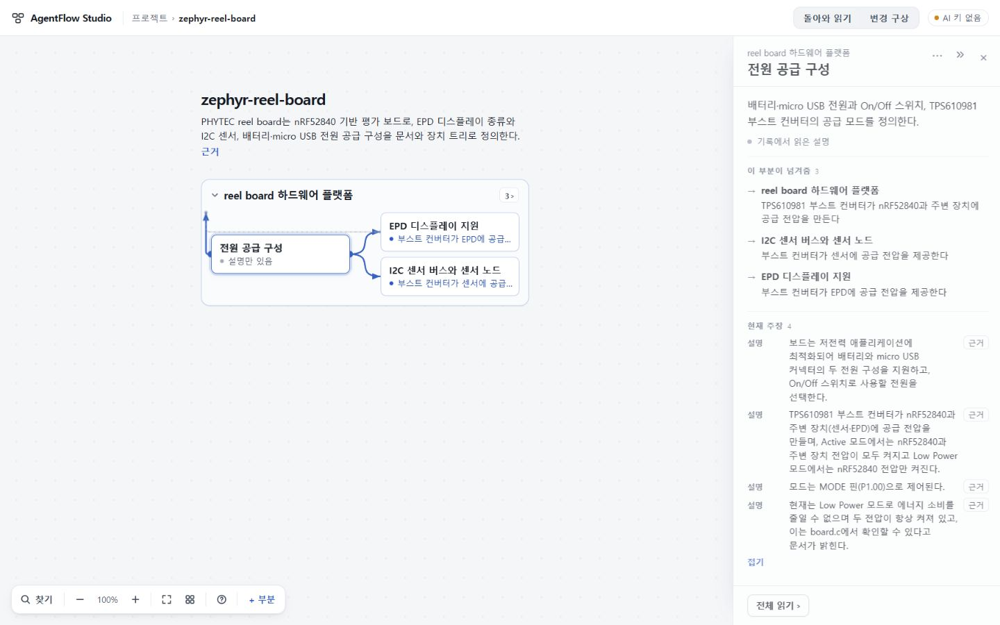
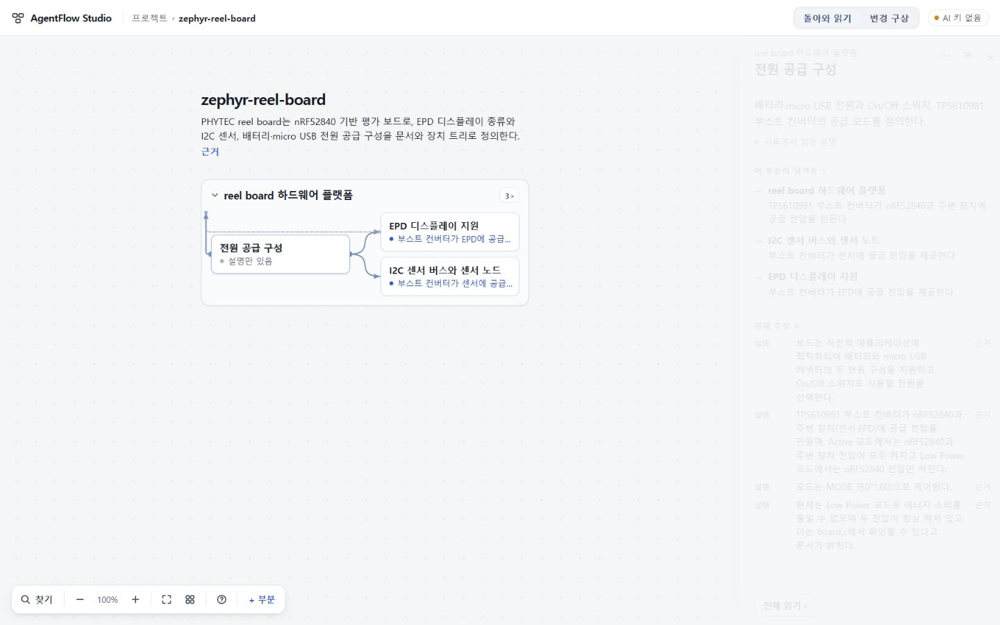

# 불확실성 계약76 — 검증 진행 결과

2026-10-29. 구현 기준 `c53949152d2d0495c0d4e944ca61a6caa53f6cd9`, [PR46](https://github.com/tlsee0813-cmd/agentflow-studio/pull/46). **명시 계약과 두 OSS 의미 검토는 통과했으나 실제 개발 지시는 전달에 실패했다. 전체 수용·병합·배포는 보류한다.** 공개 수용73은 그대로이며 UI75 최종 `693d0c7` 수리를 포함한다.

## 구현과 독립 검토

[선택한 계약](DECISION.md)을 map.6 / map-reading.5 / project.13에 구현했다. 미정 대상은 귀속·동일성·부모·성립으로 명시하며, 진술의 key·종류·본문·판본·근거를 보존한다. 새판의 모든 확정 진술은 고유 key가 필요하다. 같은 명시 대상의 확정/미정 동시 출력과 material/제품 근거 모순은 적용 전 전체 거절한다. 근거 구간이 겹친다는 이유로 독립 사실을 지우지 않는다. 구판 해석·저장은 그대로이고 과거 누락을 소급 복원하지 않는다.

독립 Sol의 첫 검토에서 후보 statement가 저장돼도 읽기면에 본문/원문 버튼이 없는 P2를 발견했다. c539에서 후보 목록에 진술과 정확 원문 버튼을 추가하고 같은 후보 포커스 복귀를 연결했다. 독립 delta 검토는 P1/P2 0건으로 이 수정을 수용했다. 동일 구간 인용은 하나, 다른 구간 및 같은 문장의 다른 좌표는 별개 버튼으로 남는다. 이는 compiled renderer/계약 검증이며 실제 브라우저 검증과 구별한다.

UI75의 지도 배치·복귀 모듈·public CSS는 최종693과 변경이 없다. app.ts의 후보 읽기 표시만 좁게 추가했다. 기존 부모에 대한 질문을 기존 구조 철회로 해석하지 않는다. 서로 다른 key로 같은 자연어 명제를 표현하는 의미 모순까지 자동 검출한다고 주장하지 않는다.

## 새 실제 응답

동일 원문 3개를 c539에서 각각 한 번 새로 요청했다. model deepseek-flash, thinking enabled / low, max_tokens 16384, timeout 90초를 유지했다. 과거 실패 응답 재적용이나 disabled/strict/단계 분리 재실험은 하지 않았다.

| 원자료 | 소요 | 응답 | 적용·의미 판정 |
|---|---:|---|---|
| 실제 개발 지시 | 85.758초 | length, completion 16384 / reasoning 15672 | INVALID_RESPONSE, 미적용. 전달 P2 미해결 |
| micro-javascript | 81.941초 | stop, completion 15815 / reasoning 14224 | 정상 저장, 이 표본의 핵심 의미 기준 통과 |
| Zephyr reel-board | 61.614초 | stop, completion 13717 / reasoning 11677 | 정상 저장, 이 표본의 핵심 의미 기준 통과 |

원본 hash는 실제 지시 `6c5bbfd44899c67e7478618a7d43bbbd69fd392598ef48bb160aafc81c8595b4`, micro `fd241de7ecfb12c663751b267b66942740cffb84c1334515270ea36d578c1fbe`, Zephyr `e2844df044db67829387ab9099534b07888e26321cf75092bbbda0ade21edae9`로 기존 입력과 같다.

독립 의미 검토는 원문→wire→decoded→적용→저장→현재 이해를 대조했다. 두 OSS의 32개 저장 진술이 현재 이해에 모두 남고 인용 36+33개가 원문과 일치했다. 숫자는 보존 대조이며 합격을 정하는 노드/진술 수가 아니다.

- micro: parse/AST→compile/bytecode→VM→Python 반환, globals 공유, 네 오류, 깊은 중첩·regex·Error 위치 한계를 보존한다.
- Zephyr: FAST/default·sleep, 두 display/controller/board designation 대응, 명목 전원 모드와 현재 always-on/절전 불가를 함께 보존한다.
- 실제 지시는 지도가 없어 의미 성공으로 판정하지 않는다. 두 OSS 성공을 세 원자료 전체 성공이나 운영 신뢰성으로 확대하지 않는다.

공개 문서/코드 발췌에 대한 실제 모델 응답이며 OSS 자체 실행·하드웨어 측정이 아니다. 비공개 실제 지시와 raw 응답·키는 공개하지 않는다.

재현용 [합성 후보 백업](synthetic-candidate-backup.json)은 실제 API나 개발 실행 결과가 아니다. 정상 가져오기 후 근거에서 두 미정 진술과 독립 PC 사실을 비교할 수 있다.

## 실행과 PC 화면

- 총괄: c539 고정 TypeScript 5.8.3 check/build exit 0. 앞선 f6 전체 Node473 통과는 그 SHA의 증거로 유지한다.
- [정확 c539 CI40711691279](https://github.com/tlsee0813-cmd/agentflow-studio/actions/runs/40711691279): completed/success. 작성자 Node476 통과 보고와 총괄 실행을 구별한다.
- 총괄 실제 브라우저: 합성 정상 백업의 두 후보 본문/종류/정확 원문→같은 후보 버튼 복귀, 독립 PC 정밀도 사실 보존. 새 micro eval의 넷째 주장 펼침→다문단 오류 원문→같은 근거 버튼 복귀. 새 Zephyr 전원의 절전 불가 원문→같은 넷째 버튼/펼침 복귀. 성공한 두 모델 응답은 수정 없이 정상 가져오기했다.
- 총괄 후반 화면은 실측 1440×900이다. viewport override 요청과 실제 적용값을 구별하며 1280 검증으로 재표기하지 않는다. 넓은 지도 여백, 영어/한국어 작명 혼재, 긴 설명의 읽기면 의존은 남는다.
- 독립 Cloud AF-CLOUD-20261029-76은 c539 검토를 완료했다. 계약/복귀/기존 UI75 회귀는 통과했으나 아래 읽기순서 P2를 발견해 시각 수용은 보류했다. 제공 Windows 빌드 ZIP `36e0dc2ab3e06439f151b4fa94f83b1273c272847eab680426ed8bdc207e016c`, 1,162,032 bytes, 206 entries/7 fixtures, manifest·CRC·실제 secret 값 스캔 통과. 양 PC 후보 왕복·두 OSS·UI75 두 회귀·legacy/repeat/history 최소 왕복을 확인했고 uncertainty76_flow 1회와 Playwright 검토 래퍼는 exit 0이다. Cloud 재빌드나 새 실제 API로 표시하지 않는다.

## Cloud 읽기순서 P2와 수리

Cloud는 Zephyr 전원 설명의 기본 세 주장에 명목 Low Power 동작이 있지만 실제 절전 불가/always-on 제한인 넷째 주장은 더보기 뒤에 숨는 문제를 양 PC에서 재현했다. 총괄은 P2를 수용했다. 자료 보존 성공만으로 사용자에게 올바른 이해가 전달됐다고 볼 수 없다.

수리 `eac7b08600588a4a8b9699adc1b63385536625a6`은 현재 주장의 개수 기준 접힘을 제거한다. 특정 단어나 네 번째 항목을 골라 올리지 않고 모든 현재 주장을 원래 순서로 연속 표시한다. 읽기면은 자연 스크롤하며 과거 이력은 기존 전체 읽기에 남는다. 관계 설명/전체 보기, 지도 배치·선 회피, 저장·모델 계약은 변경하지 않았다.

총괄 고정5.8.3 check/build exit0, context75의 5경로 검사 pass. 수정 빌드의 실제 Zephyr 저장본에서1440×900 기본4진술/추가버튼0/절전불가 정확원문/동일넷째버튼복귀를 직접 확인했다. 많은 현재 주장으로 읽기면이 길어지는 한계와1280 사용성은 독립 delta 확인 대상이며 아직 수용 완료로 표시하지 않는다. 새 모델 호출은 없다.

## 다음 설계

최우선 공백은 실제 개발 지시에서 오래 기다린 뒤 아무 지도도 전달되지 않는 것이다. Pro77 검토를 회수하고 기존69와 대조했다. 새 요약면·앵커 메모·같은 지도 재호출을 묶은 제안은 중복과 실패 은폐 위험 때문에 채택하지 않았다. 현69도 세 원자료 전문을 이미 전달하므로 전문 전송 자체가 새 가치는 아니다. 다음77은 요구·설명·보고·예문·명시 선택·해석 불확실성을 정확 발생 위치에 연결하는 작은 독립 읽기 계약의 가설만 실험한다. 기존 읽기면을 재사용하는 방향이며, Claude가70817dc에서 별도 work/experience77-first-reading의 docs/cycles 아래 standalone prototype을 작성 중이다. 제품 runtime/UI/기본 설정은 바꾸지 않는다. 기존 세 원자료 의미표와 반복 인용·문서 끝 제약 반례를 먼저 고정하고, 이후 새 계약만 각1회 평가한다. 기존 지도 호출은 반복하지 않는다. 첫 읽기가 성공해도 최종 지도 전달 실패를 해결했다고 판정하지 않는다. 단순 로딩 장식, 무조건 토큰 상향, 잘린 응답 수선, 실패 항목 삭제, 사용자 수동 분할로 해결했다고 보지 않는다. 전체 목표는 계속 진행한다.
