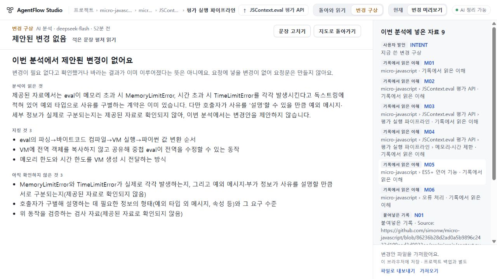

# 87 — 제안 없는 분석 옆에서 자료 읽기

2026-10-29. **총괄은 제안 없는 분석의 자료 읽기·복귀 범위를 수용한다.** runtime `2999fd65c67754bd7a0bd0d45f9fd841fd3956e5`, app tree `7beb4ba00211a1afd3b9549ef4eb08a55b2a8384`. [PR55](https://github.com/tlsee0813-cmd/agentflow-studio/pull/55)는 draft·미병합·미배포다. 공개73과 UI75 최종693의 계승을 유지한다.

## 읽는 경험의 변화

85 실제 응답에서 변경 제안이 없으면 오른쪽에는 비활성 요청 영역이 남고 자료 입구는 긴 왼쪽 본문 아래에 있었다. 이제 왼쪽에서 분석의 설명·지킬 것·미확인을 읽으면서 오른쪽에서 그 분석에 넣었던 자료를 연다. ID·종류·전체 제목·원래 순서는 그대로이며 원문을 읽은 뒤 같은 목록 위치와 입구로 돌아온다. 문장별 근거 확인 또는 변경 불필요의 검증을 뜻하지 않는다는 설명도 유지한다.

이 목록은 동결된 `plan.evidence`다. 나중에 고친 초안과 새로 붙인 자료는 다음 분석의 입력 관리에서 따로 읽는다. 양수 변경안의 선택이0인 상태는 여전히 요청 선택 화면이며, 제안 자체가 없는 상태와 구별한다. 과거 요청문과 반환 기록은 만든 때 그대로 열 수 있다. API·prompt·저장 계약·모델 응답은 바뀌지 않았다.

1280×720에서는 원문 URL이 긴 N01/N02와 과거 요청 입구를 보려면 오른쪽 목록을 스크롤해야 한다. 제목을 줄이거나 임의로 순서를 바꾸지는 않았다. 빈 공간 감소, 작은 검사 통과 또는 이 한 장면을 사람 사용성의 전체 완성으로 세지 않는다.

## 실제로 발견하고 수리한 복귀 결함

초기 `e0ef0ba`에서 독립 코드 검토가 과거 반환 복귀의 누락을 찾았다. 총괄은 기존 Cloud85 합성 검토 묶음을 정상 파일 가져오기로 재사용해 같은 PC에서 재현했다. 목록 끝387.2px에서 돌아온 기록을 펼쳐 읽은 뒤 Back/Esc로 복귀하면0px와 BODY 초점으로 돌아갔다. 당시 CI도 통과했으므로 검사 통과만으로 수용하지 않았다.

최종 `2999fd6`은 원문·돌아온 기록·다음 입력 자료 관리로 떠나는 입구와 목록 위치를 탭 안에서만 기억한다. 총괄의 수리 후 관측에서는 반환 Back/Esc, 입력 관리 Esc/토글 닫기가 각각364.8px와 실제 누른 버튼으로 복귀했다. 두 관측의 위치 차이는 새로고침 후 가져오기 안내가 사라진 화면 높이 차이이며, 각 관측은 자신의 전후 위치로 비교했다. 정상 내보내기로 대조한 과거 요청·보고 bundle 전체가 동일했다. 검토 뒤 실제85 분석 원본을 정상 파일 가져오기로 복원했다.

기존 렌더 중 역방향 초안 선택을 정방향으로 바꾸던 문제도 같은 화면 코드에서 수리했다. 전체 첫 지도 의미 품질의 수리가 아니다.

## 검증의 범위

- 총괄 Windows: 고정 TypeScript5.8.3 check/build 최종 exit0. 관련 Node40개는 초기e0ef에서 통과했고 같은 계약 검사를 최종 delta에서 반복하지 않았다.
- 총괄 실제1280×720/DPR1.25: 저장된 실제85 응답을 재사용했다. N01 정확1369자·원문 끝읽기·복귀 초점, 본문144.8/목록217.6, 역선택71..88, 초안·URL·카메라를 보존했다. 새 제공자 호출0이다.
- 독립 Sol 코드 검토: 초기 반례를 보존하고 최종두파일 차이에서 해당 경계 해소 및 새 실질P1/P2없음을 확인했다. UI 실행 주장과 구별한다.
- 작성자: 임시 Node 브라우저 스크립트로 두PC 수리 전후와 관련 회귀를 확인했다. Python Playwright와 고정TS5.8.3이 없어 커밋한 Python flow 및 고정빌드 성공으로 세지 않는다. 환경 설치는 하지 않았다.
- 최종 [CI40781916884](https://github.com/tlsee0813-cmd/agentflow-studio/actions/runs/40781916884): 정확2999fd6의 Windows2022·Ubuntu24.04 모두success. 수리 전 e0ef의CI40780430427success와 구별한다.
- Cloud 독립 검토: 제공된 최종 빌드에서 커밋된 reading87_flow만1280×720·1440×900/DPR1 각1회, 총14.235초/exit0. 실제85 저장 응답과 별도 합성 옛 요청을 구별했고 N01·돌아온 기록·입력관리·stale새자료·양수선택0을 확인했다. 원본PNG5개를 직접 열고 새P1/P2없음을 보고했다. 총괄은 원본ZIP580341B/SHA256d925febc9fb060bf77f45ddfa69967c16ff3a28140ffb5b8dc98200b59bb8c46의CRC·9파일hash를대조하고 대표 원본화면을직접확인했다. 제공 빌드 실행이며 독립 소스재빌드·Windows실행·OSS검사와구별한다. 백업/조건전환 전체왕복은반복하지않았다.

공개 최소 증거는 이 폴더의 `evidence/`와 `MANIFEST.json`으로 묶는다. 실제85 모델 의미 판정은 [85 최종 결과](https://github.com/tlsee0813-cmd/agentflow-studio/blob/2b4363d233b47f8c9f394b40c7d16831ba51e9d3/docs/cycles/2026-10-29-real-context-reading-85/RESULT.md)를 그대로 사용하며, 이번에는 새 모델 호출·첫 지도 실패 실험 반복·응답 수선이 없다. 원문 저장소 자체의 실행 검증도 아니다.

## 이어갈 일

Q02/Q06 첫 지도 전달·의미 품질은 미해결이다. 86의 판정 조건을 유지하며 새 근거 없이 목적 재입력·이미 구현된span복원·완료 실패 실험을 반복하지 않는다. 88 준비의 기존 원본 메타데이터 회수에서는 독립된 원래 작업/저장소/세션 연결이 없었다. 별도 기존 설계 Page의 ID·제목·시각은 문서 출처를 알려주지만 원문 속 예시의 귀속을 추가로 결정하지 않는다. 이를 새 실제 가져오기 관측 또는 모델 개선 성공으로 확대하지 않는다. 전체 제품 목표는 활성이다.
