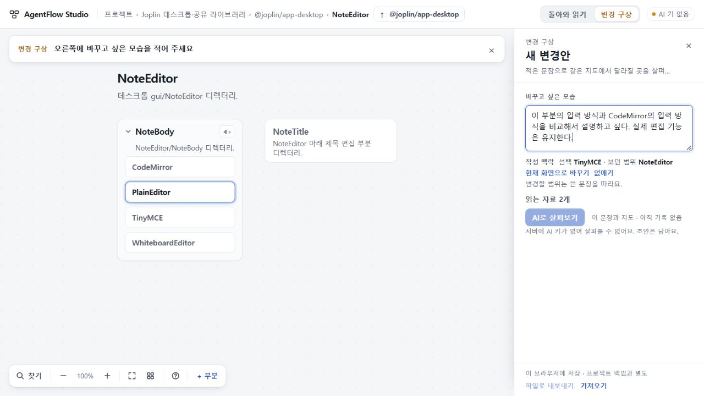

# 84 — 변경 구상의 작성 맥락

## 현재 판단
최종 런타임 **90ac73624689e8f3639dacf93b5e7cb3640def64**의 작성 맥락·저장/전달·이전 기준·편집 복귀 범위를 총괄이 수용한다. 고정 빌드, 실제 자료 PC 관측, 독립 Cloud 원본 JSON/PNG, 실제 합성5진단과 native 의미 판정, 정확 SHA 양OS CI를 구별해 대조했다. 공개는73이며 PR53은 draft·미병합이다. UI75 최종693과 수용76·78·80·83 수리를 계승한다. 첫 지도77·79·81·82의 실패는 그대로이며 반복 호출하지 않았다.

## 달라진 경험
새 초안은 처음 본문을 편집할 때 보이는 선택과 범위를 작성 맥락으로 고정한다. 열기만 했을 때는 고정될 맥락을 미리 보여준다. 이후 다른 부분을 읽고 돌아와도 맥락은 바뀌지 않는다. 현재 화면으로 바꾸기와 없애기는 명시 행동이며, 구형 초안을 현재 화면에서 소급 추정하지 않는다.

맥락은 ‘이 부분’의 참고다. 본문의 명시 대상과 전체 변경이 우선하며, 요청의 전체 parts와 사용자 의도를 줄이거나 추가 요구를 만들지 않는다. 화면에도 “변경할 범위는 쓴 문장을 따라요.”를 보인다. 프로젝트/부분의 안정 ID와 당시 이름으로 저장하고, 요청마다 alias로 변환한다. 이름 변경·참조 부재·동명 다른 ID를 구별한다.

맥락을 변경하거나 제거하면 기존 분석은 보존하면서 이전 기준으로 표시하고 요청 생성·지도 조작을 차단한다. 늦게 도착한 응답도 실제 분석 시작 기준과 대조한다. 구형 plan.1은 그대로 지원하며 plan.2에 독립 맥락을 추가했다. 저장/파일은 명시 버전과 구형 읽기를 갖춘다.

## 검토 중 찾은 문제와 수리
- 지정/제거 후 커서가 끝으로 이동하고 disabled 버튼 때문에 초점이 BODY로 가던 문제를 수정했다. 실제1280/DPR1.25에서 caret1과 활성 버튼 초점이 유지됐다.
- 구형 envelope에서 다른 프로젝트를 저장한 뒤 잘못된 형식의 이웃 entry까지 새 형식으로 받아들이던 문제는 entry별 원래 버전 보존으로 수정했다.
- 다른 프로젝트 소유의 맥락이 전체 프로젝트 맥락처럼 표시되던 가져오기는 소유 ID 대조로 거절하며 원본을 보존한다.
- 실제 저장 micro의336~567자 인용6개가 origins300 제한에 막혔다. 정착 인용의 기존600 상한과 origins를 맞췄으며 인용 절단/삭제는 없다. 옛 복사 인용 RequestMatch300과 ID·배열·null 검증은 유지한다.
- 닫기/재열기의 별도 커서 이동은6404afe에서 같은 탭·초안별 본문 일치 조건으로 커서/선택 방향/스크롤을 복원했다. root Joplin caret1→61 실패와1→1 해소 원본을 함께 보존한다.
- Cloud가 분석 기준으로 맥락을 되돌릴 때 편집면이 닫히는 별도 문제를 발견했다. 90ac736에서 이미 열린 편집면을 유지하도록 수정했다. Cloud 두 PC의 A→B→A와1280 제거→A에서 경고는 정상 해소되고 편집면·역선택7..20·활성 없애기 초점이 유지됐다. 1/2 선택 항목·기존 분석·요청·출처는 불변이었다.

## 검증의 구분
- root: 고정 TypeScript5.8.3 check/build,048dfec의 관련29검사 성공. 이후640의 변경은client8줄과 해당browserflow23줄,90의 변경은client3줄과flow26줄이며 각 root재빌드 성공. 서버/공유계약/plan-source/모델 지시는640→90 불변이므로 실제5응답을 재호출하지 않았다.
- root 실제PC: Windows1280×720/DPR1.25에서 저장된 micro의 legacy 무소급·명시지정/제거·초점, Joplin30부분 중 NoteEditor 깊은 범위의 첫편집 TinyMCE 고정→다른부분탐색→닫기/재열기 확인. Joplin은 공개 소스 기반 수작업 부분지도+합성 초안이고 자동OSS 이해/OSS 실행 증거가 아니다.
- native: legacy 승격·소유ID·긴 인용 메모리 왕복과640커서delta 코드 검토. 기존 전체 검사를 반복하지 않았다.
- Cloud:048 제공빌드207파일/4fixture해시 대조,authoring84/origins84 각1회 성공. 실제 micro의 긴 인용6개를 유지한 스텁 분석→요청문→내보내기/가져오기/새로고침 통과 중간 관측.640은 두PC에서 caret1·역선택12..40·textarea스크롤369 및 본문/맥락/카메라를 보존했다.90은 편집면 복귀와 남은 초안별 커서 분리/본문 교체 대조를 마쳤고 새 P1/P2가 없었다. 스텁을 실제 모델로 세지 않는다. [독립 최종 결과](evidence/cloud/result.json).
- 정확90 Windows·Ubuntu CI [40764156377](https://github.com/tlsee0813-cmd/agentflow-studio/actions/runs/40764156377)는 성공. 앞선640의 양OS 성공과 구별한다.

## 실제 모델의 새 기능 진단
실행 전 기준·5입력·순서·source640·PLAN2 지시 해시·설정을 고정했다. 새 합성 파일도구의 불러오기/내보내기 두 부분이며 실제 코드/오류 종류는 제공하지 않았다. DeepSeek flash,thinking enabled,low,8192,60초로 각1회 순차 실행했다. 매 응답을 root가 판단한 뒤 다음을 실행했고 재시도·수선·프로젝트 적용은0이다. native는 기준과 원응답을 먼저 읽고 마지막에 root판정 파일을 대조했다. 총괄 메시지에 잠정 결론이 있어 완전한 blind 평가라고 주장하지 않는다.

| 사례 | 결과 | 시간 |
|---|---|---|
| 맥락 없음 | 대상을 미정으로 남기고 서로 조건부인 두 후보 제시 |22.813초|
| 맥락 불러오기 | 지시어를 불러오기로 읽고 내보내기 안내/실제 처리 유지 |18.339초|
| 맥락 내보내기 | 같은 문장을 내보내기로 읽고 불러오기 안내/실제 처리 유지 |12.883초|
| 불러오기 맥락+명시 내보내기 | 본문 내보내기 우선 |14.835초|
| 불러오기 맥락+명시 두 흐름 | 두 흐름 모두 유지 |5.635초|

5건 모두 계약과 좁은 의미 기준을 통과했다. 기존 오류 분류·재시도 안전성을 만들어내지 않았고 자료에 없는 부분을 미확인으로 남겼다. 맥락 없는 두 후보는 확정한 변경 두 개가 아니다. 이 단일 합성5건으로 일반 정확도·인과 효과·첫 지도 품질·복잡한 실제 코드 이해를 주장하지 않는다. [전체 입력/반환/고정 기준](evidence/model-diagnostic.json), [독립 의미 판정](evidence/model-semantic-review.json).

## 최소 증거
- [실제micro 지정·제거 관측](evidence/final-context-root.json), [이전커서실패](evidence/context-focus-before.json)
- [Joplin 첫편집·탐색·재열기](evidence/joplin-root.json)
- [닫기커서 이전 실패](evidence/close-reopen-caret-before.json), [640해소](evidence/close-reopen-caret-final.json)
- [세 경계 독립 검토](evidence/final-code-review.json), [640커서delta 읽기](evidence/caret-delta-review.json)
- 최종90 직접 화면: 선택은 PlainEditor로 옮겼지만 작성 맥락은 TinyMCE·NoteEditor를 유지한다.

## 독립 증거의 회수와 대조
Cloud 최소 ZIP243410B의 SHA256은 b3018768d07fe2d6563a187dc961fc92fcbb8329022c1ba99541c77fd0a9a94f, 최종 결과 JSON은4c5ceddbc1459bef1dc856f1f2027e09401553b04dd6588bd71c31b724b9850b다.28청크를 합쳐 해시/ZIP CRC/9파일을 확인했고 총괄이 원본048 실패 PNG와 최종90 PNG를 직접 열어 같은 단계 JSON과 대조했다. [048실패](evidence/cloud/048/15-api1280-context-restored-A-editor-hidden.json), [90의1280해소](evidence/cloud/90/03-90-1280-B-to-A-after.json), [90의1440해소](evidence/cloud/90/08-90-1440-B-to-A-after.json).

원본048은87자 지연응답 장면,90은 기존 분석A/고정요청 파일을 정상 가져온20자 장면이다. 같은 stale 해소 전환을 대조했으며87자 전체 지연순서를 재실행했다고 주장하지 않는다. 옛 실패는 삭제하지 않았다. Cloud의 cross-tab 교체 시도는 첫 탭 캐시가 갱신되지 않아 전제 미도달로 제외했고 정상 same-tab 본문 교체만 별도 확인했다. Cloud 서버/브라우저는 종료했다.

## 남은 한계
브라우저 재시작 뒤 커서 영속 저장, 임의 규모/모든 글꼴의 화면, 일반 모델 의미 정확도와 자동 수집·동일성은 수용 범위가 아니다. 원래 인수인계의 실제 개발 지시→첫 지도 품질 gate는 미해결이다. 공개73·미수용74·UI75 및 후속 좁은 수용을 구별하며 전체 목표는 계속 활성이다.

## 다음85
합성5진단과 실제자료PC의 분리된 근거를 연결하기 위해, 기존 micro의 평가 실행 맥락·두 원문·이전 AI 읽기를 함께 받은 새 plan.2 응답 한 건을 같은 PC 비교면에서 읽는 범위만 선택한다. 이미 제공된 MemoryLimitError/TimeLimitError 계약과 실제 실행 증거의 부재를 구별해야 한다. 출력 전 초안·판정·wire를 고정하고 첫 실패에서 중단한다. 새 첫 지도·65 일반분석·70/71 전체요청반환을 반복하지 않으며 아직 실행하지 않았다.
