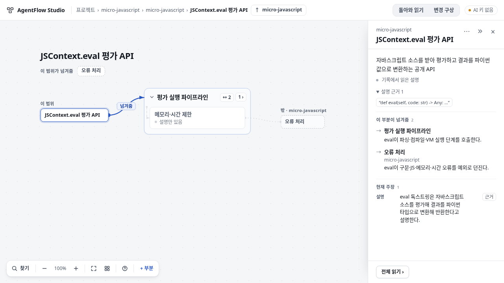
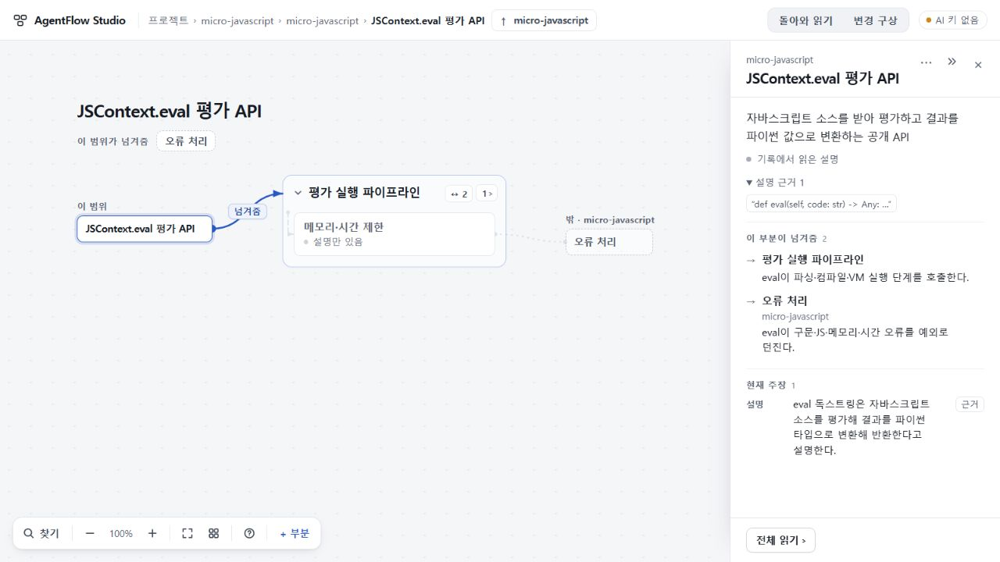
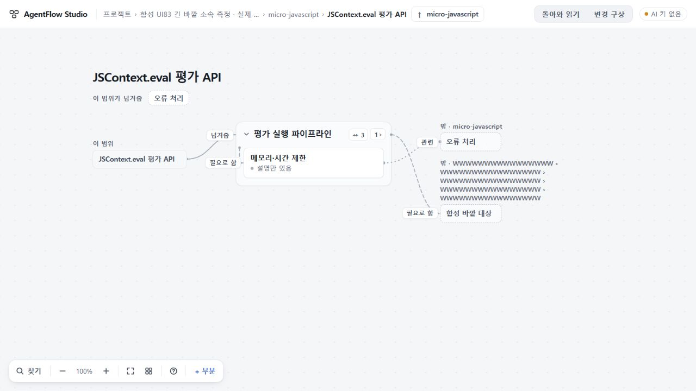

# AF-UI83 boundary reading — RESULT

## 총괄 최종 검증 — 런타임 f93b095 범위 수용

UI75 최종693d0c7의 관계 우회·전체 설명 접근과 수용80을 계승했다. 81/82의 미채택 지시는 포함하지 않았다.
공개본73, 미수용74, UI 범위 수용75를 구별하며 이번 UI 수정으로 첫 지도 생성 품질이 해결됐다고 보지 않는다.

- root: 저장된74 micro 응답을 일반 백업 가져오기로 읽었다. 원본 SHA256 `aaffb3764afc68f054d05ff54f4e2b5bf72b5b0abfc259d0bfc1deda666f8065`. 새 모델 호출·OSS 실행 없음.
- Windows 실제 1280×720, DPR **1.25**: API 범위의 '이 범위' 카드가 같은 범위의 정상 부분 읽기를 연다. 역할 본문, 설명 근거1, 현재 주장1, 전체 읽기 유지. 역할 원문에서 같은 범위·부분·펼친 근거·인용 버튼 초점으로 복귀했다.
- 같은 Windows의 PIPE 범위에서도 Enter로 같은 scope의 정상 부분 읽기를 열고 역할·설명근거1·현재주장4·전체읽기를 확인했다. 양쪽 경계 caption16px와 카드 사이4px를 실측했다.
- 같은 Windows의 합성16W×5 조상 경로: 최종 head y292/h80, 대상 카드 y376으로 간격4px. 이전 y360의12px 겹침을 해소했다. 합성 자료의 성공을 실제 OSS 자동 이해로 세지 않는다.
- root 고정 TypeScript5.8.3 `check.mjs`, `build.mjs`, 관련 boundary83/context75/role80 Node13 검사 모두 exit0. 작성자 TS6 빌드와 구별한다.
- 독립 native Sol High: f93 코드 차이에서 새 차단 결함 없음. 1px 여유는 모든 Unicode·글꼴·금칙·grapheme 조합의 동일 줄바꿈을 보증하지 않는다. 해당 보장은 실측한 사례로 제한한다. 검토 SHA256 `9e13bd9b6c95c7321ecca918687102bd6baa3313b69faf01a4d7bddd5e4e9613`.
- Cloud: 기존 세션에 f93 제공 빌드 검토1회 접수. ZIP SHA256 `0ad84a34694e9536455056424edce2953517db71b1403248f24c10de8ff8c029` (1,125,617 bytes, 202 entries, 지정 fixture4). 비밀값0·manifest·CRC 대조. 중간2ad 번들은 전송하지 않았다. 독립 두 PC 검토를 완료했고 아래 보고 정정을 거쳐 해당 범위를 수용했다.
- [exact f93 CI40749460110](https://github.com/tlsee0813-cmd/agentflow-studio/actions/runs/40749460110) Windows2022·Ubuntu24.04 모두 success. 스텁 제공자의 전체 검사이며 실제 모델 의미 검증을 대신하지 않는다. PR52 draft, 미병합·미배포.

### 독립 Cloud와 총괄 판정

제공 빌드를 Linux Chromium의 1280×720·1440×900, DPR1에서 실행했다. 일반 경계는4px, 긴 합성 경계는5줄80 CSS px와4px를 확보했다. 1280의 자동 카메라 약92%에서는 화면 좌표상73.56px·3.68px이고, 1440은80px·4px이다. 폭300px·11px 글꼴·전체 이름을 유지했다. API/PIPE의 클릭·Enter, 역할/설명근거/현재주장, 전체읽기·정확원문·외부방문 복귀, 동명 다른ID, 부모 연결의 제목/카드 관통0을 확인했다. boundary83와 UI 검토 래퍼 exit0. 새 API·재빌드·CI·이전 전체suite 반복 없음.

최초 Cloud 최종 보고는 외부 문맥 제목 누락 P2 후보로 보류했다. 총괄이 그 보고의 PNG를 직접 회수·열어 SHA256 `a5b85642ce7ac5cb35a2d20bc7d0fd69a0cb5a1599a3c3f0c622885e42e73483` 일치를 확인했을 때 제목이 보였고, 최초 self-click DOM에도 제목 y273/h16/bottom289, 오류 카드y293/gap4가 있었다. Cloud는 기존 원본만 재대조해 관련14스냅샷에 누락 증거가 없음을 확인하고 P2·보류를 철회했다. 코드 수정·새 브라우저/시험/API 실행 없이 보고 오류를 정정했다. 최초 보고/observations는 보존하며 corrected result SHA256은 `f38b27e8ec247328d4aea8f1c3c24cbf2c27810c0537fec9b215ab678253fa8a`다.

총괄은 기존 두 중간 결함의 수리와 최종 UI83 범위를 수용한다. 임의 글꼴·모든 Unicode·일반 의미이해·전체 제품 완성으로 확대하지 않는다. README는 Cloud 번들에 없었고 FIXTURES 출처와 tests를 사용했으며, 공개 저장소 README는 보존한다. 공개73과 draft PR44–52는 그대로다. 후속은 자기 범위 선택에서 변경 구상으로 넘어갈 때 대상·미전송 초안이 유지되는 새 연결만 확인하며 첫 지도 실험을 반복하지 않는다.

[최소 root 실측](root-evidence.json)

## 작성자 검증 (UI 작성자, 기준 05f64d0)

범위: `app/continuity/src/client/map-layout.ts`, `app.ts`, `public/styles.css`, 새 회귀 `tests/boundary83.test.mjs`. 원본 fixture,
source/API/schema/prompt, 저장 parent·관계는 바꾸지 않았다.

### 바뀐 것
1. **경계 이름(.ghost-head) 치수**: layout이 이 글을 12.5px/400 설명글 측정 × 0.96으로 재고 있었으나 CSS는 600 11px + 자간 .04em(글자마다
   0.44px)으로 그린다. Linux 글꼴에서는 우연히 일치(116.5 vs 116.2px)하고 Windows 글꼴에서는 어긋나 2줄로 그려졌다(layout은 1줄 20px만
   예약). 이제 `TextMeasure` 'where'(600 11px, 페이지 글꼴 canvas 측정) + `HEAD_TRACK` × 글자 수로 잰다. 이름 자르기·축소·ellipsis 없음;
   300px 넘는 긴 문맥은 이전처럼 줄바꿈하며 그 줄 수만큼 높이를 예약한다. 관계 동사 라벨도 경계 이름을 덮지 않게 장애물에 넣었다.
2. **현재 범위 자신**: 범위와 그 안쪽 부분 사이 관계의 끝이 범위 자신(id 동일)이면 '밖 · …' 대신 '이 범위' 머리 아래 실선 카드
   (`.ghost.self`)로 읽는다. 읽기면의 그 관계 행도 위치를 '이 범위'로 적는다. (누를 때의 동작은 아래 DELTA1에서 바뀜.) 판정은 id로만: 같은 이름의 다른 부분은 여전히 '밖'. 관계 수·방향·종류는 그대로.

### 실제 검사 (Linux 컨테이너, Chromium/Playwright 기존 설치, mock 서버, 새 API 호출 없음)
- before 재현: 05f64d0에서 페이지 글꼴을 더 넓은 DejaVu Sans로 바꾸면 1280/1440 모두 오른쪽 머리 `h32`, 다음 카드와 `-12px`(보고된
  Windows 12px 겹침과 동일). 기본 글꼴에서는 우연히 1줄.
- after: 같은 두 글꼴·1280×720/1440×900 모두 머리 `h16`, 머리 하단 + 4px = 카드 상단, 이름 전체 유지(넓은 글꼴 `w135`, 기본 `w119`).
- 상호작용(1280): 범위 카드 클릭/키보드 Enter → 범위 설명, `/in/<scope>` 유지·선택 없음; 선택 상태에서도 동일; 읽기면 '이 범위' 행
  따라가기 → 범위 유지; 실제 바깥 '오류 처리' 클릭 → 그 자리로 이동, 브라우저 뒤로 → 범위 안 복귀. 페이지 오류 없음.
- UI75 보존: 주장 순서·근거 왕복(포커스/스크롤/카메라)·끝점 note·행↔선 강조·관계 따라가기와 복귀 19개 통과. 이전 '더 보기' 기대는
  기준의 eac7b08(전체 주장 표시)로 대체되어 제외. 75 외곽 우회(E75-5)·안쪽 선(E75-4)·전체 읽기 노트 검사 통과.
- Node: `node --test continuity/tests/*.test.mjs` 486 pass / 0 fail(신규 U83-1·U83-2 포함; 80 역할 근거 검사 포함).
  U83은 05f64d0에서 새 export가 없어 실패(행동상 before 증거는 위 브라우저 재현).

### 미실행·한계
- 고정 TypeScript 5.8.3 미설치: 환경의 TS 6.0.2로 빌드. `check.mjs` 타입 단계는 기존과 같이 손대지 않은 `bindNewProject`의 TS6 전용
  오류 1건에서 멈춘다. Python `studio_browser.py`(Python Playwright 미설치) 미실행. Windows 실제 글꼴·실PC는 root 담당.

### DELTA1 반려와 수리 (2ad9b64 위)
- 반려: 2ad의 '이 범위' 카드는 범위 읽기면(`openScopeReading`)을 열었는데, 그 면은 적어 둔 note만 읽는다. fixture의 area.note는 비어
  있고 저장된 모델 role·현재 주장·설명 근거는 그 면에 없어, 빈 '적어 둔 설명' 아래 바깥/자식 목록만 보였다(기존 바깥 ghost나 관계
  행으로 연 정상 부분 lens에서는 보이던 내용의 접근 회귀). 2ad 작성자 검증은 '범위 설명이 열림·선택 없음'을 성공 조건으로 삼아 이를
  놓쳤다.
- 수리: 카드는 `go(o.key, id)`로 범위를 바꾸지 않고 그 범위 부분을 정상 부분 선택 경로로 연다(역할·현재 주장·설명 근거·전체 읽기 그대로).
  선택된 범위는 지도에서 자기 경계 카드로 그려지므로 그 카드가 선택 표시를 받고 그 선들이 켜진다. 저장 note·role·관계는 손대지 않았다.
- 최종 검사(1280×720, mock, 새 API 호출 없음) — API·PIPE 두 범위 각각 37개 통과: 클릭과 자식 선택 중 Enter → URL `/in/<scope>/<scope>`
  (범위 유지), 저장 role 문장 그대로, 현재 주장 수(API 1·PIPE 4), '설명 근거' 접기, '전체 읽기', 카드 선택 표시·선 켜짐; 주장 근거 원문 →
  돌아가기 → 같은 읽기·같은 근거 버튼 포커스; 실제 바깥 '오류 처리' 이동 → 뒤로 → 범위 안. 페이지 오류 없음.
- 유지 확인: 경계 머리 측정(기본·넓은 글꼴, 1280/1440 모두 1줄·카드와 4px), id 구별(U83-2), `boundary83`·`context75`(E75-4/5)·`role80`
  node 12 통과. 전체 반복 검사는 생략(변경 차이 검증).

### DELTA2 중간 반려와 수리 (482efcd 위)
- 중간 반려(root 실화면, 2ad 고정 5.8.3 Windows 1280): root의 합성 fixture `boundary83/long-context.json`(16W 조상 5개 + 바깥 대상)에서
  긴 경계 이름이 300px 열에 실제 5줄(h80)로 그려졌는데 layout은 4줄+4(h68)만 예약해 대상 카드와 12px 겹쳤다. 2ad의 글꼴 일치 수리는
  맞지만, 줄 수를 '총폭 × 1.12 / 열 폭'으로 추정해 단어 끝에 남는 빈 자리(다음 단어가 들어가지 않는 줄 끝)를 놓쳤다. bdff는 이 계산을
  바꾸지 않았다.
- 수리: 경계 이름(.ghost-head)에 한해 `captionLines`가 브라우저가 끊는 자리(공백 뒤, 한글·CJK 글자 사이, 한 줄보다 긴 덩어리는 아무
  데서나 = overflow-wrap anywhere)에서 같은 글꼴 측정(600 11px + 자간)으로 한 줄씩 채워 줄 수를 센다. 측정이 같을 때는 1px 일찍 찬
  것으로 세어 측정 경계의 오차 여유를 둔다. 모든 문자·글꼴의 과소예약 부재를 보증하지는 않는다. 폭 상한·글자 크기·이름·패딩·일반 카드/우회는 그대로.
- before(482efcd 레이아웃, 이 컨테이너 기본 글꼴): 16W 이름 5줄 h80, 대상과 gap −12(1280·1440 모두) — root 관찰과 같음.
- 최종 확인(mock, 새 API 호출 없음): 기본·넓은 글꼴(DejaVu Sans) × 1280/1440 × 짧은 micro·16W 합성 20개 경계 이름 모두 그려진 높이 =
  예약 높이, 이름 하단 + 4px = 카드 상단, 카드·frame 머리·관계 라벨과 겹침 없음, 이름 전체. 16W는 5줄 h80.
- 노드: U83-3(단어 경계로 손으로 센 5줄을 기대값으로, 총폭 추정이면 4줄; 짧은 두 낱말은 한 줄, 긴 덩어리는 두 줄) — 482efcd 레이아웃에서
  실패, 지금 통과. `boundary83`·`context75`·`role80` 13 통과. bdff 범위 카드 읽기(역할·현재 주장·설명 근거·전체 읽기, 범위 유지) 한 경로
  통과. 전체 반복 검사는 생략.
