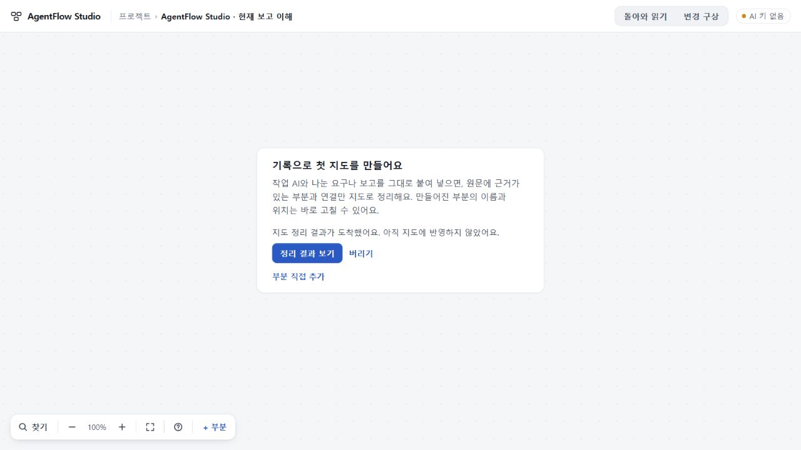
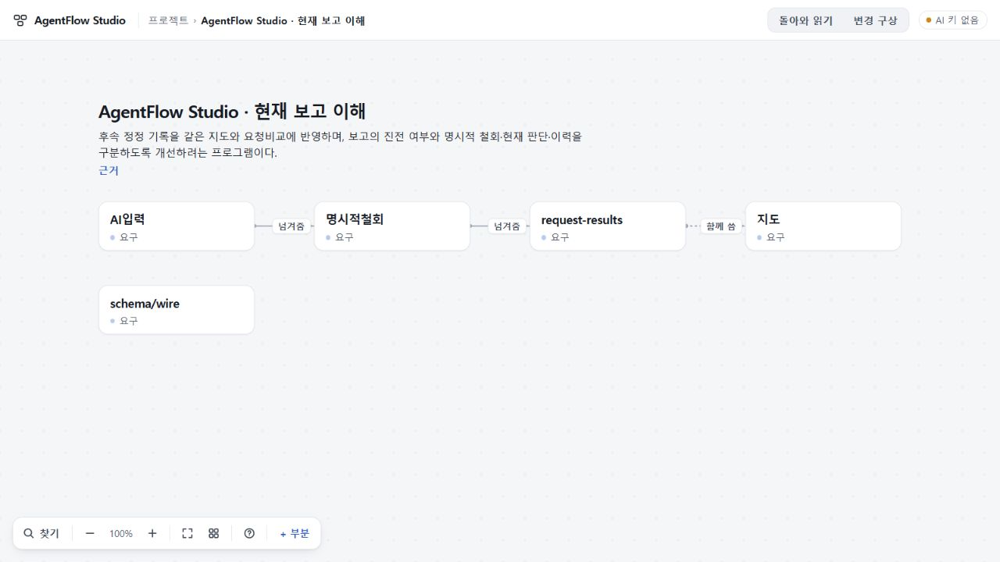

# 100 총괄 수용: PC의 지도 작업 보관과 복구

**로컬 Node 작업 보관·복구 범위를 수용한다.** 창을 닫거나 새로고침해도 완료 결과를 회수하고, 원래 프로젝트에 새 AI 호출 없이 명시적으로 반영한다. 실행기 재시작 때 진행 중 작업은 중단으로 표시하며 자동 재호출하지 않는다. 공개 배포·첫 지도 생성 품질·전체 제품 수용을 뜻하지 않는다.

코드 **bf6063099ab9428f30a9ef2be090f6f40d0dccf5**, app tree **3fc2ab0421cda167bd3fbb70c5eaa2a2e9dcc0e5**. 정확 CI head는 문서만 더한 **f2a086df31bf5eebb9ce9c9612b9abea61d9aea3**이다. [PR60](https://github.com/tlsee0813-cmd/agentflow-studio/pull/60)은 draft·미병합·미배포, base는98이다. [작성자 결과](RESULT.md)와 [설계](DESIGN.md)를 함께 보존한다.

## 실제로 확인한 범위

| 증거 | 결과 | 한계 |
|---|---|---|
| 총괄 고정 컴파일러·실행 | TypeScript5.8.3 check/build, 관련45개 통과(새100 31 +97 9 +98 5) | 로컬 Node24.19.0; 정확 Node22.16은 아래 CI |
| 독립 Sol High 소스 검토 | 접수 경쟁·취소·용량 예약·종료 후 쓰기·귀속·seq·영구 예약·버림 확인 실패를 단계별로 검토하고 수리 대조 | 정적 검토이며 별도 실행으로 세지 않음 |
| 총괄 정상 CUA PC 1280×720 | 보존된89 실제 응답1회가 실제 HTTP/job/journal 경로를 통과. B의3492자 초안·역선택3481..3492·scroll3736·focus가 응답 도착 전후 동일 | 새 모델0, 기존 응답의 새로운 의미 수용 아님 |
| 실제 실행기 종료·재시작·새로고침 | 완료 ready를 디스크에서 회수. AI 키 없이 재시작해도 결과 대기 표시→사용자가 반영. 원래 reading ID/time 유지, 새 호출0 | 실행기가 꺼진 동안 계산을 계속한다는 보장 아님 |
| 실제 결과 파일 | 5부분·3관계·2자료, 원문 인용 왕복. A 백업/reload/새 사본 전체필드 SHA256 **466b7aad66494619c3305d55d3d3b7b2458c200c038cce8e5896554e06e31d44** 동일. B 전체 **c4a637a2d050d5cd8c54e94e721e1df58d5e43fc658a03701ab11ecd8e851369** 원본과 동일 | reading 비교는 생성ID 대응·시간/model·이미 수용한98 prompt identity를 명시적으로 구별 |
| [정확 CI40858711030](https://github.com/tlsee0813-cmd/agentflow-studio/actions/runs/40858711030) | Windows2022·Ubuntu24.04 모두 성공, 각각 app279/continuity559. 실제 child-process kill/restart·별칭으로 두 소유자·손상기록 검사, 1280/1440의100·97 정상흐름, Worker dry-run/static 포함 | 합성 공급자, 유료 AI 없음 |

내구 접수와 원래 입력/소유를 결속하고, 취소를 기록한 뒤 provider abort를 시도한다. 다른 저장을 암묵적으로 채택하지 않으며 같은 페이지의 정당한 자체 저장만 연속 허용한다. 반영 성공 뒤 ack가 유실되면 안정 reading ID/hash와 소유로 재확인한다. 버리기를 기록할 로컬 저장과 서버 ack가 함께 실패하면 완료처럼 숨기지 않고 실패와 기존 결과를 유지한다.

## 수리 과정에서 발견한 실패를 구별한다

- 초기1b8/dc5c/0f/c412 코드의 접수·회수·저장 경계 결함은 독립 검토로 회수해 수리했다. 최종 D15가 로컬 의도 쓰기+서버 ack 동시 실패를 직접 재현한다.
- 작성자 첫 전체 브라우저 실행은 도중 dist 재빌드로 실패했다. 안정 빌드의 두 번째 실행과 구별하고 원본 실패는 작성자 기록에 남겼다.
- app/.gitignore 수정이 기존 I9.01 보존 지문을 깨뜨린 회귀는 되돌렸다. 기본 작업 폴더는 app/continuity/.studio-data이며 그 범위만 ignore한다. 작성자 환경의 I6R Node버전 차이와 달리 정확 CI는279/279다.
- head52fc913의 첫 CI는 문서 갱신으로 취소됐다. 수용 근거는 app tree가 동일한 headf2a086d의 완료 로그다.

## 보장하지 않는 것과 다음 경계

기존90초·model·token·98 prompt·validator/의미 기준은 유지했고 새 실제 모델 호출은0이다. 89의 두 제한적 성공과 Zephyr timeout,91/92/96 실패,81 미실행 비교를 다시 실행하거나 새 성공으로 바꾸지 않는다. 첫 지도 생성의 의미와 완료 시간, Q02/Q06·인수인계5/8 전체 관문은 미완료다. 다음 총괄 판단은 이 미해결 실행 계약으로 돌아가며 새 모델 실험은 아직 선정하지 않았다.

Worker/static/구형 서버는97 경로를 유지한다. 기본 내구 경로는 기존 로컬 Node 실행기에 한정된다. 원격 연산·과금 취소, PC 전원 종료 중 계속 계산은 보장하지 않는다. macOS 소유 잠금은 약한 pid 방식이며 Linux의 별도 network namespace 사이 공유 볼륨은 미지원이다. 미확인 ready를 몰래 지우지 않으며 전체 tombstone10000개 상한에는 새 접수를 거절한다. 보관 자료의 수동 정리 UI는 없다.

공개 수용73·미수용74·UI 범위 수용75/693d0c7을 구분한다. UI75 이력·97/98 수리·원래 stash와 키·Ops 기존 미커밋 파일을 보존했다. 총괄 테스트 서버와 임시 탭은 종료했다. 전체 목표는 active다.

[최소 증거·해시](evidence/manifest.json) · [총괄 실행](evidence/experience100-root-checks.json) · [실제 PC](evidence/experience100-root-ui.json) · [정확 CI 원문 발췌/로그 해시](evidence/experience100-ci-summary.json) · [최종 독립 검토](evidence/experience100-final-delta-review.json)

[공개 주장·해시·비밀 제외 감사](evidence/experience100-public-audit.json)는 기존12파일을 대조했다. 감사 자체를13번째 증거로 추가했으며 기존12파일의 해시는 그대로다.
