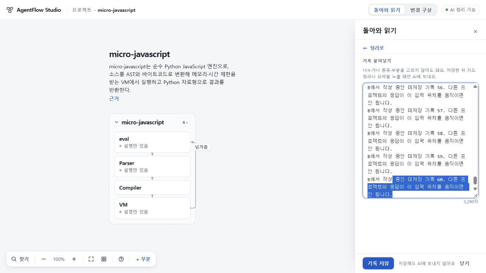
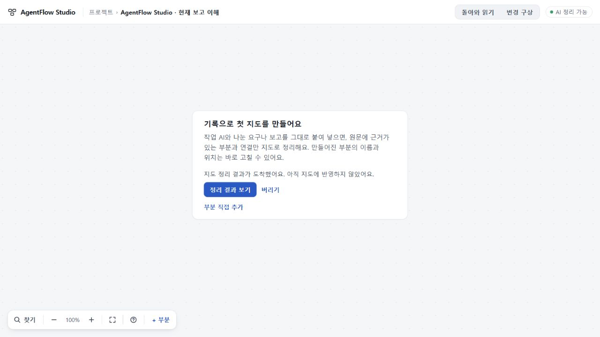
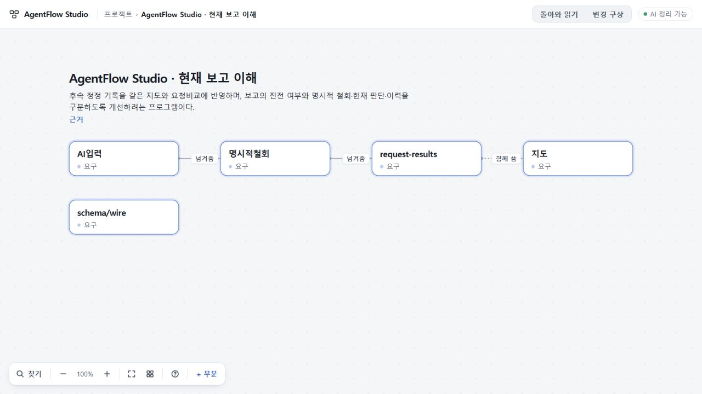

# 97 프로젝트 이동 중 도착한 정리 결과 — 범위 수용

프로젝트 A의 지도 정리를 기다리는 동안 B를 열어도 받은 결과를 A에 보관한다. 돌아와 **정리 결과 보기**를 누르면 원래 요청과 검증된 응답으로 현재 지도에 반영한다. 저장 실패 후 **다시 반영**도 새 AI 요청 없이 저장만 다시 시도한다.

최종 코드:796da3ad8fa4d3f8114724fa7882e1e80fc72c9b · app tree:25e85324f48e8cf08d7e8edcabc176d92482eced. [PR58](https://github.com/tlsee0813-cmd/agentflow-studio/pull/58)은 draft이며 미병합·미배포다.

## 수리한 경계

첫 비동기 hash 계산 전에 entry별 요청을 예약해 연타 중복을 막는다. entryId·Project.id·lifecycle과 화면 방문을 구별하고, 취소한 요청의 늦은 응답이 새 요청을 건드리지 못하게 한다. ready는 원래 MapInput과 요청 문맥, 검증된 reply, model/prompt/hash를 보존한다.

저장이 시작되면 취소 대신 반영 중을 표시한다. 저장 중 A→B→A로 돌아온 새 방문은 같은 lifecycle·저장 전 seq일 때만 저장된 값을 이어받는다. 다른 탭 충돌을 우회하거나 새 seq를 임의로 채택하지 않는다.

초기7c371은 고정5.8.3 검사와 관련81개를 통과했지만, 독립 검토에서 다른 프로젝트를 다시 그리는 P2를 찾았다. 총괄 정상UI에서도 A 응답 도착이 B의3290자 초안 선택을 backward→forward, scroll3332.8→0으로 바꾸는 것을 확인했다. 최종796da는 변경 알림에 소유 entry를 전달해 B의 DOM을 건드리지 않는다. 홈에서도 해당 카드 상태 한 줄만 바꾼다. 초기 실패와 수리 후 증거를 각각 보존했다.

## 검증

| 구분 | 실제 확인 | 한계 |
|---|---|---|
| 총괄 고정 빌드 | Windows, 잠긴 TypeScript5.8.3 check/build 통과(exec8a5b0f), 변경된97 검사9개 통과(exec525778) | 최초7c371의81개 검사는 별도 기록 |
| 독립 Sol | 설계, 초기 P2, 최종 변경분 검토. 최종 새 P1/P2 없음 | 정적 판단이며 독립 브라우저 실행 아님 |
| 총괄 정상 CUA | 1280×720, 실제 지시 저장본과 micro-javascript 저장본을 정상 가져오기. 기존89 수용 응답을 재생하여 A→B→A 결과 보관·반영·근거 왕복·백업·새로고침 확인 | 새 생성이나 첫 지도 의미 재수용 아님 |
| 정확 CI | [40826463621](https://github.com/tlsee0813-cmd/agentflow-studio/actions/runs/40826463621), Ubuntu123290534391/Windows123290534648 모두 성공. 각각 기존 app279개·continuity523개 통과. 양쪽 원본 로그에서 AF97의1280/1440 화면 흐름 실행 확인 | 합성 stub 자료. 실제 AI 호출 없음 |

총괄은 A의 응답이 도착할 때 B에서 긴 미저장 초안을 편집했다. 수정본은 원문3290자, 선택3242..3290, backward 방향, scrollTop3332.800048828125와 초점을 모두 보존했다. A로 돌아온 뒤 대기 결과를 명시적으로 반영했다. 고정 재생 서버는 원문 응답 하나만 허용한다. 요청 횟수와 저장 재시도 검사는 단위·CI 흐름에서 별도로 확인한다.

정상 내보내기에서 원자료와 정리의 전체 필드를 대조했다(parts5/relations3/material2). 임의 reading/area/relation ID를 참조에 맞춰 대응하고 timestamp/model 메타만 제외했다. A 백업과 새로고침 후 백업의 SHA20234b9a…가 같고, B 백업은 처음 파일 SHA c4a637a2…와 전체 바이트가 같다. 새 모델 호출은0이다.

## 판정과 남은 한계

97의 요청 중복·취소·결과 보관·명시 반영·저장 재시도·다른 프로젝트 편집 보존 범위만 수용한다. 공개73을 교체하지 않는다. 미수용74·UI 범위 수용75/693d0c7와 첫 지도 전체 수용을 구별한다. provider·model·prompt·token·timeout·shared/storage 계약은 바꾸지 않았다.

ready는 이번 페이지 메모리에만 있어 반영 전 새로고침하면 사라진다. 저장 충돌은 기존대로 거절되며 새로고침 안내 후 재요청이 필요할 수 있다. 프로젝트 직접 새로고침 시 빈 지도 AI 상태 갱신의 기존 한계도 이번 수리 밖이다.

CI의 B 보존 검사는 응답 후300ms 시점이며 그 순간 client ready 완료를 별도로 확정하지 않는다. 이 한계는 정적 소유 필터와 총괄의 실제 응답 전달 후 복귀 확인으로 보완했으며, 자동검사만으로 완전한 타이밍 증명을 주장하지 않는다. 총괄 직접 화면과 두 PC 자동 흐름의 자료·실행 주체를 구별한다.

## 일시정지와 재개

사용자가 “이번꺼까지 잘마무리하고 잠깐멈춰줘”라고 지시했다. 97 기록을 마친 뒤 총괄을 일시정지하며 새98 연구·실험은 시작하지 않는다. Q02/Q06·인수인계5/8 전체·실제 첫 지도의 의미와 전달 문제는 남아 있고, 전체 목표 완료가 아니다.

재개할 때 이 판정과 최신 원격 ACTIVE·QUESTIONS를 대조한다. 완료76~97 결과와 실패 실험을 반복하지 않는다. 공개73 app b670c0ea300050e28cdba9655515ebcf2e03d9d5, UI75 수리693d0c7, 기존 stash fa07118과 키를 보존한다. 브라우저·모델 실행과 로컬 검사 서버를 끝내고 기존 Claude97 세션 링크는 Ops에 남긴다.
