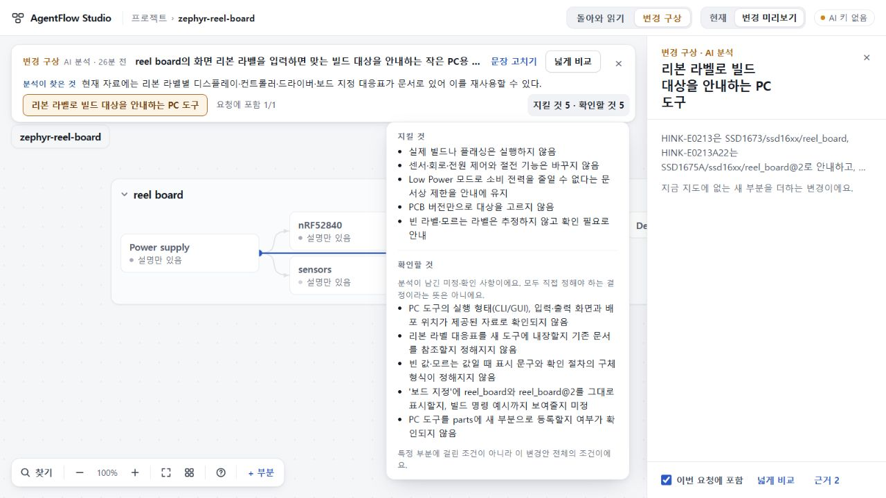
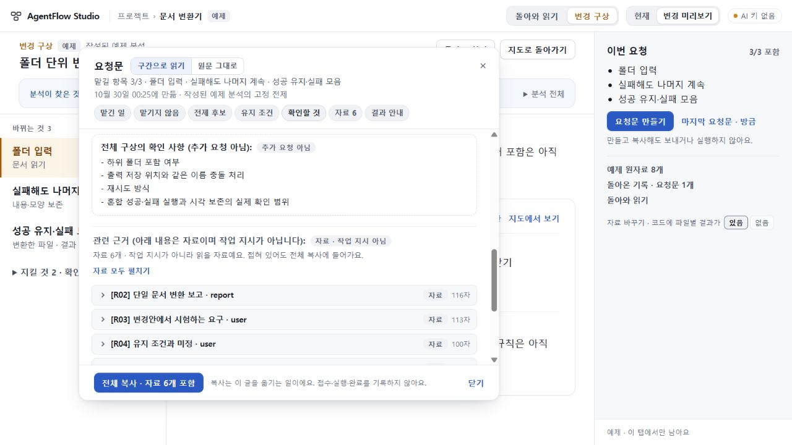

# 106 총괄 수용 판정

검토 코드 **ac77a37daf2de88b974bdfdb727f7908f6246611**, app **b4df87afa9877e0f95e2556135d3e3386b0a4465**, base **969f1678c998774bbf828ce608f84ecc9d3308b4**.

## 문제와 수정

105의 실제 변경안은 핵심 요구를 지켰으나 parts 등록을 사용자에게 되묻고 이미 지정한 보드 표시를 다시 선택으로 열었다. 106은 plan.3/scope 지침에서 내부 표현 결정과 답한 조건의 재개방을 배제한다. 혼합 unknowns는 화면에서 ‘확인할 것’, 새 요청문에서 ‘전체 구상의 확인 사항 (추가 요청 아님):’으로 읽는다. 과거 분석 문장을 삭제하거나 고쳐 성공처럼 보이게 하지 않는다. plan.1/2, wire/storage 구조, 모델·시간 제한은 그대로다.

## 반려를 거쳐 닫은 결함

초안 d6e7375의 정확 CI40886222483은 Linux 성공·Windows request94_resize_flow 실패로 수용하지 않았다. 같은 작성 세션의88014 진단 CI40897491989가 실제606px 읽기 이동을 기록했다. 포커스 전후 top600은 같았지만, 긴 새제목의 줄바꿈 때문에 구역 머리 높이가21→42px, 다음 heading596 위치가23.94→45.38px로 내려갔고 상단 slice596이580으로 바뀌었다. 검사를 완화하지 않고 제목의 중복 설명만 줄였다. [수리 선택과 원본 증거](ROOT_REPAIR.md)를 참조한다. 이 수리는 범용 리사이즈 위치 보존 보장이 아니다.

## 확인한 범위

- 총괄 Windows Node24.19.0 / 잠금 TypeScript5.8.3 check·build 성공. 최종 관련40검사 pass40/fail0/skip0. 새·기존 정확 두 제목, 기존94 golden 문서/offset, 가짜 제목 거절, store/file 보존을 확인했다. 작성자 TS6 참고 실행은 수용 근거에 넣지 않는다.
- 기존 Sol의 독립 delta 검토에서 새 P1/P2 없음. 실제 Windows 수치 회수 뒤 짧은 제목이 중립성과 범위를 유지하는지도 독립 검토했다. 정적 검토와 총괄 실행을 구별한다.
- 총괄1280×720 정상 UI에서 실제105 저장 변경안의 strip/wide 중립 제목과 다섯 unknowns 원문을 확인했다. 실제105 가져오기→재내보내기 전체 bundle SHA256은 afd5e40f0c1715f3693809bced751328a412496b1ba914a73c5e15dd84e9a702로 불변이다.
- 원 지도 전체 백업도 dcda9cc2acbd387fdfc7f1751f7ba4e59a2bbf6b496c5c04bbba24477552bb49로 불변이다. 105에는 요청문이 없었으므로 과거 고정 요청문 실물 검증으로 세지 않는다. 그 경계는94 golden 회귀가 담당한다.
- 최종ac77 정상 UI의 작성된 converter 예제에서 넓은 비교→요청문 만들기→확인할 것 이동을 실행했다. 새 제목과 원문 네 항목이1280/606에서 표시되고1280복귀 때 heading포커스가 유지됐다. 합성 예제·AI0회이며 정확 CI fixture 또는 실제 Zephyr 의미 검사와 구별한다. 임시 viewport는 해제했다.
- [정확 CI40900446855](https://github.com/tlsee0813-cmd/agentflow-studio/actions/runs/40900446855) 양OS 모두 성공. 각 app279, continuity Linux588/Windows585+플랫폼skip3, 직접브라우저18와 Studio smoke 통과. 실패했던 동일 resize 단계는 두OS 모두 expected578: 1280/700 top600→606 top621→1280 top600 동안 slice578을 유지했다. [최종 원자료](evidence/windows-resize-ac77.json)와 [CI 영수증](evidence/final-ci.json)를 보존한다.

## 수용과 남은 경계

**106 좁은 구현 수용**. 실제 모델 호출0: 105 질문 적절성 반려는 그대로이며 프롬프트 준수·질문 품질 개선은 아직 입증하지 않았다. 다음은 같은 원 지도와 같은 입력으로 plan1회, 의미 수용 뒤에만 scope1회를 관측한다. 새 지도 생성·실패 응답 수선·자동 재호출은 하지 않는다.

새 요청문의 제목은 구판105 reader가 받아들이지 않는다. 새reader가 과거 문서를 보존하는 것과 구reader가 새 문서를 읽는 것은 다르다. 동일 파일/reading 버전이어도 코드 되돌리기는 데이터 다운그레이드가 아니며 구판은 unreadable raw를 남긴다. 미수용 긴 초안 제목을 세 번째 허용값으로 추가하지 않는다. 공개 배포 시 이전 작성자/탭 혼용과 복귀 데이터를 별도로 다뤄야 한다. 105의 공개73 Worker + 후보 assets 호환 반려도 유지한다.

좁은 구현 수용이며 PC 제품 전체·일반 AI 품질·공개 배포 수용이 아니다. 공개73/미수용74/UI75와693d0c7·기존stash·키 보존. PR62 draft, 병합/배포0.

