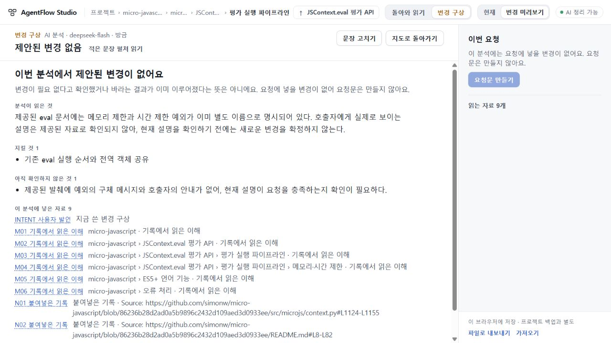
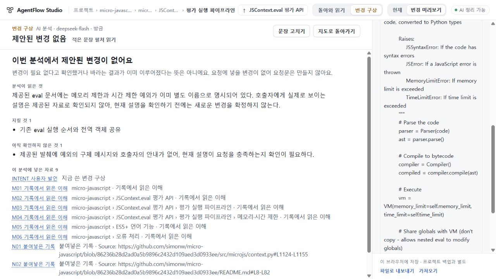

# 85 진행 근거 — 최종 수용 전

후보 runtime **bf30033cca0f16b87b90aac31d8bdccd8bb03d49**, app tree **42803f840f53dce12a047a4cd27912ebf945267f**, [PR54 draft](https://github.com/tlsee0813-cmd/agentflow-studio/pull/54). 공개73의 앱 코드는 바꾸지 않았다. UI75 최종693d0c7과84 최종90ac736 수리는 계승한다.

## 확인한 것
- 총괄 Windows의 고정 TypeScript5.8.3 check/build 및 zero85·authoring84·plan-api·request71 관련41검사 exit0. 실 모델 호출 없이 stub fetch를 쓴 계약 검사다.
- [독립 코드 읽기](evidence/code-review.json): 새 실질 P1/P2를 찾지 못했다. 실제 PC/모델 의미 수용을 대신하지 않는다. [구형 판본 경계 선택](evidence/compat-review.json)을 별도로 보존한다.
- 총괄 실제1280×720, DPR1.25: 기존 micro PIPE 자기범위와 고정 초안에서 검토자 작성 0항목 응답을 정상 UI로 받았다. summary·유지조건·미확인을 읽고 N01의 MemoryLimitError/TimeLimitError와 eval 본문을 열람했다. 복귀 뒤 같은 N01 버튼 focus, detailScroll0, 같은 URL/범위, 새 요청 차단을 확인했다. [DOM 관측](evidence/root-pc.json). 이것은 새 모델 응답이 아니다.
- 정상 UI가 보낸 plan.3 전체 ask와 같은 고정 fixture에서 로컬이 만든 ask가 동일했다(SHA256 9d9b2533e8643c57f6e39d2d8b9453eb1f99a1fcf264ed00653a5c63d8c82a0d). 이는 사전 UI stub 검사이고 최종 실 호출의 source/prompt/wire 동결을 대신하지 않는다.

## 작성자 보고와 한계
작성자는 관련94 Node검사와1280/1440 scratch Node Playwright 흐름 통과를 보고했다. 그 환경에는 고정5.8.3이 없어 PATH6.0.2로 오류가 있어도 emit했으며, 기준에도 존재한다는 app.ts 오류1건을 보고했다. 이 빌드는 고정 버전 성공 근거로 쓰지 않는다. 커밋된 Python zero85_flow는 작성자 환경에 Python Playwright가 없어 미실행이다. scratch 캡처는 작성자 컨테이너에만 있으며 총괄이 회수한 것으로 세지 않는다.

과거 반환의 textContent 검사는 닫힌 details 안의 데이터 존재도 포함한다. 독립 PC에서는 이를 실제 펼쳐 읽는 접근성과 분리하여 확인하도록 했다.

## 진행 중
Cloud는 정확 bf30033의 총괄 고정 빌드 ZIP(1252452 bytes, SHA256 38b139d6f85abd179eb310161af97657e9110b4abaef59263edf57cc281ec44d,246항목)을 받아 두PC·저장/복원·과거 요청/반환 읽기를 독립 확인 중이다. 기존84 전체 검사나 실패 실험은 반복하지 않는다. 정확 bf30033의 CI40771472056도 이 기록 시점에는 진행 중이다.

85의 실제 제공자 호출은 **0회**다. [사전 계약 반례](evidence/preflight.json)는 검토자 작성이고, 모델 실패가 아니다. 원래 의도/자료/최대1회 조건을 유지하며 계약·PC 수용 후 새 source/prompt와 전체 UI ask를 고정한다. 코드 검사·PC stub 통과가 실제 의미 정확도·첫 지도 품질·전체 제품 완성을 뜻하지 않는다.
