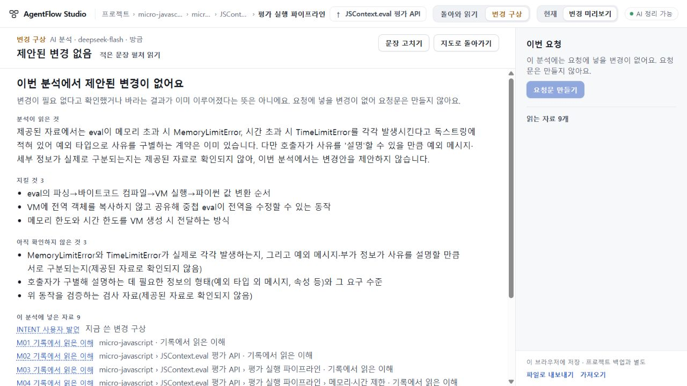
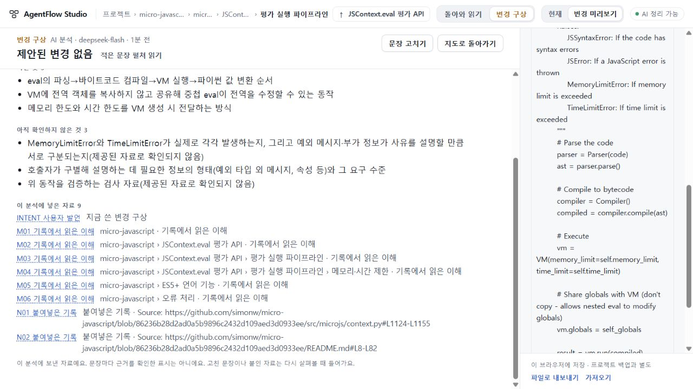

# 85 결과 — 실제 자료의 제안 없음 읽기 범위 수용

기존 micro-javascript 자료·작성 맥락에서 받은 실제 응답을 PC 비교면에서 읽고 원문으로 왕복하는 범위를 수용한다. **제안된 변경 없음**은 이번 분석의 결과이며, 요구 달성이나 검증된 변경 불필요를 뜻하지 않는다. 첫 지도 Q02/Q06과 전체 제품 목표는 여전히 미해결이다.

최종 runtime **ffe60935a6f7f5760fb9a1a72ca66e8ab8693fa3**, app tree **b4984d261a4a7ccc1ace712a4d9d783c8a9103db**. [PR54](https://github.com/tlsee0813-cmd/agentflow-studio/pull/54)는 draft·미병합·미배포다. 공개 수용73, 미수용74, UI 범위 수용75를 구별하며 UI75 최종693d0c7과84 수리를 계승한다.

## 변경과 판단

원래85 계획은 실제 자료와 새 분석의 연결이었다. 호출 전 검토자 작성 정상 응답 items=[]가 기존 parser에 거절되는 의존 결함을 발견했다. [사전 반례](PREFLIGHT.md)와 [Pro·호환 결정 및 초기 검증](PROGRESS.md)을 보존하고 새 요청 studio.plan.3에서 items=[]·impacts=[]를 허용했다. 구형plan.1/2 prompt와 양수 응답 계약은 그대로 두었다. 저장.3, 과거 요청/반환, 소유와 작성 맥락의84 경계를 유지한다. 구형 reader의 새 저장판본 거절을 하위 호환 성공으로 부르지 않는다.

빈 응답에서는 summary·유지조건·미확인과 연결 자료를 읽는다. 가짜 항목·0/0 선택을 만들지 않으며 새 요청 생성은 비활성이다. 원문에서 돌아올 때 같은 초점·스크롤·초안·맥락을 보존한다.

Cloud가 옛 반환을 실제 펼쳐 읽다가 상단 “아직 받은 내용 없음”과 하단 직접 첨부 보고1의 충돌을 발견했다.73부터 있던 서로 다른 두 채널의 설명 문제이며85 신규 회귀로 판정하지 않았다. 최종ffe는 “연결된 원문 구절 없음”과 “이 요청 항목에 연결된 프로젝트 원문 구절이 아직 없어요.”로만 좁게 고쳤다. 기존 Python 기대문구3곳을 함께 바꿨다. AI 보고·코드·검사·철회 효력의 계약은 바꾸지 않았다. [수리 전](evidence/final/return-before.png) · [수리 후](evidence/final/return-after.png) · [독립 코드 검토](evidence/final/wording-review.json).

## 실제 모델과 PC 연결

고정 공개 micro-javascript86236b28의 README8–82/context.py1124–1155와 기존74 저장 AI 읽기, 총괄 작성 가상 초안을 썼다.6부분·9자료이며 PIPE 자기범위 작성 맥락을 전달했다. OSS 자체 실행이나 실제 라이브러리 변경 작업은 아니다.

초안은 메모리/시간 제한 사유를 호출자가 구별해 설명하되 eval 순서와 전역 공유를 유지하려는 내용이다. 기존 독스트링은 이미 MemoryLimitError/TimeLimitError를 명시한다. 미기재된 메시지/호출자 처리/실행 검사를 기능 부재로 바꾸면 실패로 정했다. 사전 기준은 바꾸지 않았고 protocol3 의존 수리만 첫 호출 전에 별도 기록했다.

[실제 ask·응답·설정](evidence/final/actual-model.json): deepseek-flash, low,8192tokens,60초 한도, **1회·7.469초·stop**, 재시도/수선/적용0. 응답은 기존 두 예외 계약을 인정하고 실제 메시지·발생·검사와 호출자 설명 수준을 미확인으로 남겼다. items/impacts=[]의 근거가 있으므로 [총괄 의미 판단](evidence/final/root-semantic.json)과 [독립 의미 검토](evidence/final/independent-semantic.json)를 통과했다. 빈 배열 자체를 성공 기준으로 삼지 않았다.

같은 저장 응답을 정상 UI에 재생했다(추가 제공자 호출0). 총괄 실제1280×720/DPR1.25에서 summary·유지3·미확인3을 읽고 N01의 정확1369자 원문을 열어 두 예외와 eval 경로를 확인했다. 복귀 뒤 N01초점, 스크롤211.2, 같은 초안·작성 맥락·URL·카메라가 유지됐다. [PC 관측](evidence/final/root-real-pc.json). 자료 접근은 문장별 자동 검증 표시가 아니다.

## 검증과 범위

| 근거 | 확인 범위 |
|---|---|
| 총괄 Windows | bf30033 고정TS5.8.3 check/build+관련41검사 통과. ffe 두 문구 수리 후 같은 고정 check/build 통과. |
| Cloud 원본 | 제공bf 빌드·Node 및 zero85_flow,1280/1440 각각1회. flow 높이800, 별도 수동 화면1280×720/1440×900 DPR1. 원문·저장/복원·닫기·양수0선택·과거 반환 보존 확인. 반환 문구P2는 당시 미수용. |
| Cloud 최종 차이 | 정확ffe 제공빌드,두PC 옛 저장 반환 정상import·실제 펼침만 재확인. 새 분석0, 이전 전체flow 반복0. 문구P2해소·전체 bundle 보존. |
| 최종 CI | 정확ffe [40774010257](https://github.com/tlsee0813-cmd/agentflow-studio/actions/runs/40774010257) Windows·Ubuntu 모두success. [원본 체크](evidence/final/ci.json). |
| 실제 의미·UI | 모델1회 총괄+독립 의미 통과, 같은 실제 응답 총괄1280 PC 왕복 통과. Cloud 두PC는 검토자 응답이며 실제 모델 두PC 수용으로 바꾸지 않는다. |

[Cloud 원본](evidence/final/cloud-original.json)과 [최종 차이](evidence/final/cloud-delta.json)는 원본 ZIP에서 회수·CRC/해시 대조했다. 총괄은 원본/최종1440 PNG를 직접 읽고 보존 필드를 대조했다. 최종1280 PNG를 직접 회수한 것으로 세지 않는다. Cloud 최종 실행은 첫 localhost listen 권한 오류 후 지원된 권한 경로에서 성공했다. 환경 설치나 프록시 변경은 없었다.

초기bf CI는 문서 push concurrency로 취소됐으며 성공으로 올리지 않는다.995와 최종ffe CI 성공은 별도다. 작성자 고정TS 미설치/브라우저 미실행 한계는 당시 PROGRESS에 남긴다. 원래 plan2 runner와 중간 v2는 실 호출하지 않았다. 원본 실패와 판정을 덮지 않는다.

## 남은 일

한 실제 no-proposal 응답의 근거 읽기를 수용했을 뿐, 양수 변경안 품질·일반 의미 정확도·첫 지도 전달·실제 OSS 동작·사람 사용성 전체를 검증한 것은 아니다. 다음86은 완료76/77/79/81/82와 Pro81 결과를 먼저 회수해 첫 지도 대상/조건/자료 층위의 남은 원인을 비교한다. 실패한 prompt 재시도나 검토→재생성을 반복하지 않고 새로운 단일 제품 가설을 선택한다.

최소 공개 증거의 SHA256은 [MANIFEST](evidence/final/MANIFEST.json)의 정확 Git blob 바이트 기준이다. 비공개 제공자 원문·키·프로필은 공개하지 않는다. 기존 stash와 미커밋 작업은 보존했다.
