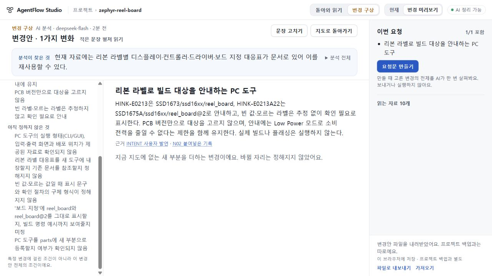

# 105 — 실제 지도에서 요청으로 이어가다 발견한 결정 부담

104의 지도를 재생성하지 않고 정상 UI에서 Display를 읽은 뒤 새 구상을 분석했다. 실제 DeepSeek plan.3 응답은 20.155초에 완결됐고, 리본 라벨별 대응·미상 라벨 보류·PCB 비추정·센서/회로/전원 비변경·절전 제한·빌드/플래싱 미실행을 보존했다. 원 지도 전체 백업은 104와 동일하다.

그러나 **105의 요청 진행은 수용하지 않는다.** 모델이 이미 새 부분(partIds=[])으로 제안한 도구에 대해 “PC 도구를 parts에 새 부분으로 등록할지 여부”를 사용자 미결정으로 내보냈다. 요청된 보드 지정 표시와 비요구 빌드 명령 예시도 선택지처럼 섞었다. UI는 unknowns 전체를 “정할 것/아직 정하지 않은 것”으로 표시해 자료의 미기재·구현 확인을 사용자 결정으로 승격했다. 이는 인용/JSON 검사가 통과해도 남는 실제 사용 결함이다. 총괄과 [독립 검토](evidence/plan-review.json)의 판단이 일치했다.

계획 호출1회, scope/map/digest/재시도0. 요청문은 만들지 않았고 snapshots/observations는0이다. raw·요청·원 분석 파일은 비공개로 보존했으며 잘못된 unknown만 지우거나 손수정하지 않았다. 서버를 종료하고 해당 Node 프로세스가 없음을 확인했다. [수치와 해시](evidence/observation.json). 104의 실제 지도 수용은 그대로 유지한다.

## 다음 수리의 범위

새 저장소나 실행자를 만들지 않는다. plan.3와 scope의 지침에서 앱 내부 표시/등록 판단·이미 정해진 사실·비요구 확장을 사용자 미결정으로 만들지 않도록 제한한다. UI와 요청문은 혼합된 기존 unknowns를 중립적인 “확인할 것”으로 보존한다. 무엇이 사람의 선택인지 모델의 확인 부족인지 문자열에서 임의 분류하거나 과거 파일을 재작성하지 않는다. prompt만 바꾸거나 제목만 바꾸는 반쪽 수리로 닫지 않는다. 수리 후 같은 입력의 새 결과는 별도 판본 관측으로 비교하며105를 소급 수용하지 않는다.

## 공개 전달의 구체적인 경계

[독립 공개 검토](evidence/release-review.json)를 수용한다. 후보 전체 Worker 배포는 새 map.6 생성까지 바꾸므로 UI 배포가 아니다. 반대로 공개73 서버에 후보 UI만 얹으면 후보가 보내는 plan.3를 공개 서버의 plan.1 검증/dispatch가 거절한다. project11→13 및 planfile 업그레이드는 구탭·롤백의 읽기 호환도 바꾼다. 따라서 단순 혼합 배포는 반려한다.

공개 전달을 무기한 보류하는 대신, 기존/가져온 지도 읽기·편집→호환되는 변경안·요청·반환을 한 수용 범위로 만들고 지도 생성 정책과 저장소 업그레이드를 명시하는 배포 계약을 준비한다. AI 없는 보조 정적판만으로 전체 목표를 대체하지 않는다. 우선105에서 실제 드러난 요청 부담을 고쳐 이 경로를 끝까지 확인한다. 결합 SHA·서버 closure·정확 CI·독립 실행·실제 응답·복구 근거 없이 공개73을 교체하지 않는다.

공개73/미수용74/UI75·693 수리와 키·기존 작업은 보존됐다. 제품 코드·병합·배포0, 전체 목표 active.
