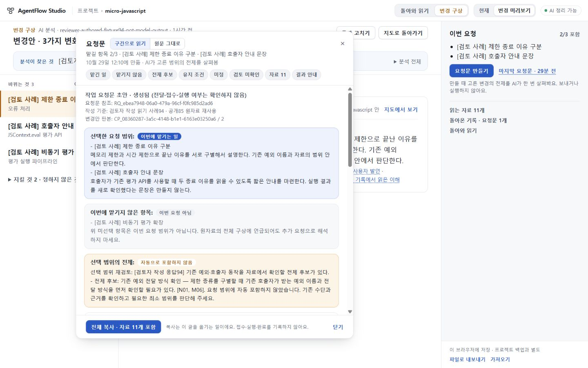

# 94 동결 요청문 읽기

최종 후보는 531ac4ee62ac3a09836611d67483371ec14726f3, app tree는 501a7a1faa4b50c182e56ad0cd3a21ac65ed6e5d다. **요청문 읽기·구판 보존·창 축소 수리의 한정된 범위를 수용한다. Cloud 독립 화면 실행은 실패한 채로 남기고, 별도 Windows/Ubuntu CI의 실제 브라우저 자동화와 총괄 정상 조작·독립 소스/반례/원본 화면 검토를 대조해 판단했다. 첫 지도 품질·전체 제품·공개 배포의 수용은 아니다.** 공개73·첫지도·인수인계5/8 전체 관문의 수용과 구별한다. PR57은 draft·미병합·미배포다.

긴 요청문에서 맡긴 일·제외·전제·유지·미정·원자료를 구분해 읽고, 자료를 접어도 전체 원문을 복사할 수 있게 했다. 생성 시 원문과 UTF-16 읽기 구간을 함께 동결한다. 현재 변경안을 이용해 과거 요청문을 다시 해석하지 않는다. 구판 요청문에 읽기 구간이 없으면 원문 그대로 보여 준다. 파일과 저장 envelope는4, 새 읽기 metadata는 request-reading.2다. 실험판.1 metadata는 거절하며 구판의 metadata 부재와 구별한다.

## 발견한 문제와 수리

- 독립 검토에서 원자료 속 가짜 제목을 이용해 자료 경계를 재분할해도 수용되는 문제를 발견했다. 3749190에서 자료 ID·종류·제목·기준·본문 길이와 원문 구간, 선택된 자료의 frozen scope를 대조하도록 고쳤다. metadata 전체를 일관되게 다시 쓴 조작의 진위를 인증하는 기능은 아니다.
- 특수 프로젝트 ID가 상속받은 legacy marker로 잘못 승격되는 문제도3749190에서 수리했다. own property와 명시적인 판본 대응을 사용한다.
- 총괄 정상 UI에서 열린 문서의 창 너비를1280→700으로 줄이면 sheet 폭680→1.6px로 붕괴했다. f76922b의 CSS 수리로700·606px에서도 본문·복사·닫기가 보이며 자료 펼침과 읽던 위치가 유지된다.
- 이후b769/752/734 변경은 구판 검사 대역의 reading 제거, 숨은 panel 대신 실제 저장 완료를 기다리는 검사, Python arg= 호출 수정이다. 제품 runtime/CSS는 f769와 동일하다. 실패 원인을 남겼으며 검사 통과를 위해 제품 validator나 timeout을 완화하지 않았다.

## 총괄 직접 확인

공개micro 자료9개와 검토자가 추가한2개 자료를 사용해 3항목 중2개를 맡긴 요청문을 정상 UI로 한 번 만들었다. 새 모델 호출은 없고 scope 응답은 고정 대역이다. 14,871 UTF-16자·자료11개의 읽기/원문 보기, 읽기1226.4와 원문720의 위치 왕복, 자료 펼침·초점, 창1280→700→606→1280 복귀를 확인했다. 각 sheet 폭은680/676/582.4/680px였다. 줄바꿈에 따른 scroll anchoring과 의도치 않은 처음 위치로의 복귀를 구별했다.

첫 clipboard 읽기는 직전 자동화 붙여넣기1240자와 같았고 귀속을 확정하지 못했다. 두 번째 정상 복사는14,871자 전체와 일치했다. 이 첫 관측을 지우거나 일반적인 OS clipboard 성공 보장으로 확대하지 않는다.

정상 내보내기 file4/reading2를 최종 reader로 읽고 실제 saveBundle의 메모리 저장 왕복을 확인했다. 이 envelope는 UI export에서 구성한 메모리 대역이며 브라우저 저장소 추출이 아니다. 보존한93 reader는 새 file/envelope4를 쓰기0·원본 불변으로 거절했다.

보존한88 저장파일은 정상 가져오기·원문 열기·복사·닫기·내보내기를 수행했다. 4,013자 복사가 첫 시도에 일치했고 마지막 요청문 입구로 돌아왔다. file3→4에서 전체 bundle·project·원문이 동일하며 없던 reading metadata를 만들지 않았다. 이는 내장 변환기 합성 대화 위의 과거 실제 모델 결과이며 실제 OSS 실행은 아니다.

최종734fe88은 Windows의 고정 TypeScript5.8.3으로 check/build exit0이다. 이미 직접 확인한 f769와 최종 runtime 다섯 파일의 해시가 동일해 UI 검사를 반복하지 않았다. 앞서 독립 구판 생성기와 고정4사례의 원문 일치도 확인했다.

최종531의 app에서 tests를 제외한 diff는0, src subtree는734와 동일한242e92a6948c4b39bb48fae805dfe6b9883dc0ef다. 531 로컬 재빌드는 주장하지 않으며 최종 CI는 따로 확인한다. [빌드 재사용](evidence/build-reuse.json). 총괄은734의 같은 요청문을1440×900에서 직접 열어 기본 읽기·자료 U01의 가짜 제목·닫기 복귀도 확인했다.

[606 창 축소](evidence/experience94-final-resize606.jpg) · [1440 자료](evidence/experience94-material1440.jpg) · [1280 읽기](evidence/experience94-final-default1280.jpg)

## Windows 복사 진단과 검사 경계

734 CI는 Ubuntu 성공·Windows 첫 복사 불일치였다. 실제 clipboard가 없어 원인은 미확정으로 남긴다. f4의 [CI40813804935](https://github.com/tlsee0813-cmd/agentflow-studio/actions/runs/40813804935)에서는 첫 읽기 전체가 정확히 LF345개→CRLF345개였다(13,539→13,884 codepoints, firstDiff38). 이번 실행에서 다른 내용 손실은 관측하지 않았다. 이 결과로734나 IAB의 원인을 소급 확정하지 않는다. [최소 진단](evidence/windows-f4-diagnostic.json).

[W3C Clipboard API 작업 초안](https://www.w3.org/TR/2026/WD-clipboard-apis-20260624/#write-content-to-the-clipboard)과 [WPT Windows 검사 수정](https://github.com/web-platform-tests/wpt/pull/63738)을 대조해531에서 Windows clipboard expected에만 CRLF·단독CR·단독LF→CRLF 규칙을 적용했다. 읽은 값은 수정하지 않고 첫 읽기를 비교한다. 비Windows는 원문 그대로 비교한다. 원문 exact와 platformExact를 별도로 남기며 DOM·저장·파일의 원문 동일성은 유지한다. 누락·추가문자·공백 손실·잘못된 개행은 실패하고 나중 읽기로 통과시키지 않는다. 진단은 첫 증거를 먼저 남기고 보조 읽기 실패를 격리하며 미확인 clipboard 원문을 기록하지 않는다. [판정 근거](evidence/clipboard-platform-decision.json).

## 독립 검증과 판단

Sol은 최종531의 테스트 두 파일 diff를 독립 검토해 새 구체적 blocker를 발견하지 않았다. Python/Node 기대값을7입력×win32/linux/darwin 및6잘못된 actual로 확인했고, fakepage6경계와 해당 첫 기록이 보조 읽기 전에 저장되는지 검사했다. 첫 읽기 원본 반환·오류 격리·미확인 원문 제외·나중 일치로 구제하지 않음·DOM/store/file exact 불변을 확인했다. 실제 OS clipboard·브라우저 실행은 이 검토에서0이며 작성자의34/14개 보고와 구별한다. [최종 독립 검토](evidence/delta7-independent-review.json).

Cloud는 제공 ZIP253항목/252payload hash·CRC를 확인하고 C1/C2 정적 수리 검토를 마쳤다. 대상 Node 파일1회 exit0이나 개별8검사 PASS 출력은 회수되지 않았다. Chromium은 setsockopt 권한 오류·SIGTRAP으로0.957초/exit1, 화면·두PC flow·resize·PNG 모두0이다. 재시도·환경변경0이며 원본 ZIP5379B/SHA8f7c47fa6fefa5acef8acd5de92dd4cc7b2099f92daa272e8c49f7e9e15f13b8의CRC/3파일 해시를 회수했다. 실행 실패를 UI 통과로 세지 않는다. [Cloud 경계](evidence/cloud-summary.json).

Sol은 총괄 원본4이미지를 직접 열어 새 시각P1/P2를 발견하지 않았다. 이는 독립 UI 조작이 아니다. 처음 .png 확장자로 저장됐지만 실제JPEG였고 잘못 읽은 PNG헤더 크기는 수정 기록으로 폐기했다. 공개 .jpg는 원본 byte와 동일하다. [화면 검토·정정](evidence/independent-visual-summary.json).

[최종531 CI40815349545](https://github.com/tlsee0813-cmd/agentflow-studio/actions/runs/40815349545)는 Windows123254985534·Ubuntu123254985785 모두 completed/success다. 각 OS에서 domain514/514와94 개별8검사를 확인했다. 두PC의 첫 복사/자료를 펼친 복사 및606 축소 복사, 각5회 원본 로그를 대조했다. Windows는 원문 exact=False·platformExact=True, Linux는 두 값 모두True다. 양 CI의 runtime5파일 해시는 로컬734 빌드와 동일하다. 이는 별도 환경의 실제 브라우저 자동화이며 새 AI 의미 검사나 독립 사람 사용성 평가는 아니다. [최소 CI 근거](evidence/final-ci.json), [총괄 범위 판정](evidence/root-decision.json).

첫 지도 의미 품질과 인수인계5/8 전체 관문은 미완료다. 공개 수용73·미수용74·UI 범위 수용75를 구별하며 UI75 최종693d0c7과 기존 작업·키를 보존한다. PR57은 draft이며 병합·배포하지 않았다. 완료된 연구와 실패 모델 실험은 반복하지 않았다.
