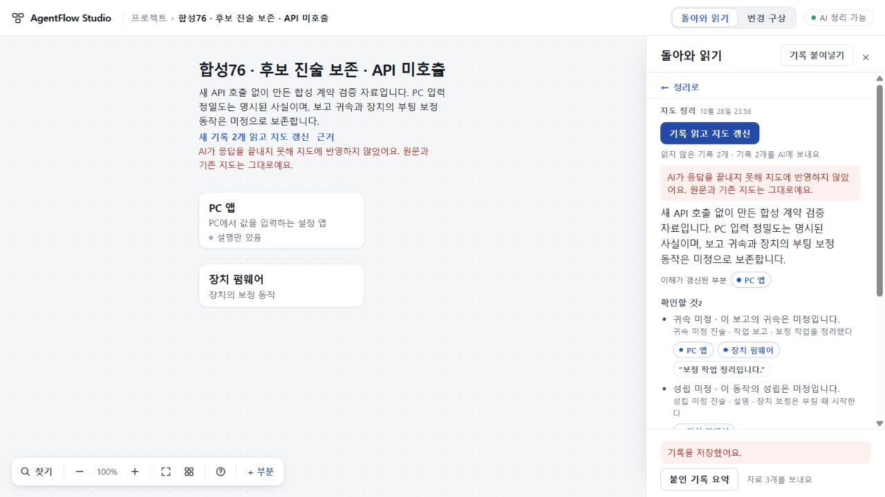

# 응답 중단 안내78

2026-10-29. [PR48](https://github.com/tlsee0813-cmd/agentflow-studio/pull/48)은 모델 응답이 끝나지 않은 이유를 근거 위반으로 잘못 설명하던 문제를 고친다. 최종 앱 소스는 `d12009e9822b71b6b4a8bdf4fbed671721e036b6`이다. 실제 개발 지시의 첫 지도 전달 실패를 해결한 변경은 아니다. 공개 수용본73은 그대로이며 병합·배포하지 않았다.

## 바뀐 행동

- 공급자가 `length`로 끝내면 `AI_RESPONSE_INCOMPLETE`, 그 밖의 미완결 종료는 `AI_RESPONSE_UNFINISHED`로 반환한다. 둘 다 응답 내용을 지도 근거로 읽거나 적용하지 않는다. 정상 종료 뒤의 계약 검사, timeout, 취소는 분리한다.
- 지도에서는 “AI가 응답을 끝내지 못해 지도에 반영하지 않았어요. 원문과 기존 지도는 그대로예요.”라고 안내한다. 부분 저장·자동 재시도·응답 수선은 없다.
- 총괄 PC 검사에서, 전송 시도 뒤에도 저장 안내에 “AI에는 아직 보내지 않았어요”가 남는 모순을 발견했다. 저장 확인은 “기록을 저장했어요.”로 고쳤다. 저장 전 안내에는 지도 정리나 요약을 누를 때 전송한다는 설명이 유지된다.

76의 명시 불확실성 계약과 후보 진술, 현재 주장 연속 읽기, UI75 최종693의 경로·관계·복귀 수리를 보존했다. 모델·프롬프트·한도·저장 형식·레이아웃은 변경하지 않았다.

## 실제 검증과 한계

작성자는 `42ff08bd5c7aacab301855da60946e034ac664b7`에서 TS6 빌드의 전체 Node479개 통과를 보고했다. 총괄은 고정 TypeScript5.8.3 check/build와 failure78·context75 관련8개를 실행해 통과했다. 이후 저장 문구 한 줄을 고친 최종 앱을 다시 고정 빌드하고 PC에서 재확인했다.

관련 검사는 서버 HTTP 오류 전파, 유효 JSON이어도 length면 미적용, 정상 종료의 불법 근거 거절, 정상 결과, timeout/cancel, client의 commit·done0/pending해제/입력불변을 포함한다. 구형 map.1의 오류 분류와 모르는 오류 코드의 일반 안내도 대조했다. 구형 실제 브라우저를 별도로 실행한 검증은 아니다.

총괄은 실제 브라우저1280×720에서 표준 합성76 백업을 정상 가져온 뒤 후속 기록을 저장하고 지도 갱신을 눌렀다. 로컬 공급자 경계에서 length를 반환한 **오프라인 재현**이며 실제 API 호출은 없다. 기존 두 부분·두 미정 진술·읽지 않은 기록이 남고, 실패 안내를 읽을 수 있으며 문서 전체 스크롤도 생기지 않았다. 새로고침 후에도 지도와 기록이 남았다. 문구 수리 뒤 같은 사용자 흐름을 새 합성 기록으로 다시 확인했다.

이 화면은 실모델 품질이나 Cloud 독립 PC 검사의 증거가 아니다. 화면의 합성 표시를 유지했으며, 저장·미적용의 바이트 불변은 관련 실행 검사와 구별한다. 정확 최종 SHA의 원격 CI 판정은 아래 후속 기록에 남긴다.

## 남은 일

실제 입력의 최종 지도 완결·대상 판독은 여전히 미해결이다. [79의 별도 모델 조합 비교](../2026-10-29-direct-model-79/RESULT.md)와 이 안내 수리를 구별한다. 작은 검사 통과를 전체 제품 수용으로 세지 않는다.
