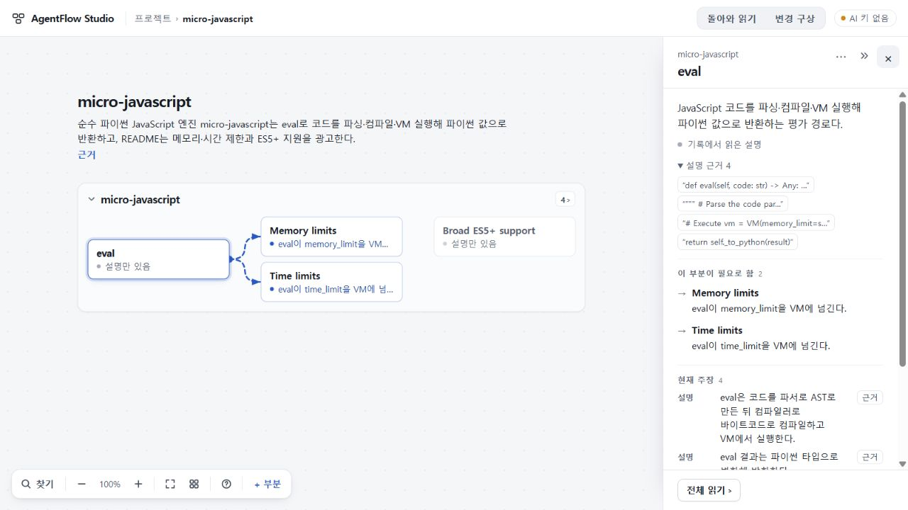

# 80 · 현재 설명의 근거 접근

현재 부분 설명에 저장된 근거를 선택 읽기와 전체 읽기에서 직접 열도록 했다. 런타임 코드 `589ac6247ea5f08c3ed989c6cad2b7d97e2735ac`, 기준78 `e20d7d5ca99a2d6406ca05af69c9fc0a57293e78`, [PR49](https://github.com/tlsee0813-cmd/agentflow-studio/pull/49). **독립 PC 검토는 수용 가능, Windows 테스트 런처 수리 뒤 CI 확인은 대기 중이다.** 공개 수용73, 미수용74, UI 범위 수용75와 후속76·78의 좁은 수용을 구별한다. 미병합 개발 계열이며 배포 변경은 없다.

## 판정 기준을 바로잡은 이유

79의 A1 진단 중 역할 문장이 현재형이라는 이유만으로 요구를 구현 완료로 올렸다고 확정한 부분은 철회한다. 책임을 설명하는 “~한다”는 요구된 구성에도 쓰일 수 있다. 기존 설계 v1.3.1은 책임별 구성도 유효하다고 했고, 현재 UI는 설명의 출처와 주장 종류를 구별한다. 앞으로는 원문이 요구만 했는데 구현·실행·검증 완료를 명시적으로 덧붙였는지, 화면이 요구를 실현된 사실로 올리는지 구체적으로 판단한다. 79의 무효 응답은 화면에 적용되지 않았으므로 그 화면에서 사람이 실제로 오독했다고 주장할 수 없다.

이 수정으로 79를 구제하지 않는다. 별칭 길이 초과, 제품 근거와 material의 충돌, 운영 절차의 제품 부분화, 정확한 철회 대응 조건 누락은 독립적으로 남아 있다. 원래 응답·평가 파일은 보존하고, 이 문서가 판단의 변경 이력이다. 기존 실패 재호출·수선·재적용은 하지 않았다.

Pro와 내장 Sol의 읽기 검토를 대조한 뒤 총괄이 선택했다. 역할 양태를 위한 새 스키마, 모든 역할에 미구현 접두사를 붙이는 규칙, 카드에 대표 주장 본문을 덧붙이는 제안은 채택하지 않았다. 대표 주장 종류가 역할 전체의 출처·상태를 대신하지 않으며, 추가 문장은 카드 밀도와 조건 잘림 문제를 만들 수 있다. 실제로 확인한 공백은 **역할 자체의 근거 입구가 없었다는 것**이다.

## 바뀐 경험

현재 설명 아래 접힌 `설명 근거 N`을 두고, 펼치면 각 구간을 짧은 칩으로 보인다. 원문을 열 때는 전체 정확 인용을 사용한다. 같은 문장의 서로 다른 위치는 구별하며, 기존 원문 복귀 경로로 같은 부분·면·버튼·펼침을 되살린다. 현재 역할의 `roleBasis`만 사용하고, 사람이 바로잡은 설명에는 과거 AI 근거를 붙이지 않는다. 무대체 후속 설명과 명시 대체, 위치 없는 구형 인용을 기존 계약대로 처리한다.

UI75의 중첩 제목·선 우회·아홉째 관계 설명, 76의 명시 불확실성·현재 주장 연속 표시, 78의 응답 중단 안내를 포함한 계열이다. 지도 배치·카드 상태·스키마·원문·모델·프롬프트는 바꾸지 않았다. [구현 범위](README.md), [사람이 작성한 합성 백업](role-evidence-synthetic-backup.json).

## 확인한 것과 남은 것

- 총괄 Windows의 고정 TypeScript 5.8.3로 check/build 통과. role80·context75·failure78 관련 12개 테스트 통과. 작성자의 전체 Node 483개 통과는 TS6 환경의 별도 결과다.
- 총괄은 기존76 실제 모델 응답의 micro-javascript 백업을 정상 가져와 실측1280×720에서 조작했다. eval의 역할 근거4개 중 기존 현재 주장에 없던 넷째 `return self._to_python(result)`가 정확 `[1338,1368)` 근거로 열렸다. 선택 읽기와 전체 읽기 각각에서 같은 버튼 초점·펼침으로 복귀했다. 기존 현재 주장 하나의 정확 인용과 초점 복귀도 유지됐다.
- 같은 문장 두 위치, 역할만 있고 주장 없음, 요구 역할과 좁은 작업 보고, 사람 수정, 무대체/명시 대체, 구형 좌표 미생성은 역할 단위 검사에서 확인했다. 실제 사람의 의미 이해나 임의 자료 일반 품질을 증명하는 검사는 아니다.
- 내장 Sol의 독립 코드 검토에서 새 P1/P2는 없었다. 사람이 설명을 수정한 뒤 모델이 명시 대체를 보내도 사람 설명이 유지되고 AI 근거가 붙지 않는 추가 반례를 실행했다. 좌표 없는 구형 반복 인용은 기존 첫 일치 검색의 한계가 있으며, 80이 그 위치를 복원했다고 주장하지 않는다.
- Cloud에는 기존 검토 세션으로 두 PC 크기의 새 차이만 전달했다. 제공 Windows 빌드 ZIP은1,114,945B, SHA256 `8d8f775e0456a2abd19136a4e4166057ed03c3bda4d6ebdb2e7d3c4cee9cbe13`, 201항목·지정3자료다. 76의 두 OSS 저장 응답과 새 합성 백업을 재사용하며 새 모델 호출은0이다. 제공 빌드 실행은 Cloud 독립 소스 재빌드나 새 CI 성공과 다르다.
- Cloud는431.3초 후 이번 접근 범위 수용 가능·새 P1/P2 없음으로 반환했다. 실측1280×720·1440×900(DPR1)에서 micro의 첫째/넷째 근거를 선택 읽기·전체 읽기로 왕복하고 면·버튼·펼침·선택·스크롤·카메라 복귀를 확인했다. Zephyr의 명목 모드와 실제 절전 불가 제한은 계속 함께 읽혔다. 합성80의 역할만 있는 부분, 요구와 좁은 보고, 사람 수정도 확인했다. 별도 domain 합성 사본에서 반복 문장의 둘째 `[38,62)`와 첫째 `[6,30)`를 구별했다. `role80_flow` 및 별도 실제 자료 검토 래퍼 각각 exit0. 원문·소스 실행·새 모델 호출 검증으로 확대하지 않는다.
- [초기 CI40734653403](https://github.com/tlsee0813-cmd/agentflow-studio/actions/runs/40734653403)는 Ubuntu 성공, Windows 실패였다. Windows의 기존 검사들은 통과했으나 새 `role80_flow`가 CLI 자료를 읽기 전에 빈 stdout으로 실패했다. 원인은 `file://${process.argv[1]}`가 Windows 경로를 정상 파일 URL로 변환하지 못한 테스트 런처였다. 총괄 Windows에서도 수정 전 stdout0을 재현했다. `pathToFileURL`로 바꾸고 실제 CLI 하위 프로세스의 JSON 백업을 검사하는 회귀를 추가해 role80 5개가 통과했다. 제품 런타임은 그대로다. 수리 커밋의 새 CI를 확인한 뒤 최종 판정한다.

넓은 지도 여백과 긴 읽기면 스크롤, 복잡한 실제 지시에서의 첫 지도 전달 실패는 남아 있다. 이번 근거 입구 수리를 전체 지도 생성 또는 완성된 PC 제품 경험의 수용으로 확대하지 않는다.

현재 표시된 역할만 대상이다. 사람이 쓴 note나 받은 요약이 선택 읽기에서 먼저 표시되면 그 문장에 AI 역할 근거를 붙이지 않는다. 과거 역할의 근거 이력 UI는 이번 범위에 포함하지 않았다.

총괄 직접 화면 SHA256 `1e12bac58175659b387bc3b0be43f7281b7529200c4a86d0d5713bfa79cc4d62`. 저장 응답을 보는 화면이며 OSS 실행 결과가 아니다.
