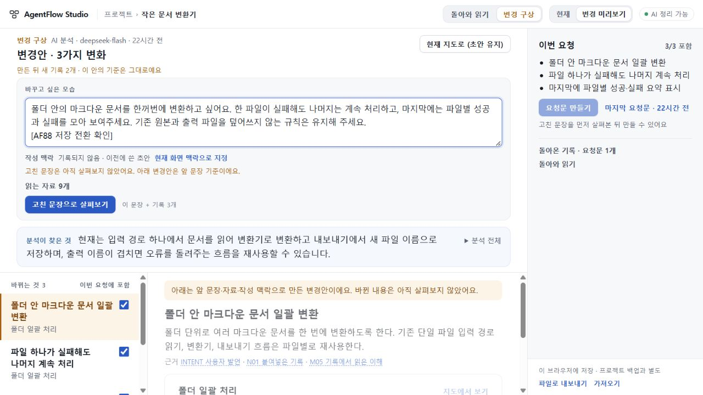
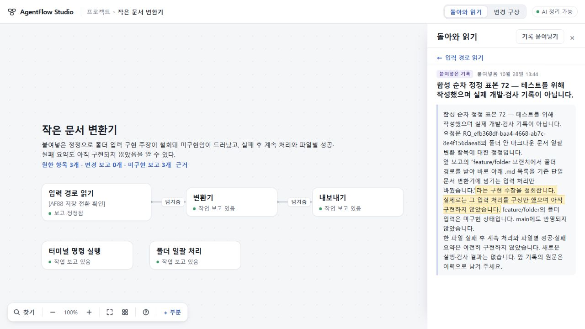

# 88 결과 — 공개73 저장 사본의 업데이트 범위 수용

2026-10-29. **공개73 저장 사본을 최신 후보에서 처음 저장·재열기하고 정상 파일 왕복하는 범위를 수용했다. 제품 코드는 바꾸지 않았다.** 실제 개발 지시의 첫 지도 문제는 미해결이며 공개73 유지·미병합·미배포를 계속한다. 이 결과를 전체 제품 완성이나 공개 전환 허가로 읽지 않는다.

## 무엇을 확인했나

[설계와 입력 구별](DESIGN.md)에 따라 source `26b24b935567a95d101720cbf0e06d188d8765d9`의 격리 빌드에서 정상 저장한 뒤, 같은 로컬 주소의 서버를 source `107318ac296ecbb1ce6734e630f8ec1f35eb9f6d`로 바꾸었다. 새 후보의 app tree는 `7beb4ba00211a1afd3b9549ef4eb08a55b2a8384`이며87 최종runtime `2999fd65c67754bd7a0bd0d45f9fd841fd3956e5`와 같다.

총괄이 Windows1280×720/DPR1.25에서 직접 정상 UI를 조작했다. 공개73의 프로젝트 백업은 기존 철회 백업과 바이트가 같았다. 공개 사본의 변경안은 비어 있어 같은 소유자의 과거 실제 AI 변경안 파일을 격리 사본에만 가져왔다. 합성 변환기 원문을 처리한 과거 실제 AI 결과와 검토용 조합을 구별한다. 실제 OSS 실행이나 완전한 과거 공개 sidecar 복원이 아니다.

- project.11→project.13: revision15→16, 지정한 한 부분의 빈 메모→검토 표식, 해당 구성 revision0→1만 바뀌었다. 원문·읽기·좌표·철회 연결과 나머지 필드는 전체 JSON 대조에서 동일했다.
- 변경안 file.2→file.3: 첫 열기는 파일 형식과 내보낸 시각만 달랐다. 초안117자 끝에 검토 표식16자를 한 번 추가했고, 기존 분석·선택·동결요청·근거·소유·자료는 바뀌지 않았다. 재열기와 정상 재수입 후 bundle 전체도 동일했다.
- 과거 작성 맥락은 ‘기록되지 않음 · 이전에 쓴 초안’으로 남았다. 현재 선택을 소급하지 않았고, 고친 초안을 이전 분석으로 새 요청에 쓰는 동작은 차단했다.
- 동결 요청문4013자는 화면 PRE 원본과 저장 snapshot이 문자·UTF8 바이트 모두 같았다. 새 초안 표식은 과거 요청문에 들어가지 않았다. 본문 SHA256은 `e93a2b3457108f96b728499ce9307e0829e0e70ed74c7365cd2bcd7fcf6c4277`이다.
- 철회 근거53자는 원문의 같은 구절로 열렸고, 복귀 후 같은 주장·선택 URL·카메라와 해당 근거 버튼 초점을 유지했다. 내보낸 새 프로젝트를 정상 재수입한 뒤 다시 내보낸 파일도 바이트까지 동일했다.

기존 reading의 요청ID와 별도 legacy snapshotID는 서로 달랐다. 같은 plan/item이라는 이유로 강제 연결하지 않았으며 직접 첨부결과0도 유지했다. 전체 JSON 차이와 원본 해시는 [독립 대조](evidence/independent-preservation.json), 실제 화면·본문은 [최소 증거 목록](MANIFEST.json)에 둔다. 독립 담당은 회수 파일과 소스를 대조했으며 브라우저를 다시 실행한 것으로 표시하지 않는다.

## 실행과 남은 한계

73 격리 소스는 기존 고정 TypeScript5.8.3으로 app·continuity 빌드가 각각 exit0이었다. 최신 후보는 같은 app tree의87 제공 빌드를 재사용했고, 기존 성공 receipt·핵심 파일·전체 dist 해시를 대조했다. [정확2999 양OS CI40781916884](https://github.com/tlsee0813-cmd/agentflow-studio/actions/runs/40781916884)는 기존 증거로 재사용했으며 이번 새 CI 실행으로 세지 않는다. 모델·외부 API·설치·제품 코드 변경은0이다. 자체 검토 서버는 모두 종료했다.

처음 선택한 로컬4388에는 이미 읽을 수 없는 저장 상태 경고가 있어 가져오기·쓰기를 하지 않고 중단했다. 그 저장공간을 초기화하지 않았다. 새51888의 빈 상태를 확인한 뒤 위 검증을 진행했으므로4388 사전 점검은 업데이트 성공으로 포함하지 않는다.

요청문 닫기 후 키보드 초점이 BODY로 가는 한계를 관측했다. old73/new107의 해당 closeSheet 코드는 완전히 같았으며 이번 업데이트에서 생긴 회귀라고 단정하지 않는다. 초안·요청문 보존과 요청문 닫기 초점 품질을 구별하며, 전체 키보드 사용성이 통과했다고 말하지 않는다. 모든 legacy 판본·동시 구형 탭 편집·다운그레이드는 이번 검증 범위가 아니다.

## 총괄 판단

현재 후보에 실패77·79·81·82 runtime이 섞였다는 증거는 없고, UI75 최종693 수리를 포함한 기존 수용은 유지된다. 그러나 후보의 공개 승격은 map.6 기본 생성 경로까지 포함한다. 인수인계5·8의 실제 첫 지도 의미 조건을 저장 업데이트 성공으로 대체하지 않는다.

86의 독립 출처 연결은 특정 정보 증분 가설에 필요한 관측이었다. 이를 모든 향후 계산 개선의 유일한 필요조건으로 일반화한 해석은 정정한다. 그렇다고 완료한 Pro 추론·비추론·typed 읽기·검토·대상 우선 실험을 다시 시작하지는 않았다. 이번에 새 첫 지도 실험은 선택하지 않았다.

전체 목표는 활성이다. 미병합 UI 축적을 제품 완성으로 취급하지 않고, 다음 선택에서도 실제 첫 지도 전달·의미 품질이라는 남은 관문과 사용 경험을 함께 판단한다.
