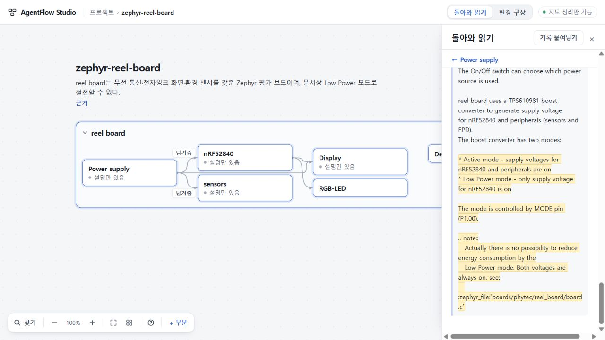

# 104 — 실제 Zephyr 첫 지도, 제한된 범위 수용

103에서 실패했던 CLI 설정의 호환성을 바로잡은 뒤, 같은 원문 두 건으로 실제 첫 지도를 만들었다. **정상 UI 접수 → 다른 프로젝트 편집·새로고침 → 도착한 결과 회수 → 명시 반영 → 원문 확인 → 전체 백업 복원**을 총괄이 1280×720 PC에서 확인했다. 전달과 이 한 응답의 의미를 수용한다. 공개 제품 완성이나 일반적인 생성 성공률의 판정은 아니다.

## 실제 실행과 과거 실패의 구별

사전 선택은 [3024a88의 관측 계약](https://github.com/tlsee0813-cmd/agentflow-studio/blob/3024a88e6cfa0536181904d45cc782f0138429c6/docs/cycles/2026-10-29-zephyr-config-correction-104/OBSERVATION.md)에 남겼다. 102 수용 runtime 8ae7eb9와 최종 코드/검사 ffcef18, app 2e9d8d9를 사용했다. 이번 제품 코드 변경은 없다.

103의 code_mode_host disable을 제거하고 approval_policy=never를 명시했다. 설치된 host를 사용했으며 설치·계정·키 변경은 없다. 나머지 17개 feature disable, read-only, 원문 전체 ask, 98 FIRST 지침, Sol High, 299초 선택/300초 판정은 유지했다. 103을 같은 설정으로 재시도하거나 과거 실패를 소급 수용하지 않는다.

실제 생성은 top-level 1회, 앱 재시도·fallback 0회다. 접수부터 ready까지 **120.646초**, 실행자 판정까지 120.639초였다. child exit 0, 완결된 6,734바이트 응답을 수리 없이 검증했다. 네 이벤트는 thread.started, turn.started, agent_message, turn.completed였으며 tool/error 이벤트는 없었다. PowerShell snapshot 경고 158바이트는 비치명적이었다. stdin 실제 전달 바이트의 SHA가 동결한 전체 wrapper와 일치한다.

관측 usage는 input 16,109 / output 5,023 / reasoning output 2,588이며 각 원래 필드를 그대로 남겼다. 이는 비용 상한·성공률·p95의 증거가 아니다. 토큰/금액 hard cap 및 원격 연산·과금 중단은 여전히 미확인이다. 설치 CLI는 0.165.0-alpha.1.2이며 89의 구판 실행과 같은 조건으로 간주하지 않는다. [실행·보존 수치](evidence/observation.json).

## 의미 판정

총괄이 원문·전체 응답·실제 화면을 대조했고, 기존 Sol High 세션의 독립 검토도 같은 네 관문을 통과로 판정했다. [독립 검토](evidence/semantic-review.json).

| 관문 | 실제 보존된 의미 |
| --- | --- |
| Z1 구성과 방향 | nRF52840, 디버그 어댑터, SPI+GPIO 화면 제어, 공유 I2C 센서의 주소·인터럽트, 전원 공급 방향. nordic,nrf-twim·FAST·default/sleep도 남았다. |
| Z2 화면별 제약 | B1/HINK-E0213/SSD1673/ssd16xx/reel_board와 B72/HINK-E0213A22/SSD1675A/ssd16xx/reel_board@2를 보존했다. 실제 화면 종류가 빌드를 제약하며 PCB 판본만으로 @2를 추정하지 않는다. |
| Z3 절전 제한 | 명목 Active/Low Power 구분과 실제 두 전압 always-on, 절전 불가를 함께 설명한다. 이 제한은 지도 첫 요약에도 나온다. |
| Z4 근거의 한계 | 고정 문서·DTS의 설명으로 남고 실물 연결·센서 측정·플래싱 성공으로 승격되지 않는다. |

부분 7개·관계 5개·claim 14개는 결과의 크기이며 합격 기준이 아니다. 센서는 한 부분으로 묶였으나 개별 기능·주소·핀이 claim에 남았다. 모든 compatible 문자열과 부수 문서 정보까지 전사한 것은 아니다. 빈 candidates/gaps/material도 완전성의 증거로 세지 않는다.

## 실제 PC 사용과 저장

생성 중 13:07:56 UTC에 다른 micro 프로젝트의 기록을 저장하고 새로고침했다. 이어 편집하던 118자 초안은 ready 도착 전후 값·역방향 선택 117..118·스크롤 0·포커스가 모두 같았다. 도착 뒤 이 초안도 명시 저장했다. micro 전체 백업은 revision +2와 이 두 기록 외 모든 필드가 기존과 같았다.

원래 Zephyr로 돌아오면 도착 결과를 명시 반영할 수 있었다. Power supply의 제한 claim에서 해당 원문이 강조된 자리로 가고, 읽던 부분으로 돌아왔다. Display의 두 대응 조건과 sensors의 독립 I2C 사실·원문도 확인했다. 입력 원문은 불변이다. 적용 후 전체 백업, 새로고침 후 백업, 새 사본 import 후 백업은 모두 동일하며 SHA는 dcda9cc2acbd387fdfc7f1751f7ba4e59a2bbf6b496c5c04bbba24477552bb49다.

서버는 STOPPED(slot=null, unsettled=null)로 닫혔고, 실행 lease 부재·runs 빈 상태·이 관측의 node/codex 프로세스 0을 확인했다. raw·원문·journal·전체 백업은 비공개로 보존한다. 공유 증거는 해시·판정·필요한 화면만이다.

## 남은 사용 경험과 다음 선택

한계도 실제로 보였다. Display의 긴 대응 설명은 1280×720에서 좁은 문단으로 읽어야 하며, 전체 읽기 역시 폭이 좁다. 지도 전용 CLI가 가능한 상태에서 상세 하단은 일반적인 AI 키 없음 문구를 보여 기능 범위를 흐린다. 103의 실패 안내가 새로고침 뒤 사라지는 문제도 남아 있다. 이를 현재 의미 성공으로 덮지 않는다.

다음은 **이 성공한 실제 지도를 다시 생성하지 않고**, 한 부분 이해 → 변경 범위 선택 → 요청 고정 → 돌아온 결과와 변화 확인을 하나의 체험으로 연결한다. 로컬 map-only 실행자는 plan/digest까지 제공하지 않으므로 이 경계를 먼저 기존 기능·완료 증거와 대조한다. 새 기반 기능을 늘리기 전에 무엇이 기존 경로로 가능한지, 막힌 단계가 무엇인지 확정한다. 동시에 공개 가능한 읽기·보존 개선과 로컬 CLI/전체 생성 품질 보류를 분리해 실제 전달 범위를 정한다.

공개 수용73·미수용74·UI 범위 수용75 및 693d0c7 수리는 그대로 구별·보존한다. 공개 앱 변경·병합·배포는 0이고, 전체 목표/Q02/Q06은 active다. 102 검사 성공, 103 설정 실패, 104 이 표본 성공은 서로 다른 판정이다.
