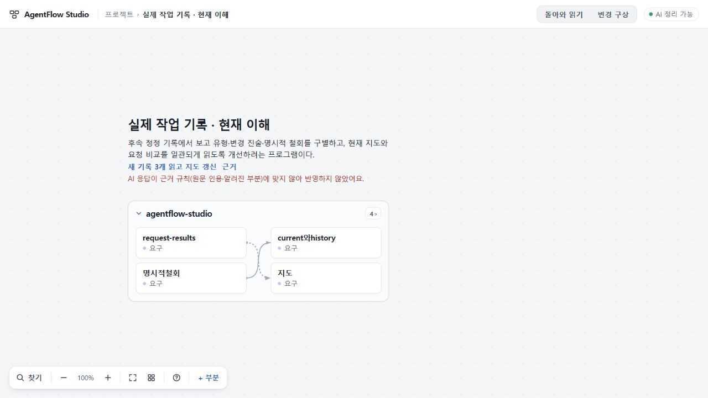

# 136 실제 반환 — 계약 반려, 원프로젝트 보존

135의 좁은 UI 수용 뒤, 129 지도→130 변경 구상→134 고정 요청→135 실제 구현을 같은 정상 PC 경로에서 한 번 이어 읽었다. **178.210초 만에 완결 응답이 도착했으나 계약 검사에서 거절됐다.** 반영·재시도 0이다. 반환 의미와 전체 사용자 경험은 통과하지 못했다.

## 실제 입력과 실행

선택97fc4fab85edaf67f5473e79a16177fe3bdc8ea5, runtime73f6f253e8ce9921504011b7281584955d41716d. 원RQ93168eb4-c5bc-40b7-93e6-0ba660df3f3f 하나를 정상 화면에서 선택했다. 작성자135보고3792자(pasted), 실제 request-results.ts의 표시된 여섯 구간11567자(code, 전체 파일 아님), Root 검사기록1014자(test)를 정상 입력했다. 기존3545자 역사기록은 요청 이전 자료로 구별했다. 자료4건 전체 포함/partial0, JSON입력44621UTF-8bytes. ask SHA844b1ef79bb41bceab08b77371b7e7bba87542102dd3148ca9c3db146ffc4a23.

정상 버튼 ‘이 요청과 보고 읽기’로 job MJ_7e76055e-3e66-4660-9ade-3d2e72fdc05c를 접수했다. 생성1회, retry0. 기존 고정CLI0.165.0-alpha.1.2/gpt-6.1-sol high/map7-later, 선택299초·판정300초. prompt·권한·실행 정책 변경0. 03:18:35.840Z 접수→03:21:34.050Z failed. exit0, 허용events4, 최종9974bytes SHA d7bbf386fd21798acd28d0352e87a6a770b9d9c82de9298459ffd80df686e414. JSON.parse는 성공했고 최종파일과 agent_message는 일치했다. INVALID_RESPONSE/detail.rule CONTRACT로 거절됐다. 시간초과·미완결 전달 실패와 구별한다.

## 진단의 한계

**어느 필드의 어떤 조건을 어겼는지는 확인되지 않았다.** validator의 여러 기본 검사와 request-match 검사가 일반 오류로 합쳐져, 영수증에는 CONTRACT만 남았다. 고정 실행은 --ephemeral이며 consumed 뒤 run 폴더가 정리된다. 이 원실행의 최종 텍스트는 회수하지 못했다. 해시·바이트 수는 내용 보존이나 의미 판정의 대체물이 아니다. 앞선 진행 안내에서 원응답을 보존하겠다고 했으나 실제 보존된 것은 입력·실행영수증·UI저장 상태이며, 원응답 내용 보존은 달성하지 못했다. 특정 위반 원인을 추정해 사실로 적지 않는다. 응답을 수정하거나 같은 입력으로 다시 생성하지 않았다.

## 실제 화면과 보존

접수 뒤 다른 기존 프로젝트 ‘PC 시작 검증 · 원문 보관’으로 이동해 초안을 입력했다. 그때 textbox 원값은 빈 문자열이었다. 새 메모 입력→새로고침→변경 구상 재진입 뒤 정확히 복구됐다. 모델 호출 없이 원프로젝트로 돌아왔고 계약 거절 안내와 기존5부분을 확인했다.

실행 전후 전체 workspace 문자열은 일치한다. 기존 모든 plan/RQ도 그대로며 변경은 다른 프로젝트의 새 초안 저장뿐이다. 실패 뒤 새로고침한 workspace·plans는 직전과 byteexact, 정상 UI 백업의 전체 원project도 실행 전과 exact(SHA45ea2fd128a94fdfa28627bae334346774e0c6cb21268d780071be5e0aa028c4). 원134RQ와 반려132RQ 모두 보존됐다. 새로고침 뒤 실패 안내가 사라지는 기존 한계는 재관측했으며, 영수증 자체는 failed로 남아 있다.

[최소 실행·보존 증거](evidence/preservation.json). 원입력·초안·백업은 로컬 비공개 보존. 모델 원응답은 없으므로 독립 의미PASS를 요청하지 않았다. Root 초기 비교의 realm/prototype 차이는 JSON바이트 비교로 정정했으며 제품 오류로 세지 않는다.

## 다음 선택과 종료선

137은 새 저장·queue·모델 실험이 아니라 **현재 validator의 거절 위치와 고정 규칙을 기존 영수증으로 전달하는 진단 수리**로 한정한다. 허용·거절 조건, 반환값, prompt, 모델, 제한시간, apply는 바꾸지 않는다. 원문·민감한 값·자유문자열 exception을 영수증에 추가하지 않는다. 기존 검사 및 합성 오류 fixture로 동등성과 진단을 확인하고 독립 검토한다. 136 원인 규명 성공으로 소급하지 않는다. 새 실제 생성은 수리 수용 후 별도로 선택하며 이번 실패를 성공할 때까지 반복하지 않는다.

135 수용은 유지하되136 반환 의미·전체경험은 미수용. 공개73·미수용74·UI범위75/693d0c7·기존미커밋·키 보존, 배포0. 독립 수용된 기존지도 공개127 경로와 생성후보의 경계도 유지한다.
