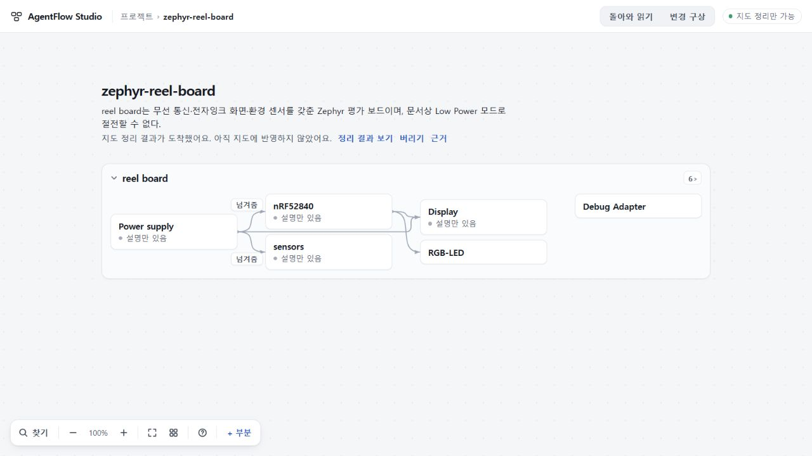
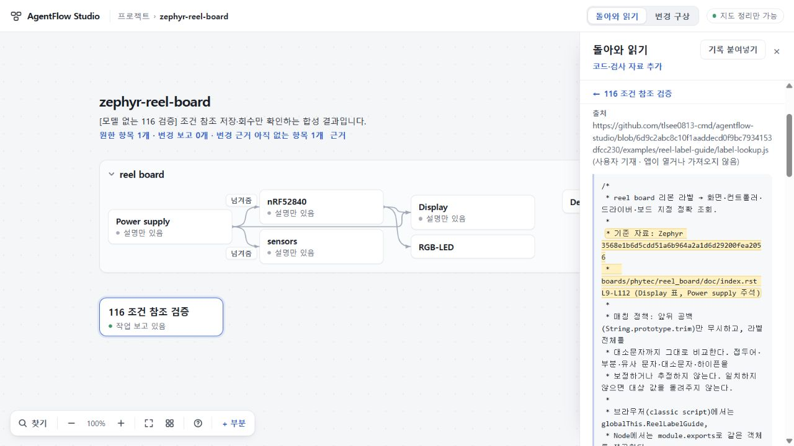

# 116 조건 참조 계약 — 총괄 검증

구현 후보: `23aef513cc1214c2f0f21502a37334c22b4a1308` · 검사/이전 결과 fixture: `2697bb57470837f5b4093340c539e70732243f63` · [초안 PR66](https://github.com/tlsee0813-cmd/agentflow-studio/pull/66).

최종 판정은 원문 조건 계약과 정상 UI 경로 한정 수용이다. 정확 head 47445f30c0f04c98c26bb6c9e96fa05186411c2f의 CI40938990873은 Linux·Windows 모두 성공했다. 초기2697 CI는 양 OS에서 계약·도메인 검사를 통과했으나, browser smoke의 가짜 서버가 후속7을 지원하지 않아 실패했다. a39735bd00e1d629cd9b2ce06532424bfa9a6f35에서 검사용 서버와 후속 응답 기대값 두 파일만 고쳤다. FIRST6 기대값은 강화했고 실제 제품 계약은 바꾸지 않았다. 아래 검증은 실제 모델의 의미 정확성이나 제품 전체 완성을 입증하지 않는다.

## 해결한 경계

115의 실제 반환은 사용자 기재 파일 판본을 원문 조건으로 써서 거절됐다. 116은 후속 읽기만 studio.map.7로 선택하고, roleAboutAt·claim.aboutAt·candidate.statement.aboutAt·match.aboutAt을 보낸 원문 구간 또는 null로 받는다. 조건 원문은 바깥 공백만 제거해 기존 about 문자열에 저장한다. 다른 기록·역할 근거 밖·없는 구간·material과 겹침·80/200 UTF-16 초과·이전 키 혼용은 응답 전체를 거절한다. 사용자 기재 자료 정보는 기존 원자료 화면에 남는다.

FIRST6와 map1–6의 프롬프트·recipe 12개는 고정한 원본 hash와 모두 같다. 새 laterPrompt와 명시적 map7-later 범위가 있을 때만 후속7을 선택한다. project14/map-reading.5/map-input.1/map-job.1은 유지한다. 이전 ready6은 저장 당시 input/schema/prompt로 읽으며 현재 later7 상태로 바꾸거나 새로 생성하지 않는다.

## Root 실행 및 독립 검토

- Windows Node24.19.0 / 잠금 TypeScript5.8.3 build/check: exit0. 제품 코드는 이후2697에서도 같다.
- 새 condition116 검사 11개: 모두 통과, 실패·skip0. 네 슬롯/길이/거절표, null의 의미손실 한계, 기존 프롬프트, 실제 handler·CLI·browser controller, 이전 ready6 회수를 다룬다. 내부116case 숫자는 작성자의 집계이며 Root 실행기는11test로 집계했다.
- 기존 Sol High가 구현23aef51과 추가검사2697을 각각 정적으로 검토: actionable P1/P2 없음. 리뷰어의 실행 횟수는0이며 Root 실행과 구분한다.

## 정상 1280×720 제품 경로

Root는 115 원프로젝트14와 전체 변경안·요청문 묶음을 정상 가져오기 UI로 넣었다. 프로젝트 SHA256 `dd5b31e0792d71ae5fa1aa625a23a0728e1e6742fee89324140f12f6c60b5e54`, 묶음 `cdf2dc70965e8eaf9c6d701dcef39a022d1baab8e0e0fcf047e4941590f8ba05` 그대로다. 선택한 RQ0797의 ask는 schema 문자열만6→7로 바뀌고 내용은 같다.

새로 작성한 명시적 합성 wire를 가짜 CLI로 딱 한 번 반환했다. 실제 모델 호출은0, 115 실패 wire의 수정·재검증·적용도0이다.

1. 정상 ‘이 요청과 보고 읽기’ → 홈 → 별도 프로젝트 초안 편집.
2. 원프로젝트 복귀·새로고침 뒤 ready 회수. 명시 적용 전 프로젝트와 전체 요청 묶음은 그대로다.
3. ‘정리 결과 보기’로 명시 적용. 네 조건 문자열이 정확히 저장되고 원6개 기록·기존reading·전체 요청 묶음·다른 초안은 보존된다.
4. 코드 근거를 열면 실제 원문 구절을 강조하고 파일 판본은 ‘사용자 기재’로 보인다. 읽던 부분과 근거 버튼으로 돌아온다.
5. 적용 후 새로고침·정상 백업 다운로드·새 사본 가져오기에서 전체 project가 정확히 같다. 116 회수 전에 보존한 실제 pre116 reader도 이 정규화 project14를 그대로 읽는다.

## 증거의 한계와 운영

작성자 Claude는 코드·검사·pre116 ready6 fixture를 push한 뒤 5시간 한도에 도달했다. 작성자 추가 UI 스크립트는 미완성·미push이며 통과 증거에 넣지 않았다. 원세션과 미커밋 파일을 보존하고 추가 제품쓰기/push를 멈추도록 전달했다. Root가 별도로 끝낸 정상 UI 검증으로 위 경로를 판정한다.

ready6 fixture 생성기는 실제 db63a42 checkout의 builder/codec/handler/store를 사용하고 MAP7 export 부재를 확인한다. 새 producer에 schema6만 붙인 시험과 다르다. 다만 작성자 구빌드(TS6 offline emit)의 clean tree·compiled module hash까지 manifest가 묶지는 않아, 정확한 생산 빌드 출처는 작성자 기록에 의존한다. Root는 그 저장 파일의 복사본을 새 코드가 재생성 없이 회수·적용하는 실행을 확인했다.

정규화된 project14의 이전 리더 호환성과, 미처리 raw7 예약을 구형 탭이 지원한다는 주장은 다르다. 다운그레이드 전에 raw7 작업을 마무리하고 원 job·백업을 보존해야 한다. 조건 구간을 따로 클릭하는 UI는 이번 범위가 아니다. 원문 안에 있는 조건이라도 해당 주장에 의미상 적합한지는 기계적 위치 검사만으로 증명되지 않는다.

다음 관문은116 수용 후117에서 같은 실제 자료·RQ를 쓰는 정상 제품 경로 한 번이다. 전달 실패와 계약 실패, 의미 오류를 구별한다. null을 쓰더라도 중요한 판본·검사 조건을 빠뜨리면 의미상 반려한다. 코드 주석의 Zephyr 의존성 commit을 입력 파일 자체 판본으로 바꾸어 읽어도 반려한다. 시간/토큰/권한 확대나115응답 수선은 하지 않는다.

공개73·미수용74·UI수용75(693d0c7)를 구별한다. UI75 조상과 기존 stash를 보존했고 병합·배포는0이다. 전체 목표는 계속 active다.
