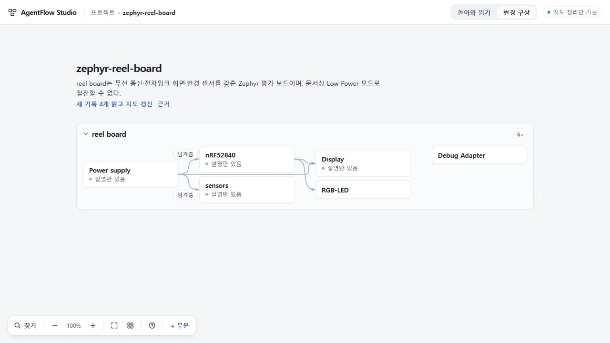

# 119 실제 반환 관찰 — 전달 완료, 적용 반려

동일 원본·동일 요청으로 새 실제 생성 1회를 정상 PC 경로에서 관찰했다. 약180.967초에 완전한 JSON이 도착했지만 기존 ID 계약에 맞지 않아 응답 전체가 거절되었다. ready·지도 반영에 도달하지 못했으며 전체 의미/사용 경험 성공으로 수용하지 않는다.

## 무엇이 일어났나

- 선택 b4f3ef989f60627c460e1db9bfcc5b5da152c9c8; 제품8875b774, 앱71ddbda17b49bf20bfe26fc399222065fd6339b0. 실제 status/newrecipe와 동적prompt·stdin·ask 해시가 사전 선택과 일치한다. [실행 바인딩](evidence/actual-binding.json) · [실행 영수증](evidence/execution-receipt.json).
- 모델 gpt-6.1-sol high/map7-later, 기존299/300초, 실제1회(별도 버전확인1). exit0/4이벤트/도구호출0/완전최종JSON10703bytes SHA8daf6ca242eef80bd224523afbad26465a767cfb5ad05c0cba53acaaafcc3967. 입력31189/캐시0/출력8223 토큰, 숨은 추론 내용은 회수하지 않았다. 시간초과나 불완전 전달이 아니다.
- 실제 실행기 거절은 INVALID_RESPONSE {rule:CONTRACT}. 원응답과 기존코드 정적 대조상 최초 거절은 parts[0].ref=`new:labelGuide`; 뒤의 `new:labelLookup`도 소문자 ID 정규식 `^new:[a-z0-9_-]{1,24}$`에 맞지 않는다. 검사 위치 map-reading.ts:116,277. 프롬프트는 `new:짧은영문키`라고만 적어 소문자·길이·허용문자 계약을 명시하지 않았다. [진단](evidence/diagnosis.json).
- 응답 ID 치환·대소문자 보정·조건 null변환·validator 재실행·부분 적용·재호출은 하지 않았다. 첫 ID 검사에서 멈췄으므로118 조건 길이 안내의 전체 계약 성공을 입증한 결과도 아니다.

## 정상 PC에서 보존된 것

1280×720에서 원project14/요청 전체 묶음을 정상 가져왔다. 넓게비교→돌아온기록→마지막RQ0797→이요청과보고읽기로 접수한 뒤 다른 프로젝트에서112자 초안을 작성했다. 종료 후 새로고침과 원래 프로젝트 복귀를 확인했다. 원project dd5b31…·전체요청cdf2dc…·다른프로젝트 및 초안bundle 모두 해시가 동일하다. 원자료6/기존읽기1 그대로, 실패RQb9049도 보존된다. [정확 보존](evidence/preservation.json).

원래 지도의 새 기록4개는 미반영으로 남았다. 실패 안내의 지속 표시까지 확인한 것은 아니다. ready→명시적용→근거/복귀→백업의 이번 실제 성공은 미검증이다.

## 판단과 다음 범위

전달 PASS / 엄격 계약 FAIL / 전체 의미 미수용 / 반환 적용 흐름 미도달. [독립 Sol 검토](evidence/independent-review.json)도 같은 최초거절을 확인했다. 원응답을 제한적으로 읽었을 때 두 라벨의 정확대응·trim/미상비움·LowPower·시제품/실기/배포구별과 판본·환경범위는 보존되어 보였고 별도 의미 blocker를 발견하지 않았다. 다만 전체검사/의미PASS가 아니며 ID만 고치면 통과한다고 결론내리지 않는다. 117의204자표행을 조건으로 고르지 않은 변화도 관측했지만, 첫ID에서 검사가 멈췄으므로118효과·조건성공을 입증한 것으로 취급하지 않는다. 다음 후보는 원래 ID 문법을 생성 안내에 정확히 명시하고 거절 위치를 드러내는 좁은 수정이다. 수용 규칙 완화·응답 자동수리·MAP8·추가 생성 재시도·시간/토큰 증가는 선택하지 않는다.

공개73, 미수용74, UI수용75 693d0c7을 구별하고 보존한다. 새 제품 변경/병합/배포0. 인수인계5절 전체 불확실성·원3자료/문단배치 반례·PC완성도·공개전달 관문은 남아 있으며 전체목표는 활성이다. 실행기7011 orderly stop slotnull/unsettlednull·port51911closed·lease없음, 검사탭33닫음·viewportreset·기존Claude세션유지. [정리 증거](evidence/cleanup.json).
