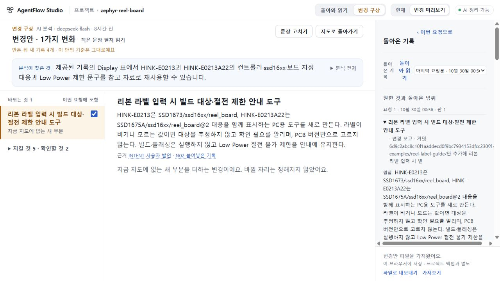

# 126 연결된 반환 결과를 넓게 읽기

## 확인한 문제와 목표

104→107plan→109RQ0797→110실제 시제품→121반환 읽기는 실제 같은 작업 계보다. Root전체JSON/원요청bundle 대조와 [독립 감사](INDEPENDENT_CHAIN_REVIEW.json)를 통과했다.122는 owner가 같아도 본문/부분ID/reading이 다른 배치 FIRST 사본이고124/125 RQ2270은 별도 재생 요청이다. 서로 연결하지 않는다.125문서의 ‘121/122 반환 읽기’ 표현은121반환/122FIRST로 바로잡는다. 완료 생성·실패실험 재실행은 필요 없다.

현재 공개와 동일한 source cfe993f/appa0a56c1 패키지를 격리localorigin에서 정상121백업+109plan으로 읽었다.14개 대응/원문인용·코드판본/같은근거버튼복귀/reload는 보존된다. 그러나 넓게비교의 반환 rail은1280×720에서 폭304/내용319px,높이564/내용3559px다. 반환근거를읽으려고넓게열었는데전체폭대부분은옛변경안이고반환은좁다. 지도 경로도 좁은lens이며 정리결과 아래‘아직 이 자료를 정리하지 않았어요’가digest와map을구분하지않고보인다. [직접 측정](BASELINE_PROOF.json).

## 구현 선택

사용자가 요청한 일과 돌아온 근거를 충분한 폭에서 읽고, 정확한 원문을 본 뒤 같은 요청·항목·구절·위치로 돌아오는 읽기면을 만든다. 현재 requestResults/itemReading/requestMatches를 재사용한다. 새 상태 판정이나 모델 요약을 만들지 않는다. 기존 부분 읽기123과 UI75 수리를 보존한다.

1. 지도/돌아와 읽기의 요청대응과 변경구상 반환rail 양쪽에서 발견 가능한 ‘넓게 읽기’ 입구를 제공한다. 현재 선택한 request/item을 그대로 열고 원래 지도/변경구상으로 명시복귀한다.1280×720에서선택요청·원한항목·현재대표·근거종류를같이찾고본문을통상문단폭으로읽게한다. 원래좁은카드에모든내용을강제로늘어놓지않는다. 기존넓은면/탐색기능을재사용할수있으면새대시보드보다우선한다.
2. 보고·코드·조건별확인·미확인·철회이력을기존저장kind/stance/replaces/정정에근거해구별한다. 각반환구절의조건/about·정확근거에바로접근한다. 여러근거가있는실제121(14개)와모호한대응/철회에서도첫화면의핵심을찾고선택근거로이동할수있도록한다. 단순완료율·등급·‘14개통과’·별도AI요약·의미추정분류/중복삭제금지.14개라는크기는합격기준이아니다.
3. 인용원문은같은넓은읽기맥락에서열리고돌아오면정확RQ/planRevision/item/reading/match의선택·접힘·스크롤·초점이복원된다. 다른요청의같은item제목에상태가번지지않는다.닫기/Escape/키보드·정상폭/좁은화면·프로젝트전환·reload에서덮어쓰기나stalecontext없음. 읽기만으로project/plan/request를변경하지않는다.
4. 정리종류범위가분명하도록map결과가있는때digest미생성문구를교정한다. 예컨대별도추가요약이없다는뜻이필요할때만명시하고이미읽은지도전체를미정리로보이게하지않는다. 진짜미생성·실패·오래된digest의현재안내는유지한다. 이작업에새digest/map호출·서버계약변경은없다.

## 보존·완료 관문

- 제품범위는client request-results/return-view/plan-view/app와styles 및필요한집중UI검사. shared request-return 의미·저장schema·서버·AI지침·CLI/jobs·인증·배포정책변경없음.126은UI후보이며공개125자동배포/병합없음.
- 기존get-effective-match/withdrawal/manualcorrection 경계를그대로사용한다. current/history/excluded/ambiguous/unrelated를누락하거나임의승격하지않는다.보고≠실행확인≠완료;원문부재≠미구현.
- 작성자는준비된도구로타입/관련node및의미있는UIflow를검사한다.실제121privateJSON은Root가그대로보유하고최종후보에정상import하여위동작과전후wholeproject/bundle불변을직접확인한다. 작성자 fixture는실제모델성공으로세지않는다. 독립Sol delta검토·정확후보양OSCI를수용전에확인한다.
- Root는동일실제121에서선택RQ0797·미연결실패RQb9049의구분,원문긴실행조건/typed코드왕복,원위치복귀,1280의본문읽기폭/overflow와기존좁은면경로를직접판정한다.단순가로scroll제거만으로가독성성공을선언하지않는다.
- 전체생성일반성·121 actual later away/ready/명시반영미실행·전체신규사용자경험은미완료로남는다.새실험을만들어빈칸을채우지않고이번UI수리의범위와분리한다.

기존공개73과새제한공개125는유지,미수용74·UI범위75/693구분.키·기존dirty·stash보존·환경재설치/계정전환없음.

## 연결 구현에서 빠뜨리면 안 되는 조건

독립 사전 검토가 지적한 기존 API 경계: request-results의 capture/restore는현재item/history만다루고 ambiguous/excluded/unrelated근거일부에는focus키가없다. 새면에서이들을지원할때정확읽기ID/구절위치와원래분류를보존하고복귀키를완성한다. plan의readReturn 호출은현재resultFor/snapshot을넘기지않으므로새입구는선택한정확요청과호출출처를명시전달해야한다. host.mapBlock()가존재한다는사실만으로이미정리됨을판정하지않는다. 그블록은아직map읽기없어도fresh원문안내를포함할수있으므로실제저장된mapreading의존재·범위와별도digest상태를구별한다.
