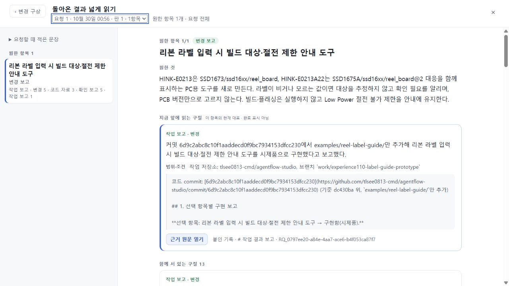
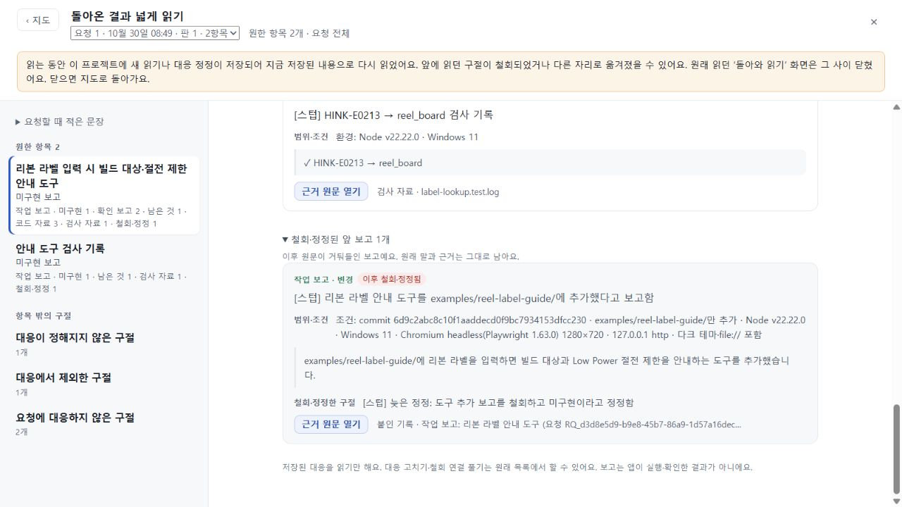

# 126 총괄 수용 — 연결된 반환 결과를 넓게 읽기

최종 코드 **6badd901b5ac4061353e487ee8bafd10b019efa2**, app tree **d5a6be031fb06b925a1511e06c5845f15d56ec14**를 UI 범위로 수용한다. 실제 104→107→109 RQ0797→110 시제품→121 반환 계보에서 원한 것과 돌아온 근거를 함께 읽고, 정확한 원문을 본 뒤 같은 구절로 돌아오는 경험을 개선했다. 공개 전달은 별도 다음 단계이며 이 문서는 배포 완료나 전체 제품 완성 판정이 아니다.

## 실제 확인한 변화

기존 넓게 비교의 반환 rail은 304px였다. 최종 1280×720 화면의 본문은 969px, 카드 760px이며 가로 넘침 없이 요청 항목·현재 대표·근거 종류·조건을 함께 읽는다. 지도와 변경 구상 양쪽 입구에서 같은 RQ0797을 열며, 같은 제목의 실패 요청 RQb9049는 미연결로 분리된다. 미연결을 미구현으로 바꾸지 않는다.

Root가 정상 가져오기로 보존 121 프로젝트와 원래 109 전체 bundle을 읽었다. 최종판으로 바꾸기 전후, 읽기·원문 왕복·다시 열기·새로고침 후 전체 workspace와 plans 저장 문자열이 byte 단위로 같았다. 새 AI와 응답 재생은 0이다. 긴 실행조건 구절9(N_e301…2041–2300)과 코드 구절5(N_dfe…1969–2282)의 원문·판본·출처를 확인했고, Escape/Back 후 정확한 키와 화면 안 초점으로 복귀했다. 지도/변경 구상 닫기도 원래 입구로 돌아왔다. 390×844에서는 실제 DOM 폭·가로 넘침 없음·코드 근거 복귀 가시성을 확인했고 임시 viewport를 해제했다. [직접 증거](ROOT_PROOF.json).

지도 읽기 결과와 별도 자료 요약을 구분하여, 이미 읽은 프로젝트 전체가 미정리인 것처럼 보이던 안내를 고쳤다. 저장된 요청/대응/분류/원문/schema/서버/AI 지침은 바꾸지 않는다.

## 발견한 결함과 해소

독립 검토에서 F1 다른 요청으로 이전 스크롤 전파, F2 읽는 동안 도착한 새 결과가 열린 읽기면에 반영되지 않음을 반려했다. ce3ebe8에서 둘을 수리했으나 F3 철회되어 이력으로 옮겨진 구절의 초점만 복원되고 화면 밖에 남는 문제를 추가 반려했다. 최종 6badd90은 동일 배치의 스크롤은 보존하고 이동한 대상이 화면 밖일 때만 읽기면 안으로 드러낸다. [초기 검토](INDEPENDENT_CORE_REVIEW.json) · [수리 검토](INDEPENDENT_REPAIR_REVIEW.json) · [최종 추가 P1/P2 없음](INDEPENDENT_FINAL_REVIEW.json).

Root는 별도 fixture를 정상 UI로 가져온 뒤 지도 요청의 응답을 1회 보류했다. 기존 대표 원문을 열고 응답을 해제하자 그 원문에 철회 표시와 최신화 안내가 나타났다. Back 후 같은 RQ/항목/reading/구절이 열린 이력에서 실제 화면 안에 보였고, 원래 면이 사라졌을 때 닫기는 지도로 복귀했다. 요청 bundle은 byte 동일, 제어된 map 응답1·provider0이다. 이것은 실제 전달 경로를 타는 화면 검사이며 새 모델 의미 성공이나 121 actual away/ready/명시반영 검사를 대신하지 않는다.

## 실행 근거와 한계

- Root Windows Node24.19.0·잠금 TypeScript5.8.3 check 및 named existing-map dry-run 성공. 최종 동결 패키지 54 assets SHA b777bac555e8f332771f3b7d296b742ecf7633c3f0a0601bf7ebd246a1b49f98, 27 modules SHA 1df394bd38dc2ff2cd04deb3d4c01d68be876efb70f88cc09aefba898c5678c9. 모든 파일 bytes/hash 대조.
- [정확 SHA CI40975830264](https://github.com/tlsee0813-cmd/agentflow-studio/actions/runs/40975830264) Windows/Linux 모두 성공. 기본 app279/279, continuity Linux635/635·Windows632통과+3skip, browser smoke 성공. [최소 CI 로그](CI_PROOF.json). CI의 기본 패키지와 Root의 named release는 구분한다.
- 작성자 focused flow19/19, S/L이 수리 전 실패·수리 후 통과, W 동일 위치 보존은 [작성자 RESULT](RESULT.md) 증거다. connected126-flow는 CI에 포함되지 않는다. 작성자 TS6 기존 lib 오류와 Python 검사 미실행은 Root 잠금 타입/정확 CI와 구별한다. Root가 실제 짧은 실패RQ로 긴 A/B scroll 회귀를 재현했다고 주장하지 않는다.
- [독립 시각 검토](INDEPENDENT_VISUAL_REVIEW.json)는 core의 정적 이미지4개를 확인했다. 최종 화면과 동작은 Root가 직접 확인했다. 14개 근거의 전체 읽기량 감소나 일반 사용자 사용성 성공을 선언하지 않는다.

## 보존과 다음 선택

UI75 693d0c7 수리·기존 stash fa07118·키 보존. 공개73과 공개125는 그대로이고 PR71은 draft 미병합이다. 검증 서버 두 개는 정상 작업 종료 뒤 중지했다. 실제121의 later away/ready/명시반영 미실행, 첫 지도 생성 일반성, 실제 기록 연결기, 전체 신규 사용자 경험은 남아 있다.

다음은 **126에서 통과한 읽기 개선을 공개125의 동일 existing-map 범위에 전달**한다. 현재 공개 assets/modules/settings와 이전 배포 식별자를 먼저 회수하고, 같은 정책·저장·server 모듈을 유지한 후보를 고정해 검증한다. 기존 공개 URL에서 실제 저장 자료를 보존하면서 넓은 읽기·원문 왕복을 확인한다. 새 모델 호출·완료 실험 반복·새 기반 공사는 필요 없다. 공개 첫 지도와 jobs를 이 전달에 끼워 넣지 않는다. 전체 목표는 active다.
