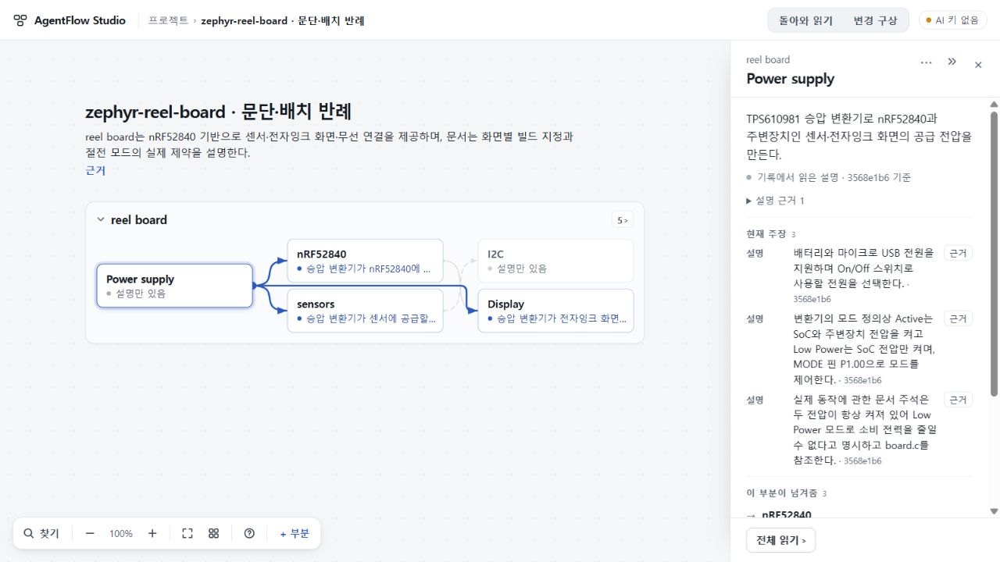
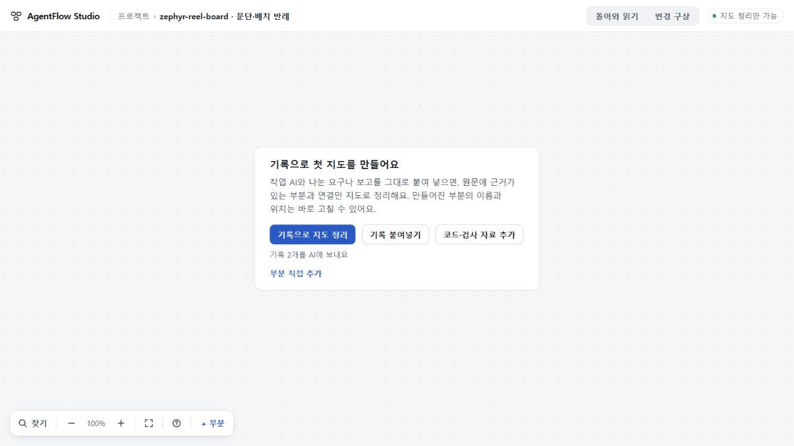
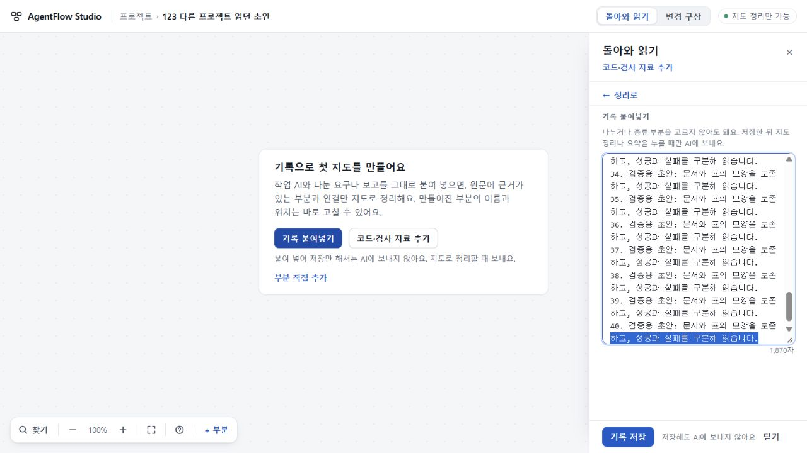

# 123 총괄 검증

제품 bc27a1adb40f003ffcd5443568c7b331a03d3507, app310208b428575ea5f43c66a6b3237a176068244b. 실제 사용자 사용성 연구와 구별되는 총괄의 Windows PC 직접 조작이다. 122의 완료 지도와 원자료를 그대로 재사용했으며 새 AI 생성은 0회다.

## 현재 이해 먼저 읽기

1280×720 Power의 현재 주장 시작은 y555.8에서 y313.7로 242.1px 올라왔다. 목록 끝 y598.7이 본문 끝 y663.2 안에 있어, 명목 Active/Low Power와 실제 두 전압 always-on·절전 불가를 처음 선택한 화면에서 연속 읽었다. 표시 문장·순서·목록 높이285px는 같고, 전체 본문 scrollHeight740도 같다. 정보를 줄인 개선은 아니다.

Display 역시 두 패널의 리본 케이블·컨트롤러·드라이버·보드 지정이 첫 화면에 이어진다. 1440×900에서는 주장과 두 공급·제어 관계를 함께 볼 수 있었다.

Power 제한의 근거를 열고 돌아오니 같은 claim identity 버튼·scrollTop0·카메라로 복귀했다. 관계는 1280에서 한 번 자연 스크롤해 접근했다. Power→Display 공급 관계를 따라간 뒤 돌아오니 scrollTop201.6과 카메라 및 원래 관계 버튼 초점이 같았다. 관계를 읽는 부담이 모든 경우에 줄었다고 주장하지 않는다.

## 지연된 상태와 첫 지도 진입

총괄의 별도 UI 서버는 실제122에서 저장한 map-only ready 상태 응답만 지연해 반환하고 모든 생성 POST를 거절한다. 정상 빈 origin에서 원자료 사본을 가져온 뒤 상태 응답을 해제했다. 다른 화면 이동 없이 중앙의 ‘기록으로 지도 정리’ 버튼과 전송 기록 수가 나타났다.

새로고침으로 두 번째 상태 지연을 만들고 부분 이름·설명을 정상 입력했다. 응답 뒤에도 두 값·초점 part-note·커서36이 같았다. 취소 후 정상 시작 카드가 나타났다. 상태 응답2회, 생성 및 기타 POST0회. 이 검사는 실제 실행기나 생성 품질 재검증이 아니다.

## 보존·검사·한계

원 프로젝트 JSON은 전후 SHA256 36bcdbd2542210e8220d301309ec84d5ed70434e68af402af7bde056ec67719b로 같다. 다른 프로젝트도 같다. 원문·주장·저장 형식을 고치지 않았다.

Node24.19.0 / app의 잠금 TypeScript5.8.3으로 continuity/scripts/check.mjs 및 build.mjs를 실행해 통과했다. [독립 delta 검토](evidence/independent-code-review.json)는 새 실재 P1/P2가 없으며 정적 검토와 실제 브라우저 검증을 구별한다. [직접 관찰·수치](evidence/root-ui-proof.json), [편집 보존](evidence/delayed-edit-proof.json), [관계 복귀](evidence/relation-return.json).

1440 초기 캡처는 viewport 설정 대상이 다른 탭이라 1280이었고 증거에서 제외했다. 최종1440은 읽기 탭의 실제 innerWidth/innerHeight와 명시적1440×900 캡처를 확인했다. 검증 탭과 임시 viewport는 정리했다. 전체 목표·공개 배포·세 원자료 최신 통합 생성 수용과는 별개다.

## 최종 초안 보존 수리

최종 제품8c70bac0b2876ef052315bee0f36ea7976e2ec66, app c69120224cf09a0f7252f8bb7283f096d75171a6. 이전 app.ts 관찰과 같은 구현이며 return-view.ts의 paste 재생성 보존만 추가했다. 최종 제품에도 같은 잠금 check/build를 실행해 통과했다.

총괄은 원 프로젝트의 status가 지연되는 사이 정상 홈을 거쳐 다른 프로젝트의 1,870자 초안을 열고, Ctrl+End→Shift+Home으로 [1849,1870,backward]와 scrollTop1317.5999755859375를 만들었다. 응답 후 전체 본문(길이만이 아님), 선택 범위·방향, 세로스크롤, 초점 paste-text, URL이 모두 같았다. scrollLeft는 전후0이므로 0이 아닌 가로스크롤 보존까지 입증하지 않는다. 상태 칩은 ‘AI 확인 중’에서 ‘지도 정리만 가능’으로 바뀌었다. 실제 실행기·모델은 호출하지 않았다.

앞선 준비는 120초 보류가 만료되어 503이 되었고 성공 증거에서 제외했다. 다시 보류한 정상 응답1회에서 위 결과를 관찰했다. 이 로컬 UI 준비 재실행은 실패한 모델 실험 재호출이 아니다. 서버 집계 statusRequests2/statusReleased1/POST0; [직접 보존 증거](evidence/paste-repair-proof.json), [집계](evidence/paste-server-stats.json).

[독립 최종 delta](evidence/independent-final-delta.json)는 새P1/P2 없음. 작성자 집중검사11개는 별도 스텁 브라우저 실행이며 기본 CI에 연결돼 있지 않다. 실제122를 사용한 위 Root 관찰과 작성자의 record76 기반 작성 fixture 결과를 합치거나 혼동하지 않는다. [정리](evidence/cleanup-final.json): 임시서버·탭 종료, 두 포트 닫힘, viewport 복구.
