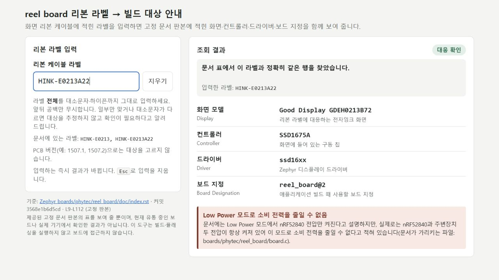
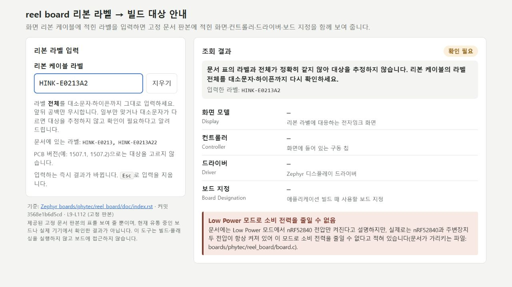

# 110 총괄 범위 수용

코드 `6d9c2abc8c10f1aaddecd0f9bc7934153dfcc230`(회수 `f9272cee7bca928c8f0828b4d5821059e4e25158`)의 로컬 라벨 안내 시제품을 수용한다. 실제104 지도 → 107 변경안 → 109 고정 요청 `RQ_0797ee20-a84e-4aa7-ace6-b4f053ca87f7`을 외부 작성자에게 전달해 얻은 구현이다. AgentFlow 앱 전체나 배포 수용이 아니다.

## 직접 확인한 범위

- Windows Node24.19.0으로 작성자가 제출한 정확 코드의 기본 test 20개 통과(실패·skip0). 가짜 DOM 검사는 렌더링 증거로 세지 않았다.
- Windows IAB 실제1280×720에서 두 라벨의 화면 모델·컨트롤러·driver·board 지정 네 값을 확인했다. `HINK-E0213A22`에서 Backspace로 `HINK-E0213A2`가 되자 네 값이 즉시 —로 바뀌었다. 대소문자변형·PCB버전·공백·HTML형태도 추정하지 않았고, 앞뒤공백 정상입력은 정확대응했다. Esc로 비운 뒤 Tab은 지우기로 이동했다. 관측 상태는 모두1280×720 안에 들어왔고 console 오류·경고0이었다.
- 양 라벨과 미상 상태에서 Low Power 절전 불가, 고정 문서 판본·실기 미확인이 같은 화면에 보였다. 안내문은 다소 길지만 핵심값과 제한을 한 화면에서 읽을 수 있어 이 좁은 시제품 범위에서 수용한다. 실제 사람 사용성·다른 브라우저 전체 품질을 증명하지 않는다.
- Sol 독립 검토는 기능상P1/P2를 발견하지 않았다. RETURN의 실행형태 선택을 작업자 결정으로 적은 문장은 실제 사전 총괄 선택과 달라 root가 바로잡았다. 코드 변경은 없다. 작성자 검사 보고를 root 검사로 소급하지 않았다.

## 보존과 다음 관문

`app` 트리 `5736b7949d50ba92c07ae583ff22c618c25c3e94` 불변. 수정은 examples/reel-label-guide와110문서뿐이다. 원 Zephyr·공개73·미수용74·UI75/693 수리·키·기존stash는 보존했다. 하드웨어 빌드/flash/전력측정·AgentFlow 앱 배포/merge는 실행하지 않았다.

다음은 보존109 요청과 실제110 RETURN 및 독립 코드/실행 근거를 정상 AgentFlow에 붙여, 구현보고·코드자료·판본/조건별확인·실기미확인을 구별해 읽는 관문이다. 기존 first-only CLI를 업데이트 가능한 것으로 주장하지 않는다. 모델은 이 수용의 증거가 아니며 다음 관측을 별도로 고정한다.
