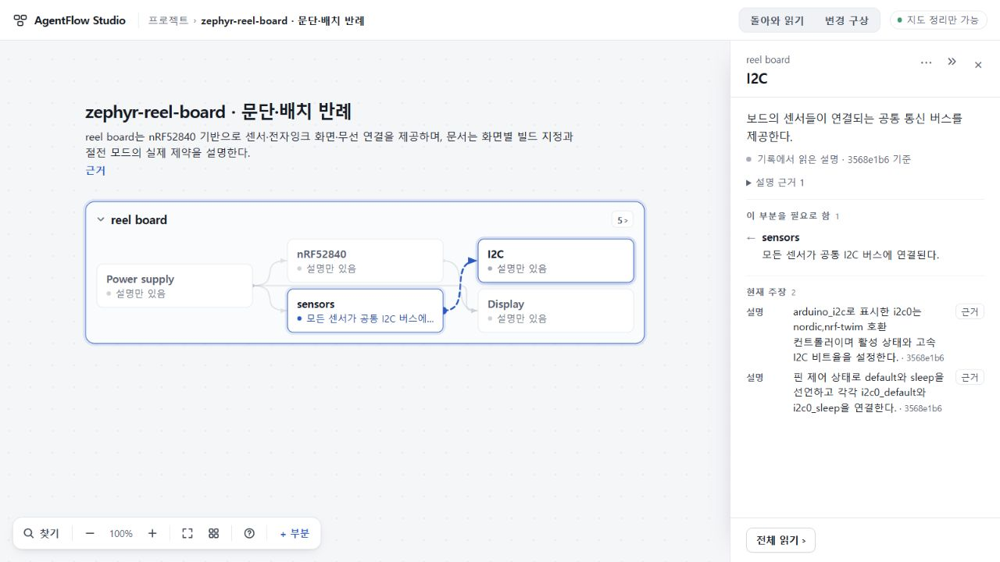

# 122 — 문단·배치 반례 한 건, 의미와 실제 PC 흐름 수용

**준비한 Zephyr 배치 사본 한 건에서 선택한 독립 사실·핵심 제약과 정상 제품 흐름을 범위 수용한다.** 원본세건을재생성하지않았다. 문단을합치고절순서를옮겨도센서/I2C독립설정·두Display대응·명목모드와실제절전불가가새응답/현재저장/UI에남았다. 일반적인생성성공률·모든원문속성완전보존·세원자료통합경로·공개제품완성을뜻하지않는다.

## 사전 동결과 실제 전달

[설계](DESIGN.md)와[선택18506db](https://github.com/tlsee0813-cmd/agentflow-studio/blob/18506dbb2e120e4d4f4393e346257e2db02c0f26/docs/cycles/2026-10-30-layout-preservation-122/SELECTED.md),[정적사본검토](INDEPENDENT_STATIC_REVIEW.json)를실행전에게시했다. 문서Power/Display블록순서교환·센서5줄접합·DTS빈줄2개제거외내용은같다. 원본104파일과완료지도는보존했고,새origin51913빈저장소에서정상import한별도entry를썼다. 사본자체의좌표로새ask를만들었다.

currentproduct be061284/app7b36f3, ask8a04a5fe…9015bytes/systemcef94b26…11879bytes/stdin47c19e79…21254bytes가실제전달과일치한다. 104대비[수용114자료종류한줄](FIRST_PROMPT_DELTA.json)만FIRST에추가돼있어배치만의통제실험이라고주장하지않는다. 118/120map7지침은이번FIRST6에들어가지않는다.정책·CLIbinary·SolHigh·299/300초는기존104와같다.

실제생성1회/versionprobe1회/재시도·fallback·응답수선0. jobMJ_45755b0e-0ad4-4e25-8530-58a1dcd1a3f1은 **89.333초**에판정,exit0·final7109bytes/SHA4a3360081e9fc5415d6dfe6089d63de4a9346a066fbd522a4470c87d9c826f67. 기존strictvalidator가ready로수용했다. event4개(thread.started/turn.started/agent_message/turn.completed),tool/error0. input16222/cached8192/output4618/reasoning_output2070는관측값이며hardcap·일반응답시간·원격과금중단증거가아니다. [실제결합](evidence/actual-binding-proof.json)·[실행](evidence/execution-receipt.json).

## 의미와 저장된 현재 이해

총괄과[독립Sol](evidence/independent-review.json)은새final과사본원문을대조했다. 독립보고서는Root UI마감전판정이며,아래UI완료는총괄의별도직접관찰이다. 독립브라우저재실행으로표기하지않는다.

| 기준 | 이번에 남은 의미 |
| --- | --- |
| Z1 구성과 독립사실 | nRF52840·디버그·GPIO/SPI제어·전원방향,센서각기능과DTS주소/인터럽트,공유I2C·nordic,nrf-twim·FAST와default/sleep설정. 같은원문span에묶인두I2C주장도별도로남는다. |
| Z2 두 대응 | B1/HINK-E0213/SSD1673/ssd16xx/reel_board와B72/HINK-E0213A22/SSD1675A/ssd16xx/reel_board@2. PCB변경과화면선택을혼동하지않는다. |
| Z3 전원 한계 | 배터리/USB·TPS610981·MODE P1.00,명목Active/LowPower와현재두전압always-on·절감불가를같이설명한다. |
| Z4 근거 범위 | 실제rawheader의고정commit을조건으로쓴describes. 문서/DTS설명이며실기·flash·센서스트리밍·전력측정·현재유통검증으로승격하지않는다. |

부분6/claim17/관계5는결과크기이며합격기준이아니다. candidate가없어명시불확실성의모든유형을이번모델이실증한것도아니다. 원문의가속도정밀도12-bit는원문/인용에는남지만현재role/claim에직접재현되지않았다. 이는사전에고정한Z1–Z4차단조건이아니며,모든세부속성완전전사주장을하지않는다.

## 실제 PC 흐름

접수직후원방문을떠나미리만든다른프로젝트에서125자초안을작성했다. 생성중새로고침후같은초안이열렸다. ready도착뒤에도원project는before6ef5d57e…와같고acknull이었다. 다른프로젝트와전체초안bundle4689d96c…도그대로였다. [도착 전후 증명](evidence/ready-before-apply.json).

복귀화면은‘아직 지도에 반영하지 않았어요’와‘정리 결과 보기’를표시했다. 총괄이눌러명시반영한뒤I2C·sensors·Display·Power를현재읽기로확인했다. I2C의FAST/default/sleep,Display양대응,Power명목모드와절전불가원문에서선택·같은근거버튼으로돌아왔다. 별도의전체읽기나추가claim펼침없이현재주장은자연스크롤로읽혔다.

입력두원문은exact보존,반영후/reload/정상다운로드projectJSON은모두36bcdbd2542210e8220d301309ec84d5ed70434e68af402af7bde056ec67719b. 다른프로젝트/초안도전후동일하다. [보존](evidence/preservation.json). 다운로드백업은project범위이며초안은별도브라우저저장비교다.

1280×720에서Power와Display는관계설명뒤긴주장을읽기위해세로스크롤이필요했다.긴코드원문은가로스크롤도생긴다. 보존과의미성공이그대로가벼운PC사용성을뜻하지않는다. 최초지도중앙카드의‘AI서버연결’안내는map-only실행기가ready여도실제생성버튼을안내하지않고,정상실행은돌아와읽기패널에서가능했다. 기능경계안내와읽기부담은실제화면에서남은제품과제다.

## 판정 경계와 다음 작업

이번선택의생성→다른프로젝트편집/reload→ready미반영→복귀명시적용→원문왕복→저장/백업은완료했다. 121의미실행후속방문전환을소급통과시키지않는다. 89두자료의완료결과와104Zephyr성공은그대로재사용한다. 세원자료의최신통합경로·전체PC가독성·실제공개전달은별도미완료다.같은원본이나과거실패를반복하지않는다.

새제품코드0,120 exactca9b 양OSCI40952043513재사용/전체suite반복0. 서버STOPPED(slotnull/unsettlednull)/51913closed/lease없음,검증탭정리·viewport원복.[정리](evidence/cleanup.json). 공개73·미수용74·UI75/693·키·stash·기존미커밋보존,병합배포0/전체목표active.
