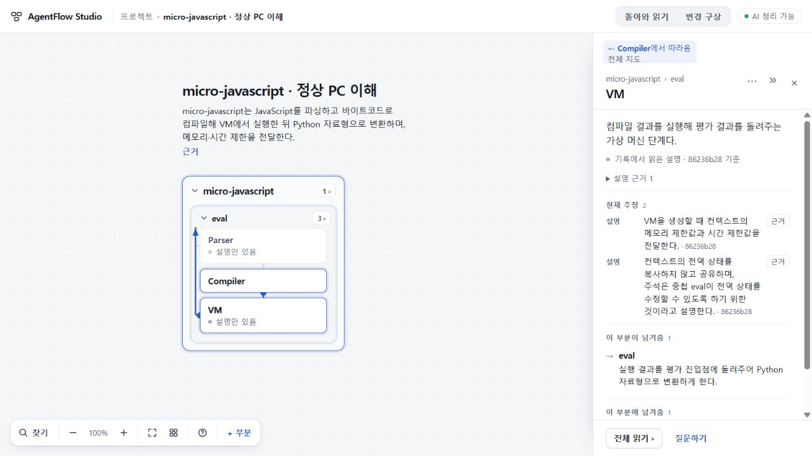
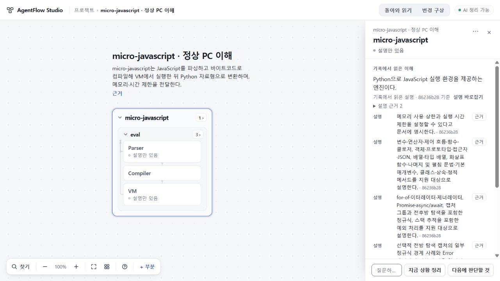

# 139 실제 micro 원자료의 정상 PC 첫 지도·이해 — 한정 수용

동결한 README와 코드 발췌를 정상 PC 화면에 그대로 입력하고, 생성 버튼으로 받은 지도에서 실행 흐름·제약을 읽는 한 건을 수용한다. 기존89의 격리 CLI 실행/파일 가져오기를 재생한 결과가 아니다. 새 생성은1회, 재시도·응답 수선·plan/scope/RETURN 호출은0이다.

## 실제 입력과 전달

선택0de4a543da830af96f2c81953539ec85517f9479, runtime app78f6842b3ba302df8444a58a904f92025ad9e3af(수용137). 기존128 PC 시작 명령과 동일 설치 CLI/키 파일을 사용했고 환경 설치·계정 전환은 없다. 정상 원문 입력2건(2595+1369자), 내용·source 문구와 기존 pasted 종류를 그대로 유지했다. 실제 ask0dc6a91cd9c2c6d8aceb37af6fc9f26dfefdec06d11ab02f0ac3292767d2d22c는 사전 동결과 같고 coverage2/2·partial0이다. 이전 응답/지도/요약을 입력하지 않았다.

원job MJ_8e7c8433-050c-4be4-adac-1fe43165e5cd는 2026-10-30T04:25:14.664Z 접수부터 **72.289초**에 ready로 보관됐다. CLI exit0·최종4577bytes·최종SHA2ade4a908ae406aaedad547c8760ca35b6278fa5a4c4c8dd771cabdfdc2d3007, strict 통과. Sol High/CLI0.165.0-alpha.1.2, 선택299초·판정300초, FIRST6 recipe m6-6859b864664f를 유지했다.89와 scaffold·runtime·정책이 달라 속도/모델만의 통제 비교로 해석하지 않는다.

## 의미와 실제 읽기

Root와 기존 독립 Sol은 기존 M1–M4 및76/89의 정정된 적용 선례로 한정 PASS를 판단했다. eval→Parser/AST→Compiler/bytecode→VM→Python 결과가 role과 관계에 남고, context의 메모리·시간 한도 전달, 복사하지 않는 globals 공유, 네 오류 종류와 재귀 깊이·regex·Error 위치 제약을 보존한다. claims는 고정 판본의 설명이며 실제 OSS 실행/보안 격리/한도 집행 검증으로 올리지 않는다.

README의 설치·API 사용 예문은 material이고 실제 eval 구현은 설명 근거다. makeCounter 같은 예문 부품을 발명하지 않았다. JSContext/import microjs가 활성 지도에 상세히 드러나지 않는 한계는 원문/예문에 남으며,76/89와 동일하게 비차단으로 처리했다. 노드 수·이름·API 철자를 새 합격 조건으로 추가하지 않았다. [독립 요약](evidence/independent.json)은 원문/응답 의미 검토이며, 화면 조작은 Root 증거다.

생성 중 다른 기존 프로젝트로 이동해 저장된 초안을 읽고 새로고침했다. 원프로젝트로 돌아오자 도착한 결과와 명시적 결과 보기 버튼이 있었고, 반영 전 workspace/plans는 입력 직후와 같았다. 의미 판정 뒤 결과 보기를 눌러5부분·4연결을 열었다. eval→Parser→Compiler→VM을 관계로 따라가고, VM의 globals 공유 원문으로 내려갔다가 같은 VM 선택/근거 버튼으로 돌아왔다. 문서상 지원과 제한도 실제 저장 지도에서 읽었다.

새로고침 뒤 workspace/plans 문자열이 같았고 기존 다른 프로젝트 전체·모든 요청/초안은 그대로다. 두 원문도 byteexact이며 정상 백업 파일의 전체 project가 현재 저장 project와 일치한다. [최소 실행·보존 증거](evidence/root.json). 전체 원문/응답/상태/백업은 private Ops에 보존했다.

## 남는 경험 문제와 범위

1280×720에서 일반 부분의 '전체 읽기'도 좁은 오른쪽 패널이다. 긴 지원 설명이 여러 줄을 차지하고 핵심 제한은 아래쪽으로 밀리며, 중앙은 넓은 지도 여백으로 남는다.129의 읽기 부담이 이 실제 자료에서도 관측됐다. 다음은 이미 생성된 이 자료로 일반 부분의 읽기 공간과 근거 복귀를 개선할 범위를 선택한다. 새로운 생성이나 같은 읽기 실험을 반복하지 않는다.

다른 프로젝트에서 새로고침한 뒤 첫 목록 snapshot에는 결과 도착 badge가 없었다. 원프로젝트를 열면 즉시 보관 결과를 정상 회수했다. 원인 미확정 관찰이며 결과 유실 또는 알림 전체 정상으로 단정하지 않는다.

이번 수용은 코드 라이브러리 자료 한 건의 정상 FIRST→이해·저장이다.136 RETURN 실패·원인 미확인, 일반 생성 품질, 자동 기록 연결기와 전체 요청·결과 왕복은 남는다.137의map7 진단을 FIRST6 성공의 원인으로 주장하지 않는다. 공개73/138·미수용74·UI75/693·stash와 키를 보존했고 배포0이다.
