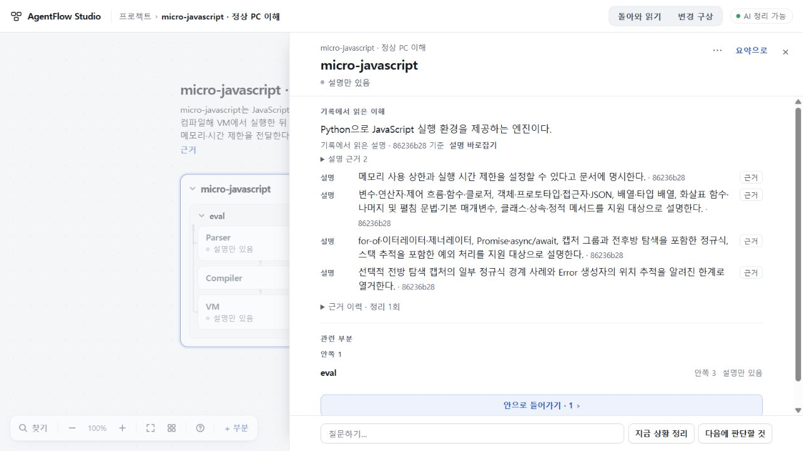

# 140 일반 부분 전체 읽기 — 총괄 수용 판정

**일반 부분 전체 읽기 범위로 수용한다.** 구현 8961db44898835a82daec1d3ce51616982991ee3, app 93be1c55734f95e0040cd333e0d8bba3d3adb12b. 일반 부분의 명시적인 전체 읽기에 충분한 본문 폭을 제공하고 원문·관계·지도 왕복, 판본별 근거 초점과 작성 중 편집을 보존하는 범위다. 공개 배포나 전체 제품 완성 판정은 별개다.

## 실제 자료에서 확인한 결과

139에서 생성해 저장한 micro-javascript 결과를 다시 생성하지 않고 사용했다. 엔진의 지원 기능과 마지막 정규식/Error 제한까지 같은 읽기면에 나타난다. VM의 설명 근거와 두 주장, eval 관계를 읽고 원문·관계를 왕복한 뒤 원래 읽기면·초점·열린 설명 근거·스크롤·카메라가 보존됐다. 1280×720과1000×700에서 직접 확인했고 창 크기 재정의는 해제했다.

a3cee3 중간 후보에서는 기존 Zephyr의 실제 두 읽기 판본으로 근거 이력을 펼쳐 원문 992..1257의265자를 정확히 표시하고, 같은 이전 읽기 R_dc5636a7의 근거 단추로 돌아오는 것을 확인했다. 이력 접힘 상태·선택·카메라가 보존됐다. 근거 클릭 전 자동 스크롤이 있었으므로 이 사례에서 클릭 전75.20과 복귀203.20의 수치가 같다고 주장하지 않는다. VM 사례의 동일 스크롤 관측과 구별한다. 실제 보드 실행·전력 측정의 성공 근거로 이 자료를 해석하지 않는다.

전체 workspace4개와 별도 plans의 원문 문자열은 micro/Zephyr 읽기·왕복·최종 새로고침 전후 byte exact다. 변경한 원자료·새 AI 호출·새 지도 반영은0이다. [기계 관측 최소 증거](evidence/root.json).

## 발견 후 닫은 결함과 검증 출처

- 13개 주장이12개로 잘리는 두 cap을 제거했다. shared 변경은 partUnderstanding 반환 한 줄에 한정하며 설계 보완에 승인 시점과 범위를 남겼다. 현재/이력·철회·정렬 의미와 map/plan의 기존6개 선택은 유지한다. [독립 영향 검토](evidence/independent-claims.json).
- 동일 시각·같은 인용을 가진 서로 다른 이력은 reading ID로 초점을 구별한다. timestamp로 구별하던 첫 후보를 수용하지 않았다.
- 옛 설명 저장이 다른 부분의 편집 또는 같은 부분에서 다시 연 새 편집을 닫지 않도록 편집 객체 소유권을 비교한다. [최종 독립 검토](evidence/independent-session.json).

작성자 fixture는4번 읽기의13개 주장·중복 시각 이력·지연 저장을 사용했다. 원 후보에서 실패하는 반례를 먼저 확인했고, 최종 변경 경로인 S/S2만2/2로 다시 검사했다. 앞선9개 브라우저 사례와 claims2개 검사를 전체 반복하지 않았다. 작성자의 고정 프로젝트 map/plan 및 origins 14490바이트 동일 검사는 작성자 근거이며 Root 재실행으로 표기하지 않는다.

Root는 최종 잠금 TypeScript5.8.3 check/build를 통과시켰고 제공되는 app.js/map-reading.js/styles.css가 빌드 산출물과 일치함을 확인했다. 첫 후보의 관련26검사와 실제 micro 왕복은 먼저 수행했으며, 마지막 두 편집 소유권 수정 뒤에는 최종 실제 Zephyr 왕복·저장 불변을 추가했다. Sol High 독립 검토는 코드 확인이며 브라우저 재실행과 구별한다.

질문 입력까지 DOM 값으로 복원하던 a3cee3 후보는 CI41006047177 양OS main_flow144에서 반려했다. 전송 성공 후 질문이 다시 나타나는140 회귀를 세 미저장 편집 필드만 복원하도록 고쳤다. 기존 Python 기대값은 바꾸지 않았다. 작성자 main_flow 포트는 a3에서 실패/수정에서 성공했고 관련 A/R/S/S2는5/5다. 최종 Root 빌드 뒤 실제 micro 읽기와 전체 저장 불변을 다시 확인했다. [질문 회귀 독립 검토](evidence/independent-ask.json).

변경 구상 넓게 비교의 배경 잠금을 일반 읽기가 풀던 9628 후보는 CI41007155003 양OS workspace_flow520에서 반려했다. b59의 소유 표시 수리 뒤 실제134의 일반 진입·요청문 읽기·창 크기 변경·지도 복귀를 확인했다. 이어 발견한 브라우저 Back→문장 편집→Forward 예외도 실제 같은134 자료에서 재현했으며, 최종8961에서 변경 구상 중 일반 읽기면 복원을 막고 현재 work 잠금을 유지하도록 고쳤다. 같은 실제 순서에서 중복 읽기면 없음·편집 중 viewport/controls 잠금 유지·닫으면 해제를 확인했다. 원래 workspace와 plans는 byte exact다. [수정 전](evidence/inert-history-before.json) · [수정 후](evidence/inert-history-after.json) · [독립 delta 검토](evidence/independent-history.json).

b59의 CI41008285556 양OS relation_visit_flow는 스크롤>40 전제에서0으로 실패했다. 넓어진 본문에 기존 fixture가 전부 들어가 1280×720의 scrollHeight/clientHeight가 모두415였다. 해당 왕복 구간만1280×500으로 설정해 실제 overflow를 만들고 reload 전에720으로 복귀했다. >40·같은 스크롤·최신 초안·답 없음·history/reload 단언은 유지했다. 이는500높이의 스크롤 검증이며720높이에서 같은 스크롤을 검증했다는 뜻이 아니다.

정확 최종8961의 [CI41009319891](https://github.com/tlsee0813-cmd/agentflow-studio/actions/runs/41009319891)은 Windows와 Linux 모두 성공했다. 기존 app279씩, continuity는 Linux656통과·Windows653통과/3skip, 직접 브라우저18씩과 실제 Python studio smoke를 통과했다. 이는 모의 provider 회귀이며 새 모델 생성 품질을 입증하지 않는다. [CI 최소 증거](evidence/ci.json).

## 수용하지 않은 범위와 다음 판단

136 실제 RETURN 반려와 원인 미확인은 남아 있다.139의 성공한 FIRST나140의 읽기 개선이 이를 닫지 않는다. 모든 생성의 의미 정확성, 자동 기록 연결기, 매우 많은 주장의 성능, 전체 요청→실제 반환 경험은 이번 수용 범위가 아니다. 공개73와 기존지도 제한공개138은 그대로이며140은 아직 배포하지 않았다. UI75/693d0c7 계보와 stash fa07118ead372bcb3201c8032ca603a5ec0a7e7d·키를 보존했다.

추가 검토 중 기존 send의 별도 결함을 발견했다. Q1 실패→미전송 Q2 작성→원 Q1 재시도 성공이 Q2를 지운다. 작성자 모의 provider UI에서1회 관찰했고 수용137 코드에도 있는 경계임을 독립 정적 검토했다.140 수리로 해소했다고 주장하지 않는다. 이 실제 필요를 다음 정상 변경 요청에 먼저 담고, 구현 전에 요청을 고정하여 반환까지 잇는 경험으로 진행한다. 지금 후속 구현·새모델호출은0이며136 재시도나임의 기능 발명은 하지 않는다.

140 읽기 개선은135 기반과 분리 전달할 수 있다는 독립 소스 검토도 회수했다. 이는 아직 배포 수용이 아니며 exact 조합 빌드/manifest와 기존지도 공개 보호 경계를 별도로 확인해야 한다. 기존 제한공개138은 이미 전달돼 있고, 다음 개선 공개를 무기한 보류하지 않는다. 전체 목표는 계속 진행 중이다.
