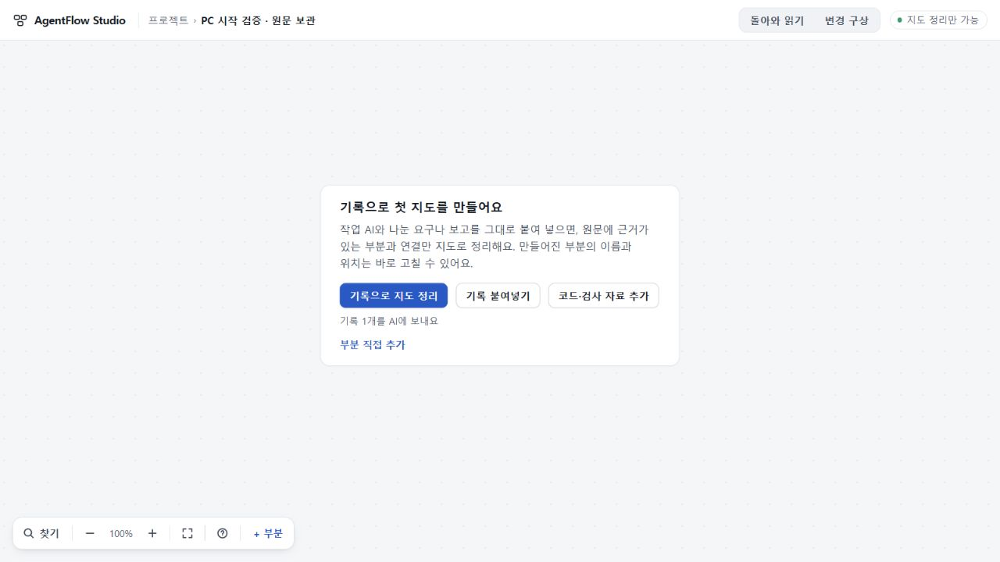

# 128 Root 수용 — 기존 Codex를 쓰는 선택형 PC 입구

**한정 수용**. 기존 설치·로그인된 Codex가 있는 이 Windows PC에서 정책 파일을 직접 만들지 않고 시작하고, 원문과 기존 작업을 읽고, 종료·다시 열 수 있는 범위를 수용한다. 일반 첫 지도 품질이나 모든 PC의 설치 지원을 뜻하지 않는다.

검증 대상은87afee7cdd93f9563b9f57965ba5f8bf77ea8be3, app581571feee480a0079b4e105151409bb8be8ac92다. 실제 실행 코드는4cfd008과 같고, 이후에는 검사128-10과 결과 문서만 바뀌었다. [설계](DESIGN.md) · [작성자 결과](RESULT.md) · [최소 증거](evidence/root.json).

## 사용자에게 생긴 변화

PowerShell7에서 app 폴더의 ./continuity/scripts/start-pc.ps1을 실행하면 기존 설치를 찾아4327의 PC 화면을 연다. 같은 명령으로 다시 열고, 출력된 -Stop 명령으로 종료한다. 모델·권한·시간·격리 인자는 기존121/122 수용 정책으로 고정돼 있다. 시작만으로 생성하지 않으며, 원문을 저장한 뒤 화면의 ‘기록으로 지도 정리’를 선택해야 요청한다.

기본 DeepSeek 실행과 공개73/127은 그대로다.4327은 기존4317과 저장 영역이 달라 정상 백업 가져오기를 사용한다. 키가 없으면 변경 구상 등 별도 기능은 꺼지고 첫 지도 경로만 준비된다. 설치·로그인·계정 전환·실행 정책 변경은 하지 않았다.

## 직접 확인한 PC 동작

Root는 Windows PowerShell7.6.5/Node24.19.0과1280×720 화면에서 정상 시작, 기존121 프로젝트와109 전체 요청 가져오기, 새 프로젝트에 공개 Zephyr 원문4699자 저장, 종료·재시작·새로고침을 수행했다. 원 프로젝트·요청·원문이 그대로였고 전체 workspace/plans 저장 문자열도 재시작 전후 같았다. 첫 지도 버튼은 활성됐지만 누르지 않았다. 고정 정책 전체와 identity29f5c36ec140가 기존121과 같았다.

49be2d7에서는 설치 바이너리와 같은 private 사본으로4328을 열고 사본 이름을 바꾼 뒤, 사라진 경로를 명시한 Stop도 exit0임을 확인했다. 설치 원본은 바꾸지 않았다.4cfd008에서는 Node/Codex 경로를 지정하지 않고 -Port4328 -NoBrowser로 시작한 뒤, 출력된 -Stop -Port4328을 그대로 따라 정상 종료했다. 두 검증 서버는 종료했다.

Windows PowerShell5.1의 -File 실행은 이 PC의 기존 정책이 거절했다. 설정을 우회하지 않았고 읽기 전용 parser의 오류0을 실행 성공으로 세지 않았다. 이 입구는 현재 고정 바이너리를 전제로 하며 새 판본과 새 PC는 미검증이다.

## 결함 수리와 검증의 범위

독립 검토가 자기 서버의 unavailable 상태 오인, 종료 조회 뒤 새 작업이 들어오는 경합, 바이너리 변경/삭제 뒤 정상 종료 거절을 재현했다. c2ae550과49be2d7에서 수리했고, 다른 서버 거절·실행 중 보호·소유 확인을 유지했다. Root의 Windows 집중 검사와 작성자의 Linux fixture 검사를 구별해 증거에 남겼다. 최종 독립 검토에서도 좁은 수정에 추가P1/P2가 없었다.

첫 CI40982791208은 Linux 성공, Windows128-10 실패였다. 작업 ready를 child/lease 정리 완료로 간주한 검사 가정이 원인이다. 정리 중 BUSY는 기존 보호 계약이다. d882de4는 실행 코드를 바꾸지 않고 정리 구간을 의도적으로 유지해 호출자와 서버의 BUSY 거절을 확인한 뒤, 실제 정리 완료를 관측하고 종료를 한 번 실행하도록 검사를 고쳤다. 원 실패 재현과 보호 제거 mutation 실패, Root Windows1/1, 독립 정적 검토31b8cce7을 확인했다.

정확87afee7의 [최종 CI40983872999](https://github.com/tlsee0813-cmd/agentflow-studio/actions/runs/40983872999)는 Windows·Linux 모두 통과했다. 기본 앱 검사는 각각279/279, continuity는 Linux646/646, Windows643통과·3skip이었다. 브라우저 직접 연결과 Studio 화면 검사, 자격증명 없는 Worker 패키지 검사도 통과했다. 이 CI는 모의 공급자 검증이며 실제 새 생성 품질의 증거가 아니다.

## 남는 관문

새 AI 생성은0이다.89 실제지시·micro의 CLI 생성과 파일 가져오기 성공을 최신 제품 버튼 통합 성공으로 소급하지 않는다.121 실제 RETURN의 away/ready/명시 반영 순서도 아직 미실행이다. 일반 생성 품질·기록 연결기·전체 신규 사용자 경험은 남는다. 다음은 기존 의미 기준을 재사용해 정상 PC 입구의 실제 작업 기록 한 건을 판단한다.

UI75의693d0c7 수리와 기존 stashfa07118을 보존했다. [PR72](https://github.com/tlsee0813-cmd/agentflow-studio/pull/72)는 누적 후보를 보존하는 draft로 미병합이며 공개 사이트를 바꾸지 않았다. 기본73, 미수용74, UI 범위75와 기존지도 한정 공개127의 구별을 유지한다.
