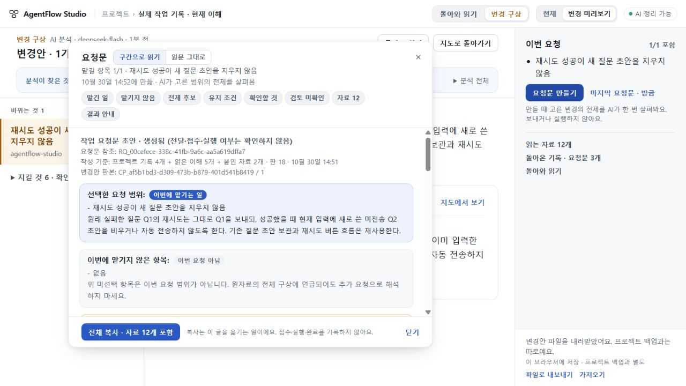

# 141 실제 질문 초안 손실의 구현 전 요청 — 범위 전제 의미 반려

**변경안 분석은 한정 통과, 생성된 요청의 범위 검토는 반려한다.** 140 수용 뒤 실제로 발견한 기존 질문 손실을 정상 제품 경로로 요청했다. 구현 전에 RQ가 만들어졌으나, 필수 전제의 근거가 부족해 전달·구현·RETURN은0이다. 응답을 고치거나 같은 입력을 다시 생성하지 않았다.

## 실행과 실제 결과

수용140 앱93be1c55에서 원래 실제 작업 프로젝트를 사용했다. 새 질문 요구378자, 정확 코드 발췌7184자(U01), 관찰과 자료의 한계835자(U02)를 정상 추가자료로 넣었다. 9628 코드 발췌의 관련 함수가 최종8961에서도 그대로임을 대조했다. 지도는129 당시 이해,135 자료3건은 제공됐으나 지도 미반영,136은 계약 반려이며135 구현 실패의 근거가 아님을 명시했다. 프로젝트 자료4/4와 추가자료 원문은 실제 ask에 포함됐다.

첫 HTTP 요청은 이전139 검증 프로세스 cap1 소진으로 PROCESS_CALL_CAP/429였다. 서버 limiter는 모델 호출 전에 거절하며 원문·초안은 그대로였다. 정상128 Stop/Start로 이번에 선택한 plan1+조건부scope1의 합계2를 배정했다. 동시성1·원 env파일·키·CLI정책은 보존했다. 실제 모델 응답을 재시도하거나 실패한 생성의 토큰/시간/모델을 바꾼 것이 아니다. 이후 실제 모델 호출은 아래2회뿐이다.

- plan: 19.319초,HTTP200,deepseek-flash,변경1개. 원Q1 재시도·미전송Q2 보존/자동전송금지·보통성공clear·실패keep·기존구조/작업보존을 구별했다. 실제모델 장애 재현과 수리 후 회귀는 미확인으로 남겼다. 옛 철회 작업을 새 요구로 넣지 않았다.
- scope: 13.958초,HTTP200,계약을 통과해 요청문을 만들었다. 그러나 아래 전제의 필요성 판단은 틀렸다. 전송 성공·JSON 유효·RQ 생성과 의미 수용을 구별한다.

[호출 영수증](evidence/receipt.json) · [실제 분석](evidence/plan-response.json) · [실제 범위 검토](evidence/scope-response.json)

## 반려 이유

scope는 새 ‘재시도 전송과 새 질문 제출을 구별해 성공 후 초안 비움 여부를 결정할 호출 정보’를 전제 후보로 제시하며, 제공된 코드에 두 전송을 구별하는 값이 없어 Q2 보존 조건을 판단할 수 없다고 단정했다.

U01에는 이미 getDraft(o, partId)로 읽을 현재 초안과 send에 전달된 원 question이 있다. 관측한 Q1≠Q2 사례에서는 두 기존 값을 대조해 새 Q2를 남기는 최소 판단 경로가 가능하다. 새 호출 정보는 구현 선택지일 수 있지만, 그것이 없으면 목표를 판단할 수 없다는 필요조건은 성립하지 않는다. 무조건 clear 결함 자체의 진단은 맞다. 자동으로 포함하지 않는 후보라는 표지도 이 근거 없는 필수성 단정을 정당화하지 않는다.

이는 실제 수리를 구현·검증했다는 증명이 아니다. 같은 글 재입력·모든 동시성 경계를 해결했다는 주장도 아니다. 기존 수단을 조합할 가능성을 지운 전제가 문제다. 기존86 이후의 계약에도 기존 수단 재사용과 특정 구현 필수화 금지가 이미 있으므로 새 지시를 추가해141을 즉시 다시 호출하지 않는다.

[독립 요청문 반려](evidence/independent-request.json) · [독립 분석 판정](evidence/independent-plan.json) · [기존 필수성 계약과 다음 선택 검토](evidence/independent-mechanism.json). 독립 검토는 원자료·응답·코드 읽기이며 모델 재호출/브라우저 재실행은0이다.

## 요청과 기존 작업 보존

RQ_00cefece-338c-41fb-9a6c-aa5a619dffa7은2026-10-30T05:52:57.670Z에 구현 지시 전에 만들어졌다. 원문36286자/SHA256 debdfcd98f814a65ea84282ce97c22cfd3b60b27a581c0e11d960ebc5fce6c80를 그대로 보존하며 미수용·미전달이다. 과거132/134 두RQ 전체,원workspace,다른프로젝트plans는 그대로다. 현재draft/extra/plan과새RQ는 의도한 변경이므로 plans 전체를 편집 전과 같다고 주장하지 않는다. 정상 내보내기 전후bundle동등성과새로고침 후 전체workspace/plans동등성을 확인했다. [보존 증거](evidence/preservation.json).

## 다음 선택

질문 초안 손실과scope의필수성오판은 열린 결함으로 남긴다.140의독립수용UI까지이실패때문에미공개로쌓아두지않는다. 다음142는기존138 제한공개판에140읽기만분리해전달하는작업이다.135기반+최종140client/CSS+projection cap한줄의정확조합을별도빌드/manifest로판정하며137진단/지도·job생성권한은공개하지않는다.136반려·원인미확인·전체요청→실제반환미완은 유지한다. 공개73·미수용74·UI75/693·키·stash를보존하며전체목표는진행중이다.
