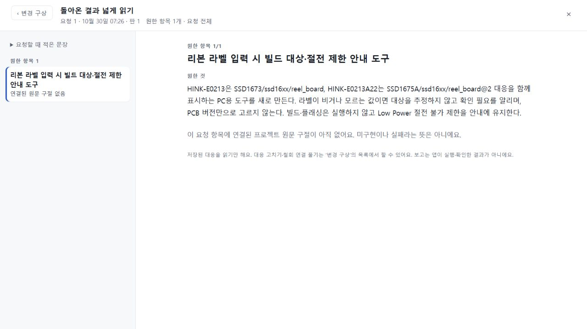

# 138 수용 개선의 기존지도 공개 전달 — 한정 수용

2026-10-30. 기존 지도용 공개판에 이미 수용한 요청·철회 읽기 개선을 전달했다. [공개 체험](https://agentflow-studio-existing-map-124.tlsee0813.workers.dev/)에서 기존 Zephyr 프로젝트와 요청을 그대로 열어 넓게 읽고 돌아오는 동작을 직접 확인했다. 첫 지도 생성과 기록 갱신은 계속 보류하며, 전체 제품 완성 판정은 아니다.

## 실제 전달 판본

- 제품 source: 73f6f253e8ce9921504011b7281584955d41716d, app tree: 3960c16dbaf229f6100291f0252b34c50301cf33 (수용135).
- 포함: 131 scope 출력 예산/timeout 수리, 133 과거 판본과 현재 근거를 구별하는 지침, 135 철회가 가리키는 이전 보고·고정 요청 항목 읽기. 이전 공개127의 나머지 수용 기능을 유지한다.
- 제외: 137 진단, Node 전용 PC 실행기, map/jobs 생성 허용. 현재 개발 브랜치의 최신 앱을 통째로 배포한 것이 아니다.
- 원 공개73 https://agentflow-studio.tlsee0813.workers.dev 의 BUILD/settings는 그대로다. 미수용 cycle74와 UI 수용75(693d0c7) 구별을 유지한다.

## 전달 증거

[영수증](RECEIPT.json)의 단일 시도138-upload-1은 exit0, Worker PUT1회이다. 실제 Cloudflare deployment는 dd704c0b-6089-4aa4-a667-693078c39383, version은 cf4a5f10-d992-4d96-8b7e-df85e15fca97 (100%), 생성시각은 2026-10-30T04:04:52.282451Z다. 배포 스크립트 stdout의 fallback Worker 이름을 실제 version으로 사용하지 않았다. 재업로드0. 직전 deployment461c3759/versionb1e66c2e는 롤백 참조로 보존했다.

[준비 대조](PREPARATION.json)는 배포 전 상태다(uploadAttempts0). 잠금 의존성을 재사용한 정확 source의 격리 checkout에서 dry-run exit0. 예상 변경은 assets BUILD/request-results/styles 3개, modules plan-prompt/studio 2개뿐이다. [독립 검토](INDEPENDENT_REVIEW.json)는 guard의 경로·판본 표기 두 줄 변경과 실제 패키지 bytes를 확인했고 열린 P1/P2가 없다.

배포 뒤 [공개 assets54개](PUBLIC_ASSETS.json)와 [다운로드 modules27개](PUBLIC_MODULES.json)의 길이·SHA가 전체 일치했다. /index.html은 제공 canonical /의 본문으로 대조했다. 모듈은 [Cloudflare 공식 다운로드 API](https://developers.cloudflare.com/api/resources/workers/subresources/scripts/methods/get/)로 회수했다. 먼저 /content 조회가405를 반환했으나 읽기 요청일 뿐이며 업로드를 반복하지 않았다. multipart의 텍스트 parts를 UTF-8 bytes로 대조했다.

settings는 빌드 annotation을 제외하고 동일하고, binding 이름/type·값이 공개된 설정·subdomain·storagePrefix가 유지된다. 기존 환경의 secret 값은 값 출력 없이 업로드 값과 비교했다. 원격 secret 원문을 조회하여 같음을 증명한 것은 아니다. guard의 첫 mutation 직전 상태 대조와 전후 검증은 원자적 원격 잠금을 의미하지 않는다.

[공개 경계](LIVE_BOUNDARY.json): map POST/jobs GET은403 MAP_WITHHELD, 접속 코드 없는 plan POST와 일부러 틀린 코드의 POST는401 ACCESS_CODE_REQUIRED다. 실제 코드를 이용한 생성 호출0.

## PC에서 확인한 사용 경험

1280×720에서 기존 Zephyr의 Display를 이어 열고, 변경 구상→넓게 비교→돌아온 기록→이 항목 넓게 읽기→같은 요청/항목으로 복귀→새로고침을 조작했다. [저장 보존](PUBLIC_UI.json)에서 workspace와 plans는 배포 전후 문자열 byte exact다. 원RQ_2270d57b와 CP_adcee85f/1이 유지됐다. 화면은 읽던 요청의 '원한 것'과 '연결된 원문 구절 없음'을 분리하고, 구절 부재를 미구현·실패로 단정하지 않는다.

공개 저장 자료에는 연결된 반환/철회 구절이 없다. 자료를 주입하거나 과거 응답을 재생하지 않았고, 135의 실제121/합성경계 검증을 이번 공개판에서 새로 생성한 성공으로 세지 않았다. 따라서 이 수용은 정확한 전달·읽기 복귀·저장 보존에 한정한다.

## 남은 핵심

136 실제 반환은 CONTRACT 반려 그대로이며 원응답 미회수·원인 미확인이다. 137은 거절 위치를 관측할 좁은 수리일 뿐 그 실패의 해결 증거가 아니다. 실제 자료의 새 지도 일반성, 요청 이후 결과의 의미 정확성, 기록 연결기, 한 번에 이어지는 전체 PC 경험은 여전히 남아 있다. 완료 실험이나136 입력을 다시 돌려 성과 수를 늘리지 않는다. 다음 선택은 이 빈칸과 기존 수용 근거를 대조해 한 작업으로 제한한다.
