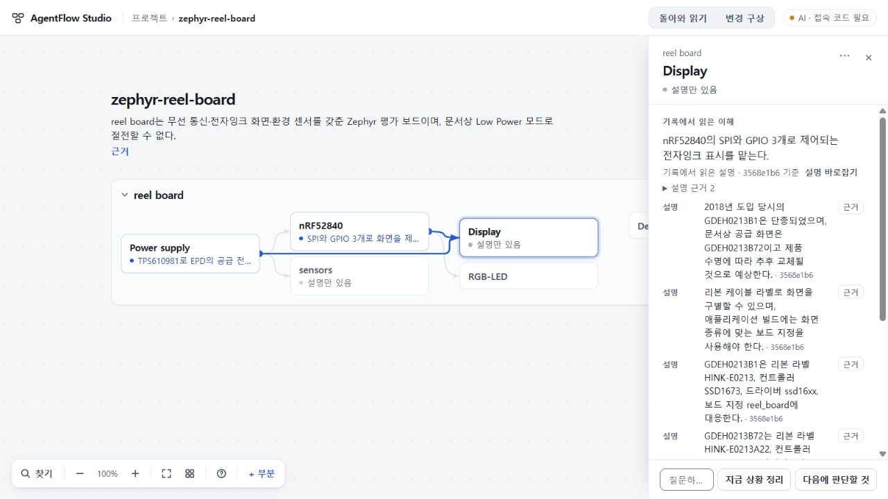
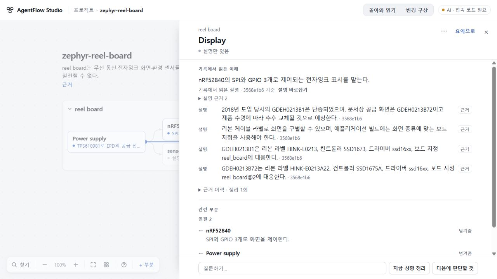

# 142 기존 지도 읽기 제한 공개 수용

기존 지도 공개판에서 Display의 네 설명과 근거를 넓게 읽을 수 있도록 수용한 140 읽기를 전달했다. Root는 실제 공개 Zephyr 자료에서 전체 읽기 → 화면 판본의 원문 근거 → 같은 Display 읽기로 복귀 → 새로고침을 확인했다. 저장된 프로젝트와 요청 기록은 바이트 단위로 그대로다. **기존 지도 읽기 전달만 수용하며, 첫 지도 생성·수정 결과 반영·제품 전체 완성을 수용하지 않는다.**

- 체험: https://agentflow-studio-existing-map-124.tlsee0813.workers.dev
- 정확한 공개 source: `76e3dc8a2939a4055ab1b99526b5cc1c98fd75e7`; app tree `29386393a5cc1a7db8ffc86d761711bf9b41686d`. [준비와 조합](PREPARED.md), [manifest](evidence/manifest.json).
- 135 공개 기반에 최종 140 client/CSS와 부분 읽기의 12개 설명 제한 제거 한 줄만 조합했다. 137 진단 변경은 포함하지 않았다. 이전 공개138 대비 assets 4개, server module 1개(shared/map-reading.js)가 달라졌다.
- 업로드 1회, Worker PUT 1회, exit 0. Deployment `efeda6bf-446b-48be-b055-6a9bc5e9ba7f`, version `2c1f8fe5-a775-412e-909b-2e78f62bd927`, 100%, 2026-10-30T06:17:19.296659Z. [원 영수증](evidence/upload-guard-receipt.json).
- 공개 assets 54개와 다운로드한 Worker modules 27개 모두 준비한 파일의 hash/bytes와 일치했다. [assets](evidence/public-assets-verification.json), [modules](evidence/worker-modules-verification.json). 기존 공개73 BUILD/설정과 기존 지도 Worker의 권한·binding·subdomain은 유지했다.
- map/jobs는 MAP_WITHHELD 403, 인증 없는 plan은 ACCESS_CODE_REQUIRED 401. 새 모델 호출 0.

## 실제 공개 화면 판정

1280×720에서 전체 읽기 폭이 약345.6px에서819.2px로 넓어졌다. 화면 판본 두 개의 컨트롤러·드라이버·보드 지정 차이까지 네 설명이 함께 보인다. 마지막 설명의 근거를 누르면 저장된 원문의 HINK-E0213A22 / SSD1675A / ssd16xx / reel_board@2 표가 정확히 강조된다. 이는 문서의 설명이며 실제 하드웨어 실행 결과로 취급하지 않았다. Display로 돌아오면 같은 전체 읽기와 지도 카메라를 유지하고 근거 버튼에 초점이 돌아왔다. 정확한 스크롤 오프셋은 주장하지 않는다.

원 workspace SHA256 `86055d9fbb282c5bfcfdd3de861d483d8a91f53381c41dba4ff05ea8c76b4a09`, plans `71fec8f52dc3433aebf10c8f20a4befe2102c0c8ac782423e537c1b8cbb96d05`는 읽기 왕복 후와 새로고침 후 모두 동일하다. [Root 증거](evidence/root-delivery.json).

## 검증 범위와 남은 문제

정확한 조합에 잠금 TS5.8.3 check와 Cloudflare existing-map dry-run이 exit0, 기존140 claims 검사2개를 이 조합의 빌드 산출물에 연결해 PASS했다. 전체140 실험을 반복하지 않았다. 독립 검토는 준비된81파일과 manifest/source를 읽고 차단 없음으로 판정했으며 별도 실행·배포·UI 검증은 하지 않았다. [독립 검토](evidence/independent-delivery.json). Root가 원격 산출물과 실제 공개 UI를 직접 검증했다. Guard는 원격 atomic CAS나 프로세스 간 중복 방지 장치가 아니며 원 접수 영수증을 회수하는 운영 규칙을 유지한다.

141 plan 한정 통과와 scope의 허위 필수 전제 반려를 유지한다. 원 Q1 재시도 성공이 입력 중 Q2를 지우는 결함은 아직 미수리다. 136 RETURN은 계약 반려이며 원인 미확인이다. 139 FIRST 한정 수용, 140 읽기 수용, 이번142 전달이 이를 닫지 않는다. 기존 전체 공개73, 미수용74, UI75/693d0c7, 키와 기존 stash를 보존했다. 전체 goal은 계속 active다.
