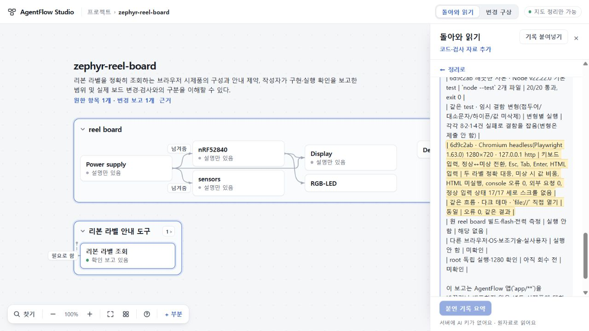

# 121 — 실제 반환 읽기 한 건 수용, 선택한 전체 사용 흐름은 미완료

120 ID 안내·진단 수용 뒤, 원래 실제 시제품 보고와 코드 자료를 정상 제품 경로에서 한 번 읽었다. **완결 응답 전달·엄격 계약·이 한 응답의 의미·현재 화면 및 보존은 한정 수용한다.** 사전 선택의 다른 프로젝트 편집 → ready 회수 → 명시 적용 관문은 관찰하지 못했으므로 전체121 선택 완료로 판정하지 않는다. 같은 입력을 다시 호출해 빈칸을 채우지 않는다.

## 선택과 실제 관측

[사전 선택](SELECTED.md)은 677cbc34d9f07e1c6165d44c909626765a822b08에 고정했다. 제품 be061284af3154b1a746acdbc249fd1cf72a24f4 / app 7b36f3ebf07a0cea25b36677ef2aedf4c6f23703, 직전수용14f7fa23. 공개73은 변경하지 않았다.

원project dd5b31e0…, 전체요청bundle cdf2dc70…, ask579741cd…34202bytes를 그대로 가져왔다. 선택RQ0797 하나에 실제110 작성자보고·독립실행기록·typed app.js/label-lookup.js를 결합했다. newrecipe m7-94f4e6678496, system0e51e224…32111bytes / stdin322d4aa0…66673bytes의 실제전달이 사전값과 일치한다. [결합 증명](evidence/actual-binding-proof.json).

실제1회, versionprobe1회(생성아님), 앱retry/fallback/응답수선0회. Sol High / CLI0.165.0-alpha.1.2 / map7-later / 299초선택·300초판정을 유지했다. job MJ_fd61a015-41ee-4dd0-a9b4-2c54abb55bcf는 **133.890초**에 ready, exit0, 완결final10867bytes SHA4e39f851e2e3ad3b6db77cfd8e414a7961615b248e98d3ca14da2a400ca83503. thread.started/turn.started/agent_message/turn.completed 네event이며tool/error0. input31432, cached8192, output7330, reasoning_output4142는 관측값이며 비용·토큰 hardcap이나 일반성공률이 아니다. 원격연산중단 미확인은 그대로다. [실행 기록](evidence/execution-receipt.json).

총괄 문맥 정리 중 원래 방문이 열린 상태로 실행이 끝나 정상 즉시 적용됐다. 접수 후 다른 프로젝트로 이동하기 전에 결과가 적용되었으므로, 도착 전 초안 보존·ready 미반영·명시 적용을 수행했다고 주장하지 않는다. 이는 자동적용 결함을 발견했다는 뜻도 아니다. 이번에 선택한 방문전환 시나리오가 미실행인 것이다. 기존104의 FIRST 관찰,118의 모의후속 관찰은 각 증거로 유지하며 이번 실제후속 관찰을 대신하지 않는다.

## 의미와 현재 화면

총괄과 [독립 Sol](evidence/independent-review.json)은 원문/새final/선택기준을 대조했다. 독립 검토는 코드·응답 대조이며 별도 브라우저 재실행이 아니다. 의미 판정은 다음 단일RQ·고정자료 범위다.

- 실제 로컬 PC 시제품을 두 새 부분으로 설명하며 실제 보드·하드웨어·AgentFlow배포 성공으로 확대하지 않는다.
- HINK-E0213→GDEH0213B1/SSD1673/ssd16xx/reel_board와 HINK-E0213A22→GDEH0213B72/SSD1675A/ssd16xx/reel_board@2, 앞뒤공백만 제거·대소문자 전체일치, 미상값 비움·PCB추정금지·LowPower상시안내를 보존한다.
- typed코드의 속성은 R01/R02정확근거, 구현·실행확인은 bounded reported/checked로 남는다. 사용자기재 코드판본/URL과 원문안 Zephyr의존판본을 혼동하지 않는다.
- 긴 N02.33-34 표행은 aboutAt:null이지만 본문과 정확인용에 코드판본·Chromium/Playwright1.63.0·1280×720·127.0.0.1http·다크/file 조건과검사결과를 남긴다. 204자행을 자르거나 조건한도를 늘리지 않았다. null슬롯 자체를 완전성으로 세지 않는다.
- 새reading은RQ0797만 연결하고 실패RQb9049를 바꾸지 않았다. 원자료6개·기존reading1개·기존부분7개·전체요청bundle은exact보존됐다.

Root1280×720 실제화면에서 돌아온범위→긴조건의원문→같은근거버튼복귀,typed코드근거→사용자기재메타데이터/전체원문→정리복귀,새로고침후9부분/2reading을 확인했다. 반영project/reload/정상다운로드백업의JSON내용SHA는 모두5ce98865fdb4eda198d7c04c2fe6f9722a7ff09a61ba4dd83c85c4f21c2a2394. 다운로드는project백업이며 전체요청bundle은 브라우저저장에서 별도로cdf2dc…동일성을 확인했다. [보존 비교](evidence/preservation.json).

좁은 패널에서14개 대응을 연속읽어야 하는 부담, 원문이 정리돼도 아래에 남는 ‘아직 이 자료를 정리하지 않았어요’와 ‘서버에 AI 키가 없어요’ 안내의 범위 혼란은 남는다. 이들을 의미검증 성공으로 덮거나 지금 전체가 세련된 PC경험이라고 평가하지 않는다.

## 남은 관문과 보존

121의선택기준7 중 source/back/reload/backup은 관찰했으나 away→other→ready→explicitapply는 미실행이다. 인수인계5/8의 세원자료현재경험·문단/배치반례·전체수용과 공개전달은 여전히 미완료다. 89실제지시/micro 한정수용과104Zephyr성공은 회수해사용하고 과거연구·실패모델을재실행하지 않는다. 다음선택은 미실행반례/현재UI검증을 기존원본과대조해 좁게정한다.

119대문자ID계약반려·117긴조건거절은소급변경없음. 120의ID안내 변경후이번응답통과는 단일관측이며 안정적성공률이나 causal proof가아니다. 새로운코드변경0이므로120 exactca9b의양OSCI40952043513를재사용하고전체suite재실행0.

서버STOPPED(slot=null,unsettled=null),port51912closed,lease없음·검증탭정리·viewport원복. [정리증거](evidence/cleanup.json). 키·stashfa07118·기존미커밋·UI75ancestor693보존. 공개73·미수용74·UI수용75구별유지,PR68draft/병합배포0,전체목표active.
