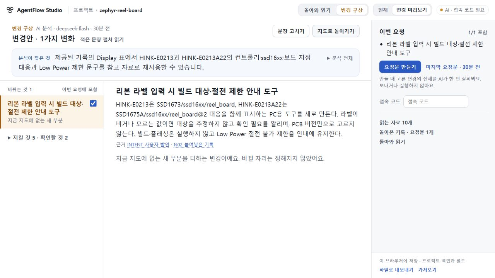

# 125 기존 지도 작업용 공개 전달 수용

2026-10-30. **수용된124 제품을 새 공개 주소에 전달하고 실제 PC에서 가져오기·읽기·요청 회수를 확인했다.** [기존 지도 작업용 버전](https://agentflow-studio-existing-map-124.tlsee0813.workers.dev/). 기존 공개73 주소와 Worker는 유지했다. 이 결과는 첫 지도 생성·새 반환 대조·전체 제품 완성을 뜻하지 않는다.

## 공개된 범위

- 저장된 지도 읽기·편집, 기존 변경안과 요청문 이어가기, 저장된 반환 읽기. 홈에서 예제 또는 지도 백업으로 시작한다. 변경안·요청·반환 자료는 해당 지도의 변경 구상에서 별도 파일로 가져온다. 두 주소의 자료는 자동 동기화되지 않는다.
- 원자료 첫 지도 생성, 새 기록으로 지도 갱신, 새 요청 대조 생성, 로컬 CLI jobs는 공개하지 않는다. UI 안내뿐 아니라 전용 Worker 정책으로 차단한다. 기존 plan/scope 등의 AI 요청은 기존 접속 코드 보호를 유지한다.
- 공개73 app b670c0ea, 미수용74, UI범위75(693d0c7)를 계속 구분한다. 누적 PR70은 draft이며 병합하지 않았다.

## 배포와 동일성

선택 fc0a2bcb57a1894328fcadb3036cc82ceafb2bb3, 제품 cfe993f31a8c53284612c22b3ded0c0739257373 / app a0a56c1cb8f2a1fdde5c7afb136bc248c8b61b6b. 기존 잠금 의존성으로 정확 source를 재빌드해124 최종 manifest 전체와 일치한 뒤 업로드1회(exit0)했다. 새 환경 설치·계정 변경·키 값 출력은 없다. 원래125 branch로 복귀했고 작업 트리는 clean이다.

공개54 assets 전부 HTTP200/bytes/SHA 일치, 서버에서 다운로드한27 Worker modules 전부 bytes/SHA 일치, entrypoint는 continuity/server/worker-existing-map.mjs이다. 배포 ea308f1f-0cb1-494e-9567-c97539999b8b / version1e6644b0-cce3-47cb-b9c8-903ab1f3910a 100%. 공개73 BUILD 텍스트와 Worker settings는 배포 전후 동일하다.

[배포 영수증](DEPLOYMENT_RECEIPT.json) · [공개 assets](PUBLIC_ASSETS.json) · [서버 modules](WORKER_MODULES.json) · [실제 HTTP 경계](LIVE_BOUNDARY.json). map6/map7/jobs는403 MAP_WITHHELD, plan은 코드 누락/명시적으로 틀린 X-Studio-Access 모두401. 실제 접속 코드나 모델 호출을 사용한 생성 검사는 이번에 하지 않았다.

## 실제 PC 확인

Root가 새 공개 주소에서1280×720으로 정상 파일 선택기를 사용했다. 기존107 실제 Zephyr project13→14는 schemaVersion만 바뀌고 나머지 전체 객체가 일치한다. 124에서 만든 변경안 파일은 같은 owner의 전체 bundle이 일치하며 RQ2270 요청문16202자도 그대로다.

Display의 현재 주장→원문 HINK-E0213A22/SSD1675A/ssd16xx/reel_board@2 대응표→원래 Display 선택으로 왕복했다. 넓게 비교에서 새 PC 도구의 범위, 미상 라벨 추정 금지·PCB만으로 선택 금지·빌드/플래싱 금지·Low Power 제한을 읽었다. 마지막 요청문은 원자료와 지시를 구별하며, 돌아온 기록은 이 요청에 연결된 원문이 아직 없다고 표시했다. 만들어진 요청을 이미 실행된 결과로 세지 않는다.

새로고침 전후 workspace와 plans 저장 문자열 전체가 byte-exact다. 선택한 Display가 복원됐고 변경 구상을 다시 열어 같은 비교와 마지막 요청문 입구를 확인했다. 열린 변경 패널 자체는 새로고침 후 자동 복원되지 않는다. 변경된 다른 저장 키는 마지막 탐색 상태뿐이다. 저장값은 개발자 읽기 전용으로 확인했으며 주입·응답 재생·새 AI 호출은0이다. [PC 영수증](PUBLIC_UI_RECEIPT.json).

[홈과 범위 안내](evidence/public-home.jpg) · [Display 원문 근거](evidence/public-display-source.jpg) · [저장된 요청문](evidence/public-request.jpg).

## 검증 구분과 다음 판단

독립 Sol High는 승격 guard의 정적 검토에서 비밀 binding 실패 출력 P2를 발견했고 최소수리 후 해소를 확인했다. Root는 dummy sentinel 실패 경로와 실제 사용 guard SHA를 확인한 뒤 배포를 수행했다. [독립 검토](INDEPENDENT_PROMOTION_REVIEW.json)는 배포 성공이나 UI 검증의 대체 증거가 아니다. 실제 배포·공개bytes·PC 확인은 위 Root 증거다.

제품이124와 동일하므로 완료한 [정확 CI40966300557](https://github.com/tlsee0813-cmd/agentflow-studio/actions/runs/40966300557), 정상 이행/첫편집/재가져오기 및 plan/scope 응답 재생 검사를 반복하지 않았다.125는 문서·증거만 추가한다. 새 생성 의미 품질은 증명하지 않았다.

다음에는 새 기반 개선이나 완료 실험 재시작 없이, 완료122 첫 지도·109 요청·110 실제 시제품·121/122 반환 읽기의 owner/요청/근거 연결을 먼저 대조한다. 서로 다른 요청과 사본을 하나의 성공 사례로 섞지 않고, 정상 제품에서 실제로 이어진 구간과 아직 끊긴 구간을 한 체험으로 판정한다. 첫 사용자 원자료→지도→구상→요청→반환 이해와 일반화된 의미 정확성은 계속 남아 있다.
