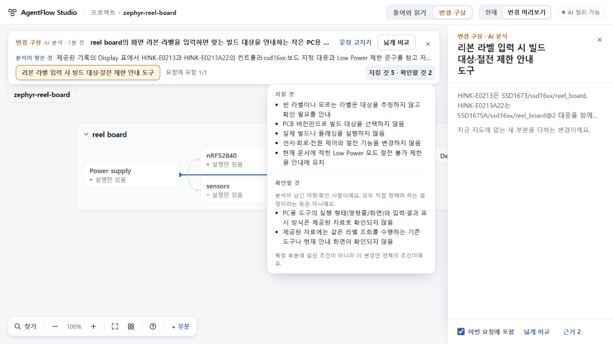
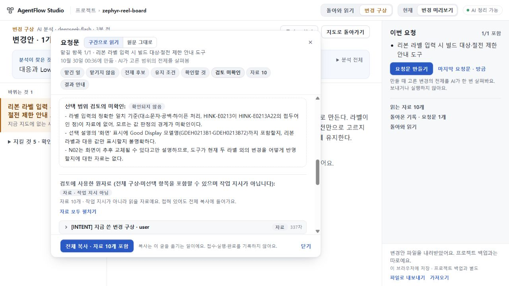

# 107 실제 변경안은 수용, 선택 범위 검토는 반려

106의 좁은 수리 수용 뒤 [사전 선택](OBSERVATION.md)대로 같은104지도·105제안에서 plan1회와 의미통과 뒤 scope1회만 정상UI로 실행했다. **plan은 제한적 PASS, scope와 최종 요청의 사용 가능 판정은 FAIL**이다. 전달 실패가 아닌 의미 오류이며 추가 호출·원문 수선·전달·구현 착수는0회다.

## 실제로 나아진 것

새 plan은21.489초 HTTP200/stop으로 도착했다. 기존105와 user입력 문자열이 같고 system은동결된106지침과 같다. 내부parts등록·이미지정한보드표시의선택재질문은 없어졌다. 두라벨 대응·빈/미상추정금지·PCB판정금지·실빌드/플래싱제외·센서/회로/전원/절전불변·LowPower절전불가 안내를 보존했다. unknowns2는 실행형태/표현방식의 실질미상과 기존도구 자료미확인이다. 후자는 새로운 승인관문이 아니다.

간결 item에는GDEH화면모델명이 반복되지 않으나 원래INTENT의 화면필드와 N02/M04의 두모델표는 정확히 남았다. 독립Sol과 총괄은 이 압축만으로 plan실패로 보지 않았고, 다음scope/요청문이 이를 보존하는지 별도로 확인했다. 단독item문장을 완전명세로 수용한 것이 아니다.

## 다음 단계에서 드러난 결함

scope는14.638초 HTTP200/stop, prerequisites0/unknowns3으로 도착했다. 전체intent·선택한1항목·excluded0·원자료10개가 그대로 전달됐다. 전달 누락이 아니다. 재사용가능한 대응표/LowPower제한을 인정하고 불필요한 전제작업을 만들지 않은 부분은 적절하다. 그러나:

1. 정확일치·대소문자/공백/하이픈과두라벨접두어 관계는 구현정확성에 영향을 주는 기술미상으로 남길 수 있다. 이를사용자승인이나접두어추정허용으로올리지는않는다.
2. 화면 모델명을 표시할지, 라벨/다른 대응값만 표시할지 다시 묻는다. 원INTENT가 이미화면대응을요구하고 N02가모델명을제공했으므로 **답한요구의재개방**이다.
3. 두라벨밖미래교체를어떻게반영할지 미확인으로올린다. 미상라벨은추정하지않고확인필요로알리는규칙이이미있으며자동업데이트/추가변형지원은선택하지않았다. **범위밖유지보수과제를추가할위험**이다.

독립Sol도같은두P2로반려했다. 106의규범/표시수리수용,107planPASS,107scopeFAIL을분리한다. 프롬프트에금지문장이있다는검사만으로모델준수를주장하지않는다.

## 보존과 실제 화면

자동생성된요청문 RQ_b9049be1-4888-4880-83cc-e0c987396b2e은삭제·수선하지않고정상내보내기로보관했다.16,398자/SHA256 13354c6894280cab29ca8d21f781ea1112269f71948015b6e2b67014734144b4. 실제INTENT와N02표가원자료에남지만,잘못된scope질문을실행자에게넘겨도되는것은아니다. 요청전달0·완료주장0. UI는복사완료를표시했으나IAB클립보드조회가빈값이라복사바이트일치는미검증으로남긴다. 정상export의고정문서보존과구별한다.

원프로젝트전체backup SHA256 dcda9cc2acbd387fdfc7f1751f7ba4e59a2bbf6b496c5c04bbba24477552bb49 불변,원기록2/지도그대로다. 105반려결과도private원본으로유지한다. 관측서버종료·임시viewport해제, map/digest/retry0. 107은실제모델2회총합이며 모델사용량은별도영수증으로보존한다.

## 다음 선택

scope가선택항목의범위와원요구의세부조건을혼동하지않도록 입력우선순위만좁게수리한다. 원자료미래설명을선택범위의미해결과제로확장하지않게한다. 새schema·저장·실행자·시간늘리기·완료연구반복은필요없다. 수리후에도107plan은재생성하지않고보존결과를재사용한다. 새로운scope관측은구현수용후별도선택하며107실패를소급성공으로바꾸지않는다.

공개73/미수용74/UI75·693·키·기존stash보존. 제품전체/일반생성/배포수용아님.

