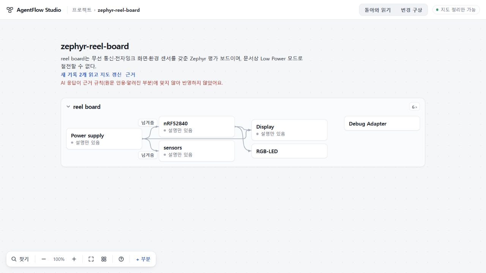

# 113 실제 반환 읽기 — 전달 완료, 응답 계약 반려

보존된111 실제입력으로112후속경로를 정상UI에서 한 번 실행했다. **151.291초 안에 완결된 답변이 도착했지만, pasted 자료를 code 대응으로 연결해 원응답 전체를 반려했다.** 반영·재시도0이며 전체 사용자경험 완료가 아니다. 111의 length/content0 전달실패와 구별한다.

## 실행과 판정

- 사전선택 `c8a7171375caa9cb76560140158380ec5dc4d31c`,112수용 `c23c24db059121104d016fc888ab7f4aeb4a9190`. 같은111 ask32,764byte/동일후속지침/같은RQ0797/기록4건. 기존104 SolHigh 정책에서 scope만map6-later로명시했다. 실제stdin은사전동결hash ddb1411c034c22b80ece4acff8c9f68651f227db20bd584d519b56abac62bfe8와일치.
- 실제생성1회+버전확인1회. exit0,허용이벤트4개,도구·오류이벤트0. 최종11,522bytes SHA256 `300b72e3f664739ffc35d31e143fcc5a702c31b2775e5c683b731f388b05614b`; 최종파일과agent_message바이트일치. input26233/cached8192/output6552/reasoning3106토큰. 기본DeepSeek시간/토큰수정0.
- 최종원문은JSON.parse에성공한다. root의초기JSON구문오류추정은취소했다. 기존executor가일반validator오류도ruleJSON으로표시하는진단결함이있었다. 이오류관측자체는receipt에보존하고해석을정정했다.
- Sol이원입력·원응답그대로기존validator를한번실행한결과,첫실패는shared/map-reading.ts355의자료kindgate: matches[12]는N01.27-29(kind:pasted)를kind:code로연결했다. [13]N01.33-34와[14]N01.50-53도같은금지조합이다. 응답을삭제/retag해서통과시키는실험은하지않았다. 첫거절이후다른위반이없다고보증하지않는다.

## 내용에서 본 진전과 한계

원답변은두라벨의매핑,trim뒤대소문자엄격비교,미상일때네값비움을실제코드구절에연결해읽었다. 새시제품과변하지않은하드웨어를구분하고,작성자구현보고와Windows/Chromium검사조건·실기미확인을나눴다. 코드를예문으로버리지는않았다. 그러나현재자료종류계약을위반한전체wire를의미PASS나정상요청대조완료로세지않는다. [변경하지않은최종답변](evidence/final-message.txt)과[독립판정](evidence/independent-review.json).

## 실제 화면과 보존

1280×720에서접수후프로젝트목록으로이동했고,돌아왔을때근거규칙에맞지않아반영하지않았다는안내를확인했다. 새로고침뒤에는실패안내가사라지는기존한계가있지만원자료·지도·요청은남았다. 정상백업의전체project는실행전/후/새로고침후모두 `ef7d9b06dcc990ac19e118391c8c48c4be27da06192e823e5cb7ea16dd315067`,원reading1/parts7/pasted4그대로. 요청파일전체bundle도 `cdf2dc70965e8eaf9c6d701dcef39a022d1baab8e0e0fcf047e4941590f8ba05` 그대로다.

원실행종료후run폴더비었고,관측서버종료뒤51905리스너와해당node/codex프로세스없음을확인했다. 원캡처·입력은로컬보존,공유판정/최종답변/최소증거만게시한다.

## 다음 선택

114는정상map+고정RQ화면에서코드·검사자료를명시적으로추가하는작은입구와자료계약을설계한다. 기존혼합pasted자료를몰래재분류하지않고실제코드파일등새로제공된자료의원문·출처·판본을보존한다. 사용자에게legacytask생성을강요하거나새저장·owner·queue를만들지않는다. 직접받은자료라는뜻과앱이실행해확인한사실은구별한다. 단순입구추가가모델의기존N분류위반을자동해결한다고주장하지않고,일반pasted코드는truthful describes/role로읽고허용된typed자료만code/test대응으로연결하는계약도함께정리한다.

같은실패입력에금지문구만덧붙여재호출하는것보다제품의실제자료입구를완성하는쪽을선택했다. 구현전데이터이행·중복·구백업보존·정상화면근거왕복을검토하고,JSON/계약오류오분류도거절조건을완화하지않고작게수리한다. 새실제생성은그범위가수용된뒤별도선택한다.

112의좁은실행능력수용과110시제품수용은유지,113반려와111전달반려도유지한다. 공개73·미수용74·UI범위75/693·키·기존stash보존,병합/배포0/전체목표진행중.
