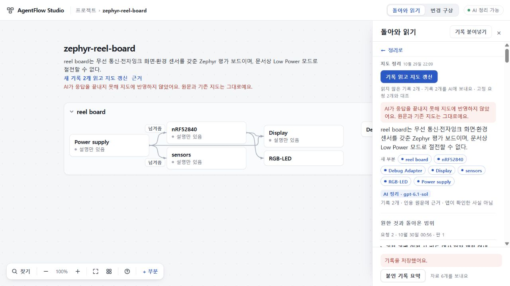

# 111 실제 반환 읽기: 완결 전달 반려

110의 실제시제품 반환을 정상제품경로에서 읽었으나 최종 응답이 없어 수용하지 않는다. HTTP200은 결과완성을뜻하지않는다. 의미판정은 하지않았다.

기준905ea55e9c90e9f6e3d397640e57b853881c25e6, app5736b7949d50ba92c07ae583ff22c618c25c3e94. 109정상export의지도·변경안·수용요청과107실패요청을재사용했다. 110정정된작성자RETURN2521자와별도root실제코드/실행근거6842자를각각정상UI로붙였다. 원Zephyr2기록과합쳐4기록전체(부분전송0),기존7부분,수용RQ0797한개를대조하도록골랐다. 동결system/user와실제전송이정확히일치했다.

## 전달과 보존

- 실제 DeepSeek map6 후속1회,86.717초,HTTP200,finish_reason=length,최종content0바이트. timeout이아니며최종JSON이없어의미수용/반려를할수없다.
- 입력17418/출력16384/합계33802토큰. 제공usage의reasoning16384,cachehit384/miss17034. 과금실액미확인. 내부추론내용은공유하지않는다.
- 기존기본정책90초/16384상한. 재시도0,plan/scope/digest/첫지도재생성0. 최종JSON자동수리0.
- 정상UI가‘AI가응답을끝내지못해지도에반영하지않았어요. 원문과기존지도는그대로예요.’로거절했다. 새로운읽기·요청대응을추가하지않았다.
- 관측전/직후/새로고침뒤전체프로젝트JSON동일(SHA ef7d9b06dcc990ac19e118391c8c48c4be27da06192e823e5cb7ea16dd315067). 두새원문을포함한4기록보존·기존지도7부분/원읽기1개그대로. 109전체변경안bundle과두고정요청도정상export에서동일했다.

## 판단

110구현의수용은유지한다. 다만104지도→107변경안→109요청→110구현뒤자동반환읽기까지성공했다는주장은반려한다. 102안정화검사나110시제품검사를이빈결과의대체증거로쓰지않는다.

같은입력의단순시간/토큰확대재호출은선택하지않는다. 기존102소유CLI는첫지도전용이라이후속요청을현재실행할수없다. 기존실행소유/보관/검증을재사용하는좁은후속범위확장가능성을독립검토한뒤선택하며,새작업관리기반이나요약으로대조완성을대체하지않는다.

원본·키·stash/UI75수리보존. 공개73/미수용74/UI범위수용75구별,제품app변경0·merge/배포0·전체목표active.

독립검토와총괄선택: 112는기존102에명시opt-in map6후속범위만추가한다. 구정책FIRST기본·미상scope거절·실제선택prompt/ask/정책결속·기존codec/fullRequests/priors/owner유지·정확범위상태안내가필수다. 새실제호출은구현수용후별도선택하며현재0. [독립판정](evidence/independent-decision.json).
