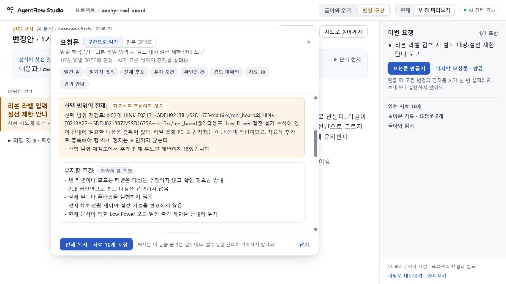

# 109 실제 scope와 고정 요청문 한 건 수용

보존한107 변경안을 재생성하지 않고, [사전 선택](OBSERVATION.md)대로108 지침을 적용한 scope1회만 정상 UI에서 실행했다. **범위 검토와 실제 요청문을 제한적으로 수용한다.** 107의 실패 요청문은 그대로 별도 보존한다. 이 판정은 아직 도구 구현·결과 반환·전체 제품 완성을 뜻하지 않는다.

## 실제 전달과 의미

14.118초에 HTTP200, finish_reason=stop으로 도착했다. 실제 user입력은107의 scope 요청과 문자열 그대로 같고, system은108 동결값과 정확히 같다. 모델·thinking·token 상한·30초 제한은 유지했다. plan/map/digest/재시도0회다.

새 summary는 HINK-E0213→GDEH0213B1/SSD1673/ssd16xx/reel_board, HINK-E0213A22→GDEH0213B72/SSD1675A/ssd16xx/reel_board@2와 Low Power 절전불가 주석을 직접 명시했다. 이미 있는 자료를 재사용하며 도구 자체를 추가 전제로 만들지 않았다. prerequisites0/unknowns0이고, 이미 요구한 화면 모델명 표시를 다시 선택으로 열거나 미래 교체 대응을 새 과제로 추가하지 않았다.

unknowns0은 이번 범위 검토가 별도 미확인을 제시하지 않았다는 뜻이다. 기존 plan의 실행 형태/표현 방식과 기존 도구 자료 미확인 두 문장은 그대로 요청문에 남는다. CLI/GUI나 정규화 정책이 사용자에 의해 결정됐다고 주장하지 않으며, 모든 구현 세부가 확정됐다는 뜻도 아니다. root와 기존 Sol이 이 범위를 독립 대조했다.

## 정상 화면·고정 요청·보존

1280×720에서 기존107 변경안→넓은 비교→요청문 만들기1회→전제·보존 조건 읽기→정상 변경안 export와 프로젝트 backup을 수행했다. 새 요청문은 RQ_0797ee20-a84e-4aa7-ace6-b4f053ca87f7,16,202자(UTF16), SHA256 76449ae324375cc73ffb2cbbffa9b2066dc534124f3817d771370f9324db2e6b이다.

원래 intent와 근거10개의 본문·제목·판본은 실제 요청 입력/reading span과 정확히 일치한다. 두 모델 대응과 다섯 보존 조건, plan의 미확인2개, scope 미확인없음이 구별돼 남는다. 모든 span은 연속이며 재결합하면 전체 text와 같다. 새 문서를 생성한 사실을 접수·실행·완료로 기록하지 않았다.

107 wholeplan과 이전 실패 snapshot은 깊은 비교로 동일하다. snapshot2개는 실패/새 문서로 분리돼 있다. 원 프로젝트 전체 backup도 SHA256 dcda9cc2acbd387fdfc7f1751f7ba4e59a2bbf6b496c5c04bbba24477552bb49로 불변이다. 원문·응답 수선0, 추가 호출0. 이번에는 클립보드 성공을 주장하지 않고 정상 export를 인계 원문으로 사용한다. 관측 서버와 임시 viewport는 정리했다.

## 다음 실제 결과물

이 요청문은 열린 세부조건을 명시한 좁은 작업 인계에 사용할 수 있다. 총괄은 사용자의 PC 경험 목표에 맞춰 로컬 브라우저 화면을 구현 형태로 선택한다. 이는 원자료의 사실이나 이미 결정된 사용자 요구를 가장한 것이 아닌 구현 선택이다. 두 라벨을 정확히 구분하고, 빈/미상/부분 일치에서 이전 대상을 남기지 않으며, 화면·컨트롤러·드라이버·보드 지정을 함께 읽는 실제 시제품을 만든다.

시제품의 실제 코드/조건별 검사/요청 참조를 돌려받아 AgentFlow에서 변화와 남은 미확인을 읽는 흐름을 이어간다. 이 결과물은 원 Zephyr 하드웨어를 변경하거나 실제 build/flash하는 작업이 아니다. 공개73/미수용74/UI75·693·키·기존stash는 유지한다. 일반 생성 품질·공개 배포 수용은 별도다.

