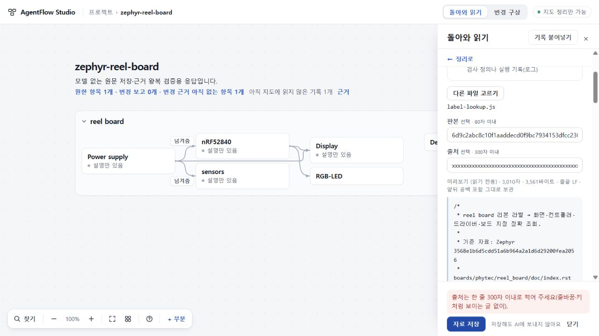
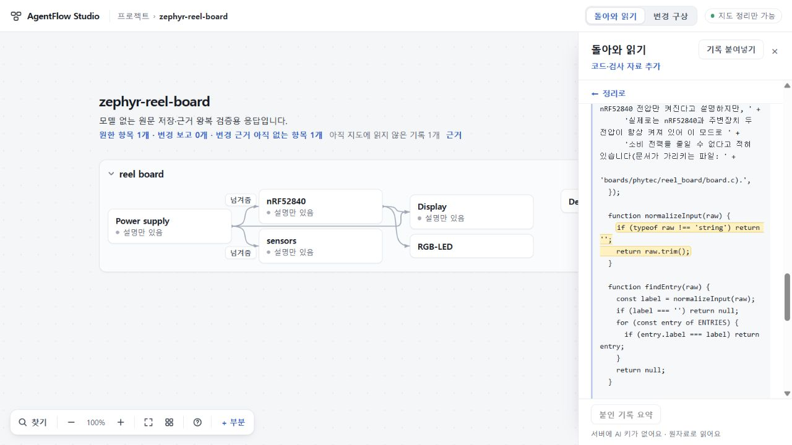

# 114 정상 코드·검사 자료 입구 — 총괄 한정 수용

최종 코드 **d6c93dffa710e7947e73c319cbee079d5c540adf**, app tree **601d68f8d91f0907bfd37ee8e51b891a91dc8c41**를 한정 수용한다. 사용자가 실제 소스 파일을 정상 화면에서 자료 종류·판본·출처와 함께 넣고 원문으로 돌아가 읽을 수 있다. 기존 혼합 보고를 몰래 코드로 바꾸지 않는다. **실제 모델 생성 품질은 아직 이 수용의 범위가 아니다.** 111 전달 실패와 113 응답 계약 반려는 그대로 남긴다.

## 해결한 사용자 문제

- 코드·검사 자료를 추가할 정상 입구가 없어 pasted 보고만 보내던 문제를 해결했다. UTF-8 파일 하나를 읽기 전용으로 미리 보고 명시적으로 보관한다. 앱이 실행·검증한 파일이라는 뜻은 아니다.
- 저장한 파일의 이름·사용자 기재 판본/출처·원문이 먼저 보인다. 스크롤된 목록에서 파일이나 입력 양식을 열어도 맨 위부터 읽는다. 기존 인용 중앙 정렬과 요청으로 돌아가기 동작은 유지한다.
- 판본/출처 초과 입력은 잘라 저장하지 않고 전체 초안을 남겨 명시 거절한다. 긴 미리보기에서도 이유가 저장 버튼 바로 위에 보인다.
- map6 지침은 보고 문장과 직접 제공 코드의 종류를 구별한다. 엄격한 source-kind 계약은 유지하며, 계약 실패를 JSON 구문 오류와 구분해 기록한다. map1–5/PLAN/SCOPE와 기본 실행 정책은 바꾸지 않았다.

## 독립 근거와 실제 화면

총괄은 보존된 실제 111/113 project13 백업과 전체 요청 묶음을 정상 UI로 가져왔다. 기존 네 기록·첫 지도·기존 요청 두 개는 유지했다. BOM/CRLF/끝 공백 합성 파일과 실제110 코드/검사 파일을 직접 추가했다. UTF-8 거절·중복·새로고침·백업 사본에서 원문과 기존 데이터 보존을 확인했다. 파일 추가 경로의 관측 요청45건 중 POST0이었다.

그 뒤 **모델 없는 고정 응답 1회**를 정상 소유 job 경로로 읽었다. 홈으로 나간 동안 준비된 결과는 프로젝트를 자동 변경하지 않았다. 돌아와 명시 적용한 뒤 코드·검사 인용 원문을 각각 열고 요청으로 돌아갔다. 코드 인용 앞뒤 스크롤은 256.79998779296875로 같았고 초점도 원래 근거 버튼으로 돌아왔다. 새로고침과 정상 백업 사본의 전체 프로젝트가 일치했다. 이 응답은 총괄이 작성한 저장·인용 검증 자료이며 AI 의미 정확성의 증거가 아니다.

마지막 d6c93df에서는 실제 label-lookup.js 3,561바이트/3,010자를 선택해 판본81자·출처301자를 각각 거절했다. 두 안내 전체가 1280×720의 y620.5–672에 보이고 중앙이 가려지지 않았다. 입력 원문·전체 workspace·요청 묶음은 동일했다. 최근 화면/보기 상태만 사용자 조작에 따라 바뀌었다.

## 검증 범위

| 근거 | 정확 범위 |
| --- | --- |
| Root Windows 잠금 Node24.19/TS5.8.3 | c73fc77 build/check 및 집중37건 중35통과·2 POSIX skip·실패0; 이후779 스크롤/d6c93df footer 변경은 각각 build/check 통과. 관련 없는 전체 반복 없음 |
| [최종 CI40927707675](https://github.com/tlsee0813-cmd/agentflow-studio/actions/runs/40927707675) | d6c93df exact HEAD, Linux·Windows 모두 성공. 기본앱279/279; continuity Linux606/606, Windows603통과·3skip; 직접 브라우저와 Studio smoke 모두 성공. 모의 공급자 검사이며 배포 없음 |
| 작성자 | 합성 자료의 정상UI6관문·스크롤·긴 파일4거절 검사, 잘못된 위치로 되돌린 변이에서 실패. 작성자 실행과 root 실제 자료 관측을 구별 |
| Sol High 독립 검토 | 기존3 P2·metadata 절단·스크롤·footer 수정분 순차 재검토, 최종 d6c93df 새 P1/P2 없음. 정적 검토이며 별도 실행/모델 호출0 |
| pre14 reader | 실제 정상UI에서 가져온 project14를 기존112 reader로 읽으면 거절·저장 잠금·쓰기0·raw 그대로. 예전 백업 별도 보존 필요 |

[evidence/root-apply-proof.json](evidence/root-apply-proof.json), [최종 UI 증거](evidence/root-footer-proof.json), [독립 검토](evidence/root-independent-review.json), [manifest](evidence/ROOT_MANIFEST.json)에 범위와 해시를 남겼다.

## 남은 제품 판단

- project14는 project13 reader로 되돌려 편집할 수 없다. 공개교체 전에 이전 백업 및 Worker/asset 동시판본 관문을 충족해야 한다. 105 배포 경계는 유지한다.
- 원자료를 사용자가 직접 분류·선택하는 입구다. 실제 기록 연결기나 자동 수집의 완성은 아니다.
- 실제 모델이 새 evidence 구절을 골라 올바른 완료/미확인 판단을 할지는 **115 실제 정상 반환 읽기 한 건**에서 판정한다. 기존111/113 wire 재시도·수선·재분류는 하지 않는다.
- 114 고정 응답 프로젝트는 실제115 입력에 사용하지 않는다. 보존된 원래13 백업+전체 요청에서 새 사본을 만들고 실제110 label-lookup.js/app.js를 정상 입구로 추가한다. 사전 ask 포함/누락 범위를 공개하고 같은112 SolHigh 정책으로 한 번만 관측한다.
- UI75 693d0c7의 조상 관계와 기존 stash fa07118ead372bcb3201c8032ca603a5ec0a7e7d 보존 확인. 공개73/미수용74/UI범위75 구별, merge/deploy0. 한정 수용을 제품 전체 완성으로 세지 않는다.
